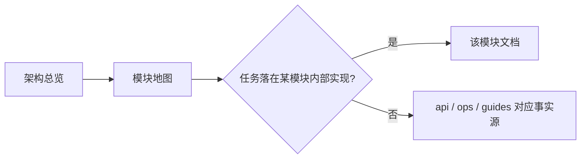

# 文档体系

## TL;DR

- 文档按 5 层组织，每层只回答自己那一类问题。
- 同一事实只有一个权威落点，其他文档只链接。
- 新增功能时更新对应事实源，不做全仓库改文档。

## 适用对象

需要查文档、写文档或评审文档的开发者。仓库根的 [README.md](../README.md) 是项目 README（面向使用者），本文是开发者文档体系的入口与维护约定。

## 分层与入口

| 层 | 位置 | 回答的问题 |
|---|---|---|
| 1 | [README.md](../README.md) | 项目定位与使用说明（项目 README），开发者从这里进入文档体系 |
| 2 | [architecture/](architecture/overview.md) | 系统上下文、模块划分、包职责、依赖规则、跨模块链路 |
| 3 | [modules/](modules/README.md) | 每个逻辑模块的边界、关键类、核心流程、扩展点；任务命中该模块时再读 |
| 4 | 源码注释 | 公开类型与方法的契约，用 IDE 查看 |
| 5 | [api/](api/README.md)、[ops/](ops/configuration.md)、[guides/](guides/code-style.md)、[adr/](adr/README.md)、[agents/](agents/domain.md) | 对外契约、运行配置与故障排查、编码约定、架构决策、agent 工作方式 |

## 任务路由

首访与落点判断先走抽象层；实现层模块文档只在任务落在该模块内部实现时读对应一篇。



| 任务 | 先读 | 按需再读 |
|---|---|---|
| 首次接触项目、判断改动落点 | [架构总览](architecture/overview.md) | [模块地图](architecture/module-map.md)、[包职责](architecture/package-responsibility.md) |
| 改依赖方向、平台隔离或端隔离 | [依赖规则](architecture/dependency-rules.md) | [包职责](architecture/package-responsibility.md)、涉及的模块 |
| 追踪跨模块顺序、判断失败停在哪一步 | [关键链路](architecture/key-flows.md) | 涉及的模块文档 |
| 改规则字段、形状或校验 | [规则 JSON](api/rule-json.md) | [规则模型](modules/rule-model.md) |
| 新增条件或效果类型 | [core-contract](modules/core-contract.md)、[类型系统](modules/type-system.md) | [规则 JSON](api/rule-json.md) |
| 改来源读取、覆盖合并或拒载 | [规则加载](modules/rule-loading.md) | [规则 JSON](api/rule-json.md)、[错误与状态](api/errors.md) |
| 改追踪、结算、恢复或调度 | [转化运行时](modules/conversion-runtime.md) | [关键链路](architecture/key-flows.md)、[运行配置](ops/configuration.md) |
| 运行或扩展后端开发探针 | [后端探针](guides/backend-probes.md) | [编辑与命令](modules/authoring.md) |
| 运行或扩展 GUI 探针 | [GUI 探针](guides/gui-probes.md) | [编辑器界面](modules/client-ui.md)、[UI kit](modules/ui-kit.md) |
| 改编辑会话、覆盖落盘、命令或调试场景 | [编辑与命令](modules/authoring.md) | [编辑协议](api/edit-protocol.md) |
| 改客户端协议、草稿或类型编辑器 | [客户端编辑器](modules/client-editor.md) | [编辑协议](api/edit-protocol.md) |
| 改 UI kit 公开面或依赖边界 | [UI kit](modules/ui-kit.md) | [依赖规则](architecture/dependency-rules.md) |
| 改编辑器界面、主题或控件适配 | [编辑器界面](modules/client-ui.md) | [UI kit](modules/ui-kit.md)、[客户端编辑器](modules/client-editor.md) |
| 改平台接入、生命周期或配置读取 | [平台模块](modules/platform.md) | [运行配置](ops/configuration.md) |
| 改编辑协议载荷、分片或回执 | [编辑协议](api/edit-protocol.md) | [错误与状态](api/errors.md) |
| 处理错误码、保存状态或文案 key | [错误与状态](api/errors.md) | 涉及的模块 |
| 改 server.json 或排查运行问题 | [运行配置](ops/configuration.md) | [故障排查](ops/troubleshooting.md) |
| 判定能否采用某设计、查取舍理由 | [ADR 索引](adr/README.md) | [术语表](../GLOSSARY.md) |
| 改注释、命名或代码组织约定 | [代码风格](guides/code-style.md) | 涉及的模块 |

## 单一事实源

| 事实 | 唯一落点 | 其他文档 |
|---|---|---|
| 规则 JSON 形状、来源层、字段扩展方式 | [api/rule-json.md](api/rule-json.md) | 只链接 |
| 编辑协议载荷、分片、幂等与版本戳 | [api/edit-protocol.md](api/edit-protocol.md) | 只链接 |
| Issue、错误码、保存状态与文案 key | [api/errors.md](api/errors.md) | 只链接 |
| server.json 的定位、分组与派生换算 | [ops/configuration.md](ops/configuration.md) | 只链接 |
| server.json 键名、范围、默认/缺省方式 | `core/config` 的 `ConfigField` 声明 | 用户配置参考表由构建导出与渲染生成 |
| 症状与排查步骤 | [ops/troubleshooting.md](ops/troubleshooting.md) | 只链接 |
| 类与方法契约 | 源码注释 | 不复制签名或字段列表 |
| 架构取舍与替代方案 | [adr/](adr/README.md) | 只链接 |
| 构建、启动与目录职责 | [README.md](../README.md) | 不重复 |
| 跨模块链路 | [architecture/key-flows.md](architecture/key-flows.md) | 模块文档只画本模块 |
| agent 工作方式 | [agents/](agents/domain.md) | 不重复 |

## 写作约定

本文档体系内的每篇文档以 front matter 开头（仓库根的项目 README 不在此列）：

```yaml
---
title: 文档标题
layer: 1 | 2 | 3 | 5
audience: 目标读者
authority: 该文档结论所依据的源码包、类或文件
---
```

正文先给 TL;DR（不超过 3 行）和“适用对象”，再进入内容；结尾用“相关文档”列出继续阅读的入口。图使用 Mermaid，链接使用相对路径，正文用中文写作，技术名词保留英文。

模块文档固定六节：模块职责、模块边界、关键类地图、关键流程、扩展点与约束、数据与配置引用；文末“相关文档”不占骨架章节。关键类地图只列对外入口、扩展点、聚合根与并发或事务敏感类，并注明“非穷举”。

## 硬规则

1. 只写当前存在的代码事实；不写占位功能、计划中功能、已删除机制、旧版本行为。
2. 边界用正面表述写清适用范围，不写“不支持 X”式否定清单。
3. 不写数量统计：文件数、类数、方法数、配置项数。
4. 不写穷举清单与全量目录树；枚举型内容指向代码枚举或常量，并说明新增方式。用户手册中机器生成的配置参考表与默认等价示例是有限例外，受管块由声明生成；开发者文档仍按职责说明并链接事实源。
5. 同一事实只维护一处，其他文档链接过去。
6. 不记录修改历史、日期、版本注记；与源码不一致时以源码为准并回改文档。
7. 类级契约在源码注释里，Markdown 不复制方法签名与字段列表。

## 校验

文档改动后运行：

```powershell
python tools/check-docs.py
```

脚本检查相对链接是否可解析、是否出现归档路径、是否出现反向指针。退出码非 0 即存在违规，修复后重跑。

## 相关文档

- [README.md](../README.md)
- [架构总览](architecture/overview.md)
- [模块文档索引](modules/README.md)
- [ADR 索引](adr/README.md)
