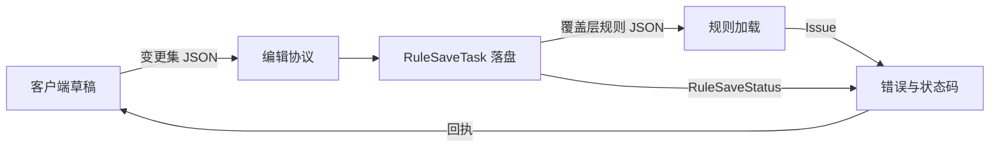

# 对外契约索引

## TL;DR

- `docs/api/` 的契约文档覆盖规则 JSON、编辑协议、错误与状态码。
- 每类契约只有一篇权威文档，模块文档与运维文档都链接到这里。
- 契约的取值集合以源码中的常量与枚举为准，本文档只解释机制与扩展方式。

## 适用对象

需要写规则文件、对接编辑协议的载荷、或根据回执状态码定位问题的开发者。

## 契约清单

| 契约 | 回答的问题 | 权威源码 |
|---|---|---|
| [规则 JSON](rule-json.md) | 一条规则长什么样、规则文件如何组织、来源层如何合并、字段与类型怎么扩展 | `core/api/RuleFields.java`、`core/model/RuleCodecs.java`、`core/model/RuleValidation.java`、`core/load/RuleFileParser.java` |
| [编辑协议](edit-protocol.md) | 独占会话如何建立与续租、快照与变更集如何传输、幂等键与版本戳如何推进、分片与限额在哪里定义 | `core/network/protocol`、`core/network/transport`、`core/service/RuleEditService.java` |
| [错误与状态码](errors.md) | Issue 与 RuleSaveStatus 的语义、拒载粒度、文案 key 如何推导与扩展 | `core/api/Issue.java`、`core/api/IssueCollector.java`、`core/network/protocol/RuleSaveStatus.java`、`core/network/protocol/RuleIssue.java` |

## 阅读约定

- 规则里的键名以 `RuleFields` 的常量为唯一来源，文档只给分区与代表键。
- 状态码与文案 key 的取值集合以对应枚举为准，文档解释命名规则与新增步骤。
- 契约与实现不一致时以源码为准，并回改对应文档。

## 相关文档

- [文档体系](../README.md)
- [规则模型模块](../modules/rule-model.md)
- [规则加载模块](../modules/rule-loading.md)
- [编辑与命令模块](../modules/authoring.md)
- [server.json 配置](../ops/configuration.md)
- [故障排查](../ops/troubleshooting.md)
