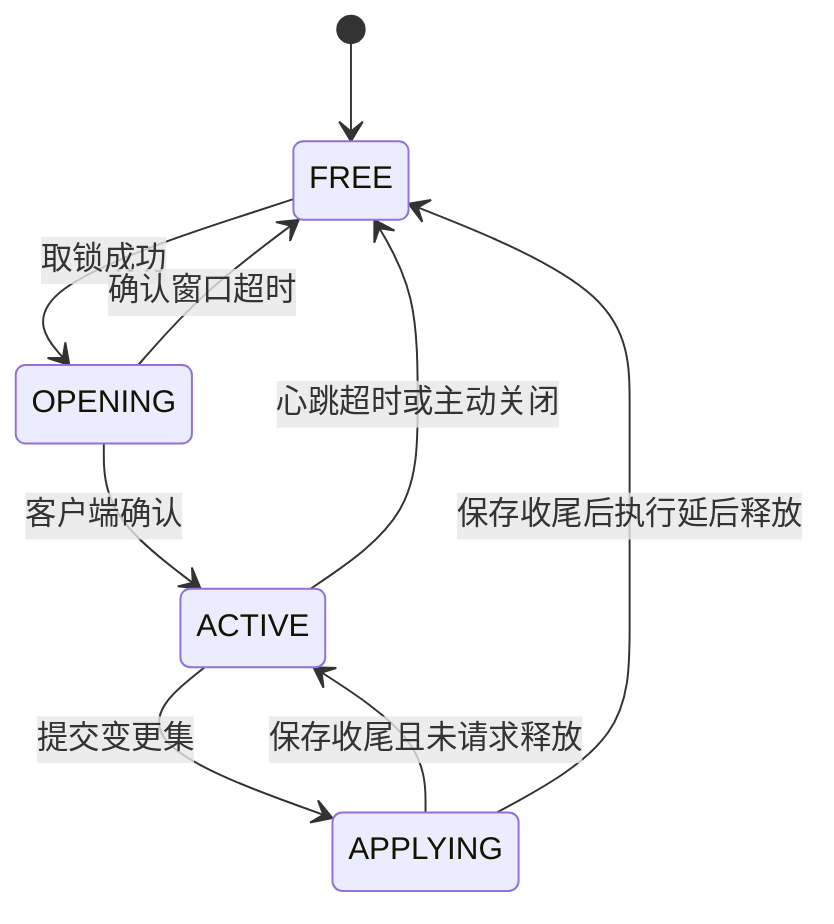

# 编辑协议契约

## TL;DR

- 编辑会话是全局独占的：同一时刻只有一个会话持有规则目标，状态在 FREE / OPENING / ACTIVE / APPLYING 之间流转，按服务端活动 tick 计时租约。
- 服务端按需下发快照与来源视图，客户端提交带 `expected_version` 与 `operationId` 的变更集，状态码回执决定下一步动作。
- 版本戳、幂等键、分片与超时限额都由服务端权威维护，客户端只做本地预检与重放。

## 适用对象

改编辑器网络载荷、接入自定义客户端、或根据回执定位保存失败原因的开发者。

## 会话与目标锁

编辑目标由 `RuleEditSessionLimits.TARGET_ID` 标识，全局只有一个。会话状态机由 `EditSessionManager` 持有，修订与文件工作由 `RuleOverlayStore` 持有；它们随本次 `AuthoringHost` 一同创建与退役，准入顺序与拒绝状态码由 `core/service/EditAdmission` 唯一决定；网络入口 `RuleEditServerHandler` 只做就绪判定、握手版本校验与转发。



| 约束 | 取值来源 | 行为 |
|---|---|---|
| 确认窗口 | `RuleEditSessionLimits.OPEN_CONFIRM_WINDOW_SECONDS` | OPENING 会话在此窗口内未确认即回收 |
| 心跳间隔 | `RuleEditSessionLimits.HEARTBEAT_INTERVAL_SECONDS` | 客户端按此间隔续租，服务端不主动推送续租回执 |
| 租约 | `RuleEditSessionLimits.LEASE_SECONDS` | ACTIVE 会话在租约内未收到心跳则回收 |
| 编辑权限 | `RuleEditSessionLimits.REQUIRED_PERMISSION_LEVEL` | 单人存档房主直接放行，局域网访客与多人服务器玩家要求权限等级达到该值 |

计时一律使用服务端活动 tick，服务端暂停时不推进。APPLYING 不被租约回收，释放请求延后到保存收尾后执行，保证在途写盘与回滚不被打断。取锁是原子操作：失败时仍然下发打开载荷，`messageArgs` 携带当前持有者，由客户端提示而不是静默失败。

## 握手与协议版本

`RuleEditProtocol.VERSION` 是协议版本，当前取值为 10：保存终态、查询失败与会话事件分别使用自己的关联载荷，字段或动作集合变化时递增。打开载荷携带服务端版本与目标标识，客户端在收到打开载荷时比对版本与状态码；确认载荷再把客户端版本回传，服务端在确认入口再次比对。客户端发现版本不一致时记录告警并放弃打开流程，不进入会话；确认入口发现版本不一致时发送 `INVALID_REQUEST` 会话事件；未完成确认的申请按确认窗口回收。

## 载荷家族

载荷按方向与职责分组，具体类型定义在 `core/network/transport`，编码顺序只在对应 record 的 `STREAM_CODEC` 里维护。

| 方向 | 载荷族 | 作用 |
|---|---|---|
| S2C | 打开载荷 | 下发会话、目标、协议版本、上下文修订、服务端放置半径上限与状态码；取锁失败也用它回执 |
| C2S | 确认、心跳、关闭 | 推进会话状态机与续租；关闭在保存期间延后执行 |
| C2S | 快照与来源视图请求 | 主动刷新快照、按规则 id 取来源分层内容 |
| S2C | 快照载荷与分片 | 整包或分片下发版本戳、逐条规则视图与整体问题清单 |
| C2S | 目录请求 | 按类型与分页取候选目录 |
| S2C | 目录载荷 | 分页结果与是否末页 |
| C2S | 变更集与分片 | 提交整包或分片形式的保存请求 |
| S2C | 保存回执与进度 | 按 `sessionId + operationId` 关联的终态回执与阶段计数 |
| S2C | 查询失败 | `RuleQueryResultPayload` 携带 `kind + sessionId + requestId + statusCode`，只终结对应查询 |
| S2C | 会话事件 | `RuleSessionEventPayload` 携带 `sessionId + statusCode`，表达确认失败与会话失效 |
| C2S | 取消保存 | 请求取消在途保存 |
| C2S/S2C | 参考寿命请求与应答 | 查询服务端缓存的参考寿命，供编辑器展示 |

## 快照与来源视图

快照是客户端视图的唯一来源：确认成功后服务端自动下发首份快照，保存回执为版本冲突或已写盘未重载时再补拉。快照条目携带来源层（`origin`）、物理来源（`source`：builtin / world / overlay / mixed，其中 overlay / mixed 表示含用户覆盖内容）、状态（`active` / `disabled` / `invalid`）、分类、生效视图与逐条问题，条目形状与状态取值见 `RuleSnapshotEntry`。

启用信息分三值：`default_enabled` 是规则 JSON 里的默认启用，`enabled` 是本服实际生效值，`enabled_override` 是本服覆盖，取 `null` 表示该 id 没有本服覆盖、生效值继承默认。保存把覆盖改回默认时摘除记录，快照随之回到 `enabled_override` 为 `null`。

`editable` 只描述内容可写：含覆盖内容的 overlay / mixed 为真，内置数据包与世界数据包为假。条目能否停用由本服启用状态决定，与 `editable` 无关；能否删除覆盖条目同样只看 `source`。

- 整包放得下就直接下发；否则按 UTF-8 字节切分，每 tick 限量投递，客户端按 `transferId` 与下标重组。
- 快照装配失败回带原请求标识的查询失败；传输总量超限回请求非法。客户端按状态映射提示，保留上一份可用快照。
- 来源视图按 id 查询共同来源索引；缓存与当前修订、数据包上下文匹配时直接读取，否则通过唯一文件队列独立读取，首次查询也可使用。读取前后比对指纹，回主线程后核对上下文与保存状态；修订变化时刷新快照，并以版本冲突终结旧来源请求。规则 id 非法或条目不存在时回请求非法。
- 分片共用一条记录 `RuleChunkPayload`：`sessionId`、`correlationId`、`transferId`、下标、总数与文本；通道由类上的类型常量区分（快照 / 来源视图 / 变更集）。`correlationId` 在两条下行通道是 `requestId`，在上行变更集是 `operationId`。
- 切分、校验与重组各只有一处实现：`RuleTextChunker.split(Family, …)` 按通道的字节档位决定直发还是分片，`RuleChunkAssembly` 校验单片并判定批次身份与是否收齐，服务端装配器 `RuleEditChunkAccumulator` 与客户端缓冲 `RuleChunkBuffer` 都复用它们。客户端重组缓冲在会话切换、批次身份变化或超时无进展时重置。

## 变更集

变更集是一段 JSON 文本，随网络载荷整体传输，形状如下：

```json
{
  "expected_version": 12,
  "edits": [
    { "id": "idtw:example", "action": "upsert", "rule": { } },
    { "id": "idtw:removed", "action": "delete" },
    { "id": "idtw:toggled", "action": "disable" }
  ]
}
```

`action` 取值由 `RuleEdit.Action` 定义，分两类。内容动作读写覆盖层文件：`upsert` 携带与文件同形的完整规则对象，`delete` 只带 id、删除覆盖层中该 id 的普通条目，覆盖层没有该条目时整批不产生文件改动。启用动作 `enable` / `disable` / `reset` 只带 id，把该 id 的本服启用状态设为本服启用、本服停用或恢复默认（摘除本服记录）；启用动作携带 `rule` 按请求非法拒绝。

同一 id 可以同时带内容动作与启用动作，两类改动在同一次提交内一起生效。变更集只表达意图，服务端以磁盘文件为准逐 id 增删改，未涉及的条目、未知字段与坏 JSON 文件都原样保留。

版本戳由 `expected_version` 与服务端当前修订号比对，不一致整批拒绝并回最新修订号，客户端据此拉取新快照。比对只针对含内容动作的变更集：纯启停批次不改写文件，不比对版本，也不推进修订号。空变更集按无变化回执处理，不触发落盘。

## 应用与回扫

校验通过后整批应用：内容动作由覆盖层写入器落盘，启用动作写入按存档保存的本服启用状态，再统一重建规则索引。内容没有实际改动、只有启用状态变化时同样重建索引；两者都没有变化回无变化，不发布索引。

重建索引复用保存任务已捕捉的数据包基底与当前覆盖层，不重读数据包。发布后回扫在公共预算内分步推进：先清理各维度旧队列与在跑任务，再推进结算恢复扫描，最后逐维度重建掉落物追踪。回扫完成前回执保持已写盘未重载；运行时上下文不可用或回扫调度失败时回环境不可用。

## 幂等与并发

每次保存由客户端生成 `operationId`。服务端保留最近的操作回执，同一个 `operationId` 重发时直接回放上次结论，不重复写盘；会话切换时回执表清空。

- 已有在途保存时，同一 `operationId` 的重复提交不再触发新保存，由在途操作的终态统一作答；不同 `operationId` 按请求非法拒绝，并提示正在应用。
- 在途保存按阶段推进：准备、校验、预备文件、写盘、回滚、读盘、解码、索引、应用、取消，阶段与计数通过进度载荷节流下发，客户端只用于展示。纯启停批次在校验后通过文件队列读取稳定来源，再提交本服状态并在应用入口重建索引；跳过内容写入阶段。命令存在性检查与重建消费同次合并加载的来源索引。
- 取锁失败、确认超时、心跳失效、失去权限属于会话类失败，回执会把会话置为失效；取消请求只发出信号，回滚结束前独占锁仍保持。
- 权限拒绝 `NO_PERMISSION` 与会话类失败（`SESSION_EXPIRED`、`LOCK_NOT_OWNED`、`LOCK_BUSY`）在客户端同属会话失效分支，仅文案不同。
- 玩家断开时清理分片传输；在途保存请求延后释放，其余会话按租约回收。
- 保存回执沿用保存任务已确定的终态；完成时释放会话不覆盖写盘与重载结果。

## 版本戳推进

覆盖层修订号由 `RuleOverlayStore` 分配并持久化到覆盖层根目录的 `.edit_version`：保存写盘成功、数据包重载完成都会推进修订，保存与快照在读取覆盖层之后以磁盘上的修订号校正当前会话版本。修订号只跟踪覆盖层内容，启停状态保存在存档数据里，写入启用状态不推进修订号。保存准备阶段用覆盖层文件的大小与修改时间判定是否被外部改动，替换前再整份比对内容；任一处不符即中止本次保存并回滚，避免覆盖他人写入的内容。

## 分片与限额

帧限额集中在 `RuleEditLimits`，网络层、服务端重组器与客户端缓冲读同一份定义；业务条数与任务推进预算集中在 `RuleAuthoringLimits`：

| 限额 | 常量 | 作用 |
|---|---|---|
| 直接包上限 | `MAX_DIRECT_PACKET_BYTES` | 整包下发的字节上限，超出改走分片 |
| 单片上限 | `MAX_CHUNK_BYTES` | 单个分片的 UTF-8 字节上限 |
| 变更集总量 | `MAX_CHANGE_SET_BYTES` | 分片收齐后的总量上限，超出按请求非法拒绝 |
| 变更集条数 | `RuleAuthoringLimits.MAX_EDITS_PER_CHANGE_SET` | 单次最多 2048 条编辑；解析时提前拒绝超限，写入入口复核 |
| 分片数上限 | `MAX_CHUNK_COUNT` | 由总量上限与单片上限推导，客户端重组时同样校验 |
| 在途传输数 | `MAX_TRANSFERS_PER_PLAYER` | 每名玩家同时保留的分片传输数，超出按插入序淘汰最早一个 |
| 传输超时 | `TRANSFER_TIMEOUT_MILLIS` | 分片超过该时长无进展即丢弃 |
| 标识与文案长度 | `MAX_ID_CHARS`、`MAX_CODE_CHARS`、`MAX_FALLBACK_CHARS` | 会话、操作、状态码、文案 key 等字符串的上限 |
| 问题条数与参数 | `MAX_ISSUES_PER_RESULT`、`MAX_MESSAGE_ARGS`、`MAX_MESSAGE_ARG_CHARS` | 回执中问题与文案参数的截断口径 |

超限请求按请求非法回执：网络层给整包留了少量余量，让越界的提交仍能收到结构化结论。

服务与任务保留完整语义结果；出站 codec 统一裁剪展示文本、问题条数与消息参数，截断位置保留完整 Unicode 代理对。会话、请求、操作与规则标识按字段上限完整编码，业务 JSON 按总字节限额整体接受或拒绝；入站读取按帧上限严格校验，可解码并可关联的非法请求返回结构化失败。

## 通道与连接

`RuleEditChannels` 是 type、codec、方向、处理器与文本分片元数据的唯一声明。Fabric 公共类型注册、客户端接收注册与 NeoForge 双向注册都遍历它；声明初始化校验 id 唯一、接收器齐备与同方向 direct/chunk 成对。

客户端每次连接绑定一个 `RuleEditClientReceiver`。平台回调调度前捕捉连接 Binding，执行时核对仍是当前连接；断线解绑并重置工作区。服务端延后回调同样捕捉编辑服务实例，防止上一生命周期的帧进入新的宿主。

## 回执

查询失败先按种类与请求标识匹配，再清理对应的快照、目录、来源或寿命请求；迟到且不匹配的回执直接丢弃。首份与服务端主动刷新的快照使用空请求号。会话事件按会话号处理，若保存仍在途，客户端先等待该操作的真实终态再结束会话。

保存回执携带状态码、文案 key、文案参数、结果版本号、是否已写盘、是否已重载与问题清单。客户端只按状态码分支，不解析文案；状态码语义与新增步骤见[错误与状态码](errors.md)。

## 相关文档

- [编辑与命令模块](../modules/authoring.md)
- [客户端编辑器模块](../modules/client-editor.md)
- [跨模块链路](../architecture/key-flows.md)
- [错误与状态码](errors.md)
- [规则 JSON 契约](rule-json.md)
- [故障排查](../ops/troubleshooting.md)
