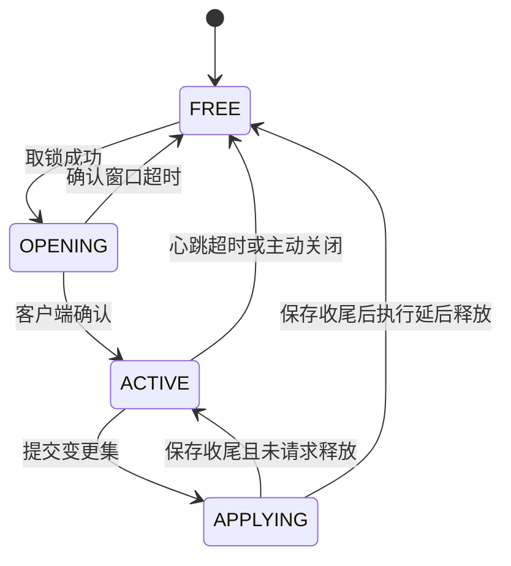

# 编辑协议契约

## TL;DR

- 编辑会话是全局独占的：同一时刻只有一个会话持有规则目标，状态在 FREE / OPENING / ACTIVE / APPLYING 之间流转，按服务端活动 tick 计时租约。
- 服务端按需下发快照与来源视图，客户端提交带 `expected_version` 与 `operationId` 的变更集，状态码回执决定下一步动作。
- 版本戳、幂等键、分片与超时限额都由服务端权威维护，客户端只做本地预检与重放。

## 适用对象

改编辑器网络载荷、接入自定义客户端、或根据回执定位保存失败原因的开发者。

## 会话与目标锁

编辑目标由 `RuleEditSessionLimits.TARGET_ID` 标识，全局只有一个。会话状态机与版本戳由 `EditSessionManager` 持有，网络入口 `RuleEditServerHandler` 只做就绪、权限与转发。



| 约束 | 取值来源 | 行为 |
|---|---|---|
| 确认窗口 | `RuleEditSessionLimits.OPEN_CONFIRM_WINDOW_SECONDS` | OPENING 会话在此窗口内未确认即回收 |
| 心跳间隔 | `RuleEditSessionLimits.HEARTBEAT_INTERVAL_SECONDS` | 客户端按此间隔续租，服务端不主动推送续租回执 |
| 租约 | `RuleEditSessionLimits.LEASE_SECONDS` | ACTIVE 会话在租约内未收到心跳则回收 |
| 编辑权限 | `RuleEditSessionLimits.REQUIRED_PERMISSION_LEVEL` | 单人存档房主直接放行，局域网访客与多人服务器玩家要求权限等级达到该值 |

计时一律使用服务端活动 tick，服务端暂停时不推进。APPLYING 不被租约回收，释放请求延后到保存收尾后执行，保证在途写盘与回滚不被打断。取锁是原子操作：失败时仍然下发打开载荷，`messageArgs` 携带当前持有者，由客户端提示而不是静默失败。

## 握手与协议版本

`RuleEditProtocol.VERSION` 是协议版本。打开载荷携带服务端版本与目标标识，客户端在收到打开载荷时比对版本与状态码；确认载荷再把客户端版本回传，服务端在确认入口再次比对。版本不一致按请求非法处理，并带上专门的文案 key，提示双方版本不同，避免用错位的字段解释载荷。

## 载荷家族

载荷按方向与职责分组，具体类型定义在 `core/network/transport`，编码顺序只在对应 record 的 `STREAM_CODEC` 里维护。

| 方向 | 载荷族 | 作用 |
|---|---|---|
| S2C | 打开载荷 | 下发会话、目标、协议版本、上下文修订、服务端放置半径上限与状态码；取锁失败也用它回执 |
| C2S | 确认、心跳、关闭 | 推进会话状态机与续租；关闭在保存期间延后执行 |
| C2S | 快照与来源视图请求 | 主动刷新快照、按规则 id 取来源分层内容 |
| S2C | 快照载荷与分片 | 整包或分片下发版本戳、逐条规则视图与整体问题清单 |
| C2S | 目录请求 | 按类型与分页取候选目录 |
| S2C | 目录载荷 | 分页结果与是否末页 |
| C2S | 变更集与分片 | 提交整包或分片形式的保存请求 |
| S2C | 保存回执与进度 | 终态回执与阶段计数 |
| C2S | 取消保存 | 请求取消在途保存 |
| C2S/S2C | 参考寿命请求与应答 | 查询服务端缓存的参考寿命，供编辑器展示 |

## 快照与来源视图

快照是客户端视图的唯一来源：确认成功后服务端自动下发首份快照，保存回执为版本冲突或已写盘未重载时再补拉。快照条目携带来源层（`origin`）、物理来源（`source`：builtin / world / overlay / mixed，其中 overlay / mixed 表示含用户覆盖内容）、状态、可编辑标记、分类、生效视图与逐条问题，条目形状与状态取值见 `RuleSnapshotEntry`。内置数据包与世界数据包来源为只读，只有含覆盖内容的 overlay / mixed 可编辑与删除。

- 整包放得下就直接下发；否则按 UTF-8 字节切分，每 tick 限量投递，客户端按 `transferId` 与下标重组。
- 快照装配失败或内容为空时回环境不可用状态码，并带上快照失败的文案 key。
- 来源视图直接取最近一次快照装配出的分层索引，不重新读盘；索引尚未就绪时回环境不可用，规则 id 非法或条目不存在时回请求非法。
- 下行文本分片共用一套视图接口（`RuleChunkPayload`）：`sessionId`、`requestId`、`transferId`、下标、总数与文本。客户端重组缓冲在会话切换、重复下标或超时无进展时重置。

## 变更集

变更集是一段 JSON 文本，随网络载荷整体传输，形状如下：

```json
{
  "expected_version": 12,
  "edits": [
    { "id": "idtw:example", "action": "upsert", "rule": { } },
    { "id": "idtw:removed", "action": "delete" }
  ]
}
```

`action` 取值由 `RuleEdit.Action` 定义：`upsert` 携带与文件同形的完整规则对象，`delete` 只带 id。变更集只表达意图，服务端以磁盘文件为准逐 id 增删改，未涉及的条目、未知字段与坏 JSON 文件都原样保留。

版本戳由 `expected_version` 与服务端当前修订号比对，不一致整批拒绝并回最新修订号，客户端据此拉取新快照。空变更集按无变化回执处理，不触发落盘。

## 幂等与并发

每次保存由客户端生成 `operationId`。服务端保留最近的操作回执，同一个 `operationId` 重发时直接回放上次结论，不重复写盘；会话切换时回执表清空。

- 已有在途保存时，同一 `operationId` 的重复提交不再触发新保存，由在途操作的终态统一作答；不同 `operationId` 按请求非法拒绝，并提示正在应用。
- 在途保存按阶段推进：准备、校验、预备文件、写盘、回滚、读盘、解码、索引、应用、取消，阶段与计数通过进度载荷节流下发，客户端只用于展示。
- 取锁失败、确认超时、心跳失效、失去权限属于会话类失败，回执会把会话置为失效；取消请求只发出信号，回滚结束前独占锁仍保持。
- 玩家断开时清理分片传输；在途保存请求延后释放，其余会话按租约回收。
- 保存回执沿用保存任务已确定的终态；完成时释放会话不覆盖写盘与重载结果。

## 版本戳推进

覆盖层修订号由 `RuleOverlayStore` 分配并持久化到覆盖层根目录的 `.edit_version`：保存写盘成功、数据包重载完成都会推进修订，保存与快照在读取覆盖层之后以磁盘上的修订号校正当前会话版本。保存准备阶段用覆盖层文件的大小与修改时间判定是否被外部改动，替换前再整份比对内容；任一处不符即中止本次保存并回滚，避免覆盖他人写入的内容。

## 分片与限额

限额常量集中在 `RuleEditLimits`，网络层、服务端重组器与客户端缓冲读同一份定义：

| 限额 | 常量 | 作用 |
|---|---|---|
| 直接包上限 | `MAX_DIRECT_PACKET_BYTES` | 整包下发的字节上限，超出改走分片 |
| 单片上限 | `MAX_CHUNK_BYTES` | 单个分片的 UTF-8 字节上限 |
| 变更集总量 | `MAX_CHANGE_SET_BYTES` | 分片收齐后的总量上限，超出按请求非法拒绝 |
| 变更集条数 | `MAX_EDITS_PER_CHANGE_SET` | 单次最多 2048 条编辑；解析时提前拒绝超限，写入入口复核 |
| 分片数上限 | `MAX_CHUNK_COUNT` | 由总量上限与单片上限推导，客户端重组时同样校验 |
| 在途传输数 | `MAX_TRANSFERS_PER_PLAYER` | 每名玩家同时保留的分片传输数，超出按插入序淘汰最早一个 |
| 传输超时 | `TRANSFER_TIMEOUT_MILLIS` | 分片超过该时长无进展即丢弃 |
| 标识与文案长度 | `MAX_ID_CHARS`、`MAX_CODE_CHARS`、`MAX_FALLBACK_CHARS` | 会话、操作、状态码、文案 key 等字符串的上限 |
| 问题条数与参数 | `MAX_ISSUES_PER_RESULT`、`MAX_MESSAGE_ARGS`、`MAX_MESSAGE_ARG_CHARS` | 回执中问题与文案参数的截断口径 |

超限请求按请求非法回执：网络层给整包留了少量余量，让越界的提交仍能收到结构化结论。

服务端出站的结构化问题按字段字符上限、问题条数与消息参数上限裁剪，截断位置保留完整 Unicode 代理对；入站读取仍按协议上限严格校验。

## 回执

保存回执携带状态码、文案 key、文案参数、结果版本号、是否已写盘、是否已重载与问题清单。客户端只按状态码分支，不解析文案；状态码语义与新增步骤见[错误与状态码](errors.md)。

## 相关文档

- [编辑与命令模块](../modules/authoring.md)
- [客户端编辑器模块](../modules/client-editor.md)
- [跨模块链路](../architecture/key-flows.md)
- [错误与状态码](errors.md)
- [规则 JSON 契约](rule-json.md)
- [故障排查](../ops/troubleshooting.md)
