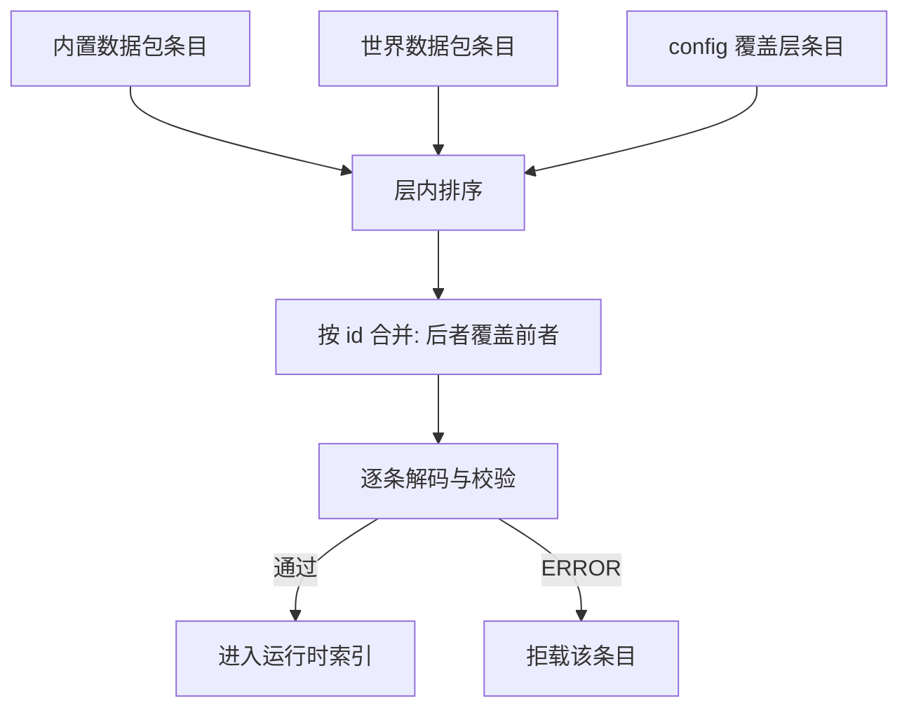

# 规则 JSON 契约

## TL;DR

- 一条规则是一个 JSON 对象；规则文件可以是单个对象，也可以是对象数组。
- 来源层按 内置数据包 → 世界数据包 → config 覆盖层 合并，同 `id` 由后面一层完整持有该规则。
- 规则文件不带本服启停状态：`enabled` 是默认启用值，本服启停按存档保存。
- 字段名以 `RuleFields` 为唯一来源；新增字段要同时改字段常量、Codec 与语义校验。

## 适用对象

手写规则文件、做数据包、实现规则编辑器或给规则模型加字段的开发者。

## 文件与位置

| 来源层 | 位置 | 说明 |
|---|---|---|
| 内置数据包 | 模组自带的 `idtw/rules/` 资源 | 随模组分发，作为默认规则基底 |
| 世界数据包 | 存档或数据包提供的 `idtw/rules/` 资源 | 同一路径可叠加多个包，按包的优先级取后者 |
| config 覆盖层 | `config/<overlay_directory>/rules/` | 运行时可直接编辑的一层，也是编辑器写盘的唯一落点 |

`overlay_directory` 的取值见 [server.json 配置](../ops/configuration.md)。规则加载读取数据包与覆盖层，按层优先级合并后再解码，合并与拒载粒度见 [错误与状态码](errors.md)。

文件以 `.json` 结尾，内容可以是单个规则对象，也可以是规则对象数组。同一文件内多条规则共享文件路径，因此每条必须显式声明 `id`；只含一条规则的文件（单个对象或单元素数组）在缺 `id` 时可由文件路径推导，路径去掉扩展名并转成资源路径。

缺省 ID 的命名空间取来源层：数据包层的规则用资源所在命名空间，覆盖层用 `idtw`。显式声明的规则 `id` 可使用任意合法命名空间。

## 覆盖层条目

覆盖层的条目是完整规则对象：同 `id` 的条目替换基底规则的全部内容，不存在只声明意图的局部条目。编辑器删除一条覆盖条目时写回的是移除该条目后的文件，基底规则随之重新生效。

未被 `RuleFields` 登记的键（含旧的 `disabled`、`delete`）按未知顶层字段处理：记一条 WARN 并保留条目，不影响与其他层的合并，也不影响解码。规则在某个存档里是否生效由本服启用状态决定，不写在文件里。

## 规则对象的分区

规则对象按键的语义分区。每个分区的键名全部登记在 `RuleFields`，本节只说明分区职责与代表键，不复制完整字段表。

| 分区 | 回答的问题 | 代表键 | 校验落点 |
|---|---|---|---|
| 标识与展示 | 这条规则叫什么、优先级多高、默认是否启用 | `id`、`display_name`、`priority`、`enabled` | 解码档 + 语义校验 |
| 来源匹配 | 哪些物品会触发这条规则 | `source` | 语义校验（物品引用与 tag） |
| 触发与时机 | 在什么消失方式下判定、存活多久后才判定 | `triggers`、`trigger_after_seconds` | 语义校验 + 运行时选择 |
| 条件 | 判定成立还需要满足什么 | `conditions` | 解码档（形状与预算）+ 语义校验（规模） |
| 效果与候选 | 转化产出什么 | `effects` 或 `outcomes` | 语义校验 + 类型注册表参数校验 |
| 成本与催化剂 | 消耗多少源物品、是否需要催化剂 | `source_cost`、`catalyst_cost`、`consume_fluid` | 语义校验 |
| 组合 | 多个候选如何轮流出现 | `combination` | 解码档（枚举取值） |
| 版本与分类 | 规则格式版本、编辑器中的分类 | `schema_version`、`category` | 解码档 + 快照装配 |

`enabled` 是规则的默认启用值，取布尔，缺省为 `true`（`RuleCodecs.DEFAULT_ENABLED`）。它表示该 id 没有本服覆盖时是否生效；本服覆盖按存档保存，生效值取「本服覆盖 ?? 默认启用」，加载与保存都只改运行时对象，不回写规则 JSON。

`category` 的取值是规则的分类标识，未知取值按原文成组展示；编辑器列表的「未完成」分组只按内容草稿状态展示，「有问题」分组只按校验问题展示，分类器不产出这两个值。

`triggers` 的取值是消失方式枚举，`combination` 的取值是组合模式枚举，两者都由模型层的枚举定义；新增取值需要同时改枚举与解码档的取值校验。`trigger_after_seconds` 缺省时按模型层默认值补齐。

## 条件树

`conditions` 是一棵以 `op` 分派的条件树，允许的 `op` 集合由 `RuleFields` 的 `OP_*` 常量给出：组合节点（`all_of` / `any_of`）、取反节点（`inverted`）、叶节点（`leaf`）。

- 组合节点用 `terms` 承载子节点，`all_of` 要求全部成立、`any_of` 要求任一成立，`terms` 为空会被当作写法错误拒绝，空条件应整体省略 `conditions`。
- 取反节点用单个 `term` 承载子节点，用来表达叶级取反。
- 叶节点用 `condition` 承载一个条件实例，类型由类型注册表解析，参数校验由注册的校验入口执行。
- 完整规则的空条件表达式在编码时省略 `conditions`；解码缺省还原为无条件，显式空组合节点、空对象与数组写法按结构错误拒绝。

条件树的形状与嵌套规模有独立预算：解析前先做文本嵌套深度预检，解码时再按条件深度与节点数检查，超限按错误处理而不是抛异常。预算常量集中在 `core/api/RuleDecodeBudget.java`，调整口径在那里改。

解码器对已废弃的写法给出带改写提示的明确错误（例如旧的分组键、把取反写在叶节点内、把节点字段写在错误层级），因此升级规则文件时按报错提示改写即可，不需要猜测。

## 行为触发点偏移

所有效果在自身参数对象中支持公共高级字段 `offset`，值为 `{"x": 2, "y": 0, "z": -1}`。整个字段或任一轴省略时按 0 处理；三轴接受整数格数，小数和整数溢出在解码时报告错误。`EffectOffset` 与 `CommonFields.OFFSET` 是该契约的声明入口。

每个行为的产出原点等于成功转化当刻冻结的触发点加自身 `offset`，保留原触发点的小数坐标。X 轴西负东正，Y 轴下负上正，Z 轴北负南正；准备阶段、战利品 ORIGIN、延迟执行、物品汇总与方块批处理共用该行为原点。条件判定、输入和催化剂消耗以及源库存返还沿用各自原有基点。

邻近产物上限按同一行为产出原点所在方块建立统计区域。同域同类需求合并，空间与引用均相交的预算共享理论扣减，分离区域独立。

服务端配置 `max_effect_offset_x`、`max_effect_offset_y`、`max_effect_offset_z` 分别限定各轴的绝对值，默认均为 6；0 表示该轴固定为零。加载和保存使用当前配置校验，编辑器开屏同步上限，以三行整格正负滑条展示。

## 版本与校验

`schema_version` 标记规则格式版本，当前取值为 1（`RuleCodecs.DEFAULT_SCHEMA_VERSION`）；取值不匹配的条目会被拒载。缺省时按当前版本补齐。

规则进入运行时索引前先过解码档、再过语义档，全部通过 Issue 报告问题，ERROR 导致拒载：

| 档位 | 入口 | 负责什么 |
|---|---|---|
| 解码档 | `RuleCodecs` 的 decoder | JSON 形状、字段名、枚举取值、条件树结构、条件预算、废弃写法 |
| 语义档 | `RuleValidation` | 必填项、来源为空、效果与候选的二选一、成本合法性、候选 id 唯一、效果参数、规模上限 |

带注册表的语义校验会逐效果、逐条件叶先检查参数声明绑定的真实值，再调用类型的业务语义钩子；嵌套对象和列表由声明递归检查，跨字段与模式相关判断由类型书写，并叠加服务端配置换算出的运行期上限（`place_block.radius` 来自 `max_place_block_radius`，行为 `offset` 的逐轴绝对值上限来自 `max_effect_offset_x/y/z`）；动态引用（例如战利品表、方块、实体 ID）由引用校验在此之后再查，服务端不可用时跳过这一档。

未知顶层字段只记 WARN 并保留该条目，便于向前兼容；候选结果对象与催化剂成本对象里的未知字段按错误拒绝，避免把拼写错误当成合法配置放过。

## 扩展点

| 要做的事 | 改哪里 |
|---|---|
| 新增规则字段 | 在 `RuleFields` 加键常量，在 `RuleCodecs` 的 MapCodec 加入字段编解码，字段集合自动派生，在 `RuleValidation` 加语义约束，需要时在模型 record 加分量 |
| 新增条件节点类型 | 在 `RuleFields` 加 `op` 常量，在 `RuleCodecs` 的条件分派里加分支，并补条件树的规模统计口径 |
| 新增效果或条件类型 | 走类型注册表，见[类型系统模块](../modules/type-system.md) |
| 调整默认值 | 在类型参数声明（`core/api/param` 的 spec）里改默认值与新建初值，编解码、校验与编辑器同时生效；不要在各处散落字面量 |

## 相关文档

- [规则模型模块](../modules/rule-model.md)
- [规则加载模块](../modules/rule-loading.md)
- [错误与状态码](errors.md)
- [server.json 配置](../ops/configuration.md)
- [故障排查](../ops/troubleshooting.md)
