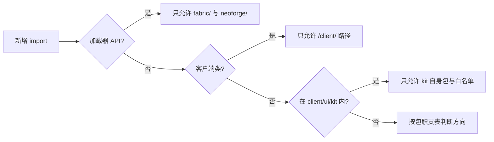

# 依赖规则

## TL;DR

- 方向只朝下：契约 `core/api` 只引用自身；加载层不认识模型；底层实现不依赖命令、调试、网络与宿主。
- 静态引用与关键结构由 `tools/check-isolation.py` 校验，UI kit 白名单由专用脚本校验；Gradle `checkRepository` 汇总门禁，其余设计方向通过评审核对。
- 现存跨包只读例外集中在本页表格，新增同类引用先在表内登记。

## 适用对象

改动 import、拆分或合并包、为某一端新增接入代码、在 UI kit 里引入新类型时，先读本文再动手；包级职责细节见 [包职责](package-responsibility.md)。

## 方向约束

| # | 约束 | 允许方向 | 固化手段 |
|---|---|---|---|
| D1 | 契约包只被引用 | `core/api`、`core/api/scheduler`、`core/api/param` 只依赖 JDK、原版契约类型与自身 | `tools/check-isolation.py` |
| D2 | 模型只依赖契约 | `core/model` → `core/api` | `tools/check-isolation.py` |
| D3 | 类型系统不依赖编辑面 | `core/registry`、`core/extension`、`core/type` → 契约、模型与只读辅助类型 | 使用方禁边由隔离脚本校验，其余按[已知例外](#已知例外)与评审核对 |
| D4 | 加载层不认识模型 | `core/load` → `core/api`；模型以 `RuleDecoder` 注入 | `tools/check-isolation.py` 禁止引用 `core/model` |
| D5 | 运行时聚合向下依赖 | `core/runtime` → 契约、配置、加载、模型、状态、类型 | 使用方禁边由隔离脚本校验，其余按[已知例外](#已知例外)与评审核对 |
| D6 | 命令、调试、网络是使用方 | `core/command`、`core/debug`、`core/network` → 运行时与编辑服务 | `tools/check-isolation.py` 禁止底层实现反向引用使用方 |
| D7 | 宿主是唯一向上装配点 | `core/host` → `core` 其余包与 `platform/Services` | `tools/check-isolation.py` 禁止底层实现反向引用宿主 |
| D8 | 客户端单向分层 | `client/net` → 协议与业务模型；`client/edit` → core 与 `client/ui/kit`；`client/ui` → `client/edit`、`client/net` | `tools/check-isolation.py` + 评审 |
| D9 | UI kit 不引用本模组其它包 | `client/ui/kit` 只引用自身包与白名单 | `tools/check-ui-kit-boundaries.ps1` |
| D10 | 平台隔离 | `net.fabricmc.*`、`net.neoforged.*` 只出现在 `fabric/`、`neoforge/` | `tools/check-isolation.py` |
| D11 | 跨加载器隔离 | `fabric/` 引用 `net.fabricmc.*`，`neoforge/` 引用 `net.neoforged.*`，两者互不引用对方加载器 API | `tools/check-isolation.py` |
| D12 | 端隔离 | 客户端类（`net.minecraft.client.*`、`com.meteorite.itemdespawntowhat.client.*`）只出现在路径含 `/client/` 的源码 | `tools/check-isolation.py` |
| D13 | 编辑业务面独立于线上格式 | `core/service`、`core/catalog` 只向 transport 提供语义模型；载荷、codec 与文案映射归 `core/network` | `tools/check-isolation.py` |

## 校验脚本

### `tools/check-isolation.py`

扫描仓库内 Java 源文件，排除构建、运行和本地工作目录。`java_references.py` 先屏蔽注释、字符串、字符和 text block 并保留行号，再提取 import/static import、全限定引用以及按源码索引可确定的同包/通配导入类型。嵌套类型与静态成员归到其所属顶层类型。

类型索引区分 common/main、各自平台 main、common/dev、NeoForge probe 和 tools；同名的两端类型按各自构建视图解析。规则覆盖静态可识别的引用，动态反射类名按调用点评审。

关键规则：

1. 加载器 API 前缀只允许出现在对应平台源集；
2. 平台源集之间禁止互引对方的加载器 API；
3. 客户端类前缀只允许出现在路径含 `/client/` 的源码，其它路径出现即违规。
4. `src/main` 只依赖生产契约；禁止引用 `core/debug`、探针实现包及源码索引中仅由开发/工具源集声明的类型，同包开发类型也按声明来源检查。
5. `core/service` 与 `core/catalog` 禁止引用 `core/network`、`CustomPacketPayload` 与网络 codec。
6. Fabric 公共/客户端与 NeoForge 注册入口须消费统一通道声明及其中的 type、codec 与处理面。允许循环、方法引用及同文件桥接；逐载荷类型常量回流到 adapter 会被拒绝。此项按注册文件的结构检查。
7. `core/api` 对本模组 core 代码只引用自身；`core/model` 只引用契约与自身；内置装配器归 `core/type`。
8. `client/edit` 的 UI 依赖限定为 `client/ui/kit`，控件和表单工厂归 `client/ui`。
9. `client/net` 禁止依赖 `client/edit` 与 `client/ui`。screen 根包不调用 `EditorField` 工厂声明业务字段；form 内从既有字段派生单项控件的适配保留。

10. 四个编辑分区不持有组合容器；screen 不调用活草稿 getter，`EditSession` 不公开 `RuleDraft` getter，`FormView` 不公开按路径或字段名配置行的旧入口。
11. `core/load` 禁止引用 `core/model`；`core/api`、`config`、`load`、`model`、`registry`、`extension`、`type`、`runtime`、`state`、`service`、`catalog` 禁止引用 `core/command`、`debug`、`network`、`host`。

根包 `Constants` 只声明模组标识、显示名、命名空间与日志入口，属环境级常量，不受包分层约束。

编辑通道的 id 唯一、处理器齐备、同方向 direct/chunk 配对由 `RuleEditChannels` 初始化校验，平台注册器共同遍历该声明。

开发实现位于 `common/src/dev` 与 `neoforge/src/probe`，生产观测只经 `core/api/RuntimeObserver`、`DevelopmentDiagnostics`；发布 jar 隔离由[后端探针工作流](../guides/backend-probes.md)的打包任务校验。

运行方式：`python tools/check-isolation.py`（可用 `--root` 指定仓库根）。通过时退出码为 0，存在违规时逐条列出并以 1 退出。

### `tools/check-ui-kit-boundaries.ps1`

扫描 `client/ui/kit` 下全部 `.java` 的 import、全限定引用与顶层 public 登记：

- 每个顶层 public 类型在 package-info 的角色表唯一登记为 host、library 或 example，过期登记也报违规；
- 允许 kit 自身包内互引；
- import 白名单为 `java.*`、`javax.*`、`net.minecraft.*`、`org.jetbrains.*`、`org.joml.*`、`org.lwjgl.*`，另有 `com.mojang.blaze3d` 的顶点与光照类型；
- 本模组其它包、`net.fabricmc.*`、`net.neoforged.*`、`com.google.gson.*` 判违规。

运行方式：`powershell -ExecutionPolicy Bypass -File tools/check-ui-kit-boundaries.ps1`；通过返回 0，有违规返回 1。

### 构建与持续集成

根任务 `checkRepository` 组合隔离、文档、i18n、UI kit 和 `checkConfigReference`，各子项目 `check` 依赖同一根任务。发布包隔离仍由 `checkProbePackaging` 消费各端 assemble 产物；单次 build 中每个根任务执行一次。

PR、`1.21.1` 分支 push 和 release 的 build 使用同一门禁；环境提供 JDK 21、Python 与 PowerShell（Windows 使用 powershell，Linux 使用 pwsh）。Wiki 发布在写入远端前运行 `checkConfigReference`。

Java 编译负责类型可见性和签名，包职责与层次设计由脚本的明确规则及评审共同核对。改包结构后先完成 IDE 检查，再运行 `tools/dsh-build.ps1 -Tasks build` 并对照[包职责](package-responsibility.md)。

## 已知例外

下表是现存于源码的跨包引用，按各自能力边界保留运行时状态所有权；新增同类引用按同样格式登记。

| 例外 | 位置 | 性质 |
|---|---|---|
| 效果执行读取区块存在性 | `core/type/effect/exec` → `core/runtime/LoadedChunks` | 只读判定：目标区块是否加载，决定生成还是顺延 |
| 返还物生成读写实体状态 | `core/type/effect/exec`（`ReturnItemSpawner`、`EffectTargets`）→ `core/state/DropStateStore` | 返还物授予永久保护与永久禁转，状态由公共门面写入 |
| 保存续接发布预建索引 | `core/service/RuleSaveTask` → `core/runtime/RuleIndex` | 后台解码后按公共 tick 预算发布索引 |
| 客户端装配本地类型表 | `client/edit/ClientTypeRegistries` → `core/type/BuiltinTypeRegistries` | 仅消费规范装配记录与冻结查询视图 |
| 传输层取得会话上下文与服务 | `core/network/transport` → `core/service` | 编辑会话需要会话上下文与保存服务，权限谓词在构造点注入 |
| 实体状态与平台能力互引类型 | `core/state/DropStateStore` ↔ `platform/Services`、`platform/services/IPlatformHelper` | 平台能力接口以 `DropState` 为参数；状态由运行时单向持有 |
| 编辑数据用 kit 的树编辑契约 | `client/edit` → `client/ui/kit` | 复用 `UiTreeEditor`、`UiTreePath`、`UiTreeCodec`，不引用宿主与主题 |
| 界面与协议读编辑常量 | `client/net`、`client/ui` → `core/service/RuleEditSessionLimits` | 双端共用限额常量与档案类型，避免协议两侧各存一份 |

服务层不引用传输层门面；权限谓词由构造点注入。

## 相关文档

- [架构总览](overview.md)
- [模块地图](module-map.md)
- [包职责](package-responsibility.md)
- [关键链路](key-flows.md)
- [模块文档索引](../modules/README.md)
- [文档体系](../README.md)
- [调度契约与实现分层](../adr/0034-scheduler-contract-and-implementation-layering.md)
- [UI kit 零引用公开 API 保留策略](../adr/0033-kit-zero-reference-public-api-retention.md)
- [客户端依赖边界与共享子包](../adr/0029-client-dependency-boundary-and-shared-subpackage.md)
