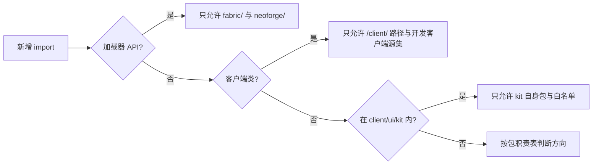

# 依赖规则

## TL;DR

- 方向只朝下：契约 `core/api` 被引用、不引用别人；加载层不认识模型；运行时不被命令、调试与网络反向依赖。
- 平台隔离与端隔离由 `tools/check-isolation.py` 校验，UI kit 引用白名单由 `tools/check-ui-kit-boundaries.ps1` 校验；其余方向由编译期 import 直接体现。
- 现存跨包只读例外集中在本页表格，新增同类引用先在表内登记。

## 适用对象

改动 import、拆分或合并包、为某一端新增接入代码、在 UI kit 里引入新类型时，先读本文再动手；包级职责细节见 [包职责](package-responsibility.md)。

## 方向约束

| # | 约束 | 允许方向 | 固化手段 |
|---|---|---|---|
| D1 | 契约包只被引用 | `core/api`、`core/api/scheduler` 只依赖 JDK、原版契约类型与自身 | 编译期（契约包内无对其它 `core` 包的 import）+ 评审 |
| D2 | 模型只依赖契约 | `core/model` → `core/api` | 编译期 + 评审 |
| D3 | 类型系统不依赖编辑面 | `core/registry`、`core/extension`、`core/type` → 契约、模型与只读辅助类型 | 编译期 + [已知例外](#已知例外) |
| D4 | 加载层不认识模型 | `core/load` → `core/api`；模型以 `RuleDecoder` 注入 | 编译期 + 评审 |
| D5 | 运行时聚合向下依赖 | `core/runtime` → 契约、配置、加载、模型、状态、类型 | 编译期 + [已知例外](#已知例外) |
| D6 | 命令、调试、网络是使用方 | `core/command`、`core/debug`、`core/network` → 运行时与编辑服务 | 编译期 + 评审 |
| D7 | 宿主是唯一向上装配点 | `core/host` → `core` 其余包与 `platform/Services` | 编译期 + 评审 |
| D8 | 客户端单向分层 | `client/net` → 协议；`client/edit` → `client/net` 与 `client/ui/kit`；`client/ui` → `client/edit`、`client/net` | 编译期 + 包内注释 + 评审 |
| D9 | UI kit 不引用本模组其它包 | `client/ui/kit` 只引用自身包与白名单 | `tools/check-ui-kit-boundaries.ps1` |
| D10 | 平台隔离 | `net.fabricmc.*`、`net.neoforged.*` 只出现在 `fabric/`、`neoforge/` | `tools/check-isolation.py` |
| D11 | 跨加载器隔离 | `fabric/` 引用 `net.fabricmc.*`，`neoforge/` 引用 `net.neoforged.*`，两者互不引用对方加载器 API | `tools/check-isolation.py` |
| D12 | 端隔离 | 客户端类（`net.minecraft.client.*`、`com.meteorite.itemdespawntowhat.client.*`）只出现在路径含 `/client/` 的源码与只随客户端加载的开发源集 `neoforge/src/guiScreenshot/` | `tools/check-isolation.py` |

## 校验脚本

### `tools/check-isolation.py`

扫描仓库内全部 Java 源文件，只按 import 语句判定（注释与 javadoc 中的全限定名不构成编译期依赖）：

1. 加载器 API 前缀只允许出现在对应平台源集；
2. 平台源集之间禁止互引对方的加载器 API；
3. 客户端类前缀只允许出现在客户端路径与开发客户端源集，其它路径出现即违规。

运行方式：`python tools/check-isolation.py`（可用 `--root` 指定仓库根）。通过时退出码为 0，存在违规时逐条列出并以 1 退出。

### `tools/check-ui-kit-boundaries.ps1`

扫描 `client/ui/kit` 下全部 `.java` 的 import 与全限定引用：

- 允许 kit 自身包内互引；
- import 白名单为 `java.*`、`javax.*`、`net.minecraft.*`、`org.jetbrains.*`、`org.joml.*`、`org.lwjgl.*`，另有 `com.mojang.blaze3d` 的顶点与光照类型；
- 本模组其它包、`net.fabricmc.*`、`net.neoforged.*`、`com.google.gson.*` 判违规。

运行方式：`powershell -ExecutionPolicy Bypass -File tools/check-ui-kit-boundaries.ps1`；通过返回 0，有违规返回 1。

### 编译期

脚本未覆盖的方向约束由编译期决定：一个包能引用什么，取决于它实际 import 了什么。改包结构后先编译，再按 [包职责](package-responsibility.md) 核对方向是否符合预期。

## 已知例外

下表是现存于源码的跨包引用。共同点是只读辅助类型、常量或装配记录，不转移运行时状态所有权；新增同类引用按同样格式登记。

| 例外 | 位置 | 性质 |
|---|---|---|
| 效果执行读取区块存在性 | `core/type/effect/exec` → `core/runtime/LoadedChunks` | 只读判定：目标区块是否加载，决定生成还是顺延 |
| 返还物生成读写实体状态 | `core/type/effect/exec/ReturnItemSpawner` → `core/state/DropStateStore` | 返还物需要打上临时保护，避免立即被再次转化 |
| 保存续接发布预建索引 | `core/service/RuleSaveTask` → `core/runtime/RuleIndex` | 后台解码后按公共 tick 预算发布索引 |
| 运行时消费内置类型注册表 | `core/runtime` → `core/service/BuiltinTypeRegistries` | 装配记录，运行时只读 |
| 传输层取得会话上下文 | `core/network/transport` → `core/runtime/RuleIndex`、`core/service` | 编辑会话需要当前索引与保存服务 |
| 编辑服务取目录服务 | `core/service/RuleEditService` → `core/network/catalog/RuleCatalogService` | 目录分页在服务端完成，编辑服务只调用 |
| 目录来源以协议 DTO 为载体 | `core/catalog` → `core/network/protocol` | 只读条目类型，协议包不回指目录包 |
| 编辑链路取调试档案 | `core/service/RuleEditService`、`RuleSnapshotTask` → `core/debug/DebugProfile` | 只在调试档案激活时附加诊断信息 |
| 实体状态与平台能力互引类型 | `core/state/DropStateStore` ↔ `platform/Services`、`platform/services/IPlatformHelper` | 平台能力接口以 `DropState` 为参数；状态由运行时单向持有 |
| 编辑数据用 kit 的树编辑契约 | `client/edit` → `client/ui/kit` | 复用 `UiTreeEditor`、`UiTreePath`、`UiTreeCodec`，不引用宿主与主题 |
| 界面与协议读编辑常量 | `client/net`、`client/ui` → `core/service/RuleEditSessionLimits`、`core/debug/DebugProfile` | 双端共用限额常量与档案类型，避免协议两侧各存一份 |

## 相关文档

- [架构总览](overview.md)
- [模块地图](module-map.md)
- [包职责](package-responsibility.md)
- [关键链路](key-flows.md)
- [模块文档索引](../modules/README.md)
- [文档体系](../README.md)
- [调度契约与实现分层](../adr/0034-scheduler-contract-and-implementation-layering.md)
- [UI kit 零引用公开 API 保留策略](../adr/0033-kit-zero-reference-public-api-retention.md)
- [客户端依赖边界与共享子包](../adr/0029-client-dependency-boundary-and-shared-subpackage.md)
