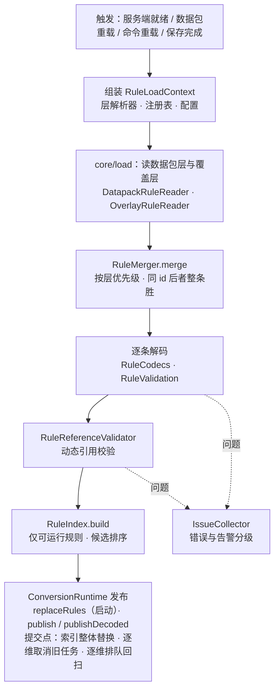
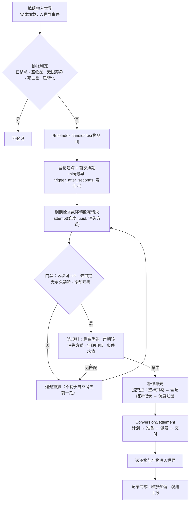
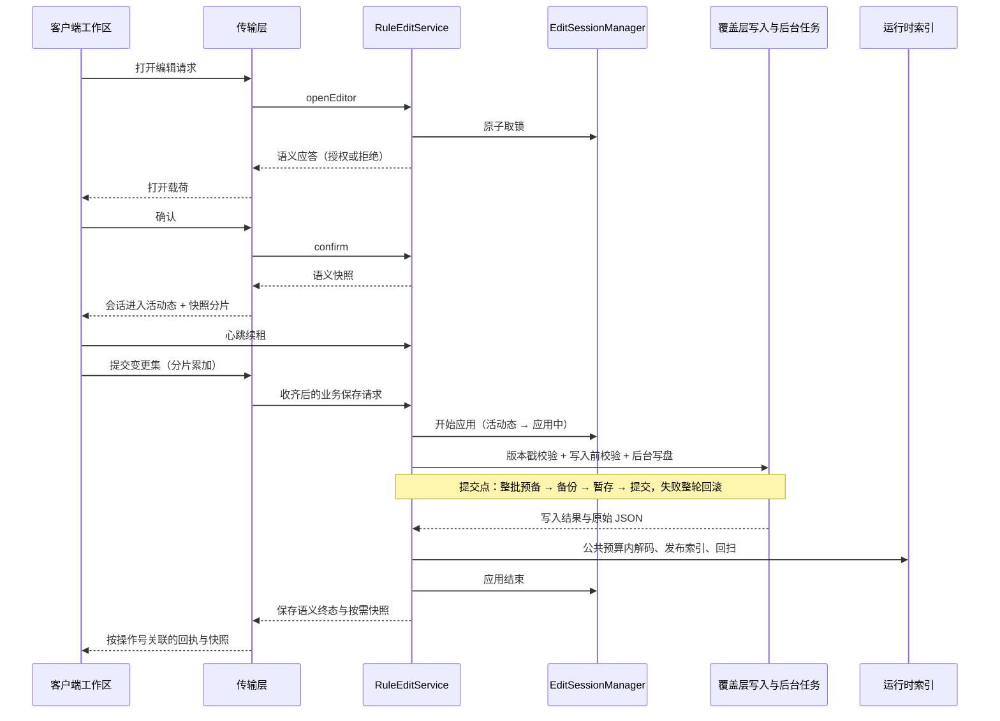

# 关键链路

## TL;DR

- 规则加载：三层来源读取 → 按 id 合并 → 逐条解码校验 → 整体替换索引并回扫；失败不替换，只留问题记录。
- 转化生命周期：入世界登记 → 到期或环境致死触发 → 门禁与选规则 → 整堆转移为一次结算 → 分阶段派发与交付 → 记录完成。
- 编辑保存：原子取锁 → 确认后进入会话 → 提交变更集 → 写入前校验 → 后台写盘 → 公共预算内应用索引 → 回执与快照。

## 适用对象

要判断「某个失败会停在哪一步」「哪些步骤可以安全重试」的开发者。本文的链路都跨越多个逻辑模块，单模块内部细节见 [模块文档索引](../modules/README.md)。

## 规则加载

覆盖服务端就绪时的首次加载、数据包重载、命令重载，以及编辑器保存完成后的索引应用。

**关键契约**

- 来源层从低到高为内置数据包、世界数据包、config 覆盖层；同 id 由高层覆盖低层，合并结果保留最终生效来源。
- 同一来源层内按文件路径与文件内顺序决定先后，同 id 的后者整条胜出；合并只处理规则内容，启用状态在装配末端按本服覆盖注入。
- `core/load` 不认识规则模型：模型以 `RuleDecoder` 注入，加载层只产出原始条目与泛型加载结果。
- 解码器从实际 MapCodec 派生对象字段集合；注册表感知校验先遍历字段绑定，再调用类型业务语义与运行期限额钩子。内置与 SPI 类型由 `core/type` 统一封口并发布查询视图。
- 候选索引只收可运行规则（启用且至少一个可执行候选），同一 id 只生效一条；候选按优先级降序、同优先级按条件叶数、再按声明顺序排序。
- 索引整体替换：替换时标签展开缓存随索引失效，并按维度取消旧任务、清空追踪后回扫，不静默丢弃在途任务。
- 问题分级进入统一收集通道：整文件解析失败拒载该文件，单条非法只拒载该条，解码期异常（含栈溢出）同样降级为拒载该条。

**异常路径**

- 运行时尚未就绪（缺世界或注册表）：本次加载空结果并记录，调用方按「无规则」处理。
- 只有数据包或只有覆盖层可见：缺失的一侧按空集合参与合并，另一侧照常生效。
- 解码抛异常：该条拒载，日志保留完整堆栈，问题记录保留异常类名与首个栈帧，其余条目继续。
- 重载失败：不替换索引，上一版继续服务，失败原因写入问题通道。
- 保存流程占着编辑目标：重载被延后到保存收尾后执行（`deferReload`），避免读到写了一半的目录。

**幂等点**

- 索引是不可变对象，整体替换；同一输入重复加载得到同一索引，重复触发不产生叠加状态。
- 启动期的首次数据包加载不按重载处理，避免把冷启动当成变更。
- 回扫任务带待回扫标记，重复入队被合并为一次。
- 保存后的索引由后台预建，发布入口在公共预算内换入并逐维排队回扫；保存任务等到回扫收尾才回成功，失败不留半套索引。

## 转化生命周期

从掉落物进入世界到结算记录完成；环境致死请求与自然消失共用同一份追踪、预算与调度器。

**关键契约**

- 一次转化只执行一条规则：候选已按优先级排序，取第一条声明了本次消失方式且条件成立者；未声明消失方式按自然消失处理。
- 年龄门槛只约束自然消失：`trigger_after_seconds` 换算为 tick，且不超过寿命前一刻；环境致死请求在当前刻立即判定，与存活时长无关。
- 门禁顺序固定：区块可 tick → 未锁定 → 无永久禁转 → 冷却归零 → 候选非空 → 选规则。
- 整堆语义：每组固定源成本（显式 `source_cost` 优先，未声明按单件），潜在组数由可用量与每组成本决定；未声明候选结果时，顶层效果隐式成为唯一候选。
- 「扣减 → 登记 → 调度注册」是一个补偿单元：任一步失败都把整堆库存写回源实体并撤销登记，全部成功才把所有权交给结算任务。
- 结算分阶段推进：定组数上界 → 按组固定效果输入 → 为每组选候选并分配源成本 → 派发效果 → 等待全部效果终态 → 交付剩余库存。方块按成功放置比例占用源成本，其余行为与概率尝试按组支付；每次源消费经受控 Writer 等额更新已消耗量与待交付量；剩余库存只读账目。
- 交付按刻预算分批加入世界；生物位置搜索跨刻保留进度，已判定过的候选在同一次交付内不重复检查，命中位置用过后继续向后推进。

**异常路径**

- 条件不满足：按退避序列重试，直到自然消失前一刻；到点仍不满足则结束追踪，自然消失请求下直接销毁实体。
- 区块不可 tick 或实体被锁定：按检查间隔或单刻退避重排，不消耗一次转化机会。
- 永久禁转：结束追踪；临时冷却中：按剩余冷却时长重排。
- 结算中止（停服、维度卸载、取消、异常）：先取消全部子任务，再把未消耗源量记为待返还、释放未支付预留，再由恢复任务在目标维度可用后交付；异常路径转失败状态。
- 容量不足：物品与实体（生物与其他实体）不开超出初始环境预算的组；方块在半径或 limit 耗尽时结束延迟任务，源成本按实际放置量计，未消耗源库存走返还路径。
- 预留与实际可用量不一致：整批返还，不做半预留。
- 交付失败或区块未加载：保留待返还量并带退避重试，不整批放弃。

**幂等点**

- 追踪表按实体 UUID 唯一：重复入世界（区块重追踪）不会重复排期。
- 已提交转化的实体带标记，在排除判定与锁定处被挡下，重复请求不重复派发。
- 结算中止幂等：已中止的任务不重复写盘，也不重复释放预留。
- 恢复任务按结算记录的幂等位推进，重复扫描或重复入队不会多发返还物。
- 物品、实体（生物与其他实体）与战利品候选的初始邻近存量只查询一轮（覆盖全部候选，预算耗尽时跨刻续接并保留已完成项），产出预算在结算内固定，生成期间不重查上限。

## 编辑保存协议

从客户端发起编辑到覆盖层落盘与新索引生效；会话状态机与保存编排在服务端，客户端只镜像状态。

**关键契约**

- 独占：同一时刻至多一个非空闲会话，同一目标只有一个编辑者；取锁原子完成，成功与失败都下发回执。
- 状态机：空闲 → 打开中 → 活动 → 应用中 → 活动；打开中与活动可主动释放或超时释放，应用中的释放延后到保存收尾，租约不打断在途保存。
- 权限与就绪：单人存档直接放行，其余要求权限等级；覆盖层根目录与类型注册表都可用才算就绪。
- 版本戳：宿主持有的 `RuleOverlayStore` 独立维护内容修订，覆盖层根目录的版本文件承载编辑版本，提交必须携带期望版本；版本推进后旧版本提交被判定为冲突。
- 写入顺序：解码与语义校验必须发生在写入前；写入按「整批预备 → 备份 → 暂存 → 提交」推进，准备阶段用文件元数据指纹发现外部修改。
- 应用顺序：写盘成功后应用预建索引并回扫；「已写盘、重载失败」是独立终态，目录已变更但索引仍为上一版。
- 回执按操作标识幂等重放：同一会话内重复提交返回上次回执，不重复写盘。
- 保存期间重载被延后；同步规则命令在保存中避开覆盖层目录。

状态码与错误文案的权威定义见 [错误与状态码](../api/errors.md)，上行下行的载荷字段见 [编辑协议](../api/edit-protocol.md)。

**异常路径**

- 无权限、未就绪或会话被占：拒绝回执，会话状态不变。
- 会话失效（超时或心跳缺失）：租约到期回收，后续请求按过期处理。
- 非持有者操作：拒绝，不改变持有者状态。
- 协议版本不符：握手拒绝，不进入会话。
- 校验失败：写入前拒绝，覆盖层目录不变。
- 写盘失败：回滚本轮写入的文件、备份与临时文件，会话回到活动态。
- 已写盘、重载失败：回执独立终态，等待再次重载或人工修正。
- 版本冲突：期望版本与磁盘不符时拒绝保存，客户端需重新拉取快照。
- 取消：尚未开始写盘时立即回执；已在途的保存走收尾后再释放。
- 玩家断开或停服：清空分片缓存与幂等记录；在途保存延后释放会话，停服时丢弃状态机。

**幂等点**

- 操作标识回执回放：保存结果按会话与操作标识记录，重复提交直接返回上次结论。
- 应用中不接受第二次保存：状态机在应用期间拒绝新的变更集。
- 版本戳单调推进，重复应用不会回退到旧版本。
- 取消与最终提交通过同一次状态竞争决定，只有一方生效。
- 客户端不缓存服务端权威状态：每次会话开始与保存结束都按需拉取快照。

## 相关文档

- [架构总览](overview.md)
- [模块地图](module-map.md)
- [包职责](package-responsibility.md)
- [依赖规则](dependency-rules.md)
- [规则 JSON](../api/rule-json.md)
- [编辑协议](../api/edit-protocol.md)
- [错误与状态码](../api/errors.md)
- [运行配置](../ops/configuration.md)
- [模块文档索引](../modules/README.md)
- [文档体系](../README.md)
- [三层作用域与覆盖合并](../adr/0014-three-layer-scope-and-overlay-merge.md)
- [独占编辑会话与目标锁](../adr/0019-exclusive-edit-session-and-target-lock.md)
- [触发方式、固定成本与完整组结算](../adr/0043-result-budget-and-source-settlement.md)
- [跨存档作业登记隔离](../adr/0037-cross-save-job-registration-isolation.md)
