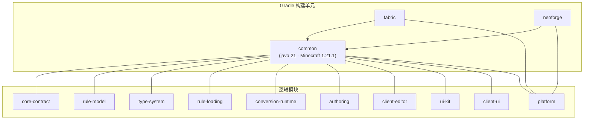
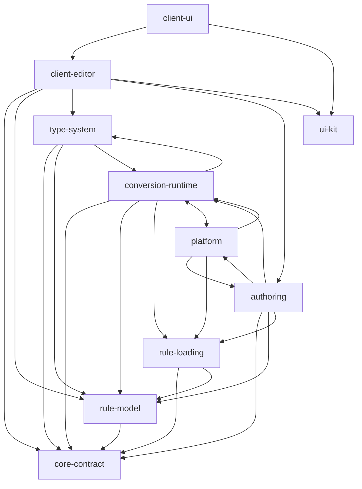

# 模块地图

## TL;DR

- 层 3 的「模块」是按职责划分的逻辑模块，覆盖 `common` 内的包与两端的平台接入；Gradle 侧的构建单元是 `common`、`fabric`、`neoforge`。
- 包按职责归属一个逻辑模块，跨模块协作只经 [core-contract](../modules/core-contract.md) 与 [authoring](../modules/authoring.md) 的协议类型；`core/service` 是唯一按职责拆成两段的包。
- 模块内部的边界、关键类与扩展点见各模块文档，本文只回答「哪个包属于谁」。

## 适用对象

准备新增功能、重构包结构或评审依赖方向的开发者。读完本文后按 [模块文档索引](../modules/README.md) 进入具体模块。

## 两种「模块」

- **逻辑模块**：层 3 的文档与职责边界，对应 `common` 内的一组包（platform 另含两端源集）。它决定「一段代码属于哪个子系统、该读哪篇文档」。
- **Gradle 子项目**：构建与装载单元，由 `settings.gradle` 声明，负责平台依赖、Mixin 配置与产物打包。

逻辑模块与 Gradle 子项目不是一一对应：`common` 内包含除两端接入外的全部逻辑模块；逻辑模块边界靠包结构与 [依赖规则](dependency-rules.md) 维持，不靠额外子项目。

## 模块表

| 逻辑模块 | 一句话职责 | 覆盖的包与目录 | Gradle 子项目 |
|---|---|---|---|
| [platform](../modules/platform.md) | 两端加载器接入、生命周期、平台能力注入与开发工具 | `common/platform`、`common/core/host`、`common/core/config`、`fabric/`、`neoforge/` | `common`、`fabric`、`neoforge` |
| [core-contract](../modules/core-contract.md) | 跨模块共享的契约：条件与效果执行、类型注册与分发、Issue、预算与观测 | `common/core/api`、`common/core/api/scheduler` | `common` |
| [rule-model](../modules/rule-model.md) | 规则的数据形态、不可变约束、Codec 与语义校验 | `common/core/model` | `common` |
| [type-system](../modules/type-system.md) | 注册与冻结、第三方 SPI、内置条件与效果的落点 | `common/core/registry`、`common/core/extension`、`common/core/type` | `common` |
| [rule-loading](../modules/rule-loading.md) | 三层来源读取与合并、拒载、候选索引与催化剂投影 | `common/core/load`、`common/core/service` 的加载装配部分 | `common` |
| [conversion-runtime](../modules/conversion-runtime.md) | 追踪与触发、预检查、完整组结算、恢复与共享预算 | `common/core/runtime`、`common/core/runtime/scheduler`、`common/core/state` | `common` |
| [authoring](../modules/authoring.md) | 候选目录、编辑会话与落盘、命令与调试场景 | `common/core/catalog`、`common/core/network`、`common/core/service` 的编辑落盘部分、`common/core/command`、`common/src/dev`、`neoforge/src/probe` | `common` |
| [client-editor](../modules/client-editor.md) | 客户端协议工作区、草稿与撤销、类型编辑器注册表 | `common/client/net`、`common/client/edit` | `common` |
| [ui-kit](../modules/ui-kit.md) | 声明式 UI kit 的公开面与依赖边界 | `common/client/ui/kit` | `common` |
| [client-ui](../modules/client-ui.md) | 编辑器界面、主题与控件适配 | `common/client/ui/theme`、`common/client/ui/widget`、`common/client/ui/shared`、`common/client/ui/screen`、`common/client/ui/screen/form` | `common` |

## 对外入口与依赖方

仅列代表性入口，非穷举；逐类清单见各模块文档。

| 逻辑模块 | 对外入口（代表性） | 主要依赖方 |
|---|---|---|
| platform | `RuleRuntimeHostCore.PlatformAdapter`、`Services` | 全部 `core` 包（经契约与宿主）、两端源集 |
| core-contract | `RuntimeObserver`、`RuleDecoder`、`ConditionEvaluator`、`EffectExecutor`、`TypeRegistry`、`TypeRegistrar`、`IssueCollector`、`ServerTickBudget` | 其它全部逻辑模块 |
| rule-model | `Rule`、`SourceMatcher`、`ConditionExpression`、`RuleCodecs`、`RuleValidation` | type-system、conversion-runtime、authoring、client-editor |
| type-system | `BuiltinTypeRegistries`、`SimpleTypeRegistry`、`RuleTypeProvider`、`BuiltinConditionTypes`、`BuiltinEffectTypes` | rule-loading（注册表装配）、conversion-runtime（求值与执行）、authoring（引用校验） |
| rule-loading | `RuleLoader`、`RuleLoadingService`、`RuleSourceLayer`、`RuleMerger` | conversion-runtime、authoring、platform |
| conversion-runtime | `ConversionRuntime`、`RuleIndex`、`ServerScheduler`、`SettlementLedger` | authoring（只读索引）、core/host、command、debug |
| authoring | `AuthoringHost`、`RuleEditChannels`、`RuleEditTransport`、`RuleEditService`、`EditAdmission`、`EditSessionManager`、`RuleCommandTree`、`RuleCatalogService` | client-editor 与 client-ui（协议与限额）、platform（编辑上下文） |
| client-editor | `RuleEditClientWorkspace`、`EditorSessionView`、`EditorSaveView`、`TypeEditorRegistry` | client-ui |
| ui-kit | `UiDocument`、`UiControl`、`UiTreeEditor`、`UiInputRouter`、`UiSliderSkin` | client-ui、client-editor（树编辑契约） |
| client-ui | `RuleEditorScreen`、`EditorScreenHooks` 的实现、`UiHostThemes` | platform 客户端入口（挂载界面） |

## 逻辑模块与 Gradle 子项目的映射

- **构建单元固定为 `common`、`fabric`、`neoforge`**，平台子项目依赖 `common`，产物各自打包；新增逻辑模块时在 `common` 内按包划界，不改构建结构。
- **platform 是唯一的跨构建单元模块**：`common` 侧提供宿主、配置与平台能力接口，`fabric` 与 `neoforge` 侧只保留适配实现、事件注册与 Mixin。
- **`common` 内的客户端包在两端都编译**：模组元数据声明双端装载（`fabric.mod.json` 的 `environment` 为 `*`、`neoforge.mods.toml` 的 `side` 为 `BOTH`），客户端入口由各平台的客户端入口点挂载，界面代码只在客户端运行路径上被调用。
- **服务端能力与客户端能力同包不同源集**：服务端逻辑只落在 `common` 与平台源集的非客户端侧，客户端逻辑落在 `common` 的 `client` 包与平台源集的 `client` 包，端隔离由脚本强制，见 [依赖规则](dependency-rules.md)。

## 模块依赖方向

箭头是编译期 import 方向，非调用时序；跨模块的例外与判定口径集中在 [依赖规则](dependency-rules.md)。

`conversion-runtime` 与 `platform` 之间的双向箭头来自实体层状态与平台能力接口：平台能力接口以 `DropState` 作为参数，实体状态存储经平台服务读取，类型级互引不改变运行时状态由 `conversion-runtime` 单向持有。

## 跨模块归属规则

- **`core/service` 按职责拆成两段**：规则加载装配（三层来源读取、解码、语义校验、内置类型注册表装配）归 [rule-loading](../modules/rule-loading.md)；编辑会话、覆盖层落盘、保存续接任务与快照装配归 [authoring](../modules/authoring.md)。逐类归属见 [包职责](package-responsibility.md)。
- **协议类型是客户端与编辑链路的共享面**：`core/service/edit` 与 `core/catalog` 的只读模型、`core/network/transport` 的载荷归 [authoring](../modules/authoring.md)，客户端只消费只读 DTO 与发起上行请求，界面层不直接构造上行载荷。
- **契约优先**：多个模块都要用的能力先落在 [core-contract](../modules/core-contract.md)，实现侧按观察者、解码器、执行器注入，不在模块之间直接互引实现类。
- **新增代码的落点判定**：先看它是否描述规则数据（rule-model）、是否是可注册的类型（type-system）、是否属于三层读取与合并（rule-loading）、是否改变运行期追踪与结算（conversion-runtime）、是否属于编辑与命令面（authoring）、是客户端工作区还是界面（client-editor / client-ui）；两端差异只加到 `PlatformAdapter` 或 `Services`。

## 相关文档

- [架构总览](overview.md)
- [包职责](package-responsibility.md)
- [依赖规则](dependency-rules.md)
- [关键链路](key-flows.md)
- [模块文档索引](../modules/README.md)
- [文档体系](../README.md)
