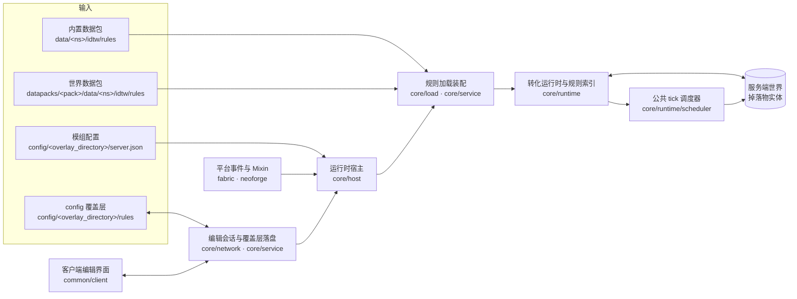

# 架构总览

## TL;DR

- 模组在服务端观察掉落物，按内置数据包、世界数据包与 config 覆盖层中的规则，把即将消失的物品转化成返还物或其它产物。
- 世界读写只发生在服务端主线程，检查与效果由同一个共享 tick 预算推进；规则加载、编辑落盘与恢复交付各有唯一所有者与提交点。
- 本文给系统上下文、外部输入与运行约束；模块划分、包职责、链路顺序见 [模块地图](module-map.md)、[包职责](package-responsibility.md)、[关键链路](key-flows.md)。

## 适用对象

需要判断一项改动落在哪个子系统、会受哪条运行时约束限制的开发者；对接规则文件结构或客户端编辑协议的集成方也可从本文开始。规则字段、错误码与配置键的含义分别以 [规则 JSON](../api/rule-json.md)、[错误与状态码](../api/errors.md)、[运行配置](../ops/configuration.md) 为准，本文不复述。

## 系统上下文

模组是 Minecraft 1.21.1 的服务端行为模组，同时提供客户端编辑界面。规则决定「哪些物品、在什么条件下、以什么代价、产出什么」，运行时负责在掉落物消失前完成转化与结算。

**服务端侧**：平台事件与 Mixin 把「掉落物入世界 / 离开世界 / 自然消失 / 环境致死 / 服务端启停 / 数据包重载 / 维度加载与卸载 / 服务器 tick 结束」交给 [RuleRuntimeHostCore](../../common/src/main/java/com/meteorite/itemdespawntowhat/core/host/RuleRuntimeHostCore.java)，后者持有一次存档生命周期的运行时状态，并以窄接口向网络层与命令层开放能力。运行时在掉落物入世界时登记追踪，在到期判定里选规则、把整堆源物品转入结算、按组支付成本并交付返还。

**客户端侧**：界面通过编辑协议与服务端会话交互，协议上行请求由 `core/network/transport` 的 payload 记录定义，服务端由 [RuleEditServerHandler](../../common/src/main/java/com/meteorite/itemdespawntowhat/core/network/transport/RuleEditServerHandler.java) 转发到 [RuleEditService](../../common/src/main/java/com/meteorite/itemdespawntowhat/core/service/RuleEditService.java)。客户端工作区负责镜像会话状态、维持心跳与分片重组，界面层只消费草稿与只读视图。

**规则与配置**：规则是唯一的行为配置单元，读取顺序与覆盖语义见 [规则加载](../modules/rule-loading.md)；模组级配置只影响运行参数，不改变规则语义。

## 外部输入

| 输入 | 进入点 | 影响 |
|---|---|---|
| 内置数据包 | jar 内 `data/<ns>/idtw/rules/*.json` | 默认规则与示例，只读；层优先级最低 |
| 世界数据包 | 存档内 `datapacks/<pack>/data/<ns>/idtw/rules/*.json` | 存档级规则，只读；覆盖同 id 内置规则 |
| config 覆盖层 | `config/<overlay_directory>/rules/*.json` | 编辑器与命令的写入目标；覆盖同 id 其它层规则 |
| 模组配置 | `config/<overlay_directory>/server.json` | 调度预算、检查间隔、实体状态时长、邻近产物阈值等运行参数；缺失时由 `ServerConfig.loadOrCreate` 落盘默认值 |
| 命令 | `/idtw` 命令树 | 查询、配置写回与重载；权限判定见 [RuleCommandTree](../../common/src/main/java/com/meteorite/itemdespawntowhat/core/command/RuleCommandTree.java) |
| 编辑协议上行载荷 | `core/network/transport` | 独占会话的取锁、确认、心跳、快照与目录请求、变更集提交、取消保存 |
| 平台生命周期事件 | fabric 与 neoforge 的 `runtime/RuleRuntimeEvents` | 服务端启停、数据包重载、实体入世界与离开、维度加载与卸载、服务器 tick 结束 |
| 平台实体事件与 Mixin | `mixin` 包、`PlatformAdapter` | 自然消失前延后判定、环境致死请求、实体层状态读取与写入、死亡掉落排除标记 |

实体层状态（临时保护、临时冷却、永久保护、永久禁转）挂在实体上而非 `ItemStack` 上，时间字段是绝对服务端游戏刻，卸载不暂停、重启后继续；字段含义见 `core/state` 的 [DropState](../../common/src/main/java/com/meteorite/itemdespawntowhat/core/state/DropState.java)。

## 运行约束

### 线程与时间基准

- 世界读写只在服务端主线程发生。环境致死请求在 `hurt` 调用栈内同步完成条件检查与规则选择，效果一律经调度器排队后在共享预算内执行。
- 会话租约、超时与幂等窗口一律使用 `MinecraftServer.getTickCount()`，暂停时不再流逝；实体层状态与调度任务使用 `ServerLevel#getGameTime()` 的绝对刻。

### 共享 tick 预算

- 整个服务器只有一个调度器实例，每 tick 只推进一次；所有维度、所有任务种类共享同一份时间软预算与工作量上限，见 [ADR-0024](../adr/0024-shared-server-tick-budget-scheduler.md)。
- 过载表现为延后：任务保留原始到期刻，预算耗尽时留在队列等下一 tick 续接，不接受提前执行或静默丢弃。新增的长循环业务都必须拆成有界步骤接入该调度器。
- 到期搬运按检查平滑窗口分摊，并受派发批量上限约束，避免同龄掉落物集中到期吃掉单个 tick。

### 索引与缓存

- 候选索引是不可变快照，按 id 去重、按优先级排序；规则变更时整体替换，读取方不持有可变索引。标签展开结果与气候采样按维度懒建缓存，随索引替换或维度卸载释放。
- 索引用物品 id 直接寻址，掉落物入世界时只查一次候选集合；合并、解码与校验都在替换之前完成。

### 文件写与提交点

- 覆盖层写入有唯一所有者：文件工作跑在保留的单写入者线程上，作业登记按存档实例隔离；服务端线程只读取结果，不扫描目录。见 [RuleOverlayWriter](../../common/src/main/java/com/meteorite/itemdespawntowhat/core/service/RuleOverlayWriter.java) 与 `RuleOverlayStore`。
- 一次保存先整批预备、备份与暂存，再提交；任一步失败都回滚本轮写入的文件、备份与临时文件，目录回到保存前状态。准备阶段用文件元数据指纹发现外部修改。
- 结算只有一个状态出口：库存所有权用显式标记表达，账目字段变更只能经受控写入句柄落账（字段变更、双索引维护与标脏在同一次调用内完成），见 [ADR-0038](../adr/0038-settlement-single-commit-point.md)。

### 幂等与去重

- 保存回执按 `operationId` 重放：同一会话内的重复提交直接返回上次回执，不重复写盘。
- 恢复交付对同一结算记录使用幂等位，重复扫描或重复入队都不会多发。
- 结算中止是幂等的，已中止过的任务不重复写盘；同一刻内同一候选的世界存量只测量一次。

### 权限与独占

- 命令入口统一为 `/idtw`，权限下放到子分支；编辑会话的取锁在单人存档直接放行，其余要求权限等级。
- 同一时刻至多一个非空闲编辑会话，同一编辑目标只有一个持有者；会话租约按服务端 tick 计算，暂停不流逝。

### 失败与降级

- 启动失败就地降级回未启动状态并记录原因，异常不外泄到平台启动流程；修正原因后重启服务端即可恢复。
- 规则加载按文件与条目分级拒载：文件解析失败拒载整文件，单条非法只拒载该条，其余照常；问题以错误与告警分级进入 `IssueCollector`。
- 数据包重载失败保留上一版规则索引继续服务；保存流程把「已写盘、重载失败」作为独立终态回执，见 [错误与状态码](../api/errors.md)。
- 结算失败补偿的边界是库存与账目：中止时先把待返还量落盘并释放预留，再由恢复任务在目标维度可用后交付；已派发的世界写保持既定结果，恢复只推进剩余待返还量。

### 可观测性

- 运行时、调度与效果执行只依赖 [RuntimeObserver](../../common/src/main/java/com/meteorite/itemdespawntowhat/core/api/RuntimeObserver.java) 的契约接口；未注入实现时判定为不活跃、上报为空操作、排期直接入队，语义等价「未启用调试」，见 [ADR-0035](../adr/0035-runtime-observation-seam.md)。
- 观测实现由平台事件装配点在服务端装配阶段注入，替换不改变调度语义。

### 机械校验

平台隔离、端隔离与 UI kit 边界由仓库脚本校验，规则与运行方式见 [依赖规则](dependency-rules.md)。

## 相关文档

- [模块地图](module-map.md)
- [包职责](package-responsibility.md)
- [依赖规则](dependency-rules.md)
- [关键链路](key-flows.md)
- [模块文档索引](../modules/README.md)
- [规则 JSON](../api/rule-json.md)
- [编辑协议](../api/edit-protocol.md)
- [错误与状态码](../api/errors.md)
- [运行配置](../ops/configuration.md)
- [文档体系](../README.md)
