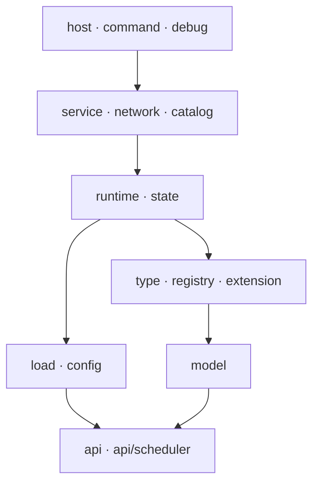

# 包职责

## TL;DR

- 一级包只有 `common/core`、`common/platform`、`common/client` 与两端平台源集；依赖朝 `core/api` 与 `core/model` 收口，越靠上的包才能引用越靠下的包。
- `core/load` 只依赖 `core/api`，模型经 `RuleDecoder` 注入；`core/state` 与 `platform/services` 之间存在类型级互引，运行时状态仍由 `core/runtime` 单向持有。
- `core/service` 是跨模块包：加载装配归 [rule-loading](../modules/rule-loading.md)，编辑会话与落盘归 [authoring](../modules/authoring.md)。

## 适用对象

需要判断「这个类该放哪个包」、评审 import 方向，或改动包结构后要同步文档的开发者。方向性规则与例外清单见 [依赖规则](dependency-rules.md)。

## 一级包

| 一级包 | 职责 | 归属逻辑模块 |
|---|---|---|
| `common/core` | 服务端逻辑与两端共用契约：规则模型、类型系统、加载、运行时、编辑面、命令与调试 | 除 client 侧以外的全部模块 |
| `common/platform` | 平台能力接口与服务定位，两端适配只实现这里的契约 | [platform](../modules/platform.md) |
| `common/client` | 客户端工作区、编辑器界面与 UI kit | [client-editor](../modules/client-editor.md)、[ui-kit](../modules/ui-kit.md)、[client-ui](../modules/client-ui.md) |
| 根包 `Constants` | 模组标识与持久化实体标记（模组 id、检查锁标记、已转化标记） | [platform](../modules/platform.md) |
| `fabric/`、`neoforge/` | 平台源集：`runtime`（事件与生命周期）、`platform`（能力实现）、`network`（载荷注册）、`client`（客户端入口）、`mixin`；NeoForge 侧另有 `debug` 包 | [platform](../modules/platform.md) |

## core 的分层

图中只画主要方向，逐包的允许与禁止以下文为准；跨层的只读例外见 [依赖规则](dependency-rules.md)。

## core 二级包

### 契约与模型

- **`core/api`** — 跨模块共享的契约：条件求值与效果执行、类型注册与分发、`Issue` 收集、解码预算、规则字段常量、观测接缝、区块与标签查询。
  - 允许：JDK 与原版契约类型（`ResourceLocation`、`Codec` 等）、`core/api/scheduler`。
  - 禁止：依赖其它 `core` 包。契约是底层，被引用而不引用。
- **`core/api/scheduler`** — 调度契约：任务种类、取消原因、步进结果、tick 预算与统计快照。
  - 允许：JDK。
  - 禁止：依赖实现包。实现方在 `core/runtime/scheduler`，方向由实现指向契约。
- **`core/model`** — 规则的数据形态：`Rule` 与来源匹配、条件树、效果与候选结果、Codec 与语义校验。
  - 允许：`core/api`。
  - 禁止：依赖注册表、类型实现、加载与运行时。需要注册表的解码与校验能力由 `core/api` 的注入式契约承担。

### 类型系统

- **`core/registry`** — 类型注册表实现：注册、重复拒绝、冻结后不可变。
  - 允许：`core/api`。禁止：依赖具体类型实现。
- **`core/extension`** — 第三方扩展点：规则类型提供者、动态引用校验及其上下文。
  - 允许：`core/api`、`core/model`。禁止：依赖内置类型与加载链路。
- **`core/type`** — 内置条件与效果的落点，含 `condition`、`condition/eval`、`effect`、`effect/exec` 子包与类型注册表装配。
  - 允许：`core/api`（含 scheduler）、`core/model`、`core/registry`、`core/extension`；`core/runtime` 的区块存在性判定（`LoadedChunks`）；`core/state` 的实体状态查询（返还物生成处）。
  - 禁止：依赖 `core/service`、`core/network`、`core/command`。效果执行需要世界写入时通过调度器与 `core/api` 契约完成。

### 加载与配置

- **`core/load`** — 三层来源读取、按 id 合并、逐条解码入口；不持有模型知识。
  - 允许：`core/api`、原版资源管理接口。
  - 禁止：依赖 `core/model`、`core/runtime`、`core/service`。模型以 `RuleDecoder` 注入，加载结果候选索引由运行时构建。
- **`core/config`** — 服务端配置的读取、校验与默认值落盘。
  - 允许：`core/api`（问题收集与解码预算）。
  - 禁止：依赖 `core/service`、`core/network`、客户端包。

### 运行时

- **`core/runtime`** — 运行时聚合：规则索引、掉落物追踪与触发、表达求值、结算与恢复、催化剂预留、出生点搜索、共享调度器。
  - 允许：`core/api`（含 scheduler）、`core/config`、`core/load`、`core/model`、`core/state`、`core/type`；`core/service` 的内置类型注册表装配类型（`BuiltinTypeRegistries`）。
  - 禁止：依赖 `core/command`、`core/debug`、`core/network`、客户端包。命令与调试是运行时的使用方。
- **`core/runtime/scheduler`** — 调度器实现：单实例、每 tick 推进一次、时间软预算与工作量上限、维度级队列与统计。
  - 允许：`core/api/scheduler`。禁止：依赖规则模型与加载。调度器不认识规则，只认识任务。
- **`core/state`** — 挂在实体上的运行期状态：临时保护、临时冷却、永久保护、永久禁转与伤害分类。
  - 允许：`core/model`（消失方式分类）、`platform/services`（实体状态读写）。
  - 禁止：依赖 `core/runtime`、`core/service`、客户端包。状态存储不含转化决策。

### 编辑、命令与调试

- **`core/service`** — 跨模块包，见下节。
- **`core/network/protocol`** — 双端共享的协议 DTO：目录、快照、来源视图、变更集、保存进度与状态。
  - 允许：`core/api`。禁止：依赖 `core/service`、`core/runtime` 与客户端包；DTO 只承载数据。
- **`core/network/transport`** — 载荷定义、分片与累加、协议版本常量、服务端转发入口。
  - 允许：`core/api`（含 scheduler）、`core/load`、`core/model`、`core/network/protocol`、`core/runtime` 的只读索引类型、`core/service`。
  - 禁止：依赖界面层与客户端包；界面通过注册槽注入。
- **`core/network/catalog`** — 目录分页与过滤的服务端实现。
  - 允许：`core/catalog`、`core/network/protocol`、`core/network/transport`。
  - 禁止：依赖 `core/runtime` 的内部状态。
- **`core/catalog`** — 候选目录来源：注册表、标签与规则来源，统一为只读目录视图。
  - 允许：`core/network/protocol` 的只读目录条目与类别类型。
  - 禁止：依赖 `core/network/catalog`、`core/service`。
- **`core/command`** — `/idtw` 命令树、子分支与文本输出。
  - 允许：`core/api`、`core/config`、`core/load`、`core/model`、`core/network/protocol`、`core/network/transport`、`core/runtime`、`core/service`。
  - 禁止：依赖客户端包与界面层。
- **`core/debug`（`common/src/dev`）** — 调试档案、开发场景、管线与运行时观测实现；由 NeoForge 开发源集编译，发布产物只取 main。
  - 允许：`core/api`（含 scheduler）、`core/command`、`core/config`、`core/load`、`core/model`、`core/runtime`、`core/service`、`core/state`、`platform/Services`。
  - 禁止：依赖客户端包；观测实现只通过 `RuntimeObserver` 契约进入运行时。
- **`core/host`** — 一次存档生命周期的装配点：启动、数据包重载、停服、维度事件、编辑上下文与网络入口。
  - 允许：`core` 的其余包与 `platform/Services`。
  - 禁止：依赖客户端包与平台 loader 专有 API；两端差异经 `PlatformAdapter` 注入。

## `core/service` 的双重归属

同一包内按链路拆成两段，文档归属不同模块；两段通过装配入参（`RuleLoadContext`、`RuleSaveReloadContext`、`RuleEditServerContext`）协作，不互相持有全局状态，因此不产生新的模块依赖。

按链路归组，非类清单；两段的责任边界由链路决定，新类按所属链路归组。

| 链路段 | 归属模块 | 覆盖的职责面 |
|---|---|---|
| 加载装配 | [rule-loading](../modules/rule-loading.md) | 加载链路装配点（自身不做缓存、不做单例、不管生命周期）、加载依赖容器、动态引用校验、内置类型注册表装配 |
| 提交校验与基底快照 | [authoring](../modules/authoring.md) | 写入前的提交校验（网络保存与配置迁移共用）、保存期间的数据包基底只读快照与身份判定 |
| 会话与落盘 | [authoring](../modules/authoring.md) | 全局单会话状态机与覆盖层版本戳、编辑编排（校验 → 写盘 → 重载 → 回执）、覆盖层文件工作唯一所有者、逐 id 写入与回滚、保存续接任务 |
| 快照与限额 | [authoring](../modules/authoring.md) | 快照续接与装配、会话窗口/权限等级/协议限额常量 |

> 判断新类归属：只服务「读取与合并、解码、类型注册表装配」放进 rule-loading 段；涉及会话、写盘、快照、回执的放进 authoring 段。

## common/platform

- **`platform/Services`** — 服务定位器，向 `core` 暴露平台能力实例。
  - 允许：`platform/services`、`core/state`（接口签名以实体状态为参数）。
  - 禁止：依赖 `core/runtime`、`core/service` 等业务包。
- **`platform/services`** — 平台能力接口：实体层状态读写等原版行为差异面。
  - 允许：`core/state` 的状态类型。
  - 禁止：依赖客户端包与平台 loader 专有 API；实现放在两端源集。

两端源集的组织：`runtime` 注册事件与生命周期并把回调转给 `core/host`；`platform` 实现 `platform/services` 的接口；`network` 注册载荷；`client` 提供客户端入口与界面挂载；`mixin` 只做原版方法级介入并把决策交给 `core`；NeoForge 的 `src/probe` 提供[开发后端探针](../guides/backend-probes.md)入口和夹具。平台源集只做适配，业务判断留在 `core`。

## common/client

客户端侧的分层是单向的：`client/net` 面向协议，`client/edit` 组织编辑数据，`client/ui` 负责呈现与交互。

- **`client/net`** — 编辑会话的客户端镜像：打开请求、会话状态、分片缓冲、界面注册槽。
  - 允许：`core/api`、`core/model`、`core/network/protocol`、`core/service` 的限额常量、原版客户端类型。
  - 禁止：依赖 `client/edit` 与 `client/ui`。界面经 `EditorScreenHooks` 注册槽注入，由客户端入口接线。
- **`client/edit`** — 客户端工作区与编辑数据：草稿、撤销栈、字段描述符、类型编辑器注册表、条件树编解码与摘要。
  - 允许：`core/api`、`core/model`、`core/network/protocol`、`client/net`、`client/ui/kit` 的树编辑契约、`client/edit/draft`、原版客户端类型。
  - 禁止：依赖 `client/ui` 的宿主子包（`theme`、`widget`、`shared`、`screen`、`screen/form`）；不发起网络请求、不打开界面。
- **`client/edit/draft`** — 未应用的编辑草稿落盘、重启与断线恢复、冲突判定。
  - 允许：`core` 的公开类型与原版客户端类型。
  - 禁止：写服务端目录或覆盖层目录；格式损坏按跳过处理，不向界面抛异常。
- **`client/ui/kit`** — 声明式 UI kit：排版、控件与交互、样式注入、树编辑、输入捕获、数值策略、滑块、文本局部历史、焦点、导航、灯箱。
  - 允许：JDK、原版客户端类型与 kit 公开面内的白名单。
  - 禁止：依赖本模组其它包。kit 不认识规则、协议与主题，样式由宿主注入。
- **`client/ui/theme`** — 灰色像素主题与宿主主题入口。
  - 允许：原版客户端类型、`client/ui/kit`、`client/edit` 的命名空间常量。
  - 禁止：依赖 `core` 与平台 API。主题只管视觉，控件只管交互。
- **`client/ui/widget`** — 通用控件：输入框、列表、树视图、弹窗、按钮变体与条件图编辑。
  - 允许：`client/ui/kit`、`client/ui/theme`、`client/ui/shared`、`client/edit`。
  - 禁止：静态读取主题；主题由屏幕注入。
- **`client/ui/shared`** — 界面中立子包：目录图标、展示名称、字段到目录类型的映射、条件摘要格式化。
  - 允许：`client/edit`、`client/ui/kit`、`client/ui/theme`、`core/api`、`core/model`、`core/network/protocol`、原版客户端类型与 JDK。
  - 禁止：依赖 `client/ui/screen`、`client/ui/screen/form`、`client/ui/widget`，保证屏幕与表单都只向下依赖。
- **`client/ui/screen`** — 编辑器主屏：列表页、编辑页、结果页、保存遮罩与页面状态。
  - 允许：`client/edit`（含 `draft`）、`client/net`、`client/ui/kit`、`client/ui/theme`、`client/ui/widget`、`client/ui/shared`、`client/ui/screen/form`、`core` 的只读投影与限额常量。
  - 禁止：被 `screen/form`、`shared`、`widget`、`theme`、`kit` 反向依赖。
- **`client/ui/screen/form`** — 表单控件与叶子面板：行布局、控件注册、条件树面板、草稿写回。
  - 允许：`client/edit`、`client/net`、`client/ui/kit`、`client/ui/theme`、`client/ui/widget`、`client/ui/shared`。
  - 禁止：依赖 `client/ui/screen`；屏幕单向依赖表单，不反向。
- **`client/ui/prototype`** — 开发期验证界面，用于组合验证 kit、主题与控件。
  - 允许：`client/ui/kit`、`client/ui/theme`、`client/ui/widget`。
  - 约束：不注册快捷键；入口只能在服务端授权后、原子取得独占编辑锁时打开。

## 包职责的维护方式

- 新增包先归入一级包，再决定二级归属；跨模块协作优先落在 `core/api` 契约上。
- `package-info` 覆盖客户端侧的 `client/edit`、`client/edit/draft`、`client/ui/kit`、`client/ui/widget`、`client/ui/shared`、`client/ui/theme`、`client/ui/prototype`；`core` 侧的包职责以本文与源码为准。
- 移动类或改包名时，同步本文与 [模块地图](module-map.md)，并运行 `tools/check-docs.py`；涉及跨端与 UI kit 的改动再运行对应脚本，见 [依赖规则](dependency-rules.md)。

## 相关文档

- [架构总览](overview.md)
- [模块地图](module-map.md)
- [依赖规则](dependency-rules.md)
- [关键链路](key-flows.md)
- [模块文档索引](../modules/README.md)
- [文档体系](../README.md)
