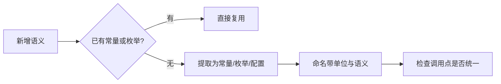

# 代码风格：注释、命名与魔法值

## TL;DR

- 注释解释设计原因与业务边界；公开类型的注释负责写清契约，实现细节交给代码本身。
- 命名要让单位、量纲与线缆取值一目了然，同一语义只用一个名字。
- 魔法值按业务语义判断是否提取；优先复用项目已有的常量、枚举与配置。

## 适用对象

新增或修改 Java 源码、评审他人改动、或决定某个字面量该不该提取的开发者。

## 注释

### 该写的注释

- 公开类型的契约：职责边界、参数含义、返回值条件、抛异常的条件、线程与时序约束。
- 设计原因：为什么这样拆分、为什么选这个顺序、为什么需要延后或原子处理。
- 业务边界：取值范围、单位、换算关系、与其他配置的耦合。
- 非直观实现：位运算、状态机、并发竞争点、跨线程交接、补偿与回滚。

### 不该写的注释

**避免过度注释**

- 复述代码行为的注释，例如给一个自解释的赋值再写一句同样的中文。
- 修改历史、日期、版本注记与个人署名。
- 指向 Markdown 文档的路径：文档会迁移，注释会随代码走，两者各自维护。
- 已经过期但未同步的说明；改代码时同步改注释，留旧说明比不写更糟。

注释用中文，技术名词保留英文。

## Javadoc

新增或修改公开 class、interface、enum、method 时补 Javadoc，用它写契约而不是写实现：

- 类型级：这个类型在体系里扮演什么角色、谁负责创建与销毁、是否线程安全。
- 方法级：参数的业务含义与合法范围、返回值的语义（特别是有多种空值或状态时）、可能抛出的异常及其触发条件。
- 标签只在有内容时写；参数、返回值或异常不存在时省略对应标签，不留空标签凑格式。

内部实现类与私有方法以普通注释说明设计原因即可，不强制 Javadoc。

## 命名

| 对象 | 口径 |
|---|---|
| 类型与接口 | 大驼峰，名词或名词短语；实现类不靠 Impl 后缀区分职责 |
| 方法与字段 | 小驼峰，动词短语表示动作，名词短语表示状态 |
| 常量 | 全大写加下划线；同一基准派生的量用单位后缀区分（tick、纳秒、字节、秒、微秒、字符数各自有既定后缀） |
| 包 | 全小写，按层与职责划分，不在包名里塞平台名 |
| JSON 键 | 小写下划线，集中在字段名常量类里维护 |

线缆取值（状态码、动作、目录类型等）用枚举承载，并成对提供「取值字符串」与「由字符串解析」两个入口，未知取值解析为空值而不是抛异常。新增取值时同步检查客户端分支与语言文件。

面向玩家的文案一律用本地化 key，key 按域分层并以模组 id 标注归属；由枚举名推导的 key 保持推导规则唯一，避免同一状态出现两个 key。

## 魔法值

判断是否提取字面量时看四件事：

1. 是否表达业务含义：换算基数、协议限额、状态时长这类值必须命名；单纯的下标与循环起点留在原地。
2. 是否跨处共享：同一数值出现在多个位置时提取，避免只改一处。
3. 单位是否不直观：以 tick、字节、微秒为单位的裸数字要带单位命名或换算方法。
4. 是否属于格式契约：JSON 键名、文案 key、路径片段这类跨版本稳定的字符串集中维护。

已有常量、枚举或配置能表达同一语义时优先复用，不要另造一份并行定义。提取后保持原有行为与对外接口不变。

## 复核

- 结构与边界：用 `tools/check-isolation.py`、`tools/check-ui-kit-boundaries.ps1` 做机械校验。
- 文案：用 `tools/check-i18n.py` 校验语言文件同步。
- 编译与构建：走仓库根目录的构建流程，构建通过后再实机验证。
- 文档改动：用 `tools/check-docs.py` 校验链接与路径。

## 相关文档

- [文档体系](../README.md)
- [依赖规则](../architecture/dependency-rules.md)
- [平台模块](../modules/platform.md)
- [规则模型模块](../modules/rule-model.md)
