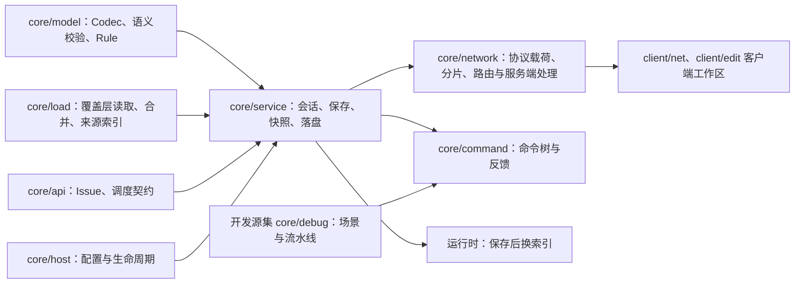
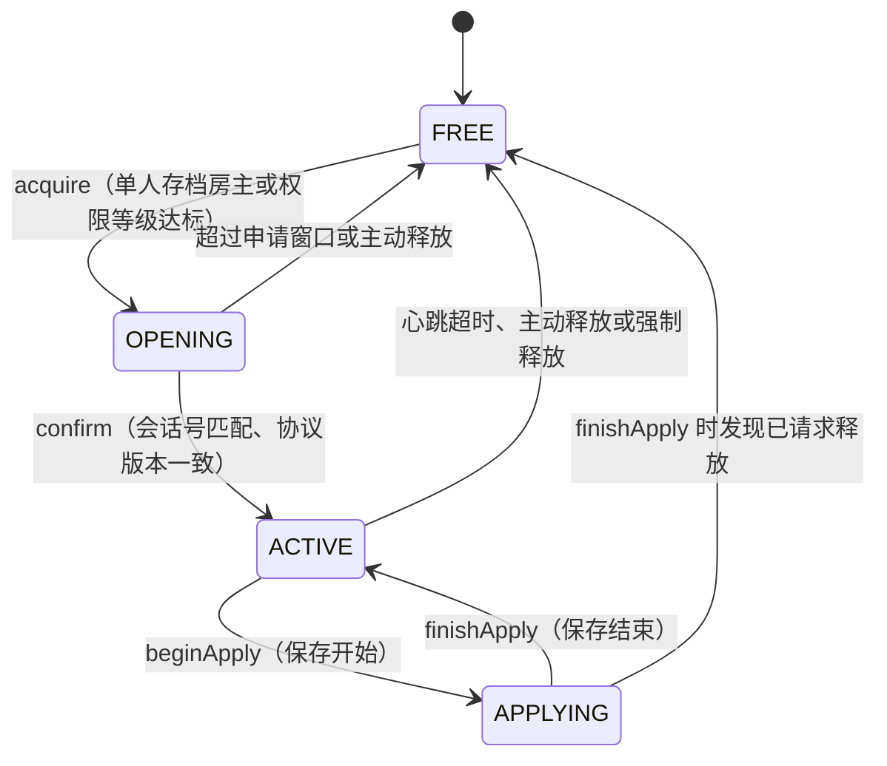
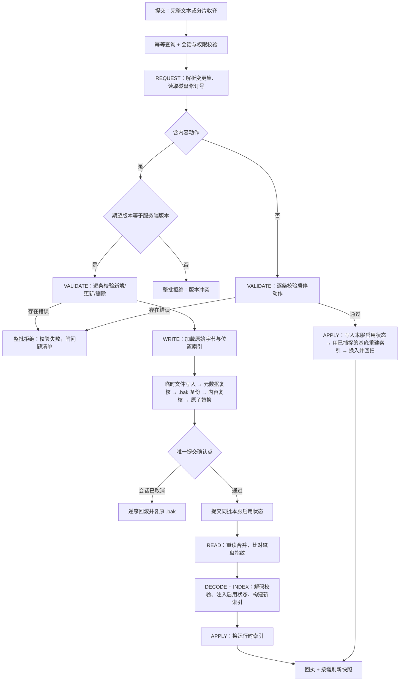

# 编辑器与作者链路

> **TL;DR**
> - 候选目录只回答“能选什么”，编辑链路负责“怎么安全地改”：同一时刻只有一个编辑会话持有规则目标。
> - 服务端权威 + 乐观并发：版本戳对不上就整批拒绝；写入走临时文件、唯一提交确认点与逆序回滚。
> - 命令根节点不统一鉴权，权限落在各子分支；调试场景与流水线只在开发环境挂载，复用真实运行时链路。

**适用对象**：改动编辑协议载荷与限额、排查“保存失败 / 锁被占用 / 保存后规则没生效”、扩展候选类别、调整命令权限、编写开发期场景与流水线的开发者。

## 1. 模块职责

一句话边界：在独占编辑会话内，把客户端提交的整批规则变更校验成合法覆盖层文件与本服启用状态，再重建索引并重载进运行时。

本模块承担：

- 候选目录：按类别给出可选目标的全量视图与修订号，供客户端列表分页、过滤。
- 编辑会话与目标锁：单目标全局唯一的会话状态机、租约与心跳、强制释放。
- 快照：把生效规则装配成客户端可编辑的载荷并按限额分片下发。
- 变更集：接收完整文本或分片、幂等回放、版本戳比对。
- 落盘：逐条校验、临时文件写入、原子替换、失败逆序回滚与备份复原。
- 本服启用状态：按存档保存每个 id 的启停覆盖，保存与命令共用同一应用入口。
- 保存后一致性：重读、解码、注入启用状态、重建索引并把新索引交给运行时，随后回扫；版本戳只在内容成功写盘时推进。
- 命令面与权限口径：`/idtw` 命令树的组装、分区鉴权与统一反馈出口。
- 开发调试：声明文件驱动的场景与流水线，复用真实链路并输出可对比的观测。

规则数据形态与编解码属于 `core/model`（见 [rule-model](rule-model.md)），来源读取与合并属于 `core/load`（见 [rule-loading](rule-loading.md)）；本模块只编排它们并决定“什么时候写、写哪些、失败怎么办”。

## 2. 模块边界

### 对外入口

- 网络入口：`RuleEditPayloadRouter` 按载荷类型路由到 `RuleEditServerHandler`；后者是按覆盖层根目录缓存的薄转发层，并在每 tick 投递 `pollSaveProgress`、`pollSave`、`pollSnapshot`，由 `expireIdle` 回收超时会话。
- 命令入口：`RuleCommandTree.register()` 注册 `idtw` 根节点，`config` 与 `rule` 子树常驻，`debug` 子树在开发环境挂载。
- 服务端服务：`RuleEditService` 只产出不可变的下发载荷列表，网络层负责发送；`EditSessionManager` 持有会话；`RuleOverlayStore` 承载后台文件调用与磁盘修订指纹。
- 目录入口：`RuleCatalogService` 的分页查询与失效，数据来自 `RuleCatalogSources`。
- 落盘入口：`RuleOverlayWriter.apply(...)`，由 `RuleSaveTask` 编排调用；启用状态入口：`RuleEnableApplyService`，保存与命令共用。
- 调试入口：`RuleDebugCommands`，背后是 `DebugScenarioManager`、`DebugPipelineManager` 与场景、流水线各自的声明目录。

### 依赖方向

### 被谁依赖

- 客户端编辑器：经 `core/network/protocol` 的载荷与服务端交互，客户端工作区见 [client-editor](client-editor.md)。
- 平台层：注册网络与命令、把 tick 事件转给本模块的轮询入口、在玩家断开时清理会话与分片。
- 加载与装配层：保存成功后调用运行时换索引入口，新索引对后续加载与查询立即生效。

## 3. 关键类地图

仅列对外入口、扩展点、聚合根与并发/事务敏感类，非穷举。

| 类型（`core/catalog`、`core/network`、`core/service`、`core/command`、`core/debug` 下） | 角色 | 职责 | 协作对象 |
|---|---|---|---|
| `RuleEditServerHandler` | 入口门面 | 按覆盖层根目录缓存会话管理器与服务；逐包转发；`canEdit` 与就绪判定；每 tick 轮询与超时回收 | `RuleEditService`、`EditSessionManager`、`RuleEditServerContext` |
| `RuleEditService` | 应用服务 | 会话持有者校验、幂等回放、分片收齐判定、构造保存任务、组装回执、按需安排新快照；只产出待下发载荷 | `EditSessionManager`、`RuleSaveTask`、`RuleSnapshotTask`、`RuleCatalogService` |
| `EditSessionManager` / `RuleEditSessionLimits` | 目标锁 | 单目标全局唯一会话的状态机；租约、心跳与申请窗口以服务端活动 tick 计时；版本戳读写委托覆盖层存储 | `RuleOverlayStore`、`RuleEditService` |
| `RuleOverlayStore` | 文件侧并发边界 | 后台文件调用队列、磁盘修订指纹、覆盖层根目录就绪与停滞检测 | `RuleOverlayWriter`、`RuleSaveTask`、`RuleSnapshotTask` |
| `RuleOverlayWriter` | 原子落盘 | 加载原始字节、按规则 id 建位置索引、临时文件写入、元数据与内容两段复核、`.bak` 备份、原子替换与唯一提交确认点、失败逆序回滚 | `RuleSaveTask`、`RuleOverlayStore` |
| `RuleSaveTask` | 保存编排 | 续接任务：请求、校验、写入、提交启用状态、重读、解码、建索引、应用；纯启停批次走校验后直达索引重建的轻量路径；每步受预算与会话有效性约束，取消与失效给出确定终态 | `RuleSubmissionValidator`、`RuleOverlayWriter`、`RuleEnableApplyService`、`RuleIndex`、运行时换索引 |
| `RuleEnableApplyService` | 启用状态应用 | 提交同批启停动作、按已捕捉的基底重建索引、安排回扫；内容与状态都不变时回答无变化 | `RuleEnableState`、`RuleLoadingService`、`RuleIndex`、运行时换索引 |
| `RuleSnapshotTask` / `RuleSnapshotAssembler` | 快照 | 后台读盘与合并、逐条解码与编码、装配生效视图与来源分层索引、按字节阈值直发或分片 | `RuleEditService`、`RuleSourceIndex` |
| `RuleEditChunkAccumulator` / `RuleEditLimits` | 分片与限额 | 按玩家与传输号重组分片、UTF-8 字节计量、重复下标以首片为准、空闲过期与在途数量上限 | `RuleEditService` |
| `RuleCatalogSources` / `RuleCatalogService` | 候选目录 | 数据源给出全量与修订号；服务做大小写不敏感过滤、分页与按“类别 + 修订号”缓存 | `RuleCatalogType`、客户端列表、保存后失效 |
| `RuleCommandTree`（含 config / rule 命令组） | 命令面 | 组装根树、把权限下放到子分支、统一本地化反馈出口 | `RuleEditServerHandler`、`RuleSnapshotAssembler` |
| `RuleDebugCommands` / `DebugScenarioManager` / `DebugPipelineManager` | 调试 | 开发环境场景与流水线的启动、推进、收尾；声明目录是唯一注册来源；复用正式编解码与真实运行时 | `RuleRuntimeHost` 观测钩子 |

## 4. 关键流程

### 4.1 候选目录

数据源与传输分段：`RuleCatalogSource` 只暴露 `type()`、`revision()` 与 `all()`，一次性给出该类别全量条目与内容修订号；分页、过滤在 `RuleCatalogService` 完成，按“类别 + 修订号”缓存该修订下的全量候选，分页时再从缓存切片，修订号变化时读取时就地重建。

- 修订号必须与条目顺序无关：内容不变则值不变，内容变化必须变；条目顺序调整不改变修订号。
- 条目的展示信息由 `RuleCatalogEntry` 承载；图标仅对物品与方块有值，其余走客户端缺省渲染。
- 缓存归属当前服务端实例，换服整体清空；`invalidate` 只在保存真正写出后调用。
- 过滤是大小写不敏感的子串匹配，命中标识、展示名或副标题任一即可；页码越界夹到最后一页，页大小越界按协议上限截断。

### 4.2 编辑会话与目标锁

- 全局唯一：同一时刻至多一个非空闲会话，目标是覆盖层规则目录的固定标识；取锁失败也下发打开载荷，携带持有者信息供客户端提示。
- 时钟：租约、申请窗口、心跳间隔与传输超时一律按服务端活动 tick 计，单机暂停时不流逝；时间常量集中在 `RuleEditSessionLimits`。
- 会话建立前检查覆盖层存储空闲，确保上一轮生命周期没有遗留文件工作。
- 保存期间释放请求被延后到保存结束，避免锁与写盘交错；强制释放会同时失效在途保存并把会话过期回执发给原持有者。
- 版本戳持久化在覆盖层根目录的版本文件里，不是规则文件后缀，规则读取器不会把它当规则扫描。

### 4.3 快照、变更集与版本戳

快照装配分线程：服务端线程按步解码与编码，后台线程读盘与合并、装配 JSON 与切分，交付时每 tick 只发固定包数；请求只保留最新一个，保存期间暂缓下发，空包按快照失败处理。快照随载荷附带来源分层索引，来源视图直接读它，避免为单条规则再读一次磁盘。

变更集是“期望版本 + 编辑列表”的协议对象：版本戳是客户端视图对应服务端版本；编辑列表按规则标识给出内容动作（`upsert` / `delete`）或启停动作（`enable` / `disable` / `reset`），动作形态见 [docs/api/edit-protocol.md](../api/edit-protocol.md)。同一 id 可以同时带两类动作，两类改动在同一次提交里生效。提交路径有两条：完整文本直发，或按字节切分后由 `RuleEditChunkAccumulator` 重组；收齐后走同一条提交入口。

启停状态按存档保存：`RuleEnableState` 以 SavedData 形式挂在主世界数据存储上，按 id 记录布尔覆盖，没有记录的 id 继承规则默认启用；恢复默认即摘除记录。保存写盘成功后立即提交同批启停动作，再走重读与索引重建；内容没有实际改动、只有状态变化时同样重建索引并回扫。

存档里保留、但合并结果中已不存在的 id 在应用时被忽略，记录作为孤儿保留；`/idtw rule orphans` 查看、`/idtw rule orphans clear` 清理。

- **幂等**：同一会话内以操作标识回放结果，重复提交不再二次落盘；幂等表按会话整体失效。
- **版本戳推进**：成功保存与成功重载都推进版本；快照装配与保存重读前后都比对磁盘指纹，中途变化即判失败而不是覆盖别人的改动。
- **在途互斥**：已有保存在进行时，同一操作回空结果、不同操作按协议拒绝。
- **会话边界**：所有入口先校验会话号与持有者，会话失效或无权限的请求在触达文件系统前就被拒绝。
- **条数限额**：变更集解析与覆盖层写入入口共同校验 `RuleEditLimits.MAX_EDITS_PER_CHANGE_SET`，单次最多 2048 条编辑。
- **保存终态**：保存任务决定写盘与重载结果；结束时的会话释放只清锁归属，回执保留任务终态。

协议载荷字段、分片阈值、超时与幂等语义的权威描述见 [docs/api/edit-protocol.md](../api/edit-protocol.md)。

### 4.4 原子落盘与回执分支

回执按失败发生的阶段分层，逐状态语义与文案 key 规则见 [docs/api/errors.md](../api/errors.md)：

- **未进入写盘的拒绝**：权限、锁归属、版本戳、提交校验任一项不通过即整批拒绝，磁盘保持原样。
- **写盘结果**：成功、无实际变更、取消，以及写入失败；写入失败时若逆序回滚也失败，存储标记为需要恢复，回执提示用 `.bak` 恢复。内容无改动但启用状态有变化时按成功回执，并重建索引与回扫。
- **已落盘但运行时未跟上**：规则文件已是新内容而重载或索引替换失败，此时不谎报成功，版本戳照常推进，并标记运行时需要重载。

实现约束：提交确认点只有一处，取消与回滚都以它为界；撤销顺序是逆序逐个用原始字节写回，新增文件直接删除；目标路径必须在覆盖层根目录内，含非法路径段或符号链接祖先的目标直接拒绝。

### 4.5 命令权限口径

- 根节点不统一鉴权：编辑锁状态查询对所有玩家开放，权限下放到各子分支，避免“查看”也被权限挡住。
- 编辑与写操作沿用同一口径：单人存档房主直接放行，其余执行者按权限等级判定；命令与网络层 `canEdit` 共用 `RuleEditPermissions`，开放局域网后的访客按权限等级判定。
- 编辑命令要求玩家实体：先判权限再取锁，取锁失败时回显持有者；强制释放需要编辑权限等级，原持有者在线时收到会话过期回执；会话处于在途保存时，改由保存收尾的终态回执携带。
- 读取、重载、启停与孤儿清理子命令在保存进行中回“保存忙碌”，避开文件替换窗口；启停与孤儿清理在应用成功后安排回扫，运行时未就绪时明确回答未应用。
- 反馈统一走命令层的本地化出口：成功与失败都按语言 key 组装，缺省参数带裁剪上限。

### 4.6 调试场景与流水线

- 实现与资源位于 `common/src/dev`，由 NeoForge `src/probe` 装配并追加开发命令；发布物只使用 main。自动运行和精选链路见[后端探针](../guides/backend-probes.md)。手动命令要求开发环境和编辑权限；场景与流水线的字面量命令由声明目录生成，命令树不硬编码。
- 声明文件是唯一注册来源：场景清单声明运行参数、初始布置、动作、故障与预期；流水线清单描述阶段、数量与轮次。字段按严格白名单解析，未知字段、越界值与重复登记直接报错。
- 场景规则用正式编解码与语义校验构建独立索引，变量替换只支持固定数值；产物实体与用户规则链路隔离，避免互相干扰。
- 场景每服务器至多一轮，启动前校验开发环境、运行时就绪与无进行中场景；自动后端入口使用固定位置，手动流水线使用玩家位置；维度卸载与异常都会收尾并记录原因，停止记为未完成。
- 流水线启动前校验 tick 速率、场景入口占用与残留夹具，运行中玩家离开、维度变化或 tick 速率变化即中止；每个阶段按真实场景结果决定继续或判失败。
- 观测走调试探针与运行时观测入口，输出含平台、版本、机器信息、预期与实际指标，便于横向对比。
- 故障注入是场景声明的一部分：`faults` 条目按故障类型、任务分类、追踪名或效果类型选中真实链路中的任务，在步骤执行、取消回调、效果准备或规则重载应用阶段抛出受控异常。故障只在调试包实现并挂在运行时观测接缝上，未启用调试时生产路径不加载、不分支、不引用。
- 故障事件进场景日志：`FAULT_ARMED` 记录生效的声明，`FAULT_STEP_EXCEPTION` / `FAULT_CANCEL_EXCEPTION` / `FAULT_PREPARE_EXCEPTION` / `FAULT_RELOAD_FAILURE` 记录每次注入，收尾时未命中的声明记 `FAULT_UNUSED`；预期里用 `events/<事件名>` 断言事件次数，用 `faults_declared` / `faults_injected` / `faults_remaining` 断言注入账目。
- 场景指标覆盖回扫一致性：`tracked_source_items` 是本轮源中仍被运行时追踪的数量，`rescan_pending` 表示结束时是否仍有分步回扫在推进，`rescan_steps` 是最近一轮回扫已执行的分步数；配合既有的 `scheduler_max_step_work_units` 等预算指标，可断言回扫按有界步推进、让出后继续，且最终追踪数量与实体数量一致。
- 场景指标覆盖取消清理：`cancelled_rule_reload` / `cancelled_dimension_unload` / `cancelled_server_stop` 是按原因分类的取消计数，`scheduler_cancelled_total` 是总数，`scheduler_max_cancelled_in_tick` 是单 tick 取消峰值（与 `cancels_per_step` 对照），`scheduler_pending` 表示结束时调度器仍有待推进任务；`run/cancel_budget` 据此断言重载取消逐槽推进、单 tick 取消有上限，且回扫重建后全部源按规则转化、无物品丢失。
- 性能场景默认只允许普通源准备；重载风暴类场景额外允许 `reload` 动作，用来验证重载期间的回扫不会退化成单 tick 全量遍历。其它动作、故障注入与催化剂夹具仍会被拒绝，避免污染负载口径。

## 5. 扩展点与约束

### 扩展点

- **新增候选类别**：在 `RuleCatalogType` 加常量 → 在 `RuleCatalogSources` 增加对应数据源（实现 `type()`、`revision()`、`all()`）→ 客户端列表按类别渲染，图标缺省走客户端占位。修订号必须满足“内容不变则值不变、与顺序无关”。
- **新增协议载荷**：在 `core/network/protocol` 定义载荷 → 在 `RuleEditPayloadRouter` 注册路由 → 在 `RuleEditService` 加服务端处理并复用会话校验与回执组装 → 客户端工作区对接。
- **新增保存前校验**：写进 `RuleSubmissionValidator`，逐条产出带字段路径的 Issue；结构档、类型参数档与运行期上限档三档校验仍由 `core/model` 提供。
- **新增限额**：网络与后台任务限额加到 `RuleEditLimits`，会话时钟与权限加到 `RuleEditSessionLimits`；两者分别是“字节与条数”和“tick 与权限”的单一落点。
- **新增调试场景或流水线**：只在声明目录里加清单与步骤文件，不改命令树；需要新动作类型时同步动作枚举与推进逻辑。新增故障类型时同步故障枚举与注入点，注入点只能落在运行时观测接缝（判定、排期与取消回调、效果准备、重载应用阶段），生产实现保持空操作。
- **保存后的运行时衔接**：换索引的入口由装配层提供，本模块只负责在重载成功且会话仍有效时调用。

### 约束

- 服务端权威：客户端提交的整批变更要么全部通过，要么整批拒绝，磁盘不出现半批结果。
- 目标锁全局唯一：同一时刻只有持有者能改规则目录，锁与写盘不交错。
- 时间一律服务端活动 tick，暂停不流逝；会话、分片与在途请求共用同一时钟。
- 版本戳只在成功保存与成功重载时推进；含内容动作的批次比较失败即整批拒绝，避免覆盖他人改动。
- 启用状态按存档保存，与规则内容分离：启停不写规则文件，也不推进内容修订号。
- 落盘只经 `RuleOverlayWriter`，提交确认点唯一，失败逆序回滚并以 `.bak` 兜底；回滚失败要显式标记需要恢复。
- 路径安全：目标必须在覆盖层根目录下，非法路径段与符号链接祖先直接拒绝。
- 后台文件调用统一走覆盖层存储的队列，服务端主线程只做按步推进与载荷组装。
- 命令层不直接写文件，全部经既有服务能力；反馈统一本地化出口，不在命令里拼接裸字符串。
- 调试入口只在开发环境挂载，场景与流水线复用正式编解码与真实运行时。

### 改动后的验证

先做 IDE 工作区检查，再执行 `tools/dsh-build.ps1 -Tasks build`，最后实机验证：取锁与占用提示、保存成功后的即时生效、版本冲突与校验失败的回执、取消保存与断开连接后的清理。改动限额或分片逻辑时同时验证大变更集与在途超时；文档链接改动后跑 `python tools/check-docs.py`。

## 6. 数据与配置引用

- 编辑协议载荷、分片、幂等与版本戳：[docs/api/edit-protocol.md](../api/edit-protocol.md)。
- 回执状态语义与文案 key 规则：[docs/api/errors.md](../api/errors.md)。
- 规则 JSON 形状与 `enabled` 默认启用语义：[docs/api/rule-json.md](../api/rule-json.md)。
- 覆盖层目录、超时与限额等运行参数：[docs/ops/configuration.md](../ops/configuration.md)。
- 保存失败与锁被占用的排查步骤：[docs/ops/troubleshooting.md](../ops/troubleshooting.md)。

## 相关文档

- 规则模型与校验：[rule-model](rule-model.md)
- 来源读取与合并：[rule-loading](rule-loading.md)
- 契约层：[core-contract](core-contract.md)
- 客户端工作区与草稿：[client-editor](client-editor.md)
- 保存后换索引的运行时：[conversion-runtime](conversion-runtime.md)
- 平台接入与生命周期：[platform](platform.md)
- 模块索引：[modules](README.md)
- 决策：[ADR-0019](../adr/0019-exclusive-edit-session-and-target-lock.md)、[ADR-0020](../adr/0020-source-catalog-and-overlay-merge.md)、[ADR-0036](../adr/0036-dynamic-reference-check-extension-point.md)、[ADR-0037](../adr/0037-cross-save-job-registration-isolation.md)、[ADR-0040](../adr/0040-on-demand-snapshot-source-views.md)
