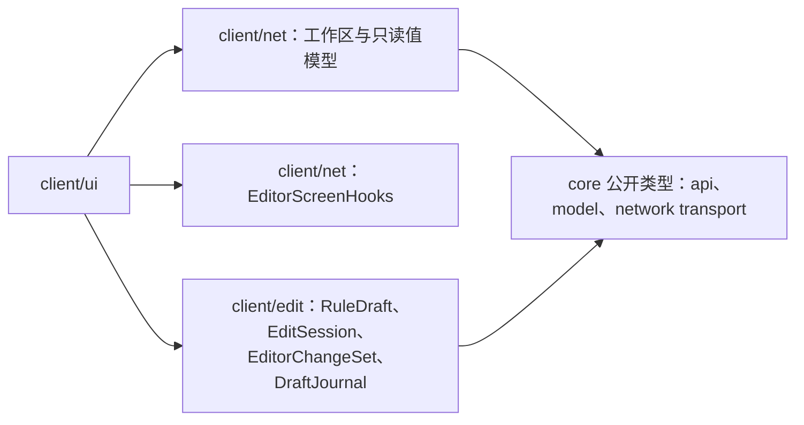
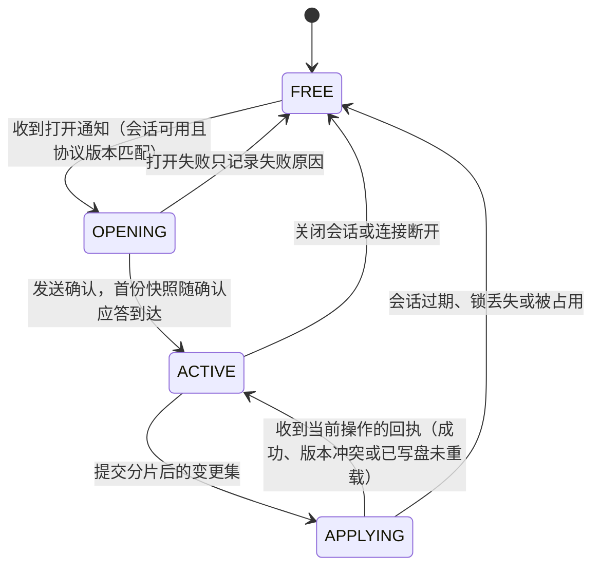
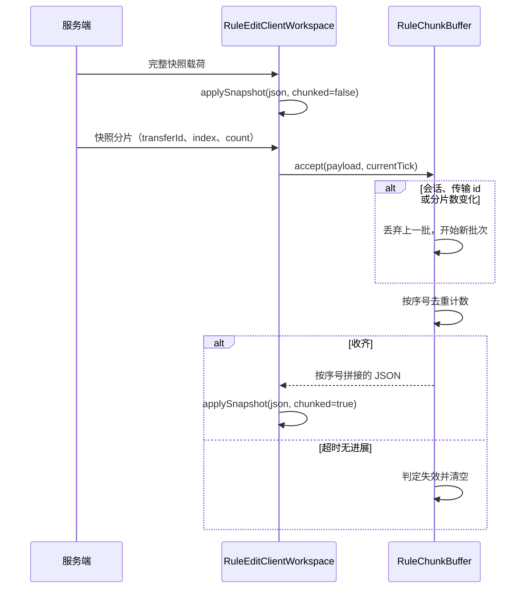
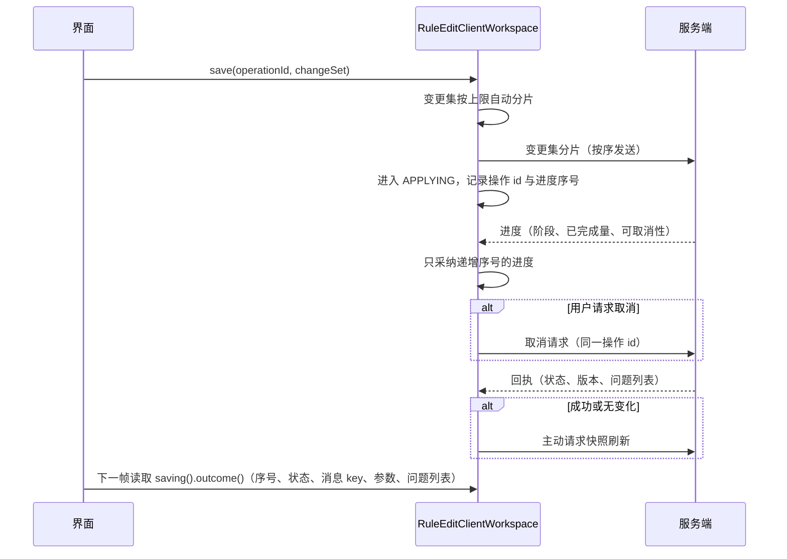
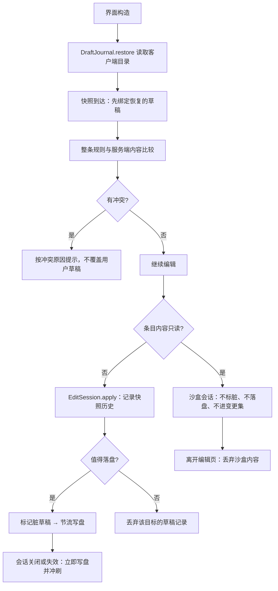

# 客户端编辑工作区

> **TL;DR**
> - `client/net` 镜像服务端的编辑状态机：确认会话、心跳、接收快照与目录、提交分片化的变更集、收敛保存回执。
> - `client/edit` 只组织客户端数据：JSON 是草稿的唯一事实来源，撤销历史按操作前后的草稿快照记录，未提交的内容与启停意图落盘到客户端目录。
> - 只读条目的内容在沙盒会话里改：控件与撤销照常可用，内容不落盘、不进变更集，离开编辑页即丢弃；启停意图不受这条约束，照常提交。

**适用对象**：调整编辑协议客户端行为、新增类型编辑器、修改草稿持久化或撤销语义的开发者。载荷字段、分片规则与回执语义见 [编辑协议](../api/edit-protocol.md)，服务端侧的会话与落盘见 [编辑与落盘](authoring.md)。

## 1. 模块职责

一句话边界：把服务端的编辑会话投影成界面可用的只读视图，并保管“尚未提交的编辑”（草稿、启停意图、撤销历史、落盘恢复）。

- **协议工作区** `RuleEditClientWorkspace`：持有连接、快照、参考寿命与跨状态编排。`SessionLease` 独占会话身份、阶段与心跳，`SaveTicket` 独占保存关联、递增进度、取消标记与终态；`SourceViewRequests` 管理来源 LRU，`CatalogDirectory` 管理目录分页，两者共用 `PendingRequest` 的身份与期限机制。
- **分片接收** `RuleChunkBuffer`：快照与来源视图共用同一套重组逻辑，同一时刻只保留最近一批分片。
- **草稿** `RuleDraft` 与 `DraftPaths`：以 JSON 为唯一事实来源的规则草稿，支持路径级读写、条件树编解码，以及 flat effects 与 candidate outcomes 之间的原子转换；删除意图不写进工作副本，组装变更集时转成 `delete` 动作。
- **撤销与重做** `EditSession`：`root/valueAt` 提供只读实时值，`snapshot` 提供独立快照；活草稿仅在 `apply(opKey, edits -> ...)` 回调中提供，每次编辑压成一条历史记录，恢复快照的同时恢复未完成的文本输入。会话本身不区分只读：只读条目的内容同样可改，改动只存在于当前界面生命周期。
- **变更集** `EditorChangeSet`：按 id 收集内容动作与启停动作，两类分开去重，序列化成一份载荷提交；只读条目的内容动作不进来，启停动作照常进来。
- **类型编辑器** `TypeEditorRegistry` 与条件/效果的注册表：类型 id 到编辑描述符的映射，未注册类型获得只读回退描述。
- **草稿持久化** `DraftJournal`：接收 `DraftState`，决定保留或删除，捕获独立快照并维护保存基线，恢复时输出 `RestoredDraft`；`DraftConflicts` 负责纯冲突分类。包内 `DraftStore`、`DraftWriter`、`PersistedDraft` 负责文件、串行写入和磁盘格式，界面不装配它们。
- **只读约束** `RuleEditorModel#isReadOnly`：按快照条目的物理来源判定，只表示内容不可写。只读条目的内容在草稿日志与变更集组装两处被跳过，能不能启停与这条判定无关。
- **启停意图** `RuleEditorModel` 的意图表：按条目记录待应用的启停动作，并与快照里的本服覆盖、规则默认启用合成生效值（意图 ?? 本服覆盖 ?? 默认启用），供列表与编辑页读取。

编辑器界面的编排（列表、表单、页面模型）在 [界面模块](client-ui.md)，本模块只提供它使用的数据面。

## 2. 模块边界

### 对外入口

- **界面入口**：直接使用 `RuleEditClientWorkspace`。`session()` 返回 `EditorSessionView`，`saving()` 返回 `EditorSaveView` 与 `EditorSaveOutcome`，`directory(type)` / `sourceView(id)` 返回 `ResourceView<T>`；读取不发包、不推进结果序号，数据未变化时复用读模型。请求、刷新、重试、保存与关闭是显式动作。
- **界面注册**：`EditorScreenHooks.setOpener(EditorScreenOpener)`；工作区在会话建立时 `open(EditorOpenRequest)`，会话失效时 `close()`，opener 未注册只记日志。
- **平台接线**：`RuleEditClientWorkspace.instance()` 的 `installSender(PacketSender)` 由两端客户端初始化调用；`bindConnection` / `unbindConnection` 随连接事件绑定与解绑唯一接收对象。
- **编辑数据**：`RuleDraft`、`EditSession`、`RuleValue`、`ResultStructure`、`EditorChangeSet`、`DraftPaths`、`DraftJournal`，供界面模块组装草稿与变更集。
- **类型编辑器扩展**：`EditorRegistries.CONDITIONS.register`、`EditorRegistries.EFFECTS.register`，参数是 `TypeEditorDescriptor`。

### 依赖方向

界面同时使用 net 的工作区与 edit 的编辑数据；工作区读模型归 net，草稿与描述符归 edit。`client/net` 不引用 `client/ui` 与 `client/edit`，`core` 不反向引用客户端。契约层的复用边界见 [ADR-0029](../adr/0029-client-dependency-boundary-and-shared-subpackage.md)。

### 运行约束

- 工作区的方法都在客户端主线程调用，同步边界保留在聚合入口，内部所有者不另加锁；`tick()` 推进期限、暂停后的目录续页与心跳。
- 只有 `ACTIVE` 状态可以发起目录、来源视图、寿命、快照与保存请求；`APPLYING` 继续心跳，允许取消，接纳匹配进度、终态和已经在途的查询响应，目录新续页等回到 `ACTIVE` 再发。
- 网络帧与版本来自 `core/network`；只读编辑模型来自 `core/service/edit`，候选目录模型来自 `core/catalog`。网络回调捕捉连接 Binding，执行时核对连接仍有效且未被替换。

## 3. 关键类地图

仅列对外入口、扩展点、聚合根与并发/事务敏感类，非穷举。

| 类或包 | 角色 | 职责 | 协作对象 |
|---|---|---|---|
| `RuleEditClientWorkspace`（client/net） | 聚合根·并发敏感 | 会话状态机镜像、心跳、快照/目录/来源视图缓存、分片重组、变更集提交、回执收敛、连接断开即重置 | `RuleEditClientState`、`RuleChunkBuffer`、`RuleEditPayloadRouter`、`EditorScreenHooks` |
| `RuleEditClientState`（client/net） | 状态枚举 | 工作区对外可见的阶段；界面据此决定是否显示编辑控件与是否允许提交 | 界面层、工作区 |
| `RuleChunkBuffer`（client/net） | 分片重组 | 复用 `RuleChunkAssembly` 校验单片并判定批次身份与是否收齐；同一时刻只保留一批，超时无进展即作废 | 工作区、快照与来源视图 |
| `EditorSessionView` / `EditorSaveView` / `ResourceView`（client/net） | 只读值模型 | 会话、保存与资源状态；终态在接纳时一次转换为 `EditorSaveOutcome`，序号只随匹配回执递增 | 界面模块、状态所有者 |
| `EditorScreenHooks` / `EditorScreenOpener` / `EditorOpenRequest`（client/net） | 界面注册槽 | 会话建立与失效时通知界面；请求字段与服务端打开载荷一一对应 | 界面模块 |
| `EditSession`（client/edit） | 撤销聚合根 | 每次编辑压入快照历史，维护撤销与重做栈、脏标记与未完成输入；不区分只读条目 | `RuleDraft`、界面表单 |
| `RuleDraft`（client/edit） | 草稿聚合根 | 保存服务器基线、工作副本与删除标记；路径级读写与条件树、候选结构处理 | `DraftPaths`、条件编解码、界面表单 |
| `EditorChangeSet`（client/edit） | 变更集组装 | 按 id 收集内容动作与启停动作，分别去重后序列化成一份提交载荷 | `RuleEdit`、`RuleEditorModel` |
| `RuleValue` / `ResultStructure`（client/edit） | 只读值与结构语义 | 严格读取文本、布尔与文本列表；共用结果形状、路径判定、候选效果定位及条件宿主结构快照 | 会话、表单与摘要 |
| `DraftPaths`（client/edit） | 路径工具 | 草稿 JSON 的字段与数组路径解析、读写、删除；必要时创建中间容器 | `RuleDraft` |
| `TypeEditorRegistry` / `EditorRegistries`（client/edit） | 扩展点 | 类型 id 到编辑描述符的注册表；未注册类型返回只读回退描述 | 界面表单、内置类型表 |
| `ParamProjection`（client/edit） | 参数投影 | 把 core 的类型参数声明投影成 `EditorField` 列表：顺序与层级取自声明，标签 key 由类型 id 与字段名派生，窗口、单位、精度与枚举分组同样取自声明，不显示的参数跳过 | `BuiltinEditorDescriptors`、`TypeEditorDescriptor` |
| `EditorField`（client/edit） | 字段契约 | 描述字段名、标签 key、类型、值域、展示层级与编辑器元数据；以无 default 的枚举 switch 集中分类为形状、数值类别与引用能力；公开谓词回答列表、数值与标签等问题，调用方只问字段 | `ParamProjection`、界面表单控件 |
| `BuiltinEditorDescriptors` / `BuiltinEditorDefaults`（client/edit） | 描述符与新建初值 | 遍历本地已发现类型表按 `params()` 投影注册描述符，并为少数内置类型补说明行与半径窗口；新建条目按 `initialValues()` 写初值，条件与效果各查自己的默认值表 | `ClientTypeRegistries`、`ParamProjection`、`EditorRegistries` |
| `ClientTypeRegistries`（client/edit） | 客户端类型表 | 复用 `BuiltinTypeRegistries` 惰性装配内置与本地 SPI 类型，从 `core/type/BuiltinTypeRegistries` 取得冻结查询视图，条件表、效果表与条件 Codec 共用同一实例 | 注册表、条件编解码 |
| `DraftJournal`（client/edit/draft） | 草稿业务入口 | 决定保留或删除，持有保存基线、捕获快照、节流写盘、显式失败重试与一次性失败上报 | `DraftState`、`RestoredDraft`、包内存储实现 |
| `DraftConflicts` / `DraftConflict`（client/edit/draft） | 恢复规则 | 按目标存在性、创建意图与原始基线判定整条规则冲突 | `RestoredDraft`、界面模型 |

## 4. 关键流程

### 协议工作区状态机

状态迁移由服务端的打开通知、本地保存、服务端回执与连接或会话失效驱动。

- 打开失败（取锁失败、协议版本不一致、打开状态码非成功）不进入会话，只记录失败原因供界面提示。
- 保存回执分为“当前操作的回执”和“迟到的重复回执”：迟到回执直接忽略；会话事件独立按会话号处理，保存仍在途时先请求取消并等待其真实终态，再结束会话。
- 成功或“无变化”的回执不携带快照，客户端主动请求刷新；版本冲突与“已写盘未重载”随回执推送最新快照。
- 新增状态时改 `RuleEditClientState`，并同步界面判断“是否可编辑”的分支。

### 快照与分片接收

查询失败按种类、会话号与原请求号配对，只清理对应快照、目录、来源或寿命请求；其他在途请求继续保留。

来源视图使用独立实例复用同一套缓冲算法：请求带 `requestId`，响应按该 id 与在途请求配对，超时未回则标记失败并允许重试。快照修订号变化时清空来源视图与在途分片缓存，因为来源内容可能已被保存或数据包重载改写。来源缓存保留最近 8 条，请求期限 5 秒；目录请求期限 15 秒、每页 200 条，失败保留已到达的部分，手动重试继续加载。读取状态只查询，期限由 tick 推进；响应接纳前也核对期限。来源视图按需拉取的取舍见 [ADR-0040](../adr/0040-on-demand-snapshot-source-views.md)。

快照包装层（`root → entries[] → entry`）不占规则体的嵌套预算：`RuleDecodeBudget.parseEnvelope` 把包装层深度加进解码上限，避免深层规则体被包装层挤掉。解析失败时工作区记录失败原因并保留上一份快照，屏幕对同一份非法快照只弹一次常驻警告（`gui.itemdespawntowhat.edit.notice.snapshot_failed`），不自动重试；重新打开会话或结束会话时清空该状态。

### 保存往返

取消不提前结束 `APPLYING`、也不释放会话，最终以回执为准；服务端已进入不可取消阶段时，客户端把取消标记回退为未请求。

### 草稿、撤销与落盘

- 撤销的粒度是“一条编辑操作”：操作压栈前先取工作副本快照，只有 JSON 或删除标记确实变化才入栈，超过历史上限丢弃最旧记录，新操作清空重做栈。
- 未完成的文本输入单独缓存，撤销与重做在恢复快照的同时恢复对应的输入位置。`RuleValue` 是只读实时句柄，跨修订比较时取独立副本；字段、关联更新与分类跟随共用一次 `apply`，保留 mutationStamp 与输入 identity 语义。
- 冲突判定在整条规则粒度：目标是否仍在服务端、按新建保存时服务端是否已有同名目标、服务端内容是否仍等于草稿记录的基线；原因由 `DraftConflict.Reason` 表达，新增原因需同步 `messageSuffix` 与文案 key。
- 未决冲突保留磁盘记录的原始保存基线，恢复会话与重新暂存都沿用该基线；玩家选择保留草稿或成功应用后才推进。采用服务端版本删除对应草稿和关联启停意图。
- `DraftState` 携带主线程会话与意图状态；Journal 只读查询内容脏标记、删除标记与独立快照，只对需要保留的内容调用快照复制；基线捕获一次后复用。后台写入者只序列化独立快照，连续编辑按 2 秒节流，关闭时最多等待 1.5 秒。失败由显式动作重试，丢弃操作覆盖排队与失败记录。
- 关闭界面时若有未保存改动，弹窗提供「暂存到本地」「放弃」「取消」：暂存先合并当前表单输入并立即写盘，再结束会话并关屏；放弃删除本次载入的全部草稿文件；取消留在编辑页。

### 只读条目的沙盒会话

- 只读条目的内容与可写条目走同一套会话与撤销栈：控件可写，撤销与重做照常工作，改动只影响当前界面生命周期。
- 沙盒内容不写入草稿日志、不计入脏标记、不进入变更集，因此保存与应用按钮的可用状态只由可写内容与启停意图决定。
- 返回列表、切换编辑目标或关闭界面即丢弃沙盒内容；再次打开看到的是服务端内容。
- 快照刷新时按“是否已在改”分流：会话里已有未应用的内容改动就保留会话，否则静默回滚到新快照内容并清空历史；未应用的启停意图不受影响。
- 启停与复制对只读条目开放：启停走意图表，复制把沙盒内容转成新的覆盖层条目。删除仍只对内容可写的条目开放。

### 启停意图

- 意图取值是启用、停用、恢复默认三种动作，另有“无意图”。意图属于本服状态，与规则内容分开记录。
- 开关的目标值与默认启用相同时，客户端不留显式覆盖：服务端本来没有覆盖就直接摘除意图，已有覆盖则改为恢复默认。这样「回到继承默认」与「显式设成和默认相同的值」在界面上是两件事。
- 生效值 = 意图 ?? 快照里的本服覆盖 ?? 默认启用；列表状态、行置灰与基本信息分区开关都读这个合成值。
- 意图随草稿记录落盘（字段 `enable_intent`），重启客户端后恢复为待应用状态；快照刷新不清除意图，保存成功后清除。
- 只读条目的内容不进草稿记录，意图照常落盘，并计入脏标记与行内「待应用」状态；条目仍留在原分类分组。
- 组装变更集时内容动作与启停动作同批提交，服务端先写内容再落状态；复制为新规则时让副本的生效状态与源条目一致，副本默认值本来就相同时不留意图。

## 5. 扩展点与约束

### 新增类型编辑器

- 内置类型与客户端已安装的 SPI 类型共用参数投影入口（发现方式见[类型系统](type-system.md#第三方类型-spi)）；非空 `params()` 自动生成描述符、新建初值与省略字段的展示默认值，必填字段的新建预填由 `initialValue` 提供。
- 定制表单可在自动装配前注册到 `EditorRegistries.CONDITIONS` 或 `EditorRegistries.EFFECTS`；描述符用 `TypeEditorDescriptor.of(id, label, fields...)` 构造，手动描述符优先于自动投影。内置说明行与动态初值保留在客户端装配表。
- 公共高级字段 `offset` 投影为固定嵌套表单，X/Y/Z 三行复用 `NumberControl`，步长均为 1 格。`BuiltinEditorDescriptors.withEffectLimits` 将开屏限额绑定为逐轴合法域；`NumericDomain.SignedLabels` 提供西/东、下/上、北/南双端文案、显式正号和零位刻度，方向名画在轨道上方左右两端，轴名行不重复绘制，三轴滑条因此共享同一左缘。上限为 0 时保留禁用滑条，精确输入仍可将超限草稿修正为 0；回填保留原始值。
- 参数声明的展示默认值经 `EditorField.defaultValue` 传入嵌套子表单；原字段与缺省轴在未编辑时保持省略形态。
- 自动投影保留 `ParamSpec.tier()`；手工描述符中的高级字段使用 `.withTier(ParamTier.ADVANCED)` 标记。结果页仅按动作顶层字段分区，嵌套字段随所属顶层字段展示。
- 界面层按 `EditorField` 的分类谓词判断字段归类（列表、数值、说明行、可带标签等），不对 `EditorFieldType` 做 switch；新增 `EditorFieldType` 取值时同步补谓词实现。
- 本地未发现的类型与参数声明为空的第三方条件类型由 `descriptorFor` 返回只读回退描述，展示原始 JSON 并原样保留未识别字段；内置无参条件类型保留说明行。已发现的效果类型在装配时检查公共字段声明（见[类型系统](type-system.md#第三方类型-spi)）。
- 手动重复注册同一 id 抛 `IllegalStateException`；类型表由 `ClientTypeRegistries` 复用核心装配点构建，类型发现以客户端安装的模组为准，与服务端数据包无关。
- 新增编辑器时同步 `en_us` 与 `zh_cn` 语言文件里的类型标签，回退标签使用注册表构造时传入的 key。

### 字段值域与固定表单

- `EditorField.domain()` 使用 `FieldDomain.Numeric`、`Choices`、`None`；数字的后端合法域、交互窗口、步长和精度只保存在一份 `NumericDomain` 中，枚举按有序不可变列表保存，并带一个展示形态标记：`Choices.cycling` 为真时界面只显示当前取值，用单个按钮轮换。
- 值域采用后端单位。amplifier 为 0..255，显示等级为 1..256；百分比、tick/秒的换算由数值适配负责，精确输入仍接受窗口外的合法值。
- `BuiltinEditorDescriptors` 提供基本信息、延迟、条件树、来源与成本、存在条件精简描述；UI 保留动态寿命窗口、行高、tooltip、本服启停与恢复默认动作。
- 草稿通用读写统一使用 `valueAt` / `setAt` / `removeAt`；`toJson` 输出独立规则体，删除意图仍由变更集单独表达。条件树与候选结构操作保留业务入口。

### 新增撤销操作

- 所有字段与树操作都经 `EditSession.apply(opKey, edits -> ...)` 提交，`opKey` 使用 `EditSession` 的操作常量（`gui.itemdespawntowhat.edit.undo.*`）；新增操作补常量并同步 `en_us` 与 `zh_cn` 语言文件。
- 启停开关改的是意图表与脏标记，不写表单字段、不进撤销栈。
- `load(next)` 会清空历史；历史上限由 `HISTORY_LIMIT` 定义。

### 接入新的界面实现

- 实现 `EditorScreenOpener` 并调用 `EditorScreenHooks.setOpener`。
- 从 `RuleEditClientWorkspace` 读取会话、保存与资源值模型，动作显式调用。按 `EditorSaveOutcome.status()` 的 `RuleSaveStatus` 分支，文案用消息 key 与参数组装。

### 变更会话协议字段

- 载荷结构在 `core/network` 的载荷类型里定义，版本戳取 `RuleEditProtocol.VERSION`，客户端只消费；版本不匹配时打开流程直接失败，因此改动协议必须同时升版本。
- 新增 payload 在 `RuleEditChannels` 补齐声明，并对接 `RuleEditClientReceiver` 与工作区；两端注册器从声明取处理器，见 [平台接入层](platform.md)。

### 草稿格式演进

- 包内 `PersistedDraft` 带格式版本号，新增字段时在 `toJson` 与 `fromJson` 同步；缺失的可选字段按缺省值读取，缺少目标 id 或草稿体的记录被丢弃。
- 新记录只写实际使用的基线、内容、意图与保存时间，旧文件的额外版本键按未知键忽略。
- 启停意图是可选字段，缺字段、写成非字符串或动作名无法识别时按“无意图”读取；只承载意图的记录草稿内容写成空对象，恢复模型以内容缺席表达；目标变为可写时从当前服务端内容建立会话。
- 文件名由 `DraftStore.fileName` 从目标 id 派生（清洗 + 短哈希），写入先落到同目录临时文件再原子替换。
- 目录固定为游戏根目录下的 `config/itemdespawntowhat/client/editor-drafts`，不写服务端目录与覆盖层目录。

### 约束

- 只在客户端主线程调用工作区；跨线程写入会破坏状态机与缓存一致性。
- `RuleChunkBuffer` 同一时刻只保留一批分片，批次边界由会话、关联 id、传输 id 与分片数共同决定。
- 来源视图缓存与目录加载都有上限与超时，界面重试走 `retrySourceView` / `retryDirectory`，不要自行重发请求。
- `client/net` 不引用 edit 或 UI；`client/edit` 只使用 UI kit 的公开树契约。页面、主题与控件适配都在界面模块。
- 条件/效果参数形状、默认值与新建初值来自 core 参数声明；规则级基本信息、延迟、条件树及输入精简字段由 `BuiltinEditorDescriptors` 集中提供，screen 只装配布局和动作。
- 字段形态由 `EditorField` 谓词回答，界面层不以字段名后缀等文本特征推断归类。
- 只读判定只取快照条目的来源：`source` 为 `builtin` / `world` 的条目内容不可写。只读约束落在草稿持久化与变更集组装两处，会话与控件层对只读条目照常可写。
- 沙盒内容与启停意图是两条不同的持久化路径：前者只存在于会话内存，需要留下时走「复制为新规则」；后者随草稿记录保存并在应用时提交。

### 改动后的验证

- 编译：先做 IDE 工作区检查，再跑 `tools/dsh-build.ps1 -Tasks build`。
- 隔离：`python tools/check-isolation.py`（客户端不引入加载器专有 API，`core` 不引用客户端）。
- 实机：单人世界与专用服务端各走一遍打开、编辑、保存、取消、断线重连、草稿恢复与只读条目的沙盒会话。
- 文档：`python tools/check-docs.py`。

## 6. 数据与配置引用

- 载荷字段、分片、版本戳、幂等与回执语义：[编辑协议](../api/edit-protocol.md)。
- 保存状态、消息 key 与问题等级：[错误与状态码](../api/errors.md)。
- 规则 JSON 的字段语义与默认启用：[规则 JSON](../api/rule-json.md)。
- 模组级配置与派生换算：[服务器配置](../ops/configuration.md)（草稿目录是客户端状态目录，不参与模组级配置）。
- 会话独占与目标锁：[ADR-0019](../adr/0019-exclusive-edit-session-and-target-lock.md)。
- 启用状态分层：[ADR-0044](../adr/0044-rule-enable-state-layering.md)。
- 只读条目的沙盒编辑：[ADR-0045](../adr/0045-readonly-sandbox-editing.md)。
- 来源视图的按需拉取：[ADR-0040](../adr/0040-on-demand-snapshot-source-views.md)。

## 相关文档

- [模块索引](README.md)
- [契约层核心](core-contract.md)
- [类型系统](type-system.md)
- [编辑与落盘](authoring.md)（服务端会话、锁与写盘）
- [编辑器界面](client-ui.md)
- [UI kit](ui-kit.md)
- [关键链路](../architecture/key-flows.md)
- [依赖规则](../architecture/dependency-rules.md)
- [平台接入层](platform.md)
