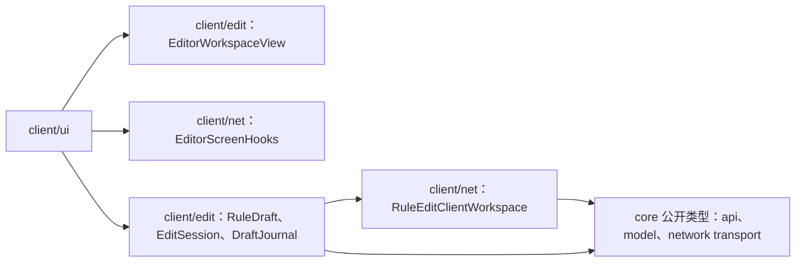
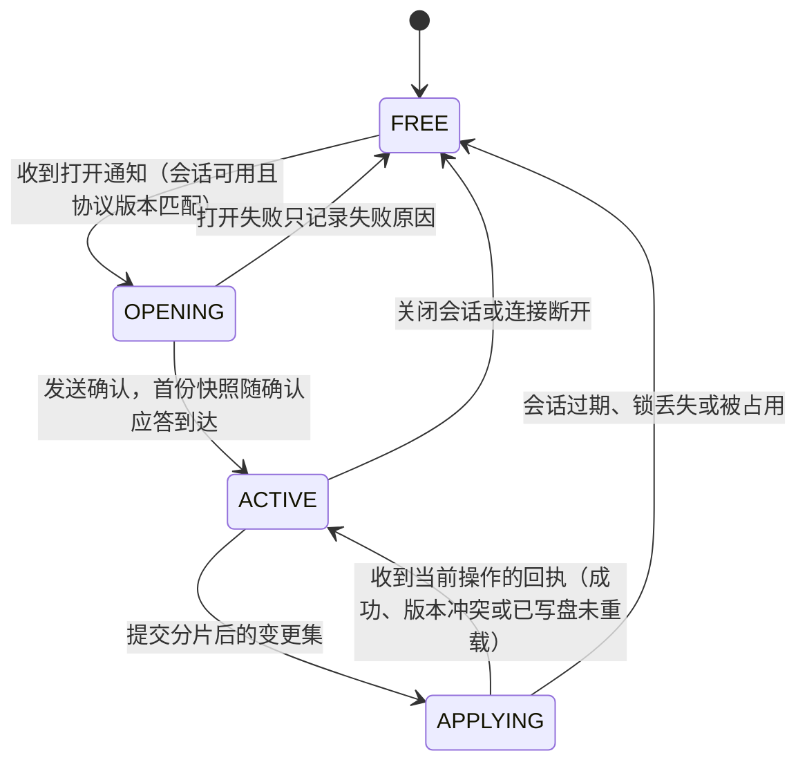
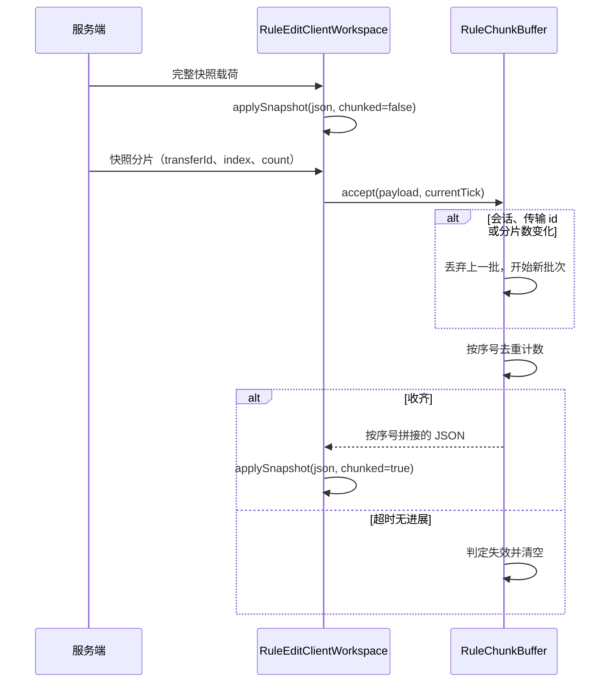
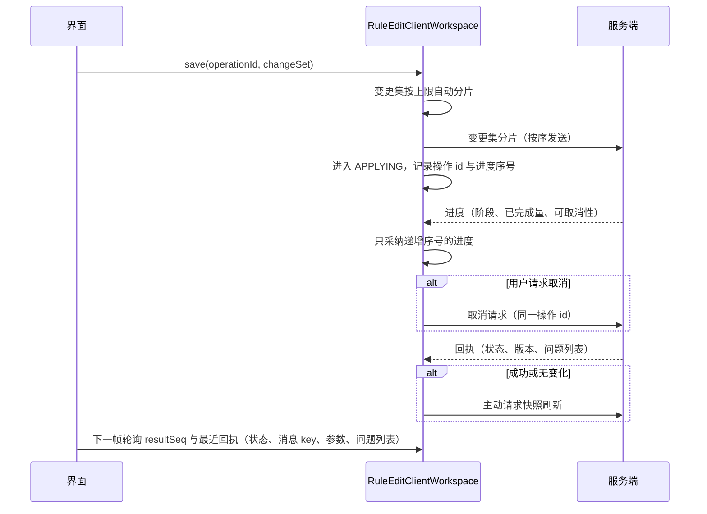
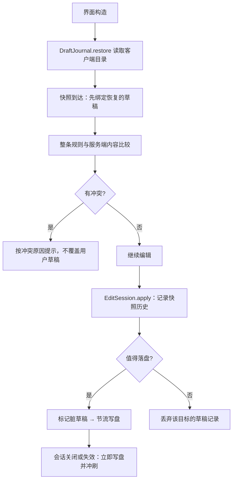

# 客户端编辑工作区

> **TL;DR**
> - `client/net` 镜像服务端的编辑状态机：确认会话、心跳、接收快照与目录、提交分片化的变更集、收敛保存回执。
> - `client/edit` 只组织客户端数据：JSON 是草稿的唯一事实来源，撤销历史按操作前后的草稿快照记录，未提交的编辑落盘到客户端目录。
> - 界面通过只读视图 `EditorWorkspaceView` 与注册槽 `EditorScreenHooks` 接入，界面实现由外部注册。

**适用对象**：调整编辑协议客户端行为、新增类型编辑器、修改草稿持久化或撤销语义的开发者。载荷字段、分片规则与回执语义见 [编辑协议](../api/edit-protocol.md)，服务端侧的会话与落盘见 [编辑与落盘](authoring.md)。

## 1. 模块职责

一句话边界：把服务端的编辑会话投影成界面可用的只读视图，并保管“尚未提交的编辑”（草稿、撤销历史、落盘恢复）。

- **协议工作区** `RuleEditClientWorkspace`：对服务端状态机的镜像，负责确认、心跳、关闭、快照与目录缓存、下行分片重组、变更集自动分片提交、进度与回执收敛、会话失效时关闭界面。
- **分片接收** `RuleChunkBuffer`：快照与来源视图共用同一套重组逻辑，同一时刻只保留最近一批分片。
- **草稿** `RuleDraft` 与 `DraftPaths`：以 JSON 为唯一事实来源的规则草稿，支持路径级读写、条件树编解码，以及 flat effects 与 candidate outcomes 之间的原子转换。
- **撤销与重做** `EditSession`：把每次编辑压成一条历史记录，恢复快照的同时恢复未完成的文本输入。
- **类型编辑器** `TypeEditorRegistry` 与条件/效果的注册表：类型 id 到编辑描述符的映射，未注册类型获得只读回退描述。
- **草稿持久化** `DraftStore`、`DraftJournal`、`PersistedDraft`、`DraftConflict`：客户端私有目录里的原子落盘、节流写入与恢复时的冲突判定。

编辑器界面的编排（列表、表单、页面模型）在 [界面模块](client-ui.md)，本模块只提供它使用的数据面。

## 2. 模块边界

### 对外入口

- **界面读取面**：`EditorWorkspaceView`，只暴露方法而不暴露任何网络载荷类型；实机实现是 `LiveEditorWorkspace`，单例包装协议工作区。
- **界面注册**：`EditorScreenHooks.setOpener(EditorScreenOpener)`；工作区在会话建立时 `open(EditorOpenRequest)`，会话失效时 `close()`，opener 未注册只记日志。
- **平台接线**：`RuleEditClientWorkspace.instance()` 的 `installSinks()` 与 `installSender(PacketSender)`，由两端客户端初始化调用。
- **编辑数据**：`RuleDraft`、`EditSession`、`DraftPaths`、`DraftJournal`，供界面模块组装草稿生命周期。
- **类型编辑器扩展**：`ConditionEditorRegistry.register`、`EffectEditorRegistry.register`，参数是 `TypeEditorDescriptor`。

### 依赖方向

依赖是单向的：`client/edit` 依赖 `client/net` 与 `core` 的公开类型，`client/ui` 只通过视图与注册槽接入；`client/net` 不引用 `client/ui` 与 `client/edit`，`core` 不反向引用客户端。契约层的复用边界见 [ADR-0029](../adr/0029-client-dependency-boundary-and-shared-subpackage.md)。

### 运行约束

- 工作区的方法都在客户端主线程调用，内部用 `synchronized` 保护共享缓存；`tick()` 由平台客户端 tick 事件驱动。
- 只有 `ACTIVE` 状态可以发起目录、来源视图、快照与保存请求；`APPLYING` 期间只接收进度与回执。
- 网络载荷类型与协议版本来自 `core/network`，客户端只消费，不定义协议。

## 3. 关键类地图

仅列对外入口、扩展点、聚合根与并发/事务敏感类，非穷举。

| 类或包 | 角色 | 职责 | 协作对象 |
|---|---|---|---|
| `RuleEditClientWorkspace`（client/net） | 聚合根·并发敏感 | 会话状态机镜像、心跳、快照/目录/来源视图缓存、分片重组、变更集提交、回执收敛、连接断开即重置 | `RuleEditClientState`、`RuleChunkBuffer`、`RuleEditPayloadRouter`、`EditorScreenHooks` |
| `RuleEditClientState`（client/net） | 状态枚举 | 工作区对外可见的阶段；界面据此决定是否显示编辑控件与是否允许提交 | 界面层、工作区 |
| `RuleChunkBuffer`（client/net） | 分片重组 | 按会话、传输 id 与分片数识别批次，按序号去重拼接；超时无进展即作废旧批次 | 工作区、快照与来源视图 |
| `EditorWorkspaceView` / `LiveEditorWorkspace`（client/edit） | 只读视图 | 界面只读面；`LiveEditorWorkspace` 把载荷收敛在工作区内部，按 `resultSeq` 暴露最新回执 | 界面模块、协议工作区 |
| `EditorScreenHooks` / `EditorScreenOpener` / `EditorOpenRequest`（client/net） | 界面注册槽 | 会话建立与失效时通知界面；请求字段与服务端打开载荷一一对应 | 界面模块 |
| `EditSession`（client/edit） | 撤销聚合根 | 每次编辑压入快照历史，维护撤销与重做栈、脏标记与未完成输入 | `RuleDraft`、界面表单 |
| `RuleDraft`（client/edit） | 草稿聚合根 | 保存服务器基线、工作副本与删除标记；路径级读写与条件树、候选结构处理 | `DraftPaths`、条件编解码、界面表单 |
| `DraftPaths`（client/edit） | 路径工具 | 草稿 JSON 的字段与数组路径解析、读写、删除；必要时创建中间容器 | `RuleDraft` |
| `TypeEditorRegistry` / `ConditionEditorRegistry` / `EffectEditorRegistry`（client/edit） | 扩展点 | 类型 id 到编辑描述符的注册表；未注册类型返回只读回退描述 | 界面表单、内置类型表 |
| `ClientTypeRegistries`（client/edit） | 客户端类型表 | 内置条件与效果类型的惰性单例，内容来自代码常量而非数据包 | 注册表、条件编解码 |
| `DraftJournal`（client/edit/draft） | 落盘调度 | 跟踪脏草稿、节流写盘、失败重排与一次性失败上报 | `DraftStore`、界面模型 |
| `DraftStore` / `PersistedDraft` / `DraftConflict`（client/edit/draft） | 持久化 | 客户端私有目录的原子读写、磁盘格式与版本、恢复时的冲突原因 | `DraftJournal`、界面模型 |

## 4. 关键流程

### 协议工作区状态机

状态迁移由服务端的打开通知、本地保存、服务端回执与连接或会话失效驱动。

- 打开失败（取锁失败、协议版本不一致、打开状态码非成功）不进入会话，只记录失败原因供界面提示。
- 保存回执分为“当前操作的回执”和“迟到的重复回执”：迟到回执直接忽略，会话级失效状态则立即结束会话并关闭界面。
- 成功或“无变化”的回执不携带快照，客户端主动请求刷新；版本冲突与“已写盘未重载”随回执推送最新快照。
- 新增状态时改 `RuleEditClientState`，并同步界面判断“是否可编辑”的分支。

### 快照与分片接收

来源视图走同一套缓冲：请求带 `requestId`，响应按该 id 与在途请求配对，超时未回则标记失败并允许重试。快照修订号变化时清空来源视图与在途分片缓存，因为来源内容可能已被保存或数据包重载改写。来源视图按需拉取的取舍见 [ADR-0040](../adr/0040-on-demand-snapshot-source-views.md)。

### 保存往返

取消不提前结束 `APPLYING`、也不释放会话，最终以回执为准；服务端已进入不可取消阶段时，客户端把取消标记回退为未请求。

### 草稿、撤销与落盘

- 撤销的粒度是“一条编辑操作”：操作压栈前先取工作副本快照，只有 JSON、删除标记或目标级开关确实变化才入栈，超过历史上限丢弃最旧记录，新操作清空重做栈。
- 未完成的文本输入单独缓存，撤销与重做在恢复快照的同时恢复对应的输入位置。
- 冲突判定在整条规则粒度：目标是否仍在服务端、按新建保存时服务端是否已有同名目标、服务端内容是否仍等于草稿记录的基线；原因由 `DraftConflict.Reason` 表达，新增原因需同步 `messageSuffix` 与文案 key。
- 关闭界面时若有未保存改动，弹窗提供「暂存到本地」「放弃」「取消」：暂存先合并当前表单输入并立即写盘，再结束会话并关屏；放弃删除本次载入的全部草稿文件；取消留在编辑页。

## 5. 扩展点与约束

### 新增类型编辑器

- 条件类型注册到 `ConditionEditorRegistry`，效果类型注册到 `EffectEditorRegistry`；描述符用 `TypeEditorDescriptor.of(id, label, fields...)` 构造，字段类型取 `EditorFieldType`。
- 未注册类型不会中断编辑：`descriptorFor` 返回只读回退描述，展示原始 JSON 并原样保留未识别字段，第三方扩展类型因此可见且不会被写坏。
- 重复注册同一 id 抛 `IllegalStateException`；内置类型表由 `ClientTypeRegistries` 提供，与服务端数据包无关。
- 新增编辑器时同步 `en_us` 与 `zh_cn` 语言文件里的类型标签，回退标签使用注册表构造时传入的 key。

### 新增撤销操作

- 所有字段与树操作都经 `EditSession.apply(opKey, mutation)` 提交，`opKey` 使用 `EditSession` 的操作常量（`gui.itemdespawntowhat.edit.undo.*`）；新增操作补常量并同步 `en_us` 与 `zh_cn` 语言文件。
- `load(next)` 会清空历史；历史上限由 `HISTORY_LIMIT` 定义。

### 接入新的界面实现

- 实现 `EditorScreenOpener` 并调用 `EditorScreenHooks.setOpener`。
- 界面只读 `EditorWorkspaceView`：按 `RuleSaveStatus`（由回执状态码派生）分支，文案用消息 key 与参数组装，不解析服务端文本。

### 变更会话协议字段

- 载荷结构在 `core/network` 的载荷类型里定义，版本戳取 `RuleEditProtocol.VERSION`，客户端只消费；版本不匹配时打开流程直接失败，因此改动协议必须同时升版本。
- 新增 payload 需要同时补两端注册与 `RuleEditPayloadRouter` 的分发与 sink 注入，见 [平台接入层](platform.md)。

### 草稿格式演进

- `PersistedDraft` 带格式版本号，新增字段时在 `toJson` 与 `fromJson` 同步；缺失的可选字段按缺省值读取，缺少目标 id 或草稿体的记录被丢弃。
- 文件名由 `DraftStore.fileName` 从目标 id 派生（清洗 + 短哈希），写入先落到同目录临时文件再原子替换。
- 目录固定为游戏根目录下的 `config/itemdespawntowhat/client/editor-drafts`，不写服务端目录与覆盖层目录。

### 约束

- 只在客户端主线程调用工作区；跨线程写入会破坏状态机与缓存一致性。
- `RuleChunkBuffer` 同一时刻只保留一批分片，批次边界由会话、传输 id 与分片数共同决定。
- 来源视图缓存与目录加载都有上限与超时，界面重试走 `retrySourceView` / `retryDirectory`，不要自行重发请求。
- `client/net` 与 `client/edit` 不引用 `client/ui`；页面、主题与控件适配都在界面模块。

### 改动后的验证

- 编译：先做 IDE 工作区检查，再跑 `tools/dsh-build.ps1 -Tasks build`。
- 隔离：`python tools/check-isolation.py`（客户端不引入加载器专有 API，`core` 不引用客户端）。
- 实机：单人世界与专用服务端各走一遍打开、编辑、保存、取消、断线重连与草稿恢复。
- 文档：`python tools/check-docs.py`。

## 6. 数据与配置引用

- 载荷字段、分片、版本戳、幂等与回执语义：[编辑协议](../api/edit-protocol.md)。
- 保存状态、消息 key 与问题等级：[错误与状态码](../api/errors.md)。
- 规则 JSON 的字段语义：[规则 JSON](../api/rule-json.md)。
- 模组级配置与派生换算：[服务器配置](../ops/configuration.md)（草稿目录是客户端状态目录，不参与模组级配置）。
- 会话独占与目标锁：[ADR-0019](../adr/0019-exclusive-edit-session-and-target-lock.md)。
- 来源视图的按需拉取：[ADR-0040](../adr/0040-on-demand-snapshot-source-views.md)。

## 相关文档

- [模块索引](README.md)
- [契约层核心](core-contract.md)
- [类型系统](type-system.md)
- [编辑与落盘](authoring.md)（服务端会话、锁与写盘）
- [编辑器界面](client-ui.md)
- [UI kit](ui-kit.md)
- [关键链路](../architecture/key-flows.md)
- [依赖规则](../architecture/dependency-rules.md)
- [平台接入层](platform.md)
