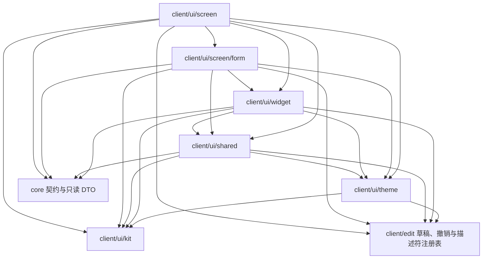
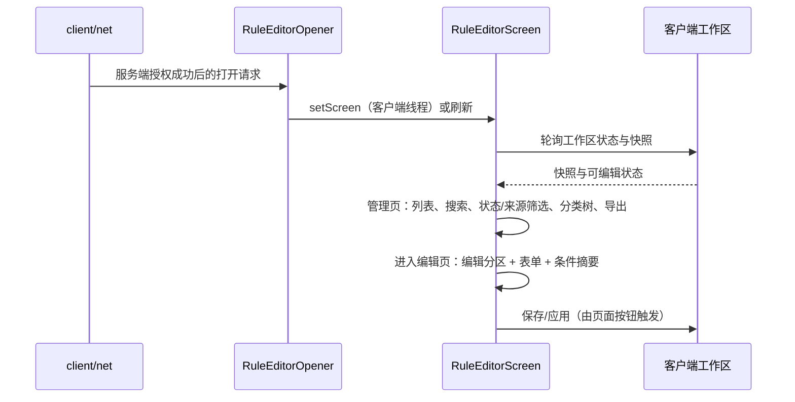
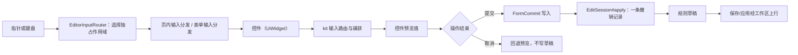

# 客户端界面

> **TL;DR**
> - 这一层把 UI kit 的原语装配成规则编辑器：主题注入、可复用控件、界面中立展示类型、三个编辑器页面与编辑分区、条件画布页。
> - 编辑器只有一个内容写入口：字段与条件编辑都经 `EditSession` 落草稿；启停改的是本服状态，走意图表与变更集的启停动作。
> - 只读条目照常进编辑页并可改：控件可写，改动不保存；启停对只读条目同样可用。

**适用对象**：改编辑器页面结构、加字段控件、加目录类型或预览图标、换主题的开发者。

## 1. 模块职责

一句话边界：在 UI kit 之上提供本项目落地的外观与控件、界面中立的展示类型，以及把规则管理、规则编辑、条件画布与调试串起来的屏幕。

子包分工：

| 子包 | 一句话职责 |
|---|---|
| `client/ui/theme` | 把灰色像素与扁平两套外观映射成 kit 的样式值，并以 `UiHostTheme` 作为唯一注入入口 |
| `client/ui/widget` | 在 kit 基础上提供可直接使用的输入框、列表、树、弹窗、按钮变体与条件树控件；滚动控件的行宽与行命中换算（`RowGeometry`）、区间宿主控件的公共外壳（`AbstractBarShell`）也收在这一层 |
| `client/ui/shared` | `screen` 与 `screen/form` 共享的纯值与展示类型：目录图标分发、展示名称、字段到目录类型的映射、条件摘要、悬停说明的语义行模型 |
| `client/ui/screen` | 编辑器外壳、三个编辑器页面、编辑分区组合、保存遮罩与页内输入分发 |
| `client/ui/screen/form` | 描述符驱动的表单视图、字段控件基类与注册表 |

三个编辑器页面（管理页、编辑页、调试页）共用 `EditorPage` 契约，由编辑器外壳持有并决定谁是活动页。页面在渲染和按钮刷新时查询外壳的可编辑状态，同步自身控件使能；外壳不向页面推送使能状态。编辑页内的编辑分区由 `RuleEditorEditSections.EditSection` 定义：INFO（基本信息）、INPUT（输入与消耗）、TRIGGER（触发条件）、RESULTS（效果与产物），`EditSection#of` 把键名解析成分区、未知键回落到 INFO。分区之间共用同一份 `EditSession` 草稿。四个分区各自持有 `EditorSectionContent`，拥有表单、控件、按钮与卡片；组合视图只消费活动分区的产物，维护布局缓存、文档坐标与滚动记忆。分区直接接收外壳、字体、表单工厂与编辑动作，不持有组合容器或其他分区。

规则启用状态分两层，界面各有一处落点：默认启用是规则内容，落在基本信息分区的表单字段里；本服启用状态是独立的一层，落在基本信息分区行尾的本服开关与「恢复默认」，以及列表页的启停按钮。两者的语义见 [规则 JSON](../api/rule-json.md)，客户端侧的意图与草稿记录见 [client-editor](client-editor.md)。

## 2. 模块边界

### 对外入口

- **编辑器入口**：`RuleEditorOpener` 注册到 `EditorScreenHooks`，服务端授权成功后由 `client/net` 调用，把 `RuleEditorScreen` 切到前台或关闭；会话的发起与结束由 `client/net` 承担，它只负责切屏与会话就绪后的刷新。链路见 [authoring](authoring.md) 与 [client-editor](client-editor.md)。
- **主题注入**：`RuleEditorScreen` 选择主主题与画布外壳主题，`EditorShell` 沿页面、分区、表单和弹层装配链传递；嵌套表单继承父主题。具体主题各自持有完整不可变 `UiHostPalette`，默认工厂保持当前配色；树与列表的行高取注入实例。独立 `FormView` 构造可自行选择默认主题。
- **表单装配**：`FormView` + `FormControl` + `FormControlRegistry`，把类型描述符的字段列表渲染成可滚动的一列控件；`FormField#addAction` 向同一行追加行尾动作按钮，基本信息分区的本服开关与「恢复默认」由此挂到「默认启用」行。
- **条件树界面**：`ConditionTreeOverlay`（画布页外壳）、`UiConditionGraphEditor`（画布编辑）、`UiConditionTreeSummary`（只读摘要兼入口）、`ConditionTreeContract`（宿主注入契约与选中路径同步）。
- **控件与弹窗契约**：`UiWidget` 统一渲染与输入转发；`UiModalStack` 负责弹窗层次、遮罩、焦点与输入独占。
- **排版快照**：`RuleEditorScreen` 与承载控件的 widget、页面、按钮条实现 kit 的 `UiLayoutSource`，把已排版的控件矩形、文案与文本带宽导出为只读快照，供 GUI 探针断言布局不变量与真实文案；快照不参与绘制与命中，也不触发重排。

### 依赖方向

箭头表示编译期依赖，方向自上而下（`client/net` 的入口类型另经 `RuleEditorOpener` 取用，图中从略）：

几条必须守住的形状：

- kit 在底层：本层各子包依赖它，而它的 import 只落在原版类型与标准库白名单上（见 [ui-kit](ui-kit.md)）。
- `shared` 是 `screen` 与 `screen/form` 的公共下游：两者都依赖它，它的 import 只落在 `client/edit`、kit、theme 与 core 契约上，于是两个子包之间只有 `screen → screen/form` 一个方向。
- `theme` 只依赖 kit 与 `client/edit` 的命名空间常量；主题负责视觉，`widget` 负责交互，两者通过注入解耦。
- `screen` 与 `screen/form` 引用 `core.api`/`core.model`/`core.network.protocol` 的公开类型；调试页与本地校验另用 `core.debug`、`core.runtime`、`core.service`、`core.type.condition` 的公开入口。
- 传输通道与上行载荷收敛在 `client/net`；界面层消费它暴露的只读工作区状态与入口类型。

### 被谁依赖

`client/net` 通过 `EditorScreenHooks`/`EditorScreenOpener` 调用 `RuleEditorOpener`；客户端入口负责把 opener 注册进去。kit 与本层之间只有 kit 被依赖这一个方向。

## 3. 关键类地图

仅列对外入口、扩展点、聚合根与并发/事务敏感类，非穷举。

| 类型 | 角色 | 职责 | 协作对象 |
|---|---|---|---|
| `RuleEditorOpener` | 界面入口 | 提供 `bootstrap`/`shutdown`/`lastRequest` 静态入口，在客户端线程把编辑器切到前台或刷新 | `client/net` 的 hooks 与打开请求 |
| `EditorShell` | 编辑器外壳 | 持有当前编辑目标、编辑会话选取、提示级别、可编辑判定与跨页命令，并持有三个编辑器页面；屏幕经它取活动页与状态 | 三个编辑器页面、`RuleEditorModel`、`UiModalStack`、`UiFocusManager` |
| `EditorPage` | 编辑器页面契约 | 三个顶层页共用的派发面：头部度量与绘制、标题与状态标签、内容与页脚排版、鼠标键盘输入、按钮状态刷新，以及可选的覆盖层与悬停说明 | `RuleEditorScreen`、编辑器外壳 |
| `EditorInputRouter` | 屏幕输入作用域 | 选择保存遮罩、顶层 modal、页覆盖层或活动页；独占作用域终止向底页派发，释放归原按下作用域；普通页排列历史、Esc 与 Tab 的优先级 | `EditorShell`、`EditorPage`、弹窗栈 |
| `RuleEditorScreen` | 屏幕聚合根 | 屏幕生命周期、窗口排版、绘制与输入派发：活动页从哪里取、提示带与页脚带怎么排都由屏幕决定，输入经 `EditorInputRouter` 选择作用域后派发；工作区进入可编辑态才允许编辑，应用期间冻结，工作区释放时自行关屏 | 编辑器外壳、`EditorPage`、弹窗栈、提示条 |
| `RuleEditorListPage` | 管理页 | 搜索、状态/来源轮询筛选、分类树、规则导出与配方预览，列表底排按钮状态同步；只持有管理页控件与视图状态 | 规则会话、目录图标、`RulePackExporter`、`RuleEditorListActions` |
| `RulePackExporter` | 规则导出口 | 把列表可导出的已保存规则写成一个数据包 zip：跳过未保存草稿与有问题条目，清单格式取当前游戏的数据包版本，规则文件按 `data/<ns>/idtw/rules/<path>.json` 落位，id 强制写回 | 列表页导出弹窗、`RulePaths`、`RuleFields` |
| `RuleListDisplayCache` / `RuleListDisplaySnapshot` | 列表行展示 | 把快照条目、草稿会话与启停意图合成一行的展示快照：生效启用、待应用标记、本服标记、只读标记；缓存按内容版本、会话修订号与意图修订号失效 | `RuleEditorModel`、列表页 |
| `RuleEditorEditSections` | 编辑分区组合 | 组合四个分区的装配产物，汇总布局、滚动、焦点与输入；分区各自拥有控件和使能策略，`EditorSectionActions` 完成编辑收尾、历史路径迁移与分类跟随 | 分区实现、`FormView`、`RuleEditorValidation` |
| `RuleEditorEditPage` | 编辑页与保存入口 | 编辑分区切换、类型选择、代码视图、保存与校验入口；`finish(reason)` 统一保留输入、结束交互、提交与释放 | `RuleEditorEditSections`、`UiModalStack` |
| `RuleEditorInfoSection` | 基本信息分区 | 规则 ID、分类与来源摘要的只读展示，显示名、默认启用、优先级与备注的表单编辑，以及行尾的本服两态开关与「恢复默认」 | `FormView`、`RuleEditorModel` |
| `RuleChangesView` | 变更清单 | 列出待应用的规则，每条同时给出内容动作与启停动作 | `RuleEditorModel`、`EditSession` |
| `RuleEditorDebugPage` | 调试页 | 按输入数量填充测试规则、一次性删除测试规则；只写草稿，落盘仍由管理页的“应用全部”决定 | `DebugTestRules` |
| `RuleEditorPageInput` | 页内输入分发 | 把按下、释放、拖动、滚动与键盘输入派发给当前页控件，并维护结果分区动作列表的拖动排序；按下归属决定释放只发给谁 | 编辑页控件、`FormView` |
| `RuleEditorPanelFactory` | 面板装配 | 把 kit 控件与目录链路接到规则草稿上；写入一律经调用方给定的 `applyChange` | 叶子面板、`shared` 图标、数值控件 |
| `FormView` | 表单聚合根 | 按 `TypeEditorDescriptor` 渲染可滚动控件列；写入统一经 `EditSession`；支持定位高亮、内联选择与行尾动作 | `FormCommit`、`FormInputRouter`、`FormControl` |
| `FormField` | 行身份与装配入口 | 绑定实际行，配置显隐、默认值、数值窗口、目录过滤、行尾动作与数量配对；路径随 rebase 更新，换描述符或卸载后失效 | `FormView`、字段声明 |
| `FormCommit` | 表单提交协议 | 装载与保留文本，按修订守卫提交合法输入；字段及关联更新共用会话回调，非法文本留在会话 | `FormView`、`EditSession` |
| `FormControl` / `FormControlRegistry` | 字段控件扩展点 | 一个字段一行，负责 JSON 值与控件值的双向搬运与本地校验；无 default 的枚举 switch 将每种字段显式映射到控件工厂 | 描述符引擎、`EditSession` |
| `UiHostTheme` / `UiHostThemes` / `AbstractHostTheme` | 主题注入入口 | 调色板、度量、文本色、控件样式、滑块皮肤、结构绘制与图标行号；两套主题逐项相同的宿主度量与外壳原语收在 `AbstractHostTheme`，默认入口给出像素外观，扁平外观由调用方显式取用 | 全部控件与屏幕 |
| `UiWidget` / `UiModalStack` | 控件与弹窗契约 | 控件统一渲染与输入契约，坐标为 GUI 逻辑坐标；弹窗栈只把输入投给最上层，并管理焦点与历史快捷键 | 屏幕、`UiFocusManager` |
| `ConditionTreeContract` / `UiConditionGraphEditor` / `UiConditionTreeSummary` / `ConditionTreeOverlay` | 条件树界面家族 | 同一份条件数据与校验的两种展示；契约提供类型选项、叶子工厂、变更监听与选中路径同步 | 条件模型、`FormView`、`ConditionTreeChrome` |
| `ConditionTreeProjection` / `ConditionTreeViewModel` / `ConditionTreeLabels` | 条件展示快照 | 字段协调器复用结构与诊断版本；共享标签，画布布局生成几何；相对 JSON 地址由 `ConditionTreeNodes` 解释 | 摘要、画布、条件表单 |
| `UiTreeView` / `UiTreeNode` | 管理树 | 节点仅承载数据，视图拥有投影及选择折叠；管理页用分类/规则业务 key 恢复重建状态 | kit 树投影、状态与导航 |
| `PreviewResources` | 资源生命周期所有者 | 世界、语言与模型身份决定资源世代；实体、方块、物品及目录名称索引平级消费；屏幕关闭与 removed 统一释放 | `shared` 预览类、`RuleEditorPanelFactory` |
| `UiFlatText` | 文本绘制原语 | 无阴影的居中、折行文本与悬停提示面板；GUI 不使用字体阴影与加粗，标题只靠颜色、缩进与分区间距区分层次 | kit 的 `UiRenderLayers`、各控件与页面 |
| `UiSlider` / `UiRangeBar` / `UiTextInput` | 控件适配 | 原版输入模型留在宿主，文本值操作经 `UiTextValue`，码点接纳与回填抑制经 `UiTextAcceptance`，数值交互委托给 kit；提交时机由宿主回调决定 | kit 数值/文本契约、主题 |

## 4. 关键流程

### 从授权到编辑

### 一次字段编辑的落点

页内输入分发先记录“按下归属”，释放与拖动只发给同一个目标；表单输入分发按“选择框 → 行尾按钮 → 字段控件 → 表单滚动”的顺序派发，事件只消费一次。基本信息分区的「默认启用」是这条链路里的普通内容字段；行尾的本服开关与「恢复默认」是动作按钮，不进撤销栈。

### 表单装配与页面收尾

`EditorFormFactory` 装配目录、条件上下文、数量默认值与几何失效通知。输入分区的刷新联动留在输入分区；`EditorConditionForms` 装配条件画布与局部参数表；`EditorQuantityBindings` 提供共享数量及存在条件写回。结果结构与严格值读取由编辑数据层的 `ResultStructure`、`RuleValue` 提供。

`addField` 返回 `FormField`，`setDescriptor` 返回有序句柄集合；固定描述符在装配时用 `field(name)` 取得必需行，动态闭包保留句柄。JSON 路径继续承担数据读写、历史迁移、问题定位与高亮。

保存、分区和目标切换、返回、刷新及关闭进入 `RuleEditorEditPage.finish(reason)`。完成编辑先保留当前修订输入，再取消未释放预览、提交合法值并通知模型，最后卸载或重建；非法文本保留在会话并参与阻塞校验。快照身份变化前只保留输入；重绑后旧修订控件重新装载并退出该次提交。放弃草稿先释放旧页面再清除记录，关闭与 removed 共用外壳的一次释放标记。

屏幕输入优先级为保存遮罩 → 顶层 modal → 页面覆盖层 → 活动页；modal 按键释放只交给本层内容。F1–F12 保持放行，Ctrl+F8 沿用调试入口条件。控件内捕获与焦点遵循 kit 契约，作用域变化结束原页面交互。

### 只读条目的编辑页

- 只读条目照常进入编辑页，内容走沙盒：控件可写，撤销与重做可用，改动只留在当前会话。
- 编辑页页头右上角的状态标签按优先级取值：工作区不可用时显示「会话冻结」，内容只读时显示「只读 · 改动不会保存」，其余按有无待应用改动显示「待应用」或「已应用」。
- 只读标签用警告色填充并加宽底色，页头标题按剩余宽度截断；冻结与只读是两句独立文案：冻结说的是会话不可写，只读说的是内容不保存。
- 底排保存按钮只按脏标记与页面可写状态合成，只读条目在没改启停时保持「无改动」的禁用态。
- 返回列表、切换编辑目标或关闭界面即丢弃沙盒内容；再次打开看到服务端内容。

### 列表页筛选与导出

状态与来源各用一个轮询按钮，点击依次切换取值，当前取值直接显示在按钮文字里，两者按交集过滤。状态取「全部 / 已启用 / 已停用」，按生效启用状态判定（未应用的启停意图已计入）；来源取「全部 / 覆盖层 / 数据包」，来源为混合（覆盖层条目同时存在数据包同名规则）的条目在两个来源取值下都可见。

列表行的状态后缀按固定顺序追加：先是问题或待应用标记，再是「（本服）」，最后是「只读」。待应用包含内容改动、本次新建与未应用的启停意图；「（本服）」只在存在本服覆盖或覆盖类意图时出现；停用的行整行置灰。编辑按钮恒为「编辑」，只读条目同样进入编辑页；启停按钮显示下一步动作（当前生效时显示「停用」，否则显示「启用」），对只读条目同样可用；删除按钮只在条目内容可写时可点。

问题不占筛选按钮：条目带服务端校验问题或客户端解码失败时，列表树把它归入「有问题」分组，优先于「未完成」与常规分类；问题消失后回到原分组。分组无成员时自动隐藏，问题一出现就能在树上看到。

导出弹窗提供两个范围：「覆盖层」只含覆盖层来源的可导出条目，「覆盖层 + 数据包」再包含数据包条目。可导出指条目已保存、状态为生效或停用、有可读规则体且未标记删除；未保存草稿（「未完成」分组）、有问题条目（「有问题」分组）与非法条目不导出，避免把半成品或不可用规则带到别的设备。导出文件写到游戏根目录下的 `itemdespawntowhat-exports/`，zip 内是标准数据包结构，可直接作为存档数据包使用或解压后共享。

### 启停控制

- 列表行启停按钮：点击在模型里产生一条启停意图，提示按实际动作给出「已启用（本服）」「已停用（本服）」或「已恢复默认启用状态」。目标值回到默认启用且服务端本来没有覆盖时直接摘除意图。
- 基本信息分区的「默认启用」是内容字段，仍由表单控件编辑并进入撤销栈；同一行的行尾并排两个动作：本服两态开关（标签直接显示生效状态「本服：启用」或「本服：停用」）与「恢复默认」。
- 「恢复默认」在存在本服覆盖或未应用的覆盖意图时可点；本服开关在页面可写时始终可点。两者不写入表单字段、不产生撤销记录，但计入脏标记与行内「待应用」状态；条目仍留在原分类分组，停用行照常置灰。
- 内容里的「默认启用」被改动时，本服开关的标签跟着刷新：生效状态按「意图 ?? 本服覆盖 ?? 默认启用」重新计算，这一同步每帧随编辑页刷新。
- 列表底排的「应用」按钮与编辑页底排的保存按钮都按脏标记合成：有改动时显示「应用改动（N）」并可点，没有时显示「无改动」并禁用；启停意图与内容改动同批提交。
- 变更清单里一条规则可同时列出内容动作与启停动作，两段用「 + 」连接。

## 5. 扩展点与约束

### 扩展点

- **规则固定表单**：基本信息、延迟、条件树和输入精简字段从 `BuiltinEditorDescriptors` 获取；screen 保留布局、tooltip、动态窗口与动作，`EditorField` 的值域使用 `FieldDomain`，数值与枚举直接读取类型化数据。
- **新增字段控件**：实现 `FormControl` 子类，并在 `FormControlRegistry` 的穷举 switch 增加工厂分支。数值字段先走 `FormControl#create` 的“滑杆 + 行内精确输入”，域元数据不足时才落到注册表；第三方只读描述符使用显式 `RAW_JSON` 类型；新增已知字段漏接控件会在编译期报错。字段归类用 `EditorField` 的分类谓词（列表、数值、说明行、可带标签等）判断，不对 `EditorFieldType` 做 switch。
- **新增界面标记图标**：标记图集是 `textures/gui/editor/marks.png`，由 `tools/image_generator/generate-editor-marks.py` 生成，字形为纯白、按调用方给定的主题色染色；在 `theme` 的 `UiMarkIcons.Mark` 登记行号与尺寸，用 `UiMarkIcons.icon(mark, color)` 取得图标后交给控件的 `setIcon` 或直接渲染。
- **新增事件图标**：事件图集是 `textures/gui/editor/events.png`，由 `tools/image_generator/generate-event-icons.py` 生成，每格 32×32 彩色成品、按 16 像素槽位缩放绘制，不做主题染色；在 `theme` 的 `UiEventIcons.Event` 登记行号，动作到事件的判定收在 `shared/EventPreviewIcons`，新增天象类动作在那里补一支分支。
- **新增目录类型或预览图标**：在 `shared` 的 `FieldCatalogTypes` 增加字段名兜底、在 `CatalogPreviewIcons` 增加分发分支；新增可预览注册表时在 `shared` 实现类型加载与失败值，在 `CatalogPreviewIcons` 接线；长期缓存用容量 256 的 `UiPreviewCache`，并列消费 `PreviewResources.generation()`。实体/方块 wrapper 每次绘制读取当前世代模型，失败测量同世代复用；物品以 Optional 缓存未知 id。Fluid/Tag/Event 按现有路径创建或解析。世界/语言当帧失效，模型探测按客户端 tick 合并；关闭统一走 `PreviewResources.release()`。
- **新增条件类型**：数据与校验在 `client/edit` 的条件模型上落点（见 [client-editor](client-editor.md)），界面侧在 `ConditionTreeContract` 的类型选项与叶子工厂登记；画布与缩进摘要消费字段级 `ConditionTreeViewModel` 的结构诊断投影；字体、语言和宽度只影响各渲染器的文本与几何缓存。
- **新增编辑分区或结果分区动作**：在 `RuleEditorEditSections.EditSection` 增加常量并实现对应分区；面板装配放 `RuleEditorPanelFactory`。页面共享的布局常量（页内留白、行高、表单与对话框的按钮高度）、`UI` 文案前缀与 2 个存在条件叶类型 id 收在 `RuleEditorPageSupport`，3 个页描述符 id 由 `BuiltinEditorDescriptors` 提供；`RuleEditorPageSupport` 不持有界面状态、不装配控件；同一层的业务助手按关注点分开：`PresenceLeaves` 管存在条件叶的构造、扫描与增删，`CatalystQuantities` 管催化剂数量表对账，`EditorQuantityBindings` 管共享数量与存在条件写回；规则结构与严格值读取由 `client/edit` 的 `ResultStructure`、`RuleValue` 提供。
- **新增行尾动作**：`UiButton` 配 `FormField#addAction` 挂到某个字段行；动作按钮不进入表单字段，读写模型而非草稿 JSON，需要参与保存时在变更集组装处接线。
- **新增主题**：实现 `UiHostTheme`（它本身就是 kit `UiStyleSource` 的宿主侧入口），在 `UiHostThemes` 暴露取用入口；控件经注入取色，新增皮肤只改主题实现。
- **新增宿主控件**：实现 `UiWidget`，由屏幕统一转发输入；需要模态行为时放进 `UiModalStack`，需要焦点顺序时登记到 `UiFocusManager`。
- **新增调试能力**：测试规则的身份前缀、分类归属与规则体在 `DebugTestRules` 统一约定，调试页只负责批量填充与按前缀删除。

### 约束

- 内容单写入口：外部只读 `EditSession.root/valueAt`，活草稿仅在 `apply(opKey, edits -> ...)` 回调中提供；所有内容写入经 `EditSession#apply`，一次完整操作一条撤销记录；面板工厂与控件只装配、只搬运值。只读条目的内容也走这条链路，只读约束落在草稿持久化与变更集组装两处。
- 启停是独立控制面：开关与「恢复默认」只改本服意图与脏标记，不写表单字段、不进撤销栈；提交时以变更集的启停动作上行。
- 界面按描述符装配；JSON 的解析与构造收敛在 `client/edit`，界面消费模型或转换结果。
- 主题只表达视觉，控件只表达交互语义；控件通过注入取色，不静态读取主题类。
- 全 GUI 不使用字体阴影与加粗：需要居中、折行或悬停提示文本时统一走 `UiFlatText`，原版的 `drawCenteredString`、`drawWordWrap`、`renderTooltip` 会把暗色阴影叠在浅色底板上；信息层次由字体颜色、缩进与分区间距表达。
- 页面内容里的按钮统一用扁平胶囊样式（`UiButton#setChipStyle`），立体边只留给外壳页脚的保存行；扁平填充配 `PANEL_BORDER` 描边，让按钮与同页的标签框、分段控件、列表行处在同一层次。
- 悬停提示只补充画面上读不到的信息：规则名、组合方式、撤销说明、只读含义等；动作名、叉号、翻页箭头、分段选项、物品卡与行为卡这类已有文字或符号表达的内容不再重复解释。
- 必填字段在标签右上角加 `*` 角标；缺值时用红色标签与控件下沿的红色警示线表达。
- 条件树的结构与参数编辑只在画布页完成，缩进树保持只读并作为进入画布的入口（[ADR-0031](../adr/0031-condition-tree-single-editor-two-renders.md)）。条件编辑入口统一在触发分区，结果分区只编辑动作自身的参数与共用补充参数（概率、延迟），动作说明也不重复条件行。
- 条件摘要与画布各自拥有选择和折叠；画布 `UiTreeEditor.ViewChange` 驱动选择展示和参数同步，功能栏、工具列与画布/JSON 区域用 `UiFocusManager` 决定 Tab 顺序。
- 文本字段只创建实际使用的单行或多行控件；表单快照与回填依赖 `UiTextValue`。两种控件共用码点接纳与滚动条几何，分别保留原版编辑和历史适配。
- 画布页与画布内联编辑框使用扁平外观，且只在调用方显式注入时生效（[ADR-0028](../adr/0028-canvas-page-and-flat-skin.md)）。
- 上行载荷与传输通道收敛在 `client/net`；界面直接使用 `RuleEditClientWorkspace` 的会话、保存和资源值模型；目录、来源、快照与寿命查询走显式请求动作。

### 改动后的验证

1. IDE 工作区检查 → `tools/dsh-build.ps1 -Tasks build`。
2. 界面布局按 [ADR-0022](../adr/0022-client-ui-kit-adoption.md) 的视觉基线验收：最低 320×240 GUI 逻辑坐标、页面在 GUI 缩放 1x/2x/3x 下无重叠与文本溢出，颜色线索同时给出文字或图标。可用 [GUI 探针](../guides/gui-probes.md) 在本机跑真实客户端用例，拿到判定与截图证据。
3. 改文案跑 `python tools/check-i18n.py`；改 kit 边界的引用跑 `tools/check-ui-kit-boundaries.ps1`；改文档链接跑 `python tools/check-docs.py`。

## 6. 数据与配置引用

界面只消费规则数据与配置，单一事实源在下列文档，本页只做指向：

- 规则字段语义、默认启用与本服启用状态：[规则 JSON](../api/rule-json.md)。
- 表单问题、校验文案与拒载粒度：[错误与状态码](../api/errors.md)。
- 会话、分片与保存回执（含启停动作）：[编辑协议](../api/edit-protocol.md)。
- 客户端与服务端配置项：[配置](../ops/configuration.md)。

界面文案的键前缀为 `gui.itemdespawntowhat.edit.`，字段问题另用 `gui.itemdespawntowhat.edit.issue.`（见 `FormControl` 的常量）；中英文语言文件由 `tools/check-i18n.py` 同步校验。

## 相关文档

- 模块总览：[模块索引](README.md)
- 底层原语：[UI kit](ui-kit.md)
- 草稿、启停意图与类型编辑器注册表：[client-editor](client-editor.md)
- 服务端编辑会话与落盘：[authoring](authoring.md)
- 条件与效果类型注册：[type-system](type-system.md)
- 依赖规则：[依赖规则](../architecture/dependency-rules.md)
- 跨模块链路：[关键链路](../architecture/key-flows.md)
- 决策：[ADR-0022](../adr/0022-client-ui-kit-adoption.md)、[ADR-0028](../adr/0028-canvas-page-and-flat-skin.md)、[ADR-0029](../adr/0029-client-dependency-boundary-and-shared-subpackage.md)、[ADR-0031](../adr/0031-condition-tree-single-editor-two-renders.md)、[ADR-0032](../adr/0032-host-injected-ui-theme.md)、[ADR-0044](../adr/0044-rule-enable-state-layering.md)、[ADR-0045](../adr/0045-readonly-sandbox-editing.md)
- 写作与命名约定：[代码风格](../guides/code-style.md)
- 文档体系：[文档体系](../README.md)
