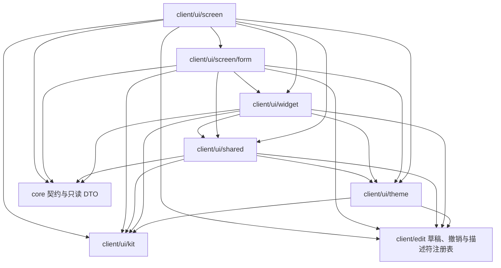
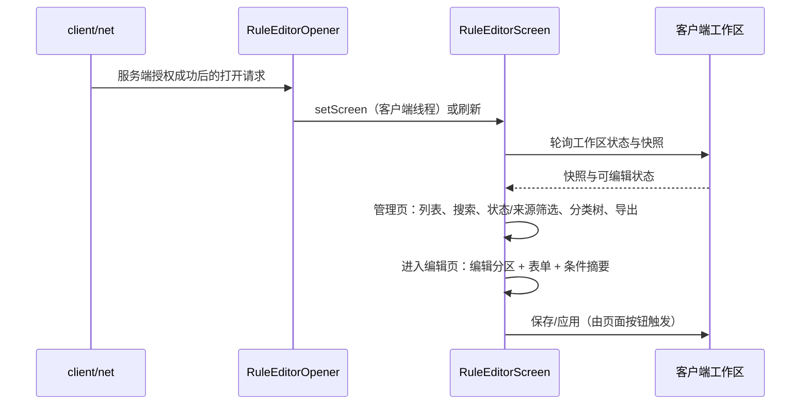
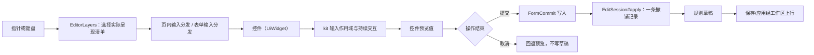

# 客户端界面

> **TL;DR**
> - 这一层把 UI kit 的原语装配成规则编辑器：主题注入、可复用控件、界面中立展示类型、三个编辑器页面与编辑分区、条件画布页。
> - 编辑器只有一个内容写入口：字段与条件编辑都经 `EditSession` 落草稿；启停改的是本服状态，走意图表与变更集的启停动作。
> - 只读条目照常进编辑页并可改：控件可写，改动不保存；启停对只读条目同样可用。

**适用对象**：改编辑器页面结构、加字段控件、加目录类型或预览图标、换主题的开发者。

## 1. 模块职责

一句话边界：在 UI kit 之上提供本项目落地的外观与控件、界面中立的展示类型，以及把规则管理、规则编辑、条件画布与调试串起来的屏幕。

子包分工：

| 子包 | 一句话职责 |
|---|---|
| `client/ui/theme` | 组合像素、扁平与 kit 原版视觉，`UiHostTheme` 扩展通用主题并提供业务配色与图标 |
| `client/ui/widget` | 在 kit 基础上提供可直接使用的输入框、列表、树、弹窗、按钮变体与条件树控件；滚动控件使用 kit 的内容宽度与行命中度量，文本控件通过 `UiTextEditSession` 协调原版模型，区间宿主控件的公共外壳（`AbstractBarShell`）也收在这一层 |
| `client/ui/shared` | `screen` 与 `screen/form` 共享的纯值与展示类型：目录图标分发、展示名称、字段到目录类型的映射、条件摘要、悬停说明的语义行模型 |
| `client/ui/screen` | 编辑器外壳、三个编辑器页面、编辑分区组合、保存遮罩与页内输入分发 |
| `client/ui/screen/form` | 描述符驱动的表单视图、字段控件基类与注册表 |

三个编辑器页面（管理页、编辑页、调试页）共用 `EditorPage` 契约，由编辑器外壳持有并决定谁是活动页。活动页通过 `EditorPage.prepare` 在布局和输入前查询外壳状态，同步动作资格、文案与控件使能。编辑页内的编辑分区由 `RuleEditorEditSections.EditSection` 定义：INFO（基本信息）、INPUT（输入与消耗）、TRIGGER（触发条件）、RESULTS（效果与产物），`EditSection#of` 把键名解析成分区、未知键回落到 INFO。分区之间共用同一份 `EditSession` 草稿。四个分区各自持有 `EditorSectionContent`，拥有表单、控件、按钮与卡片；组合视图唯一持有当前分区与各分区滚动记忆，页签从该状态派生选中值，并维护活动分区的布局缓存和文档坐标。分区直接接收外壳、字体、表单工厂与编辑动作，不持有组合容器或其他分区。

规则启用状态分两层，界面各有一处落点：默认启用是规则内容，落在基本信息分区的表单字段里；本服启用状态是独立的一层，落在基本信息分区行尾的本服开关与「恢复默认」，以及列表页的启停按钮。两者的语义见 [规则 JSON](../api/rule-json.md)，客户端侧的意图与草稿记录见 [client-editor](client-editor.md)。

## 2. 模块边界

### 对外入口

- **编辑器入口**：`RuleEditorOpener` 注册到 `EditorScreenHooks`，服务端授权成功后由 `client/net` 调用，把 `RuleEditorScreen` 切到前台或关闭；会话的发起与结束由 `client/net` 承担，它只负责切屏与会话就绪后的刷新。链路见 [authoring](authoring.md) 与 [client-editor](client-editor.md)。
- **主题注入**：`RuleEditorScreen` 选择主主题与画布外壳主题，`EditorShell` 沿页面、分区、表单和弹层装配链传递；嵌套表单继承父主题。具体主题各自持有完整不可变 `UiHostPalette`，默认工厂保持当前配色；树与列表的行高取注入实例。独立 `FormView` 构造可自行选择默认主题。
- **表单装配**：`FormView` + `FormControl` + `FormControlRegistry`，把类型描述符的字段列表渲染成可滚动的一列控件；`FormField#addAction` 向同一行追加行尾动作按钮，基本信息分区的本服开关与「恢复默认」由此挂到「默认启用」行。
- **结果页字段层级**：效果参数的主区/高级区由动作顶层 `EditorField` 的层级决定，嵌套字段随所属顶层字段展示；高级折叠状态归结果分区持有。问题定位在表单装配时按所选动作路径下的首个字段确定展开状态，同一次重建完成表单、布局和焦点树更新。
- **条件树界面**：`ConditionTreeOverlay`（画布页外壳）、`UiConditionGraphEditor`（画布编辑）、`UiConditionTreeSummary`（只读摘要兼入口）、`ConditionTreeContract`（共享类型选项、叶工厂与选中路径同步）。
- **控件与弹窗契约**：`api.control.UiWidget` 提供统一渲染与输入契约；`UiModalStack` 负责层次、遮罩和栈变化通知，每个模态拥有独立输入作用域。
- **排版快照**：`RuleEditorScreen` 与承载控件的 widget、页面、按钮条实现 kit 的 `UiLayoutSource`，把已排版的控件矩形、文案与文本带宽导出为只读快照，供 GUI 探针断言布局不变量与真实文案；快照不参与绘制与命中，也不触发重排。

### 依赖方向

箭头表示编译期依赖，方向自上而下（`client/net` 的入口类型另经 `RuleEditorOpener` 取用，图中从略）：

几条必须守住的形状：

- kit 在底层：本层各子包依赖它，而它的 import 只落在原版类型与标准库白名单上（见 [ui-kit](ui-kit.md)）。
- `shared` 是 `screen` 与 `screen/form` 的公共下游：两者都依赖它，它的 import 只落在 `client/edit`、kit、theme 与 core 契约上，于是两个子包之间只有 `screen → screen/form` 一个方向。
- `theme` 只依赖 kit 与 `client/edit` 的命名空间常量；主题负责视觉，`widget` 负责交互，两者通过注入解耦。
- `screen` 与 `screen/form` 引用 `core.api`/`core.model`/`core.network.protocol` 的公开类型；调试页与本地校验另用 `core.debug`、`core.runtime`、`core.service`、`core.type.condition` 的公开入口。
- 传输通道与上行载荷收敛在 `client/net`；界面层消费它暴露的只读工作区状态与入口类型。

### 被谁依赖

`client/net` 通过 `EditorScreenHooks`/`EditorScreenOpener` 调用 `RuleEditorOpener`；客户端入口负责把 opener 注册进去。kit 与本层之间只有 kit 被依赖这一个方向。

表单由 `FormRowLayout` 解释字段标签、说明行和数量配对，再用 `UiFormLayout` 测量相对几何。`NumberControl` 把轨道与精确文本的组合交给 `UiNumberField`，自身处理字段单位、空值、原始值、预设和草稿提交。

## 3. 关键类地图

仅列对外入口、扩展点、聚合根与并发/事务敏感类，非穷举。

| 类型 | 角色 | 职责 | 协作对象 |
|---|---|---|---|
| `RuleEditorOpener` | 界面入口 | 提供 `bootstrap`/`shutdown`/`lastRequest` 静态入口，在客户端线程把编辑器切到前台或刷新 | `client/net` 的 hooks 与打开请求 |
| `EditorShell` | 编辑器外壳 | 持有当前编辑目标、编辑会话选取、提示级别、可编辑判定与跨页命令，并持有三个编辑器页面及列表、编辑结构、焦点的待刷新需求；屏幕经它取活动页与状态 | 三个编辑器页面、`RuleEditorModel`、`UiModalStack`、`UiFocusManager` |
| `EditorPage` | 编辑器页面契约 | 三个顶层页共用的派发面：头部度量与绘制、标题与状态标签、内容与页脚排版、容器输入、布局与输入前的动作准备，以及可选的覆盖层 | `RuleEditorScreen`、编辑器外壳 |
| `EditorLayers` | 呈现清单选择 | 将当前页、保存、modal 和 picker 状态映射为同一份 `UiLayers`；输入、绘制与布局快照共同消费 | `EditorShell`、`EditorPage`、弹窗栈 |
| `EditorPageInputRoot` | 页面输入装配 | 将页面成员与公共主题按钮装入页面的稳定作用域；chrome 命中优先，Tab 位于页面目标之前 | `EditorShell`、`UiInputContainer` |
| `RuleEditorScreen` | 屏幕聚合根 | 继承 kit `UiScreen`，持有业务生命周期、窗口排版与绘制：活动页从哪里取、提示带与页脚带怎么排都由屏幕决定，输入经 `EditorLayers` 的呈现清单选择作用域后派发；工作区进入可编辑态才允许编辑，应用期间冻结，工作区释放时自行关屏 | 编辑器外壳、`EditorPage`、弹窗栈、提示条 |
| `RuleEditorListPage` | 管理页 | 搜索、状态/来源轮询筛选、分类树、规则导出与配方预览，列表底排按钮状态同步；只持有管理页控件与视图状态 | 规则会话、目录图标、`RulePackExporter`、`RuleEditorListActions` |
| `RulePackExporter` | 规则导出口 | 把列表可导出的已保存规则写成一个数据包 zip：跳过未保存草稿与有问题条目，清单格式取当前游戏的数据包版本，规则文件按 `data/<ns>/idtw/rules/<path>.json` 落位，id 强制写回 | 列表页导出弹窗、`RulePaths`、`RuleFields` |
| `RuleListDisplayCache` / `RuleListDisplaySnapshot` | 列表行展示 | 把快照条目、草稿会话与启停意图合成一行的展示快照：生效启用、待应用标记、本服标记、只读标记；缓存按内容版本、会话修订号与意图修订号失效 | `RuleEditorModel`、列表页 |
| `RuleEditorEditSections` | 编辑分区组合 | 唯一持有当前分区，统一切换与定位收尾，汇总布局、滚动、焦点与输入；分区各自拥有控件和使能策略，`EditorSectionActions` 完成编辑收尾、历史路径迁移与分类跟随 | 分区实现、`FormView`、`RuleEditorValidation` |
| `RuleEditorEditPage` | 编辑页与保存入口 | 编辑分区切换、类型选择、代码视图、保存与校验入口；`finish(reason)` 统一保留输入、结束交互、提交与释放 | `RuleEditorEditSections`、`UiModalStack` |
| `RuleEditorInfoSection` | 基本信息分区 | 规则 ID、分类与来源摘要的只读展示，显示名、默认启用、优先级与备注的表单编辑，以及行尾的本服两态开关与「恢复默认」 | `FormView`、`RuleEditorModel` |
| `RuleChangesView` | 变更清单 | 列出待应用的规则，每条同时给出内容动作与启停动作 | `RuleEditorModel`、`EditSession` |
| `RuleEditorDebugPage` | 调试页 | 按输入数量填充测试规则、一次性删除测试规则；只写草稿，落盘仍由管理页的“应用全部”决定 | `DebugTestRules` |
| `RuleEditorPageInput` | 页内输入分发 | 把按下、释放、拖动、滚动与键盘输入派发给当前页控件，并维护结果分区动作列表的拖动排序；按下归属决定释放只发给谁 | 编辑页控件、`FormView` |
| `RuleEditorPanelFactory` | 面板装配 | 装配目录模态与叶子附加控件；目录接收选择绑定，数值写入经调用方给定的 `applyChange` | `CatalogSelectionOpener`、叶子面板、目录网格 |
| `CatalogSelectionBinding` / `CatalogSelectionOpener` | 目录接收契约与宿主装配 | 接收端声明本次模式、初始引用和确认出口；宿主集中打开目录并核对活动编辑会话 | `FormView`、`CardListControl`、`SourceBlacklistPicker` |
| `UiCatalogGrid` | 目录网格 | 以一次发布的 `View` 读取条目、选择、分页、加载/错误与可用状态；只向宿主发送搜索、分页、范围和选择意图 | `RuleEditorPanelFactory`、`SourceBlacklistPicker`、弹窗 footer |
| `FormView` | 表单聚合根 | 按 `TypeEditorDescriptor` 渲染可滚动控件列；写入统一经 `EditSession`；支持定位高亮、内联选择与行尾动作 | `FormCommit`、`FormRowInput`、`FormControl` |
| `FormField` | 行身份与装配入口 | 绑定实际行，配置显隐、默认值、数值窗口、目录过滤、行尾动作与数量配对；路径随 rebase 更新，换描述符或卸载后失效 | `FormView`、字段声明 |
| `FormCommit` | 表单提交协议 | 收集纯候选、执行同次历史写入、同步表单树修订并接受原行，最后通知局部视图；普通字段独立历史，复合字段收集合法子路径 | `FormView`、`EditSession` |
| `EditorFormBindings` / `EditorQuantityBindings` | 业务表单绑定 | 有效默认值、流体兼容、撤销标签、结果分类、数量引用与存在条件关联写入 | 表单工厂、条件参数表、输入分区 |
| `FormControlContext` | 复合控件装配能力 | 提供实际子表单创建、路径、目录选择与结构命令；表单保留会话和行守卫 | 子列表、嵌套对象、卡片控件 |
| `FormControl` / `FormControlRegistry` | 字段控件扩展点 | 一个字段一行，负责装载、纯候选值转换与本地校验；普通工厂接收主题、字体、字段与变更出口，复合控件由 `FormControl.create` 单独装配。枚举控件是单个轮询按钮：当前取值显示在按钮文字里，点击切到下一个候选，候选列表与写入路径只有一份 | 描述符引擎、`EditSession` |
| `UiHostTheme` / `UiHostThemes` / `AbstractHostTheme` | 主题注入入口 | 调色板、度量、文本色、控件样式、滑块皮肤、结构绘制与图标行号；两套主题逐项相同的宿主度量与外壳原语收在 `AbstractHostTheme`，默认入口给出像素外观，扁平外观由调用方显式取用 | 全部控件与屏幕 |
| `UiWidget` / `UiModalStack` | 控件与弹窗契约 | 控件共享 `UiInputTarget`；模态栈维护层次与关闭通知，宿主选择顶层模态作用域，历史回调注入该作用域 | `EditorLayers`、`UiInputScope` |
| `ConditionTreeContract` / `UiConditionGraphEditor` / `UiConditionTreeSummary` / `ConditionTreeOverlay` | 条件树界面家族 | 同一份条件数据与校验的两种展示；共享契约提供类型选项、叶子工厂与定位，画布提供语义动作、只读工具状态与完整结构事件 | 条件模型、`FormView`、`ConditionTreeChrome` |
| `ConditionTreeProjection` / `ConditionTreeViewModel` / `ConditionTreeLabels` | 条件展示快照 | 字段协调器复用结构与诊断版本；共享标签，画布布局生成几何；相对 JSON 地址由 `ConditionTreeNodes` 解释 | 摘要、画布、条件表单 |
| `UiTreeView` / `UiTreeNode` | 管理树 | 节点仅承载数据，视图拥有投影及选择折叠；管理页用分类/规则业务 key 恢复重建状态 | kit 树投影、状态与导航 |
| `PreviewResources` | 资源生命周期所有者 | 世界、语言与模型身份决定资源世代；客户端 tick 观察变化；关屏保留近期 READY 场景，超时或世代变化释放 | `PreviewIcons`、目录名称索引 |
| `PreviewIcons` | 图标宿主门面 | 注册名、age、NBT 与结构输入统一转换，转台参数、状态文案与 kit 适配 | `CatalogPreviewIcons`、`RulePreviewIcons`、`TagPreviewIcons` |
| `StructurePreviewResources` | 资源读取 | 枚举 assets 结构，异步有界 NBT 解码并保留资源诊断 | 资源管理器、`PreviewStructure` |
| `PreviewExamplesScreen`（common dev） | 工作台工具 | 枚举结构与载荷示例，展示多个尺寸和预算 | 正式 `PreviewIcons` 入口 |
| `UiFlatText` | 文本绘制原语 | 无阴影的居中、折行文本与悬停提示面板；GUI 不使用字体阴影与加粗，标题只靠颜色、缩进与分区间距区分层次 | kit 的 `UiRenderLayers`、各控件与页面 |
| `NumberControl` / `UiRangeBar` / kit `UiTextInput` | 控件适配 | 原版输入模型由 kit 文本控件适配，数值宿主外壳委托 kit 核心；提交时机由宿主回调决定 | kit 数值/文本契约、主题 |

## 4. 关键流程

### 从授权到编辑

### 一次字段编辑的落点

作用域记录按下归属，拖动与持续交互释放直达会话目标；无会话配对释放沿原命中链派发。每个 `FormRow` 稳定持有 `FormRowInput`，字段、picker、action 按绘制顺序登记，命中按逆序选择唯一分支。滚动条在行之上，子树未消费滚轮时由当前表单视口滚动，再交给外层视口。基本信息分区的「默认启用」是这条链路里的普通内容字段；行尾的本服开关与「恢复默认」是动作按钮，不进撤销栈。

### 条件画布与宿主协作

`UiConditionGraphEditor` 拥有唯一 `UiTreeEditor`，工具栏与键盘共用结构动作；`ToolState` 缓存冻结的选择与动作资格，`StructureChange` 直接携带同次操作的 opKey 和完整 Change。`ConditionTreeOverlay` 在一次 `EditSession.apply` 中迁移输入路径并写入完整条件作用域，源码视图直接读取会话已接受原文。`ConditionTreeContract.Navigation` 供摘要与画布共同定位。

包内 `ConditionGraphInteraction` 拥有按下候选、拖动、平移、框选与范围锚点；捕获仍登记在 `UiInteractionSession`，移动基准与预览由 `UiTreeMoveInteraction` 维护。`ConditionGraphMenus` 拥有类型插入目标、确认菜单及其几何。`ConditionGraphLayout`、`ConditionGraphRenderer` 和 `ConditionGraphInlinePanel` 分别负责布局、绘制和内联壳；实际参数表单由 overlay 装配。

`EditorConditionForms` 通过 `UiModal.onPrepare` 接入 `ConditionTreeOverlay.prepareUi`，在输入与布局前处理表单、会话修订回填、选择结算、工具状态和几何。render、hitTest 与布局快照消费已准备结果。正常切换完成合法参数并保留非法原文；历史回填与外层作用域失效沿模态协调直接卸载旧视图。关闭动画只承担呈现与阻断，表单结束编辑后退出输入。

### 表单装配与页面收尾

`EditorFormFactory` 为表单注入目录入口、条件上下文、业务绑定与几何失效通知。`EditorFormBindings` 负责有效默认值、legacy fluid 兼容、来源撤销标签及结果分类跟随；`EditorQuantityBindings` 装配动态数量引用、数量显示默认值与引用过滤。普通表单与条件叶表单共用 `CatalogSelectionOpener`；嵌套表单继承该入口、默认值配方、拒绝提示与上层几何失效通知，并传递自身行过滤条件。条件上下文配方按实际子表单身份重新绑定，路径在打开时读取；源黑名单在输入表单装配处路由到分组目录。输入分区的刷新联动留在输入分区；`EditorConditionForms` 装配条件画布与局部参数表；`EditorQuantityBindings` 提供共享数量及存在条件写回。结果结构与严格值读取由编辑数据层的 `ResultStructure`、`RuleValue` 提供。

控件消费键盘前，`FormView` 固定原行身份；合法的普通字段 Enter 经 `FormCommit` 收集、写入并接受原行，长文本保留换行，待输入原文由会话保存。回调卸载或替换原行后停止该行后续提交。PageUp/PageDown 由持焦子树先处理，未消费才翻动表单。嵌套对象、子列表、卡片和叶子面板复用相同成员派发，值写入和历史仍由原提交入口负责。

`FormControl.draftValue` 与 `FormField.pendingValue` 只读取候选，不改变草稿、pending input 或接受基线。`finishInput` 只完成局部输入；`FormCommit` 在进入 `EditSession.apply` 前固定原行、路径、修订和候选。普通字段保留字段级历史，嵌套对象与子列表按合法子路径合并为一次复合字段提交；非法子字段保留原文，写集在变更前预检，缺席父对象由所属表单明确组装；已有对象沿当前草稿合并，未知字段、未编辑的显式 null 与省略键保留原状。数值、数量和卡片的接受基线在写入后逐级同步。

`addFieldWritten` 按注册顺序组合同次历史中的业务写入，`setRelatedEdit` 在写入前捕获分类等旧状态、在事务末应用关联更新。原行接受完成后才调用 `addFieldCommitted` 更新数量行、年龄显隐与数值窗口；`FormField.reload` 只重载受影响行。结构增删由提交层组织：先完成合法输入，再在同次历史内变更容器及输入路径，纯候选供应器只组装值。

`addField` 返回 `FormField`，`setDescriptor` 返回有序句柄集合；固定描述符在装配时用 `field(name)` 取得必需行，动态闭包保留句柄。`FieldPath` 统一承担数据读写、历史迁移、问题定位与高亮；字段名作为字面键组合，条件坐标经 `ConditionTreeNodes` 与实际字段上下文转换。

保存、分区和目标切换、返回、刷新及关闭进入 `RuleEditorEditPage.finish(reason)`。完成编辑先保留当前修订输入，再取消未释放预览、提交合法值并通知模型，最后卸载或重建；非法文本保留在会话并参与阻塞校验。快照身份变化前只保留输入；重绑后旧修订控件重新装载并退出该次提交。放弃草稿先释放旧页面再清除记录，关闭与 removed 共用外壳的一次释放标记。保存与应用不关闭编辑页：回执到达后页面留在原处，用户退出、工作区释放或外部切屏才关屏。

当前分区只保存在 `RuleEditorEditSections`；手动切换与跨分区问题定位共用旧输入收尾、滚动保存、交互退出和 picker 关闭流程。当前可见字段直接定位，跨目标按当前草稿选择候选与效果、重建并恢复滚动后定位。结果分区私有持有候选、效果、列表/详情阶段及高级区展开状态，外部通过语义入口选择与定位。

`EditorShell.prepareUi` 取走本批列表、编辑结构与焦点需求，依次刷新列表、重建编辑面、准备活动页动作并刷新最终焦点；回调新增需求留在下一准备点。根 `RuleEditorScreen.prepareUi` 在布局和输入前结算，tick 也在模型推进后收尾。普通输入只更新 pending input 与必要展示；结构操作、历史恢复、冲突解决和会话重绑请求编辑重建。显式导航同步完成布局与焦点并消费已满足的结构需求。快照统一在 shell tick 消费，保存回执先接纳模型和文案，再刷新展示；覆盖层变化继续立即选择实际作用域。

`EditorLayers` 将当前业务状态映射为一份呈现清单：保存时为页面与保存层；存在 modal 时为页面与按栈顺序的 modal；其余情况下加入打开的 picker，或只显示页面。`UiLayers` 从清单顶项提供稳定作用域，按同序绘制和导出布局节点。被暂隐的覆盖对象保留在原所有者中。通用输入派发交给 kit `UiInputRouter`。`UiThemedScreen` 共享正文 Context 绘制原版背景与主题窗口，`layoutUi` 准备页头、内容与页脚，`renderThemedUi` 消费同一布局结果，各呈现项从自己的作用域解析 `UiPointer` 供绘制共用；复合控件的 `hitTest` 返回实际叶子与包装/核心归属。输入与 hover 使用同一个活动作用域，POINTER 捕获只保留所属分支反馈并关闭 tooltip，KEY/TEXT 会话保留普通 hover。左键命中合格候选自动转焦，标签和滚动条等操作区保焦，真实空白清焦；事件消费独立处理。F1–F12 保持放行，Ctrl+F8 在屏幕层按保存与模态状态进入开发工作台。关屏先取消未完成会话，再冲刷已提交草稿。

页面通过 `UiInputContainer` 接入 `UiChildren`，命中、焦点贡献、普通输入和退出传播从同一成员结构派生。`EditorShell.createPageScope` 为每页装配 `EditorPageInputRoot`，页面与公共主题按钮共用该页稳定作用域。主题按钮命中优先且 Tab 靠前，管理页工具排保持 Tab 靠后。普通文本与条件说明附在 `UiPointerHit`，屏幕和模态根统一呈现，表单提示由 `rowHit` 装饰真实行命中。各页面、模态、选择器与保存遮罩独立拥有焦点和持续交互；作用域返回恢复合格的旧焦点。`EditorShell` 按滚动、名称播报、业务激活键政策组合焦点通知；编辑页用 `UiFocusFollow` 注入目标归属与内容坐标，模态用同一名称播报 adapter。展开组保留叶子归属与 Tab 锚点，内部编辑从组内位置续接。表单子树隐藏、禁用或卸载时结束本子树交互，数值取消恢复模型与文本快照。

目录网格用 `UiScrollView` 唯一持有偏移、范围、轨道和拖动会话，行命中复用 `UiRowMetrics`。网格配置整行对齐、滚轮三行、按下居中、抓取外扩与固定轨道留宽；筛选、翻页、键盘和 resize 共用偏移入口。绘制、预热和布局快照读取同一行列几何；hover、选择与 tooltip 复用带行身份的命中快照。轨道统一经 `UiScrollView.renderScrollbar` 读取主题。

宿主按钮、复选框、树与数据视图、列表编辑、分段组、条件画布及参数面板组合 kit 的 `UiWidgetShell`，普通 Widget 使用 `UiShellWidget` 默认能力。复合控件保留实际子命中、行身份、内部焦点与专用收尾。`UiButton` 的普通与胶囊路径共享核心壳及标签呈现；`UiCheckBox` 点击方框立即切换，标签点击沿整行焦点政策处理，键盘焦点框画在方框上，Enter/Space 通过通用焦点路由激活。

`ItemCountsControl` 的稳定数量条目持有 `UiLabelPresentation`，名称区域提供保焦命中，文字滚动读取同一 `UiPointer` 门禁。`AbstractBarShell` 的可用状态与焦点视图直接读取区间核心，标签、轨道和精确输入保留宿主布局；标量与区间的会话及取消恢复共用 kit 数值包内实现。

`UiSegmentedControl` 只用于编辑分区的页签切换，导航位置与业务选中独立：整组占一个 Tab 位置，方向键、Home、End 移动组内位置，Enter/Space 激活后才切换分区。状态、来源、目录范围、组合模式和产物档位等循环取值入口是单个胶囊按钮（`UiButton#setCycleStyle`，标签右侧带前进箭头），点击即切到下一个取值，不参与焦点序列。鼠标与键盘共享唯一逻辑焦点，额外焦点轮廓仅键盘操作显示；文本光标与选区照常显示。

保存遮罩使用 kit `UiOverlay` 的遮罩、保焦背景与阻断作用域；保存中 Esc/背景关闭由业务策略拒绝，取消仅向 workspace 发信号，终态由业务移除。通用模态的正常关闭统一经 `UiModal.requestClose`，宿主销毁可强制移除。

resize 保留已有页面、文本控件与编辑会话，只重排几何；单行光标/anchor、多行换宽快照以及局部历史由 kit 的原版模型 adapter 保持。

### 只读条目的编辑页

- 只读条目照常进入编辑页，内容走沙盒：控件可写，撤销与重做可用，改动只留在当前会话。
- 编辑页页头右上角的状态标签按优先级取值：工作区不可用时显示「会话冻结」，内容只读时显示「只读 · 改动不会保存」，其余按有无待应用改动显示「待应用」或「已应用」。
- 只读标签用警告色填充并加宽底色，页头标题按剩余宽度截断；冻结与只读是两句独立文案：冻结说的是会话不可写，只读说的是内容不保存。
- 底排保存按钮只按脏标记与页面可写状态合成，只读条目在没改启停时保持「无改动」的禁用态。
- 返回列表、切换编辑目标或关闭界面即丢弃沙盒内容；再次打开看到服务端内容。

### 列表页筛选与导出

状态与来源各用一个轮询按钮，点击依次切换取值，当前取值直接显示在按钮文字里，两者按交集过滤。状态取「全部 / 已启用 / 已停用」，按生效启用状态判定（未应用的启停意图已计入）；来源取「全部 / 覆盖层 / 数据包」，来源为混合（覆盖层条目同时存在数据包同名规则）的条目在两个来源取值下都可见。

列表行的状态后缀按固定顺序追加：先是问题或待应用标记，再是「（本服）」，最后是「只读」。待应用包含内容改动、本次新建与未应用的启停意图；「（本服）」只在存在本服覆盖或覆盖类意图时出现；停用的行整行置灰。编辑按钮恒为「编辑」，只读条目同样进入编辑页；启停按钮显示下一步动作（当前生效时显示「停用」，否则显示「启用」），对只读条目同样可用；删除按钮只在条目内容可写时可点。

问题不占筛选按钮：条目带服务端校验问题或客户端解码失败时，列表树把它归入「有问题」分组，优先于「未完成」与常规分类；问题消失后回到原分组。分组无成员时自动隐藏，问题一出现就能在树上看到。

导出弹窗提供两个范围：「覆盖层」只含覆盖层来源的可导出条目，「覆盖层 + 数据包」再包含数据包条目。可导出指条目已保存、状态为生效或停用、有可读规则体且未标记删除；未保存草稿（「未完成」分组）、有问题条目（「有问题」分组）与非法条目不导出，避免把半成品或不可用规则带到别的设备。导出文件写到游戏根目录下的 `itemdespawntowhat-exports/`，zip 内是标准数据包结构，可直接作为存档数据包使用或解压后共享。

### 启停控制

- 列表行启停按钮：点击在模型里产生显式启用或停用意图，提示「已启用（本服）」或「已停用（本服）」。新建规则与已保存规则走同一路径，规则内容的默认启用保持原值；目标值与默认启用相同时仍保留本服覆盖。
- 基本信息分区的「默认启用」是内容字段，仍由表单控件编辑并进入撤销栈；同一行的行尾并排两个动作：本服两态开关（标签直接显示生效状态「本服：启用」或「本服：停用」）与「恢复默认」。
- 「恢复默认」在存在本服覆盖或未应用的覆盖意图时可点；本服开关在页面可写时始终可点。两者不写入表单字段、不产生撤销记录，但计入脏标记与行内「待应用」状态；条目仍留在原分类分组，停用行照常置灰。
- 本服开关的标签每帧按「意图 ?? 本服覆盖 ?? 默认启用」刷新；存在显式本服覆盖时，修改默认启用保留本服状态；继承默认时，生效状态随默认启用变化。
- 列表底排的「应用」按钮与编辑页底排的保存按钮都按脏标记合成：有改动时显示「应用改动（N）」并可点，没有时显示「无改动」并禁用；启停意图与内容改动同批提交。
- 变更清单里一条规则可同时列出内容动作与启停动作，两段用「 + 」连接。

### 图标准备与短期驻留

目录只登记可见行及上下相邻一行的预取，标签轮播登记当前与下一成员；实际绘制优先消耗共享准备预算，帧末再处理预取。准备态使用低对比度中性槽位，不可用终态使用问号标记。方块与方块实体沿共用视图绕模型中心旋转，与实体使用同一周期和相位，取景使用整圈固定包围。

`PreviewResources.screenClosed` 在关闭与 removed 路径保留最近实际展示的 READY 场景，最多保留 64 个场景和 64 个 renderer 实例，15 秒后释放；重复关闭通知共用同一到期时间。几何继续受场景所有者的 GPU 预算约束。客户端 tick 在关屏后继续观察到期、世界、语言和模型世代，失效时立即释放；重新打开恢复逐帧推进。

### 图标开发验收入口

开发客户端按 **Ctrl+F8** 进入 `DebugWorkbenchScreen` 工具目录，再选择 `PreviewExamplesScreen` 图标预览。B 轮换默认、小容量和过限预算，N 切换请求组，独立所有者复用宿主线程池。列表从资源管理器枚举本模组的 `assets/itemdespawntowhat/structures/<path>.nbt`，逻辑 id 保留子目录；资源包覆盖同路径后用 F3+T 重载。随包 `preview/icon_gallery` 包含跨 x=16 的水体、玻璃围合、箱子、告示牌文字与实体载荷。每个结构以 16、48、80 像素绘制，显示准备状态、失败原因与 GPU／待上传预算。滚轮浏览，空格切换转台，R 清理并重读，Esc 关闭。

结构解码读取 size、palette／palettes、blocks、entities，多 palette 固定首组；压缩 NBT 使用 16 MiB 读取限额，尺寸体积在分配前检查。静态几何使用完整只读占位；需要世界的实例使用当前客户端 Level。实体与方块实体独立创建、不入世界、不 tick，方块实体邻居联动按独立实例展示。开发列表另外提供幼年实体、带物品实体、Display 与空实体，使用相同正式入口。

### 运行时换肤

编辑器顶部栏提供「外观：当前风格 / 原版风格」按钮，管理、编辑和调试页共享同一实例。标题、状态标签与换肤按钮同处顶部栏：标题居左，状态标签与换肤按钮靠右，栏高取页声明的最小高度与控件高度中的较大值；窄窗口下先压缩状态标签宽度，标题再按剩余宽度截断，状态标签放不下时隐藏。页签与页内容都从顶部栏下方开始。按钮通过页面正常命中、焦点、Tab、Enter/Space 和旁白链激活，并导出真实布局快照；保存、模态和选择器沿现有作用域阻断背景操作。

`RuleEditorScreen.requestTheme(UiThemeScheme)` 请求完整方案，`UiThemeSelection` 保存客户端运行期间的方案标识，首次默认当前风格，重开编辑器恢复选择。当前风格是像素正文与扁平画布组合；原版风格以组合方式复用 `UiMinecraftTheme`，通用外壳直接委托 kit，宿主组合业务调色板与图标，窗口、顶部栏、内凹列表与面板都透出原版背景，正文与画布 Context 同次发布。主题定义与按角色解析的 skin 保持不可变，业务色按 `UiHostPalette` 的表面、控件、状态、代码、画布和说明职责组合。语义表面同时封装颜色与 painter，像素圆角使用可染色掩码；`UiHostIcon` 表达业务用途，图集切片由 Adapter 解析。

根通过 `UiThemePublication` 在输入派发结束后的准备点应用最后一次主题请求，存在指针捕获时等待原手势正常结束；重复选择不发布版本。先替换完整方案，再刷新页面、模态和覆盖面布局并同步输入。表单、摘要、树与代码视图按 revision 更新度量或着色缓存；原控件保留文本原文、选区、局部历史、草稿、业务选择、折叠、焦点及有效滚动位置。

普通 tooltip 与结构化说明共享 `UiTooltipSkin` 的外框、留白及 `UiTooltipPanel` 默认定位；内容的标签列、Tone 和行数策略由宿主说明面板维护。提示贡献沿 `UiPointerHit` 命中结果和活动作用域的 `allowsTooltip` 门禁呈现。缓存的目录预览通过 `UiIcon.Themed` 在绘制位置接收主题，占位与标签标记随所在区域配色，真实物品及事件图像保留自身语义。

### 调试工作台

`DebugWorkbenchScreen` 位于 common dev 的 client/debug，目录显式装配组件展台、组合交互、独立 kit 展示、图标预览和测试规则草稿。NeoForge probe 客户端事件装配 Ctrl+F8；main 的 `DebugWorkbenchHooks` 只持有打开动作。草稿工具保留在编辑器，预览和本地场景由各自 Screen 持有状态与资源。独立 kit 展示使用 UiThemedScreen、UiInputScope、UiLayers 和 UiModalStack，内容只依赖 kit、原版类型与本地模型；外围目录注入导航与可选预览工厂，`KitSkinSamples` 提供默认、改色、资源和 painter 主题。展示包含文本/数值/列表、嵌套滚动、文档 Frame、浮板、灯箱、连线、导航、双点阵和 Layers 空间页。Layers 在显式背景上以相反顺序混排 Sprite、文字与立体、平面、透明、附魔物品，有世界时通过外层注入的工厂增加旋转方块场景；本页支持前景/兄弟重叠开关、统一提示和布局节点。kit 预算展示以 B 轮换默认、小预算、几何过限、请求容量拒绝/恢复四种模式。F6 换肤，基础页 G 修改单个点阵配置、R 发起真实资源重载。图标预览继续提供独立入口。纯 kit 样例由 `common:compileUiKitSamples` 在排除产品 main 输出的 classpath 上编译，工作台只负责外层接入。场景使用 UiInputScope、UiInputRouter 和 UiModalStack；模态切换取消持续交互，返回编辑器时重建屏幕并复用有效工作区。

`FormView.layoutNodes` 保留字段作用域；CardListControl 导出卡片及子控件，UiCatalogGrid 导出当前可见目录行，RuleNameInput 导出真实文本框。`RuleEditorScreen.layoutNodes` 沿实际呈现清单汇集节点；保存层导出面板、文本、进度条和按钮，picker 与 modal 按当前显示选择导出。保存按钮资格与文案在布局时同步；picker 动画每个可见绘制帧推进一次，事件重排读取当前进度。自动化定位使用实际层级和几何。工作台组件状态在同一页面可见、可滚动、可重置，详见 [GUI 探针](../guides/gui-probes.md)。

## 5. 扩展点与约束

### 扩展点

- **规则固定表单**：基本信息、延迟、条件树和输入精简字段从 `BuiltinEditorDescriptors` 获取；screen 保留布局、tooltip、动态窗口与动作，`EditorField` 的值域使用 `FieldDomain`，数值与枚举直接读取类型化数据。
- **新增字段控件**：实现 `FormControl` 子类，并在 `FormControlRegistry` 的穷举 switch 增加工厂分支。数值字段先走 `FormControl#create` 的“滑杆 + 行内精确输入”，域元数据不足时才落到注册表；第三方只读描述符使用显式 `RAW_JSON` 类型；新增已知字段漏接控件会在编译期报错。字段归类用 `EditorField` 的分类谓词（列表、数值、说明行、可带标签等）判断，不对 `EditorFieldType` 做 switch。
- **嵌套对象列表的卡片形态**：参数声明标 `ParamShape.CARD_LIST` 时，`ParamProjection` 把该列表投影成 `EditorField.cardList`，界面交给 `CardListControl`。控件自绘字段标题与「添加」入口，每条元素是一张卡片：首行是目录引用胶囊（图标 + 显示名，点开目录替换单个条目），下方是数值行里并排的数值控件。点「添加」以多选目录勾选引用：目录里把当前条目回填为已勾选，确认后按勾选结果补齐或移除卡片，保留卡片的数值与省略字段保持原样，新卡片采用声明默认值；更新时以原对象为底稿保留扩展字段。非对象项、缺失或非法引用项保留在原有相对顺序，新增项追加；单张替换只修改目标卡片的引用。
- **目录接收与提交**：`CatalogSelectionBinding` 表达本次单选／多选、不可变初始引用与完整快照确认出口。普通引用字段按 `EditorField.isMultiCatalog` 声明模式，卡片替换与集合编辑按操作声明。表单完成合法待提交输入后捕获固定修订、所属行与目标路径；目录只修改临时选择，确认时核对行、路径、草稿修订及活动会话。空快照表示清空可编辑选择，取消与 Esc 只关闭目录；未变化的选择保留原始值。字段、关联数量与存在条件继续沿同一 `FormCommit`／`EditSession` 回调写入，共享一条内容历史；外部组件可在确认出口转换结果并使用现有草稿入口。
- **目录宿主**：`RuleEditorPanelFactory.CatalogPicker` 与 `SourceBlacklistPicker.Picker` 各自持有查询、页请求、完整临时选择与当前 `View`。搜索、翻页、范围与选择命令在返回前完成本地查询和发布，确认读取宿主最新选择。`CatalogDisplayQuery` 统一搜索和分页；平铺目录保留网络目录与标签合并，黑名单保留源标签组、空组和组内子页，当前页才展开条目与图标。宿主推进内容语义代次，选择或资格变化保持该代次。`UiCatalogGrid.applyView` 显式接纳快照，直接读取其中的条目、选择、导航和状态；搜索框原文、选区、光标、滚动、几何与绘制缓存仍由网格持有。同页内容更新按条目 id 恢复光标，页、范围或接受查询变化重置列表位置。`EditorShell.prepareUi` 通过模态栈在输入域与命中确定前接纳工作区、语言、资源及可编辑变化；首次打开先准备再布局与收集焦点。渲染、布局快照与旁白读取已发布视图，重试继续使用显式目录请求。
- **目录名称与引用**：展示条目持有已解析的 `TaggedId`，图标、标签预览和策略直接消费引用值。目录 label 按类型解释，subLabel 为来源原文；已选内容复用同一名称策略，缺键使用资源路径可读名称，技术 id 保留给悬停与搜索。取舍见 [ADR-0059](../adr/0059-catalog-label-policy.md)。
- **新增界面标记图标**：标记图集是 `textures/gui/editor/marks.png`，由 `tools/image_generator/generate-editor-marks.py` 生成，字形为纯白、按调用方给定的主题色染色；在 `theme` 的 `UiMarkIcons.Mark` 登记行号与尺寸，用 `UiMarkIcons.icon(mark, color)` 取得图标后交给控件的 `setIcon` 或直接渲染。
- **新增事件图标**：事件图集是 `textures/gui/editor/events.png`，单列五行、每格 32×32 彩色成品，按 16 像素槽位缩放绘制，不做主题染色；图集为手工美术，增改图标直接替换贴图并保持格子尺寸与行序；在 `theme` 的 `UiEventIcons.Event` 登记行号，动作到事件的判定收在 `shared/EventPreviewIcons`，新增天象类动作在那里补一支分支。
- **新增目录类型或预览图标**：在 `CatalogTypePresentation` 为每种 `RuleCatalogType` 穷举登记名称／普通图标组合、标签能力与默认隐藏策略；标签能力集中 registry、成员说明及可选成员预览，动态 registry 随当前世界取得；字段目录类型由精确 registry 键映射。展示内容统一送入 `PreviewIcons`，物品场景身份由完整 `ItemStack` 主体缓存。场景资源由 kit `preview` 持有，`PreviewResources` 统一世代和关闭；名称解释由类型策略统一调用，流体名称与过滤实现留在 `FluidPreviewIcons`，标签展开与事件图集留在各宿主。实体 age、方块实体 NBT 与完整实体 NBT 参与场景身份。
- **新增条件类型**：数据与校验在 `client/edit` 的条件模型上落点（见 [client-editor](client-editor.md)），界面侧在 `ConditionTreeContract` 的类型选项与叶子工厂登记；画布与缩进摘要消费字段级 `ConditionTreeViewModel` 的结构诊断投影；字体、语言和宽度只影响各渲染器的文本与几何缓存。
- **新增编辑分区或结果分区动作**：在 `RuleEditorEditSections.EditSection` 增加常量并实现对应分区；面板装配放 `RuleEditorPanelFactory`。页面共享的布局常量（页内留白、行高、表单与对话框的按钮高度）、`UI` 文案前缀与 2 个存在条件叶类型 id 收在 `RuleEditorPageSupport`，3 个页描述符 id 由 `BuiltinEditorDescriptors` 提供；`RuleEditorPageSupport` 不持有界面状态、不装配控件；同一层的业务助手按关注点分开：`PresenceLeaves` 管存在条件叶的构造、扫描与增删，`CatalystQuantities` 管催化剂数量表对账，`EditorQuantityBindings` 管共享数量与存在条件写回；规则结构与严格值读取由 `client/edit` 的 `ResultStructure`、`RuleValue` 提供。
- **新增行尾动作**：`UiButton` 配 `FormField#addAction` 挂到某个字段行；动作按钮不进入表单字段，读写模型而非草稿 JSON，需要参与保存时在变更集组装处接线。
- **新增主题**：实现 `UiHostTheme`（它本身就是 kit `UiStyleSource` 的宿主侧入口），在 `UiHostThemes` 暴露取用入口；控件经注入取色，新增皮肤集中修改主题实现；可选完整方案由 `UiThemeScheme` 解析，发布沿屏幕统一请求入口。
- **新增宿主控件**：实现 `UiWidget`，普通可聚焦控件用 `UiShellWidget` 组合 `UiWidgetShell`，独立名称行组合 `UiLabelPresentation`；沿所属作用域的内容树派发输入；需要模态行为时放进 `UiModalStack`，焦点由 `UiInputTarget.addFocusTargets` 贡献，作用域自动收集；普通容器实现 `UiInputContainer` 并提供稳定 `UiChildren`，独立结构变更使焦点索引失效。
- **新增调试能力**：测试规则的身份前缀、分类归属与规则体在 `DebugTestRules` 统一约定，调试页只负责批量填充与按前缀删除。

### 约束

- 内容单写入口：外部只读 `EditSession.root/valueAt`，活草稿仅在 `apply(opKey, edits -> ...)` 回调中提供；所有内容写入经 `EditSession#apply`，一次完整操作一条撤销记录；面板工厂与控件只装配、只搬运值。只读条目的内容也走这条链路，只读约束落在草稿持久化与变更集组装两处。
- 启停是独立控制面：开关与「恢复默认」只改本服意图与脏标记，不写表单字段、不进撤销栈；提交时以变更集的启停动作上行。
- 界面按描述符装配；JSON 的解析与构造收敛在 `client/edit`，界面消费模型或转换结果。
- 主题只表达视觉，控件只表达交互语义；控件通过注入取色，不静态读取主题类。
- 全 GUI 不使用字体阴影与加粗：需要居中、折行或悬停提示文本时统一走 `UiFlatText`，原版的 `drawCenteredString`、`drawWordWrap`、`renderTooltip` 会把暗色阴影叠在浅色底板上；信息层次由字体颜色、缩进与分区间距表达。
- 页面内容里的按钮统一用扁平胶囊样式（`UiButton#setChipStyle`），循环取值的按钮另加 `setCycleStyle`，复用同一套胶囊底图并自动带前进箭头；立体边只留给外壳页脚的保存行。扁平填充配 `PANEL_BORDER` 描边，让按钮与同页的标签框、页签、列表行处在同一层次。
- 悬停提示只补充画面上读不到的信息：规则名、组合方式、撤销说明、只读含义等；动作名、叉号、翻页箭头、页签选项、物品卡与行为卡这类已有文字或符号表达的内容不再重复解释。
- 必填字段在标签右上角加 `*` 角标；缺值时用红色标签与控件下沿的红色警示线表达。
- 结果分区的行为列表与右侧详情卡共用一条下界：下界取视口底、左栏整装四条胶囊（含加号）所需高、右卡内容高三者中的最大值，两栏底边始终对齐。列表按「全部条目所需高 + 列表视口内缩」收紧到该下界：条目装得下时不滚动，超出后列表滚动、加号停在列表底边下一按钮间距处且不越过下界内边距。添加入口是方形加号胶囊，图标复用工具列的加号，在列表列内水平居中。某个取值下不再生效的参数直接隐藏该行，不另加说明文字。
- 条件树的结构与参数编辑只在画布页完成，缩进树保持只读并作为进入画布的入口（[ADR-0031](../adr/0031-condition-tree-single-editor-two-renders.md)）。条件编辑入口统一在触发分区，结果分区只编辑动作自身的参数与共用补充参数（概率、延迟），动作说明也不重复条件行。
- 条件摘要与画布各自拥有选择和折叠；画布把 Kit 视图变化发布为准备通知，宿主在树动作结束后同步参数。功能栏、工具列与画布/JSON 区域用 `UiFocusManager` 决定 Tab 顺序。
- 文本字段只创建实际使用的单行或多行控件；表单快照与回填依赖 `UiTextValue`。两种控件共用码点接纳与滚动条几何，分别保留原版编辑和历史适配。
- 画布页与画布内联编辑框使用扁平外观，且只在调用方显式注入时生效（[ADR-0028](../adr/0028-canvas-page-and-flat-skin.md)）。
- 上行载荷与传输通道收敛在 `client/net`；界面直接使用 `RuleEditClientWorkspace` 的会话、保存和资源值模型；目录、来源、快照与寿命查询走显式请求动作。

### 改动后的验证

1. IDE 工作区检查 → `tools/dsh-build.ps1 -Tasks build`。
2. 界面布局按 [ADR-0022](../adr/0022-client-ui-kit-adoption.md) 的视觉基线验收：最低 320×240 GUI 逻辑坐标、页面在 GUI 缩放 1x/2x/3x 下无重叠与文本溢出，颜色线索同时给出文字或图标。可用 [GUI 探针](../guides/gui-probes.md) 在本机跑真实客户端用例，拿到判定与截图证据。
3. 改文案跑 `python tools/check-i18n.py`；改 kit 边界的引用跑 `tools/check-ui-kit-boundaries.py`；改文档链接跑 `python tools/check-docs.py`。

## 6. 数据与配置引用

界面只消费规则数据与配置，单一事实源在下列文档，本页只做指向：

- 规则字段语义、默认启用与本服启用状态：[规则 JSON](../api/rule-json.md)。
- 表单问题、校验文案与拒载粒度：[错误与状态码](../api/errors.md)。
- 会话、分片与保存回执（含启停动作）：[编辑协议](../api/edit-protocol.md)。
- 客户端与服务端配置项：[配置](../ops/configuration.md)。

界面文案的键前缀为 `gui.itemdespawntowhat.edit.`，字段问题另用 `gui.itemdespawntowhat.edit.issue.`（见 `FormControl` 的常量）；中英文语言文件由 `tools/check-i18n.py` 同步校验。

## 相关文档

- 模块总览：[模块索引](README.md)
- 底层原语：[UI kit](ui-kit.md)
- 草稿、启停意图与类型编辑器注册表：[client-editor](client-editor.md)
- 服务端编辑会话与落盘：[authoring](authoring.md)
- 条件与效果类型注册：[type-system](type-system.md)
- 依赖规则：[依赖规则](../architecture/dependency-rules.md)
- 跨模块链路：[关键链路](../architecture/key-flows.md)
- 决策：[ADR-0022](../adr/0022-client-ui-kit-adoption.md)、[ADR-0028](../adr/0028-canvas-page-and-flat-skin.md)、[ADR-0029](../adr/0029-client-dependency-boundary-and-shared-subpackage.md)、[ADR-0031](../adr/0031-condition-tree-single-editor-two-renders.md)、[ADR-0061](../adr/0061-kit-default-theme-and-host-switch.md)、[ADR-0044](../adr/0044-rule-enable-state-layering.md)、[ADR-0045](../adr/0045-readonly-sandbox-editing.md)
- 写作与命名约定：[代码风格](../guides/code-style.md)
- 文档体系：[文档体系](../README.md)
