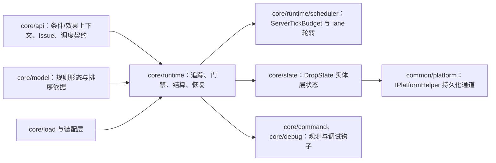
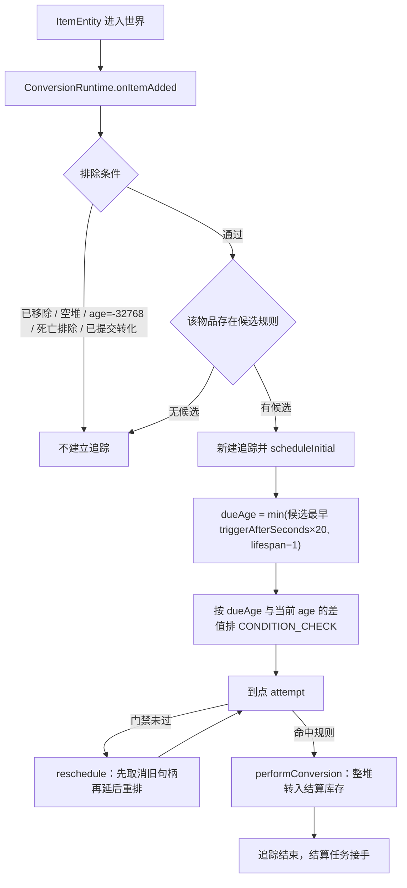
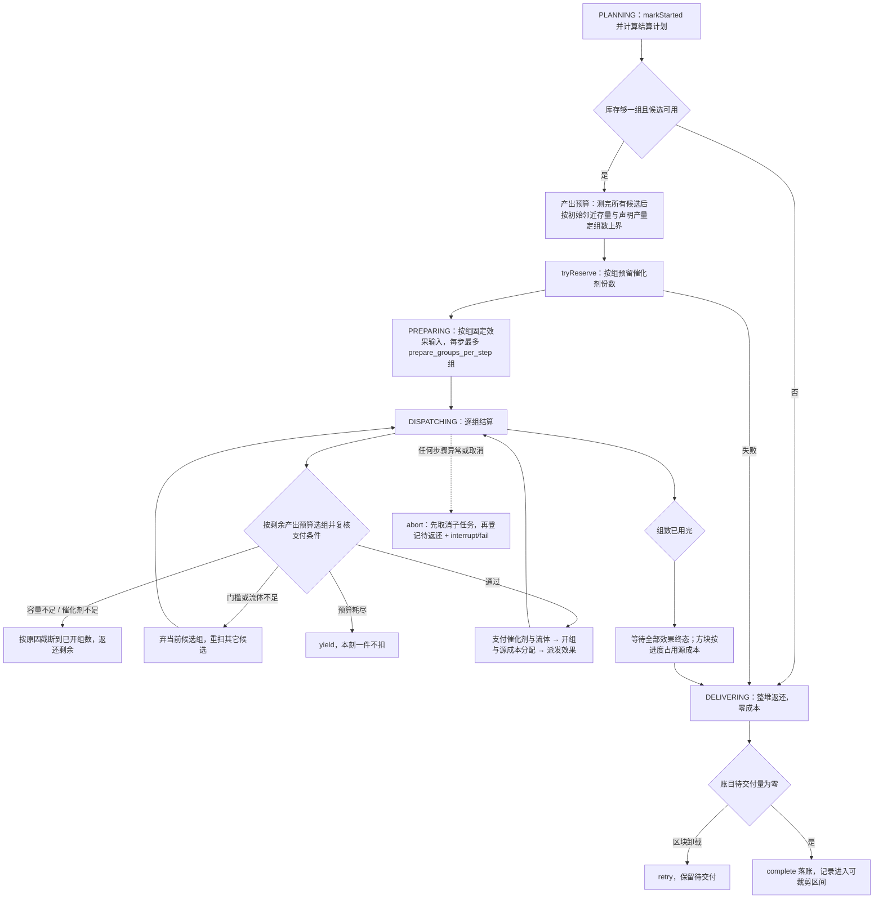

# 转化运行时

> **TL;DR**
> - 本模块把“掉落物存在”推进成一条可排期的链路：追踪实体 → 到点做预检查门禁 → 命中规则后整堆转入结算库存。
> - 结算按固定源成本确定组数：方块按实际放置进度占用成本，其余行为按组支付；全部效果终态后返还源余量，真实账目只认执行器回执。
> - 所有维度与所有任务种类共用一份 `ServerTickBudget`；取消或异常只留一条待返还记录，世界写入交给 `SettlementRecovery`。

**适用对象**：修改触发与结算语义、排查“该转化没转化 / 转化了但货没回来”、调整 tick 预算与退避参数、维护掉落物实体状态的开发者。

## 1. 模块职责

一句话边界：在服务器 tick 上判断一个已存在的掉落物实体“该不该转化、能不能转化、转化多少组、货怎么交还”，并把每一步世界操作压进共享 tick 预算。

本模块承担：

- 追踪：为进入世界的掉落物实体建立追踪，按候选规则的最早触发时间与剩余寿命算出首个检查刻。
- 触发：自然到期由调度器的 `CONDITION_CHECK` 任务推动；环境伤害由两端 `ItemEntityMixin` 经 `RuleRuntimeHost` 转发到 `requestEnvironmentalConversion`。
- 预检查门禁与规则选择：实体有效性、区块 ticking、实体锁、永久禁转、转化冷却、候选存在性，再按排序取首个命中规则。
- 完整组结算：把整堆转入结算库存，按初始环境预算定组、复核支付条件、分配源成本、派发效果并按实际占用返还剩余；开组前支付受阻按容量、催化剂、门槛、流体四类原因区分，容量或催化剂真的不够才截断整批。
- 持久化与恢复：结算记录台账、待返还记录的启动补扫与交付。
- 实体临时状态：新产物保护（掉落物写实体持久数据，生物与其他实体只按实体身份记内存到期刻）与转化冷却、返还物永久保护与永久禁转。
- 共享预算实现：`core/runtime/scheduler` 提供 `core/api/scheduler` 契约的实现。

规则语义（消失方式、固定成本、组合模式、候选结果）来自 `core/model`，条件树求值与效果执行属于类型系统与效果执行器；本模块只按契约调用，不重复定义语义。

## 2. 模块边界

### 对外入口

- 追踪生命周期：`ConversionRuntime.onItemAdded`、`rebuild(level)`、`prepareRules(...)`、`publish(server, prepared)`、`publishDecoded(server, index)`、`replaceRules(...)`、`clear(level)`、`shutdown()`；逐维回扫不是对外入口，只由模块内部的 `RulePublication` 经 `WorldRescan` 入队。
- tick 驱动：`onServerTick`，由宿主在服务器 tick 事件中调用。
- 环境触发：`requestEnvironmentalConversion(level, item, source)`；伤害是否属于可触发类型由 `DamageClassification.classify` 判定。
- 实体状态：`DropStateStore` 的读取、写入、清除与 `blocksEnvironmentalDamage` 判定；授予入口在效果执行侧的 `ReturnItemSpawner`。
- 调度：`ServerScheduler` 实现 `TaskQueue`，向运行时暴露维度注册、取消、摘除与全局释放。
- 观测：`trackedCount`、`debugInfo`、`pendingTasks`、`queueStats`、`schedulerStats`、`budgetSnapshot`、`activeRecoveryCount`、`recoverySkippedDimensions`、`settlementRecoveryStats`、`rescanPending`、`rescanSteps`。

### 依赖方向

编译期依赖只有 `core/api`（含 `api/scheduler`）、`core/model`、`core/load` 的产物类型、Minecraft 与平台抽象接口。调度器不认识任何具体任务类型，只按 `ServerTaskKind` 分 lane。

### 被谁依赖

- 平台层：tick 事件驱动 `onServerTick`；实体加入世界与伤害拦截把入口分别接到 `onItemAdded` 与 `requestEnvironmentalConversion`。
- 加载与装配层：启动加载调 `replaceRules`（只换入，随后逐维 `rebuild` 扫描世界）；数据包重载与命令重载先 `prepareRules` 构建、再 `publish` 换入；编辑器保存与启停成功后调 `publishDecoded` 换入。三条路径的换入与逐维排队回扫都在运行时内部完成，调用方只交规则集或已解码索引。
- 效果执行侧：返还效果经 `ReturnItemSpawner` 写实体状态，结算与它共享同一套预留与落账口径。
- 命令与调试层：查询、预算快照与开发场景观察读取本模块的观测入口。

## 3. 关键类地图

仅列对外入口、扩展点、聚合根与并发/事务敏感类，非穷举。

| 类型（`core/runtime`、`core/runtime/scheduler`、`core/state` 下） | 角色 | 职责 | 协作对象 |
|---|---|---|---|
| `ConversionRuntime` | 门面与执行器 | 按维度持有追踪表与标签/气候缓存；负责追踪建立、排期、门禁裁决的执行端（转化提交、重排、释放）与观测；四个状态簇各由独立包内类持有 | `ConversionGate`、`RulePublication`、`WorldRescan`、`SettlementRecoveryQueue`、`ServerScheduler`、`SettlementLedger` |
| `ConversionGate` | 无状态裁决 | 一次到期判定的全部短路条件与单趟选规：区块 ticking、锁定、永久禁转、冷却、候选、年龄门槛与退避档在同一遍里得出；产出 `Convert` / `Wait` / `Release` / `Idle` 四值结论，不持有也不回写状态 | `ConversionRuntime`（注入候选与条件上下文查询）、`DropStateStore` |
| `RulePublication` | 规则发布 | 生效索引、发布代次、候选结构摘要与发布后的逐维回扫入队；换入时清空各维度追踪与条件缓存，并由宿主摘除维度 realm | `ConversionRuntime.reloadLevels`、`WorldRescan`、`CandidateStructureVersions` |
| `WorldRescan` | 逐维回扫 | 每维已加载掉落物有序索引、轮次 token、分步游标与世界扫描快照；以维护任务分片推进，失败只重排一份续接 | `ConversionRuntime.onItemAdded`、`ServerScheduler`、`SettlementRecoveryQueue` |
| `SettlementRecoveryQueue` | 恢复队列 | 本轮会话内的待恢复记录、重试档位、退避排期、放弃与告警计数；泵任务每 tick 至多启动一条恢复 | `SettlementRecovery`、`SettlementLedger`、`ServerScheduler` |
| `ConversionSettlement` | 事务敏感任务 | `EFFECT` 任务的聚合根：只推进阶段（计划/准备/派发/交付）与守住提交边界；取消与异常统一走 `abort` | `SettlementPhases`、`SettlementGroupPlan`、`SettlementCatalystStage`、`SettlementPayment`、`SettlementReceipts`、`SettlementSourceCharge`、`SettlementItemOutputs`、`SettlementBlockOutputs`、`EffectTask` |
| `SettlementPhases` | 阶段状态机 | 只维护当前阶段与合法跃迁，不读账目也不写世界 | `ConversionSettlement` |
| `SettlementGroupPlan` / `SettlementCapacityProbe` | 计划与容量 | 候选选择与组数上界（唯一实现）、逐候选容量探测与产出预算（预算耗尽跨刻续算、已完成候选结果复用） | `ConversionSettlement`、`EffectType.capacityDemand`、`NearbyProductLimits`、`RoundRobinCursors` |
| `SettlementCatalystStage` | 催化剂编排 | 计划期催化剂上界、预留组与开组前门槛/流体复核对象 | `ConversionSettlement`、`CatalystReservations`、`CatalystThresholdCheck`、`FluidSourceResolver` |
| `SettlementPayment` / `SettlementReceipts` | 支付与回执 | 开组前输入复核与支付；效果回执解释与进度门禁，接收资格由聚合根阶段决定 | `CatalystReservations`、`SettlementRecord.Writer` |
| `RebateDelivery` | 有界交付 | 活跃结算与恢复共用的分堆、跨刻选址与成功扣账，数量只读账目 | `ReturnItemSpawner`、`SettlementRecord.Writer` |
| `SettlementLedger` / `SettlementRecord.Writer` | 持久化聚合 | 主世界 `SavedData` 台账；记录状态、计数与待交付量只经 `Writer` 改动，结算步内累积、步末一次提交（写回双索引并标脏），中止/取消/失败与恢复收尾在步外立即提交 | `ConversionRuntime`、`SettlementRecovery`、`ConversionSettlement` |
| `SettlementSourceCharge` / `SettlementBlockOutputs` | 方块结算与汇总 | 同组源成本按最高占用计费；同候选、槽位与目标方块合并为一次扫描，保留每组到期刻与消费回执 | `ConversionSettlement`、`PlaceBlockExecutor.BatchPlan` |
| `SettlementRecovery` | 补偿任务 | 只交付记录里的待交付库存，交付成功后才扣减并落账，完成/失败/取消都幂等关闭 | `SettlementLedger`、`ServerScheduler` |
| `EffectTask` | 并发敏感 | 单个效果的执行包装：一次求值、推进执行、回执入账；终态先摘引用再回执 | `ConversionRuntime.startEffect`、`EffectResult` |
| `ServerScheduler` / `ServerTickBudget` | 共享预算 | 每服务器一份预算，按维度 realm 与任务种类 lane 公平轮转，按真实世界操作量计费 | 全部任务类型 |
| `RealmCleanupTask` | 续接清理任务 | 摘除 realm 后把收集到的句柄逐槽取消：每步按 `cancels_per_step` 与单 tick 额度取用，取消回调异常隔离；停服时就地排空 | `ServerScheduler`、`ScheduledTask` |
| `RuleIndex` / `RoundRobinCursors` / `CandidateStructureVersions` | 索引与游标 | 候选按优先级与条件复杂度排序；跨结算共享轮转游标；候选结构版本用于判定失效 | `RulePublication`、`ConversionSettlement` |
| `CatalystReservations` | 并发敏感 | 运行期催化剂预留表，按结算 id 预留、支付和释放；不落盘，停服清空 | `ConversionSettlement` |
| `DropStateStore` / `DropState` | 实体状态 | 保护、冷却、死亡排除与转化提交的实体层存取；平台差异经 `IPlatformHelper` 承载 | 效果执行侧授予、平台伤害处理、门禁读取 |
| `DamageClassification` | 触发分类 | 判定伤害是否属于可触发环境转化的类型 | `requestEnvironmentalConversion` |

## 4. 关键流程

### 4.1 追踪建立与自然触发排期

追踪的建立是幂等的：已 tracked 且句柄仍有效的实体再次进入 `onItemAdded` 直接返回；每维的已掉落物有序索引（`WorldRescan.State`）按实体 id 索引，供重载后的回扫游标使用。`converted` 标签标记“已提交转化”的实体，回扫与重复回调都会因此跳过。

回扫是分步续接任务，入口只清表并入队，不在服务端线程同步遍历整维实体：

| 入口 | 模式 | 依据 |
|---|---|---|
| 启动 `rebuild(level)`、维度加载 `rebuild(level)` | 世界扫描 | 这些实体的 join 事件早于运行时装配，`items` 表不完整；入口收集一次已加载掉落物的引用快照，分步按快照登记 |
| 规则发布后的逐维排队（`RulePublication` → `WorldRescan`） | 有序 id 游标；上一轮世界扫描快照尚未消化完时仍按世界扫描续接 | `items` 表由 join/leave 事件持续维护，按 `higherEntry` 游标逐条重建追踪；快照未消化完时沿用快照并在登记完后追加同一套游标，避免漏登记 |

两种模式单步都只把 `rescan_entities_per_step` 个实体交给 `onItemAdded`，且每步检查共享预算；世界扫描模式在入口收集一次已加载掉落物的引用快照（不改追踪状态），步骤按快照切片登记，既不跨 tick 持有世界迭代器，也不必每步重扫整维；有序游标模式沿 `items` 的 `higherEntry` 前进。还有剩余工作就 `yield`，下一 tick 继续。世界扫描完成前若再次重载，重载会沿用同一份快照补齐，不会因取消任务漏掉尚未登记的实体；快照登记完成后同一任务继续沿 `items` 的 `higherEntry` 游标全量补一遍（快照创建之后 join 的实体只在这里出现）——重载会清空追踪表，这些实体不在快照里，不补这一步它们就再也不会有追踪，重复登记由 `onItemAdded` 幂等兜底，两类来源都不会漏。完成标记按维度保存轮次 token，只有当前一轮的收尾路径（完成、取消、失败终态）能清除，旧一轮的迟到回调不会破坏新一轮状态；同一轮回扫失败只重排一份续接任务，避免多份任务同时推进同一游标。回扫让出期间，自然到期入口对尚未重建追踪的实体直接补一次 `onItemAdded`，临近消失的物品不会因等待回扫而漏转化。

数据包重载走「先建后换」：先在构建阶段建好新索引与候选结构摘要，成功后才一次换入并逐维排队回扫——换入、候选摘要替换与回扫排队都由发布入口完成；构建期与换入前的失败不改动旧索引、追踪与排队任务，失败以结构化问题回传，回执不声称本次变更已应用。

追踪条目与句柄状态保持自洽：检查任务失败由本模块的失败回调收尾（见 4.6），不会留下指向已终态句柄的追踪；句柄被取消或追踪已不存在时，实体重新加载进入 `onItemAdded` 会按当前候选补排一次初始检查，自然到期入口则释放追踪并交还原版销毁，物品不会因内部失败而永久留存。

所有重排共用一个入口：先按重排原因取消旧句柄再排新句柄（取消原因为 `RESCHEDULED`）。任何只覆盖 `tracked.task` 的写法都会让旧检查变成孤儿，到期后再判定一次并推高退避档；环境致死入口与既有自然检查共用同一份追踪，因此同样经该入口重排。追踪结束（无候选、永久禁转、到期未命中、转化提交）也先取消句柄再移除条目，环境致死等同步路径不会留下孤儿检查。

### 4.2 预检查门禁与规则选择

`ConversionGate.decide` 按固定顺序逐项短路，结论收敛成 `Convert` / `Wait` / `Release` / `Idle` 四值，由 `ConversionRuntime.applyDecision` 执行；判定本身不写任何状态，写追踪表与调度器的只有执行端：

1. 追踪已不存在则直接返回；实体失效或命中排除条件则由宿主先取消句柄再移除追踪（与 4.6 的失败恢复同口径）。
2. `level.isPositionEntityTicking` 为假说明所在区块未 ticking，按配置的检查间隔重排（`Wait`，不计失败档）。
3. 实体被结算锁住（`locked`）时按 1 tick 重排（`Wait`，不计失败档），等结算回写。
4. `DropState` 的永久禁转标记为真则移除追踪（`Release`）。
5. 转化冷却未到期时按剩余冷却刻重排（`Wait`，不计失败档）。
6. 候选为空则移除追踪（`Release`）。
7. 单趟遍历候选（已按优先级排序），跳过未声明当前 `TriggerKind` 的规则；同一遍里同时产出命中结论与退避档，年龄门槛只在自然触发且非到期补算时强制。命中即 `Convert`，到期补算的命中额外带「执行后丢弃实体」。

未命中时只把“本次触发方式参与且源数量足够一组”的候选计入退避资格：只有这些规则在本刻已到年龄门槛（自然触发）或可直接判定（环境触发、到期补算）而条件不成立时，结论才带 `countsAsFailure`，由宿主先自增失败计数再重排；纯环境规则与源量不足一组的规则本刻不可能命中，不参与计数，也不会把等待拉向与本次判定无关的档位。退避时长取 `config.backoffTicks` 与“相关候选中最近一个年龄达标刻还差几刻”的较小值；相关候选都没有年龄达标时不计数，只把等待压到最近达标刻。自然检查若本触发方式完全没有规则（例如只剩纯环境规则），继续检查不会产生转化，结论是 `Release` 而非反复排期；若规则存在但源量暂时不足一组，则保留追踪、按检查间隔等待数量变化，且不累加失败计数；环境触发入口没有对应规则时结论是 `Idle`，既有自然排期完全不动。这是纯延迟策略，改动后退避参数见第 6 节。

门禁的判定输入只有三字段只读快照（`locked` / `failureCount` / `expiryPending`），候选规则与条件上下文由宿主以查询注入，因此同一 `(dropped item, kind, 失败档, 是否到期补算)` 的结论与调用来源无关：自然到期检查与环境伤害请求走同一份判定。

环境触发走同一条 `attempt`：入口位于伤害处理的调用栈，条件与选规在本步同步完成，`TriggerKind` 记为环境触发，选中的效果一律经调度器排队执行。伤害类型由 `DamageClassification` 按 `DamageType` 常量逐项比对，顺序固定为岩浆 → 火 → 仙人掌：`DamageTypeTags.IS_FIRE` 会把岩浆伤害一并覆盖，用标签判定无法区分两者。返还物与临时保护的伤害拦截在平台侧先查 `DropStateStore.blocksEnvironmentalDamage`。

自然到期若来自“取消原版消失后的补算”，追踪带 `expiryPending` 标记，此时不再校验年龄门槛，且在转化与返还结束后丢弃实体。原版消失拦截只在追踪存在且检查句柄未终态时成立：句柄已终态说明排期链已断，继续拦截会让超龄物品永久滞留，运行时改为释放追踪并交还原版销毁。

### 4.3 完整组结算与数量守恒

结算的硬口径：

- **补偿单元**：`source.copy()` 取走整堆、`source.setCount(0)`、打 `converted` 标签、经 `Writer.register` 写记录、把 `ConversionSettlement` 作为 `EFFECT` 任务入队。任一步抛错都在 `finally` 里撤销：弃记录、去标签、把数量写回源堆并保留追踪。
- **成组对应**：固定源成本决定准入与组数上界；开组先复核门槛、催化剂与流体并支付对应输入，`groupStarted` 只记录开始次数。`SettlementSourceCharge` 为每组独立记录实际源占用：方块槽位按 `ceil(成功放置量 × 每组源成本 / 该槽 count)` 计费，同组多槽取最高占用且不重复收费；非方块行为、概率落空及无效固定输入占用完整组成本。每次新增消费通过 `Writer.consumeSources` 同时增加 `consumedSources` 并减少 `pendingDelivery`，守恒项在同一次写入内更新。催化剂与流体沿用开组支付。
- **支付受阻原因**：截断时把原因（`capacity_short` / `catalyst_short` / `threshold_short` / `fluid_short`）写入 WARN 日志与 `PAYMENT_BLOCKED` 观测事件（`record` / `rule` / `reason` / `groups_started` / `group_count` / `stopped_groups`），回执与日志因此可区分不足来源；容量与催化剂真的不够才截整批，门槛或流体只是当刻不满足，优先换候选。
- **催化剂复核口径**：只校验实体存活、物品类型与件数，候选集沿用计划期按共享半径收集的实体并按 UUID 重读；可用量统一取「现存件数 − 其它结算已预留」，计划期上界与开组前复核共用同一口径。位置不参与复核：催化剂被推动或挤出原位不改变归属，只有实体消失、类型变化或件数不足才算不足。
- **准备成组**：计划组数先由源量与每组源成本、催化剂可用组数取小，再由产出预算封顶——产出预算按候选完成初始邻近存量查询、按声明的每轮理论产量折算可开组数，测完所有候选后确定，只准备预算覆盖的那部分，避免整批固定输入准备好却因邻近阈值开不出组而作废。固定输入按「候选 + 槽位 + 组序号」幂等：成功转化当刻只领先固定前 `prepare_groups_per_step` 组（保持准备阶段异常仍在检查步骤内补偿），其余组由结算任务的 PREPARING 阶段每步最多固定同样多组、按组续接；实际准备组数与最终开组数在 `SETTLEMENT_COMPLETED` 的 `prepared_groups` 与 `groups` 中可核对。
- **准备计费**：每次固定输入（例如开战利品表）按 1 个工作单位上报，准备量因此进入与其它世界操作同一份预算计价，不会被当成零成本勾当。
- **数量守恒**：转入结算库存的原始数量 = 已扣减成本总量 + 已交付返还 + 待交付返还；成本总量为各组的实际源占用之和，已开始组数与实际消费量分别记录。概率落空的组仍计入“已支付组”，回执以 `SKIPPED` 落账而不是从账上抹掉。
- **失败退款（安全生成）**：候选结果只含一个开 `safe_spawn` 的实体生成、剩余候选都不可生成（越界、被方块堵死、脚下探不到落点）时，效果以 `no_safe_spawn_position` 失败，本组源占用经 `SettlementSourceCharge.releaseCharged` 原路退回：`Writer.returnSources` 回退 `consumedSources` 并增加 `pendingDelivery`，实物由共享交付循环按账目剩余量写出世界；部分生成后才发现剩余候选都不可生成时按真实产出收尾，不退款。多效果组、概率落空与其它失败原因照常付费。组占用按组号登记在结算内，延迟回执晚于后续组开组时仍定位到正确组；退款事件为 `SOURCE_REFUNDED`（`record` / `candidate` / `group` / `count` / `reason`）。

物品、实体（生物与其他实体）与战利品的环境预算（产出预算）在计划期根据初始邻近存量确定，生成期间只递减预算，不再查询上限；外部新增产物不挤占额度，允许最终总量超过阈值。预算按声明数量计算，不折减概率；实际是否用满由效果类型决定，少产不补开组。需求聚合同一候选内可重复效果声明的「每轮一组最小产出需求」（`EffectType.capacityDemand`）：具体物品与实体按件数累计，产物类型未知的产出（战利品表）按区域物品总量保守计入，经验不占容量；声明是规划下界而非硬截断，实际产出可能更多。`EffectOrigins` 保存成功转化当刻的触发点，并按行为 `offset` 复用解析后的产出原点；领先准备、跨刻准备、执行上下文与批处理均取同一原点。搜索盒以该行为产出原点所在方块为中心，输入消耗和源库存返还仍沿用原基点。各候选仅完成一轮初始查询，查询覆盖全部候选、不按计划组数提前结束；预算耗尽时保留已完成项并跨刻续接，需求表、引用匹配器（含预建标签键）与搜索盒在结算内复用。同域同引用初始计数在结算内缓存；空间域与物品或实体引用均重叠时共享理论额度，分离空间域独立，引用交集与扣减表预计算后复用；类型未知的物品产出按声明下界扣减相关额度。轮转模式下跨结算共享游标，被跳过的候选不推进游标。

结算的协作结构：聚合根按 `SettlementPhases` 的当前阶段调用对应协作者，并统一处理完成、中止、失败与取消；活动阶段持有库存交付权，终态统一关闭回执。`SettlementGroupPlan` 定组数与逐组选候选，组数上界 `bound`（初始预算与本地剩余取小）是唯一实现，派发期只消耗已分配预算；`SettlementCapacityProbe` 把候选每轮产出折算成可开组数并封装邻近物品/实体计数；`SettlementCatalystStage` 管计划期催化剂上界与预留组，并按 UUID 生成开组前的门槛复核对象；`SettlementPayment` 做开组前输入复核与支付；`SettlementReceipts` 解释效果回执与进度，复用聚合根提供的接收判定；账目变更直接经 Writer。`RebateDelivery` 从账目读取剩余量，统一活跃结算与恢复的返还交付。派发阶段按「选组 → 支付 → 派发效果」拆成单一语义的步骤：开组受阻按原因分流为让出、重选候选或截断整批，效果槽位逐个派发，任一异常仍回到聚合根收尾。账目写入在步内累积、步末合并落账一次，成批返还因此不再按堆提交；战利品固定在成功转化当刻抽取并复制成不可变堆叠列表，执行状态共享该快照，只在写入世界时按堆复制。

直接物品由 `SettlementItemOutputs` 汇总已支付组的成功固定输入，同一结算、候选、效果槽位与已解析物品共用总件数。概率及标签抽取保持逐组独立；所有组派发后生成一个汇总任务，按堆叠上限拆分并沿用共享预算跨 tick 交付，尾堆只生成一次。汇总交付不早于该桶最晚的原定到期时刻；全部效果任务终态前，结算保留源库存与回执写入窗口；随后交付剩余源库存并完成。执行状态通过 `requiredChunks()` 声明推进所需区块，中途等待返回 `EffectStep.AwaitChunks`；`EffectTask` 在重试刻统一复查区块，沿用连续 1200 tick 等待上限，就绪后从原执行状态续接；共享计数游标由其它组推进时，当前需求替代旧断点请求。`Yield` 和 `Delay` 分别表示预算续接与正常间隔，后者直接按到期刻排期，两者均不累计区块等待。超时以失败回执终结效果，并释放结算等待计数。汇总物品任务每个桶在排期时与终态各上报一次 `ITEM_BATCH_SCHEDULED` / `ITEM_BATCH_FINISHED`，字段为 `record`、`candidate`、`item`、`items`、`ready_tick`、`pending_item_batches`；`SETTLEMENT_COMPLETED` 同带 `pending_item_batches`（完成时为零）。调试场景可用 `events/ITEM_BATCH_SCHEDULED` / `events/ITEM_BATCH_FINISHED` 断言排期与收尾；场景结束输出的 `settlement_snapshot` 汇总已完成结算的账目总量（含 `groups`、`prepared_groups`、`pending_delivery`），在飞桶数看事件字段。战利品沿用独立堆叠交付。

方块的结果预算来自各已准入组的 `count`，环境预算来自 `radius` 内可替换且可支撑的位置及 `limit` 余量。`SettlementBlockOutputs` 按候选、槽位和实际目标方块汇总；每批保留一个候选游标，各组依次填满并在各自到期刻后放置。箭雨按同一口径由 `SettlementArrowRainOutputs` 按候选与槽位汇总：每批保留各组的到期刻与已抽取的药水效果，批执行器按序打完各组序列后在全部场次结束时回执一次。半径或上限耗尽后终结任务，未占用源成本进入原持久返还路径。例如 10 个源物品、每组成本 1、`count: 2`，成功 6 个方块消耗 3 个源并返还 7 个；成功 7 个消耗 4 个源并返还 6 个。多个方块槽位共享同组成本，不同非方块行为已经占满成本时该组无剩余源可返还。

邻域计数沿 `PlaceBlockEffect.Shape` 的候选位置逐个读取，统计范围与放置范围是同一批候选；`limit` 覆盖全部候选时直接跳过计数。位置读取与放置尝试共用每步 128 工作单位上限，同时受公共 tick 剩余额度约束。计数及放置都保留跨刻游标，结果预算与环境余额分别检查，成功量不会在 limit 判定里重复扣减。

所有 `EffectTask` 注册同一终态计数；方块、实体、经验与世界效果的延迟或跨刻回执都在结算终结前入账。中止时先取消本结算持有的子任务句柄，再移交未消耗源库存，防止返还后继续产出。

### 4.4 结算记录、恢复与实体状态写入

- 记录状态机由 `SettlementRecord.Status` 声明；`needsRecovery` 只在“未完成 + 待交付量大于零 + 源快照非空”时成立，据此筛选待返还记录。
- 首 tick 做一次全局补扫；未加载维度跳过并计数，等维度可用时由回扫补做。恢复任务带幂等标记，同一记录不会被重复启动。
- 恢复只交付待交付库存，交付成功后才扣减并落账；旧效果队列不重放。交付按退避重试，区块卸载时保留待交付量等下次。
- 运行期恢复队列：结算在当前会话内失败后按记录去重入队，由调度器自有系统 realm 上的维护任务推进——它只泵队列、不持有世界写入，规则重载摘除维度 realm 与维度卸载都不打断它，停服随系统 realm 一并取消并清空队列；泵被取消或自身失败都复位排期标志，失败时队列非空还会立即重排，不会留下永久「已排期」状态。每 tick 至多启动一条恢复并占用公共预算，失败按指数退避重新入队，达到 `settlement_recovery_max_attempts` 后放弃、保留账本等下次启动扫描，超限告警对每条记录只记一次。记录所在维度未加载时不消耗恢复尝试次数、每 20 tick 复查一次，连续 5 次仍未加载就把记录留在账本交给维度加载回扫或下次启动，避免队列泵长期空转。
- 在飞恢复被取消时（reload 会摘除维度 realm 并逐槽取消）不会丢库存：取消回调释放幂等位后立即按记录是否仍需恢复重新入队，本会话内继续退避交付；发布路径的恢复扫描按幂等位去重，取消后的重排同样由这条回调兜底。
- 台账裁剪针对“已完成、无待交付、已记完成刻且超过保留窗口”的记录，再清理“已终结（中断/失败）且无待交付”的记录：后者已无恢复价值，不设保留窗口；未结清记录始终保留，条数上限告警按保留窗口降频。
- 返还交付经 `ReturnItemSpawner` 生成产物，并授予永久保护与永久禁转；新产物落入世界时授予临时保护与临时冷却，时长由配置注入，参数为 0 时不授予。
- 账目守恒：初始源数量 = 已消耗源数量 + 已返还数量 + 待交付数量；消费、退款与交付在 Writer 中等额更新，完成要求待交付已为零。源快照承载物品信息，数量以账目为准。
- 死亡掉落排除与转化提交是独立持久字段；`DropStateStore` 兼容读取旧实体 tags，类型化写入成功后清理旧标记。死亡排除随合并取并集，保护与永久禁转仍按原兼容判据；调用期间的追踪锁保留为内存态。
- 状态只挂实体、不写进 `ItemStack`：拾取即实体消亡，重丢得到普通掉落物。时间字段是绝对游戏刻，区块卸载不暂停、重启后继续计时。

### 4.5 共享 tick 预算

有界效果在 `core/type/effect/exec` 共享包内步进与单步额度；同次推进中，已报告但尚未由调度器扣账的工作量立即占用余量。实体按成功交付计费，方块按候选尝试计费，邻域计数与放置共用额度；完成量只在真实写入后回执，详见[类型系统](type-system.md)。

运行时对外提供相对延迟与绝对到期的排期能力，返回契约句柄；结算内部通过 `TaskQueue` 排期，只读配置的效果上下文持有位置搜索额度，恢复器持有 `SchedulerConfig`。

`ServerScheduler` 每服务器一个实例，所有维度与任务种类共用一份 `ServerTickBudget`：

- 每刻只推进一次，同一刻的重复调用直接返回；开始时锁定期限与工作单位上限。
- 各维度 lane 与任务种类 lane 公平轮转，搬运额度按到期任务数在检查窗口内分摊，并夹在单刻批量上下限之间。
- `EFFECT` lane 有独立工作单位配额，避免结算挤占条件检查；该配额按与全局预算相同的单步计费结果累加，不退化为「每刻执行多少步」。
- 每步结束按「任务声明回执」与「步骤内实际上报」的较大者计费：上报值是真实世界操作量，声明值只是下限；lane 配额、效果 lane 配额与时间软预算共用这一结果，耗尽后立即结束本刻轮转，剩余任务留到下一刻。结算准备阶段的固定输入逐份上报工作单位，每步最多处理的组数由 `prepare_groups_per_step` 限制，大堆叠的重准备因此跨多刻摊开。
- 诊断面：`SchedulerStats` 给出最近一 tick 与历史的最大单步计费工作量、按种类的累计工作单位，`ServerTickBudgetSnapshot` 给出本刻工作单位用量与耗尽原因，debug 场景指标可由断言器读取，用于核对预算消耗与真实世界操作量同向变化。
- 单个任务抛错只把该任务判为失败，不中断整轮；`YIELD`/`RETRY` 走重排并带最小延迟。
- 回扫续接任务与其它任务共用同一份预算：单步实体上限由 `rescan_entities_per_step` 约束，预算耗尽即让出；完成标记与失败重排都归一为单一路径，不产生并行推进同一游标的副本任务。
- 取消统一走逐槽清理：规则重载摘除全部维度 realm、维度卸载摘除该维度 realm，都只把待取消句柄收集出来，交给调度器自有系统 realm 上的清理任务按 `cancels_per_step` 每步取消；单 tick 取消量同样受该配置约束，取消回调因此摊进后续 tick 的共享预算。停服没有下一 tick，同一实现就地排空，保证取消回调在最终存档前完成。
- 取消回调异常按任务隔离：`ScheduledTask.cancel` 捕获回调异常只记日志，清理任务继续取消同批其它句柄；取消计数按 `CancelReason` 分类累计，清理完成时输出带原因、取消数、维度数与步数的日志，停服、维度卸载与规则重载因此可从日志与统计上区分。`SchedulerStats` 的 `lastCancelledInTick` / `maxCancelledInTick` 给出单 tick 取消样本。
- 预算与批量参数在构造调度器时从 `ServerConfig` 读取一次，修改配置后重启服务端生效。

### 4.6 检查失败与追踪恢复

- **失败回调契约**：`ServerTask.onFailed` 有默认幂等实现，只记录、不改容器状态；内置可失败任务按需覆写。调度器先把句柄置终态再回调，回调抛出的异常被隔离（记 ERROR、不中断整轮、不影响队列容器），因此任务终态唯一，任何终态路径都必须经过收尾。
- **谁收尾**：自然到期检查是 `CONDITION_CHECK` 任务（追踪名 `check`），`step` 复用 `attempt`；`step` 抛错时由任务自己的失败回调交回本模块恢复，而不是只让调度器记一次失败。
- **恢复规则**：追踪或实体已失效时按 `ENTITY_REMOVED` 释放；已到自然消失边缘（到期补算标记 `expiryPending` 或已过寿命）时释放追踪，到期补算路径同时丢弃实体，销毁交还原版机制；其余情况失败计数递增，首次失败固定 1 tick 后重试（一次异常不是业务结论），连续失败沿用 `config.backoffTicks` 序列并夹在「不晚于自然消失前一刻」。所有重排仍经统一入口 `replaceCheck`，先取消旧句柄再排新句柄。
- **失败事件**：`CHECK_TASK_FAILED` 携带规则标识（`rule`）、结算标识（`settlement`，尚未登记时为空）、异常原文（`reason`）、恢复动作（`recovery` 取 `retried` / `released`）、重试延迟（`retry_delay_ticks`）与失败计数（`failure_count`）；准备阶段异常另发 `CONVERSION_PREPARE_FAILED`（`rule` / `reason`），此时源物品尚未扣减，守恒天然成立。事件只经运行时观测接缝输出，未启用调试时是空操作。
- **准备阶段注入点**：委托效果执行器 `prepare` 之前上报 `RuntimeObserver.effectPreparing`，实现方只允许以抛出异常表达注入失败；异常沿转化补偿单元抛出，由检查任务的失败收尾按上面的规则恢复。
- **步骤级注入点**：结算与恢复任务不经过排期接缝，进入步骤逻辑前上报 `RuntimeObserver.taskStepStarting`，实现方只允许以抛出异常表达注入的步骤失败；异常进入任务失败路径，由调度器隔离并触发各自的失败收尾。
- **中止与待返还**：取消与失败共用同一条中止顺序——执行阶段终态 → 取消子任务并清空未派发汇总 → 释放未支付预留 → 持久终态记录 → 观测。子任务取消隔离回调异常，释放预留与终态记录各自隔离异常；剩余库存始终保留在账目中。完成、中止或失败后的迟到效果与进度回执不再落账，避免已终结记录被重新登记；失败原因可区分 `TASK_FAILED`、`exception:<类名>` 与取消原因。
- **区块等待**：开组前催化剂门槛区域未加载时保持未决，每秒重试；连续等待一分钟后按 `catalyst_chunk_wait_timeout` 失败收尾并移交账本恢复。效果任务的触发位置与执行器目标分别维护连续等待窗口；固定区域、动态落点、方块逐位置放置与共享邻域计数均由 `EffectTask` 驱动等待，超时以 `chunk_wait_timeout` 失败回执终结；等待从实际检查到区块未加载时开始，规则声明的效果延迟独立保留。催化剂复核与效果任务共用 `ChunkWait` 的就绪/等待/超时判断，各自负责业务收尾；持久返还保留独立退避与账本库存恢复。
- **容器的自洽不依赖任务覆写回调**：就绪任务在被取去执行时已从待处理计数中移除，失败分支先置终态再回调，回调异常被隔离；因此未覆写失败回调的任务只会缺少业务收尾，不会在调度器容器里留下幽灵句柄或重复通知。

## 5. 扩展点与约束

### 扩展点

- **新增触发方式**：在 `TriggerKind` 加常量 → 在 `ConversionGate.chooseOrWait` 的单趟遍历里接一条（kind 过滤、退避资格、命中判定与「本触发方式是否被规则覆盖」都只在这一处判）→ 同步 `core/model` 的编解码与 `docs/api/rule-json.md` 的取值说明。年龄门槛只对自然触发强制（`decide` 传入的 `Tracked` 与 `ageGated`），新触发方式默认走环境口径。
- **新增组合语义**：在 `CombinationMode` 加常量 → 在 `SettlementGroupPlan.select` 与 `RoundRobinCursors` 中给出候选推进规则 → 确认游标在“被跳过”与“已定稿”两种情况下行为不同。
- **新增效果类型**：落在类型系统与效果执行器，本模块只需 `startEffect` 能拿到可入账的 `EffectResult`；一次性效果（`lightning`、`explosion`、`weather`）由 `attemptedOneShots` 去重，同一源只有一次尝试机会；箭雨按可重复世界效果处理，不进入该去重。参与产物邻近容量约束时在类型定义上覆盖 `capacityDemand`，声明每轮一组最小产出需求（产物类型未知的按保守下界声明，战利品表用 `CapacityDemand.unspecified(1)`）；不覆盖即视为不占容量。
- **调整返还与恢复策略**：共同交付机制改 `RebateDelivery`，任务结束与重试节奏分别归聚合根和恢复器；落账只走 `SettlementRecord.Writer`；新增账目字段时同步 `SettlementRecord` 的 Codec 与 `SettlementLedger` 的索引维护。
- **新增实体状态字段**：在 `DropState` 记录加分量；有兼容缺省值的新增可选字段沿用当前版本，结构语义变化时调整版本与兼容读取。同步空状态、复制与合并逻辑，持久化通道由 `IPlatformHelper` 在两端的实体数据容器中承载，读写入口只保留 `DropStateStore`。

### 约束

- 结算提交点是扣减 → 登记 → 调度注册这一段补偿单元；中途失败必须整堆写回并保持零成本。
- 扣减与产出成组对应：容量或催化剂不足时截断已开始组数并返还剩余，门槛或流体不足时先弃当前候选组重扫，不出现“少扣照常产出”。
- 账目只经 `SettlementRecord.Writer` 变更；计划组数不冒充完成组数，回执是唯一成功依据。
- 取消与异常只登记待返还，世界写入统一交给恢复任务；恢复任务本身不重放旧效果。
- 检查任务失败必须走失败回调恢复：追踪要么重排到下一次检查、要么释放交还原版，不得让追踪继续指向已终态句柄；恢复不得改动账目，准备阶段失败时源物品尚未扣减。
- 规则重载先构建后换入：构建期不改动在跑索引与追踪；任何失败都发生在换入前，旧索引、追踪与排队任务保持有效。换入后逐维排队回扫，单维排队异常不影响其余维度；失败回执与日志不得声称旧索引已被替换。
- 同一掉落物只执行优先级最高的一条命中规则；排序规则集中在 `RuleIndex.RULE_ORDER`。
- 台账不裁剪未结清记录，完成记录在保留窗口与条数上限内可裁。
- 实体状态挂实体层且用绝对游戏刻；跨存档与区块卸载都按真实时间推进。
- 长循环与逐实体遍历必须接入调度器（`ServerTaskKind` 选 lane），在 tick 回调里直接全量遍历会越过共享预算；整维回扫只能经 `WorldRescan` 的 `rebuild` 或规则发布后的入队分步推进。

### 改动后的验证

先做 IDE 工作区检查，再执行 `tools/dsh-build.ps1 -Tasks build`，最后由实机验证触发、返还与重载后的回扫；重载路径用 `run/reload`（成功换入后取消旧结算）与 `run/reload_failure`（换入前失败保留旧规则与追踪，掉落物继续检查并完成转化）核对。检查失败路径用声明式场景 `run/prepare_failure`（恢复后下一 tick 重试）与 `run/prepare_failure_expiry`（到期失败释放交还原版）核对守恒、追踪恢复与不再永久拦截。结算中止与恢复路径用 `run/abort_without_held`（无待交付中止直接终结并裁剪）、`run/settlement_failure_recovery`（当前会话内恢复交付）与 `run/recovery_retry_cap`（退避重试、超限告警一次）核对台账、调度器滞留与恢复计数。支付口径用 `run/catalyst_moved`（催化剂被推离原位仍按预留支付、不整批截断）、`run/catalyst_threshold_edge`（计划期与开组前门槛结论一致）、`run/loot_table_capacity`（战利品表产出使计划组数受邻近容量约束）与 `run/settlement_item_batching`（直出物品按堆叠上限拆分、汇总任务收尾后才完成结算）核对；既有 `run/catalyst` 与 `run/catalyst_limited` 继续覆盖催化剂充足与耗尽两种基线。涉及结算路径的改动必须同时验证取消与停服场景下的待返还记录能否在下次启动交付完毕；文档链接改动后跑 `python tools/check-docs.py`。

## 6. 数据与配置引用

- 规则 JSON 的触发方式、固定成本、组合模式与候选结果：[docs/api/rule-json.md](../api/rule-json.md)。
- Issue 模型与拒载粒度、回执状态文案：[docs/api/errors.md](../api/errors.md)。
- 预算、批量、准备组数、退避与检查间隔等运行参数：[docs/ops/configuration.md](../ops/configuration.md)；取值以 `ServerConfig` 与 `SchedulerConfig` 为准。
- 效果执行与条件求值契约：[core-contract](core-contract.md)、[type-system](type-system.md)。
- 规则来源与合并、重载失败保留旧索引：[rule-loading](rule-loading.md)。

## 相关文档

- 契约层：[core/api 契约](core-contract.md)
- 规则数据形态：[rule-model](rule-model.md)
- 类型与内置效果：[type-system](type-system.md)
- 保存后换索引的编辑链路：[authoring](authoring.md)
- 跨模块链路总览：[architecture/key-flows](../architecture/key-flows.md)
- 模块索引：[modules](README.md)
- 决策：[ADR-0043](../adr/0043-result-budget-and-source-settlement.md)、[ADR-0024](../adr/0024-shared-server-tick-budget-scheduler.md)、[ADR-0034](../adr/0034-scheduler-contract-and-implementation-layering.md)、[ADR-0051](../adr/0051-settlement-stock-and-lifecycle-ownership.md)、[ADR-0041](../adr/0041-input-thresholds-and-consumption.md)
