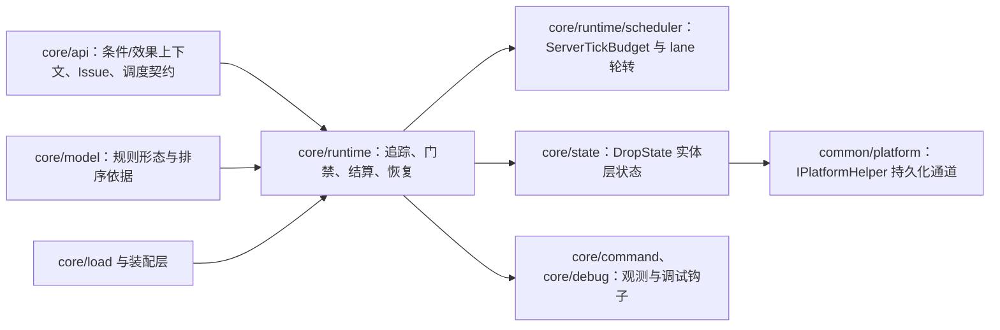
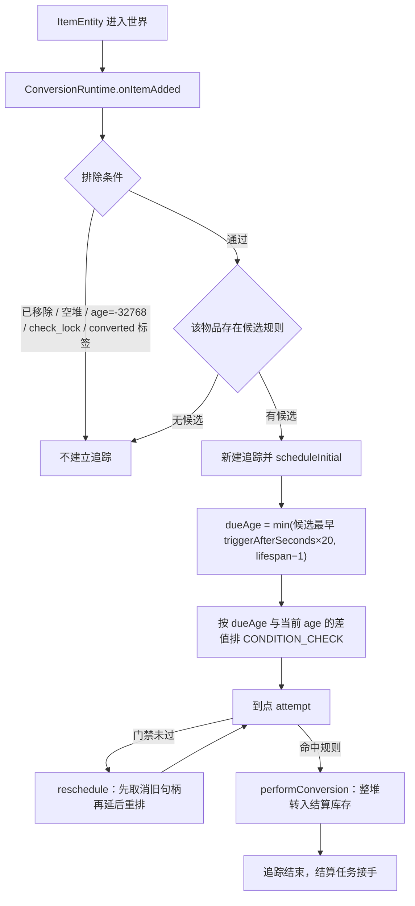
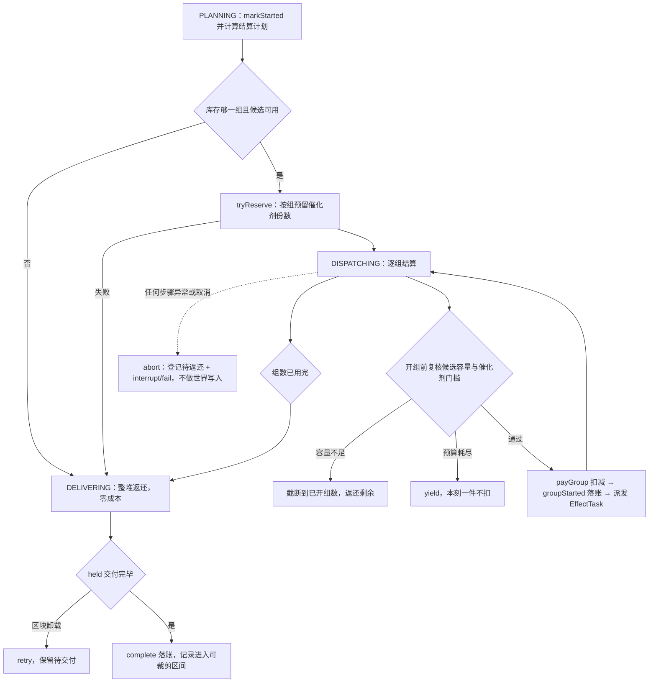

# 转化运行时

> **TL;DR**
> - 本模块把“掉落物存在”推进成一条可排期的链路：追踪实体 → 到点做预检查门禁 → 命中规则后整堆转入结算库存。
> - 结算按规则声明的固定成本整组进行：先扣减再登记，效果经调度器排队，真实账目只认执行器回执；数量守恒由记录的待交付量承载。
> - 所有维度与所有任务种类共用一份 `ServerTickBudget`；取消或异常只留一条待返还记录，世界写入交给 `SettlementRecovery`。

**适用对象**：修改触发与结算语义、排查“该转化没转化 / 转化了但货没回来”、调整 tick 预算与退避参数、维护掉落物实体状态的开发者。

## 1. 模块职责

一句话边界：在服务器 tick 上判断一个已存在的掉落物实体“该不该转化、能不能转化、转化多少组、货怎么交还”，并把每一步世界操作压进共享 tick 预算。

本模块承担：

- 追踪：为进入世界的掉落物实体建立追踪，按候选规则的最早触发时间与剩余寿命算出首个检查刻。
- 触发：自然到期由调度器的 `CONDITION_CHECK` 任务推动；环境伤害由两端 `ItemEntityMixin` 经 `RuleRuntimeHost` 转发到 `requestConversion`。
- 预检查门禁与规则选择：实体有效性、区块 ticking、实体锁、永久禁转、转化冷却、候选存在性，再按排序取首个命中规则。
- 完整组结算：把整堆转入结算库存，逐组扣减成本、复核候选容量与催化剂门槛、派发效果、返还剩余。
- 持久化与恢复：结算记录台账、待返还记录的启动补扫与交付。
- 实体临时状态：新产物保护与冷却、返还物永久保护与永久禁转。
- 共享预算实现：`core/runtime/scheduler` 提供 `core/api/scheduler` 契约的实现。

规则语义（消失方式、固定成本、组合模式、候选结果）来自 `core/model`，条件树求值与效果执行属于类型系统与效果执行器；本模块只按契约调用，不重复定义语义。

## 2. 模块边界

### 对外入口

- 追踪生命周期：`ConversionRuntime.onItemAdded`、`rescan(level)`、`rebuild(level)`、`replaceRules(...)`、`applySavedIndex(server, prepared)`、`clear(level)`、`shutdown()`。
- tick 驱动：`onServerTick`，由宿主在服务器 tick 事件中调用。
- 环境触发：`requestEnvironmentalConversion(level, item, source)`；伤害是否属于可触发类型由 `DamageClassification.classify` 判定。
- 实体状态：`DropStateStore` 的读取、写入、清除与 `blocksEnvironmentalDamage` 判定；授予入口在效果执行侧的 `ReturnItemSpawner`。
- 调度：`ServerScheduler` 实现 `TaskQueue`，向运行时暴露维度注册、取消、摘除与全局释放。
- 观测：`trackedCount`、`debugInfo`、`candidatesFor`、`pendingTasks`、`queueStats`、`schedulerStats`、`budgetSnapshot`、`activeRecoveryCount`、`recoverySkippedDimensions`、`rescanPending`、`rescanSteps`。

### 依赖方向

编译期依赖只有 `core/api`（含 `api/scheduler`）、`core/model`、`core/load` 的产物类型、Minecraft 与平台抽象接口。调度器不认识任何具体任务类型，只按 `ServerTaskKind` 分 lane。

### 被谁依赖

- 平台层：tick 事件驱动 `onServerTick`；实体加入世界与伤害拦截把入口分别接到 `onItemAdded` 与 `requestEnvironmentalConversion`。
- 加载与装配层：启动加载、数据包重载与命令重载调 `replaceRules`；编辑器保存成功后调 `applySavedIndex` 换索引。
- 效果执行侧：返还效果经 `ReturnItemSpawner` 写实体状态，结算与它共享同一套预留与落账口径。
- 命令与调试层：查询、预算快照与开发场景观察读取本模块的观测入口。

## 3. 关键类地图

仅列对外入口、扩展点、聚合根与并发/事务敏感类，非穷举。

| 类型（`core/runtime`、`core/runtime/scheduler`、`core/state` 下） | 角色 | 职责 | 协作对象 |
|---|---|---|---|
| `ConversionRuntime` | 聚合根 | 按维度持有追踪表、物品 id 有序表与标签/气候缓存；负责追踪建立、排期、门禁、选规、发起结算与观测 | `ServerScheduler`、`RuleIndex`、`SettlementLedger`、`DropStateStore` |
| `ConversionSettlement` | 事务敏感任务 | `EFFECT` 任务的结算实现：计划、逐组扣减与派发、交付返还；取消与异常统一走 `abort` | `EffectTask`、`CatalystReservations`、`SettlementRecord.Writer`、`NearbyProductLimits`、`CatalystThresholdCheck`、`FluidSourceResolver` |
| `SettlementLedger` / `SettlementRecord.Writer` | 持久化聚合 | 主世界 `SavedData` 台账；记录状态、计数与待交付量只经 `Writer` 改动，字段变更处同步双索引标脏 | `ConversionRuntime`、`SettlementRecovery`、`ConversionSettlement` |
| `SettlementRecovery` | 补偿任务 | 只交付记录里的待交付库存，交付成功后才扣减并落账，完成/失败/取消都幂等关闭 | `SettlementLedger`、`ServerScheduler` |
| `EffectTask` | 并发敏感 | 单个效果的执行包装：一次求值、推进执行、回执入账；终态先摘引用再回执 | `ConversionRuntime.startEffect`、`EffectResult` |
| `ServerScheduler` / `ServerTickBudget` | 共享预算 | 每服务器一份预算，按维度 realm 与任务种类 lane 公平轮转，按真实世界操作量计费 | 全部任务类型 |
| `RealmCleanupTask` | 续接清理任务 | 摘除 realm 后把收集到的句柄逐槽取消：每步按 `cancels_per_step` 与单 tick 额度取用，取消回调异常隔离；停服时就地排空 | `ServerScheduler`、`ScheduledTask` |
| `RuleIndex` / `RoundRobinCursors` / `CandidateStructureVersions` | 索引与游标 | 候选按优先级与条件复杂度排序；跨结算共享轮转游标；候选结构版本用于判定失效 | `ConversionRuntime`、`ConversionSettlement` |
| `CatalystReservations` | 并发敏感 | 运行期催化剂预留表，按结算 id 预留、支付和释放；不落盘，停服清空 | `ConversionSettlement` |
| `DropStateStore` / `DropState` | 实体状态 | 保护与冷却、永久禁转的实体层存取；平台差异经 `IPlatformHelper` 承载 | 效果执行侧授予、平台伤害处理、门禁读取 |
| `DamageClassification` | 触发分类 | 判定伤害是否属于可触发环境转化的类型 | `requestEnvironmentalConversion` |

## 4. 关键流程

### 4.1 追踪建立与自然触发排期

追踪的建立是幂等的：已 tracked 且句柄仍有效的实体再次进入 `onItemAdded` 直接返回；`items` 有序表按实体 id 索引，供重载后的回扫游标使用。`converted` 标签标记“已提交转化”的实体，回扫与重复回调都会因此跳过。

回扫是分步续接任务，入口只清表并入队，不在服务端线程同步遍历整维实体：

| 入口 | 模式 | 依据 |
|---|---|---|
| 启动 `rebuild(level)`、维度加载 `rebuild(level)` | 世界扫描 | 这些实体的 join 事件早于运行时装配，`items` 表不完整；入口收集一次已加载掉落物的引用快照，分步按快照登记 |
| 规则重载 `rescan(level)` | 有序 id 游标 | `items` 表由 join/leave 事件持续维护，按 `higherEntry` 游标逐条重建追踪 |

两种模式单步都只把 `rescan_entities_per_step` 个实体交给 `onItemAdded`，且每步检查共享预算；世界扫描模式在入口收集一次已加载掉落物的引用快照（不改追踪状态），步骤按快照切片登记，既不跨 tick 持有世界迭代器，也不必每步重扫整维；有序游标模式沿 `items` 的 `higherEntry` 前进。还有剩余工作就 `yield`，下一 tick 继续。世界扫描完成前若再次重载，重载会沿用同一份快照补齐，不会因取消任务漏掉尚未登记的实体。完成标记按维度保存轮次 token，只有当前一轮的收尾路径（完成、取消、失败终态）能清除，旧一轮的迟到回调不会破坏新一轮状态；同一轮回扫失败只重排一份续接任务，避免多份任务同时推进同一游标。回扫让出期间，自然到期入口对尚未重建追踪的实体直接补一次 `onItemAdded`，临近消失的物品不会因等待回扫而漏转化。

追踪条目与句柄状态保持自洽：检查任务失败由本模块的失败回调收尾（见 4.6），不会留下指向已终态句柄的追踪；句柄被取消或追踪已不存在时，实体重新加载进入 `onItemAdded` 会按当前候选补排一次初始检查，自然到期入口则释放追踪并交还原版销毁，物品不会因内部失败而永久留存。

所有重排共用一个入口：先按重排原因取消旧句柄再排新句柄（取消原因为 `RESCHEDULED`）。任何只覆盖 `tracked.task` 的写法都会让旧检查变成孤儿，到期后再判定一次并推高退避档；环境致死入口与既有自然检查共用同一份追踪，因此同样经该入口重排。追踪结束（无候选、永久禁转、到期未命中、转化提交）也先取消句柄再移除条目，环境致死等同步路径不会留下孤儿检查。

### 4.2 预检查门禁与规则选择

`attempt` 按固定顺序逐项短路，任一项不通过都在本步返回：

1. 追踪已不存在则返回；实体失效或命中排除条件则先取消句柄再移除追踪。
2. `level.isPositionEntityTicking` 为假说明所在区块未 ticking，按配置的检查间隔重排。
3. 实体被结算锁住（`locked`）时按 1 tick 重排，等结算回写。
4. `DropState` 的永久禁转标记为真则移除追踪。
5. 转化冷却未到期时按剩余冷却刻重排。
6. 候选为空则移除追踪。
7. `select` 依次跳过早先排序的候选，要求规则声明了当前 `TriggerKind`、源数量够一组、条件树求值为真；年龄门槛只在自然触发且非到期补算时强制。

未命中时只把“本次触发方式参与且源数量足够一组”的候选计入退避资格：只有这些规则在本刻已到年龄门槛（自然触发）或可直接判定（环境触发、到期补算）而条件不成立时，`failureCount` 才递增；纯环境规则与源量不足一组的规则本刻不可能命中，不参与计数，也不会把等待拉向与本次判定无关的档位。退避时长取 `config.backoffTicks` 与“相关候选中最近一个年龄达标刻还差几刻”的较小值；相关候选都没有年龄达标时不计数，只把等待压到最近达标刻。自然检查若本触发方式完全没有规则（例如只剩纯环境规则），继续检查不会产生转化，运行时释放追踪而非反复排期；若规则存在但源量暂时不足一组，则保留追踪、按检查间隔等待数量变化，且不累加失败计数；环境触发入口没有对应规则时不改动既有自然排期。这是纯延迟策略，改动后退避参数见第 6 节。

环境触发走同一条 `attempt`：入口位于伤害处理的调用栈，条件与选规在本步同步完成，`TriggerKind` 记为环境触发，选中的效果一律经调度器排队执行。伤害类型由 `DamageClassification` 按 `DamageType` 常量逐项比对，顺序固定为岩浆 → 火 → 仙人掌：`DamageTypeTags.IS_FIRE` 会把岩浆伤害一并覆盖，用标签判定无法区分两者。返还物与临时保护的伤害拦截在平台侧先查 `DropStateStore.blocksEnvironmentalDamage`。

自然到期若来自“取消原版消失后的补算”，追踪带 `expiryPending` 标记，此时不再校验年龄门槛，且在转化与返还结束后丢弃实体。原版消失拦截只在追踪存在且检查句柄未终态时成立：句柄已终态说明排期链已断，继续拦截会让超龄物品永久滞留，运行时改为释放追踪并交还原版销毁。

### 4.3 完整组结算与数量守恒

结算的硬口径：

- **补偿单元**：`source.copy()` 取走整堆、`source.setCount(0)`、打 `converted` 标签、经 `Writer.register` 写记录、把 `ConversionSettlement` 作为 `EFFECT` 任务入队。任一步抛错都在 `finally` 里撤销：弃记录、去标签、把数量写回源堆并保留追踪。
- **成组对应**：每组固定成本取规则的 `source_cost`（未声明时按源物品计 1）；`payGroup` 返回不足时截断到已开组数并返还剩余，返回预算耗尽时整步 yield 且一件不扣，扣减与产出始终成组对应。催化剂先过门槛再 `consume_counts`，可用组数作为计划组数的上界。
- **数量守恒**：转入结算库存的原始数量 = 已扣减成本总量 + 已交付返还 + 待交付返还；成本总量等于每组成本乘以已完成组数。概率落空或条件不满足的组仍计入“已支付组”，回执以 `SKIPPED` 落账而不是从账上抹掉。

容量只在开组前复核，取值聚合同一候选内可重复效果的物品与实体需求（经验不占容量）；同刻同一候选只查一次世界。轮转模式下跨结算共享游标，被跳过的候选不推进游标。

### 4.4 结算记录、恢复与实体状态写入

- 记录状态机由 `SettlementRecord.Status` 声明；`needsRecovery` 只在“未完成 + 待交付量大于零 + 源快照非空”时成立，据此筛选待返还记录。
- 首 tick 做一次全局补扫；未加载维度跳过并计数，等维度可用时由回扫补做。恢复任务带幂等标记，同一记录不会被重复启动。
- 恢复只交付待交付库存，交付成功后才扣减并落账；旧效果队列不重放。交付按退避重试，区块卸载时保留待交付量等下次。
- 台账裁剪针对“已完成、无待交付、已记完成刻且超过保留窗口”的记录，再按条数上限兜底；未结清记录始终保留。
- 返还交付经 `ReturnItemSpawner` 生成产物，并授予永久保护与永久禁转；新产物落入世界时授予临时保护与临时冷却，时长由配置注入，参数为 0 时不授予。
- 状态只挂实体、不写进 `ItemStack`：拾取即实体消亡，重丢得到普通掉落物。时间字段是绝对游戏刻，区块卸载不暂停、重启后继续计时。

### 4.5 共享 tick 预算

`ServerScheduler` 每服务器一个实例，所有维度与任务种类共用一份 `ServerTickBudget`：

- 每刻只推进一次，同一刻的重复调用直接返回；开始时锁定期限与工作单位上限。
- 各维度 lane 与任务种类 lane 公平轮转，搬运额度按到期任务数在检查窗口内分摊，并夹在单刻批量上下限之间。
- `EFFECT` lane 有独立工作单位配额，避免结算挤占条件检查；该配额按与全局预算相同的单步计费结果累加，不退化为「每刻执行多少步」。
- 每步结束按「任务声明回执」与「步骤内实际上报」的较大者计费：上报值是真实世界操作量，声明值只是下限；lane 配额、效果 lane 配额与时间软预算共用这一结果，耗尽后立即结束本刻轮转，剩余任务留到下一刻。
- 诊断面：`SchedulerStats` 给出最近一 tick 与历史的最大单步计费工作量、按种类的累计工作单位，`ServerTickBudgetSnapshot` 给出本刻工作单位用量与耗尽原因，debug 场景指标可由断言器读取，用于核对预算消耗与真实世界操作量同向变化。
- 单个任务抛错只把该任务判为失败，不中断整轮；`YIELD`/`RETRY` 走重排并带最小延迟。
- 回扫续接任务与其它任务共用同一份预算：单步实体上限由 `rescan_entities_per_step` 约束，预算耗尽即让出；完成标记与失败重排都归一为单一路径，不产生并行推进同一游标的副本任务。
- 取消统一走逐槽清理：规则重载摘除全部维度 realm、维度卸载摘除该维度 realm，都只把待取消句柄收集出来，交给调度器自有系统 realm 上的清理任务按 `cancels_per_step` 每步取消；单 tick 取消量同样受该配置约束，取消回调因此摊进后续 tick 的共享预算。停服没有下一 tick，同一实现就地排空，保证取消回调在最终存档前完成。
- 取消回调异常按任务隔离：`ScheduledTask.cancel` 捕获回调异常只记日志，清理任务继续取消同批其它句柄；取消计数按 `CancelReason` 分类累计，清理完成时输出带原因、取消数、维度数与步数的日志，停服、维度卸载与规则重载因此可从日志与统计上区分。`SchedulerStats` 的 `lastCancelledInTick` / `maxCancelledInTick` 给出单 tick 取消样本。
- 预算与批量参数在构造调度器时从 `ServerConfig` 读取一次，改动需要重载或重启服务器。

### 4.6 检查失败与追踪恢复

- **失败回调契约**：`ServerTask.onFailed` 有默认幂等实现，只记录、不改容器状态；内置可失败任务按需覆写。调度器先把句柄置终态再回调，回调抛出的异常被隔离（记 ERROR、不中断整轮、不影响队列容器），因此任务终态唯一，任何终态路径都必须经过收尾。
- **谁收尾**：自然到期检查是 `CONDITION_CHECK` 任务（追踪名 `check`），`step` 复用 `attempt`；`step` 抛错时由任务自己的失败回调交回本模块恢复，而不是只让调度器记一次失败。
- **恢复规则**：追踪或实体已失效时按 `ENTITY_REMOVED` 释放；已到自然消失边缘（到期补算标记 `expiryPending` 或已过寿命）时释放追踪，到期补算路径同时丢弃实体，销毁交还原版机制；其余情况失败计数递增，首次失败固定 1 tick 后重试（一次异常不是业务结论），连续失败沿用 `config.backoffTicks` 序列并夹在「不晚于自然消失前一刻」。所有重排仍经统一入口 `replaceCheck`，先取消旧句柄再排新句柄。
- **失败事件**：`CHECK_TASK_FAILED` 携带规则标识（`rule`）、结算标识（`settlement`，尚未登记时为空）、异常原文（`reason`）、恢复动作（`recovery` 取 `retried` / `released`）、重试延迟（`retry_delay_ticks`）与失败计数（`failure_count`）；准备阶段异常另发 `CONVERSION_PREPARE_FAILED`（`rule` / `reason`），此时源物品尚未扣减，守恒天然成立。事件只经运行时观测接缝输出，未启用调试时是空操作。
- **准备阶段注入点**：委托效果执行器 `prepare` 之前上报 `RuntimeObserver.effectPreparing`，实现方只允许以抛出异常表达注入失败；异常沿转化补偿单元抛出，由检查任务的失败收尾按上面的规则恢复。
- **容器的自洽不依赖任务覆写回调**：就绪任务在被取去执行时已从待处理计数中移除，失败分支先置终态再回调，回调异常被隔离；因此未覆写失败回调的任务只会缺少业务收尾，不会在调度器容器里留下幽灵句柄或重复通知。

## 5. 扩展点与约束

### 扩展点

- **新增触发方式**：在 `TriggerKind` 加常量 → 在 `select` 的分派与 `requestConversion` 的入口各接一条 → 同步 `core/model` 的编解码与 `docs/api/rule-json.md` 的取值说明。年龄门槛只对自然触发强制，新触发方式默认走环境口径。
- **新增组合语义**：在 `CombinationMode` 加常量 → 在 `ConversionSettlement.selectCandidateForGroup` 与 `RoundRobinCursors` 中给出候选推进规则 → 确认游标在“被跳过”与“已定稿”两种情况下行为不同。
- **新增效果类型**：落在类型系统与效果执行器，本模块只需 `startEffect` 能拿到可入账的 `EffectResult`；一次性效果由 `attemptedOneShots` 去重，同一源只有一次尝试机会。
- **调整返还与恢复策略**：改 `SettlementRecovery` 的交付循环，落账仍只走 `SettlementRecord.Writer`；新增账目字段时同步 `SettlementRecord` 的 Codec 与 `SettlementLedger` 的索引维护。
- **新增实体状态字段**：在 `DropState` 记录加分量并递增 `VERSION`，持久化通道由 `IPlatformHelper` 在两端的实体数据容器中承载，读写入口只保留 `DropStateStore`。

### 约束

- 结算提交点是扣减 → 登记 → 调度注册这一段补偿单元；中途失败必须整堆写回并保持零成本。
- 扣减与产出成组对应：容量或催化剂不足时截断已开始组数并返还剩余，不出现“少扣照常产出”。
- 账目只经 `SettlementRecord.Writer` 变更；计划组数不冒充完成组数，回执是唯一成功依据。
- 取消与异常只登记待返还，世界写入统一交给恢复任务；恢复任务本身不重放旧效果。
- 检查任务失败必须走失败回调恢复：追踪要么重排到下一次检查、要么释放交还原版，不得让追踪继续指向已终态句柄；恢复不得改动账目，准备阶段失败时源物品尚未扣减。
- 同一掉落物只执行优先级最高的一条命中规则；排序规则集中在 `RuleIndex.RULE_ORDER`。
- 台账不裁剪未结清记录，完成记录在保留窗口与条数上限内可裁。
- 实体状态挂实体层且用绝对游戏刻；跨存档与区块卸载都按真实时间推进。
- 长循环与逐实体遍历必须接入调度器（`ServerTaskKind` 选 lane），在 tick 回调里直接全量遍历会越过共享预算；整维回扫只能经 `rescan`/`rebuild` 入队分步推进。

### 改动后的验证

先做 IDE 工作区检查，再执行 `tools/dsh-build.ps1 -Tasks build`，最后由实机验证触发、返还与重载后的回扫；检查失败路径用声明式场景 `run/prepare_failure`（恢复后下一 tick 重试）与 `run/prepare_failure_expiry`（到期失败释放交还原版）核对守恒、追踪恢复与不再永久拦截。涉及结算路径的改动必须同时验证取消与停服场景下的待返还记录能否在下次启动交付完毕；文档链接改动后跑 `python tools/check-docs.py`。

## 6. 数据与配置引用

- 规则 JSON 的触发方式、固定成本、组合模式与候选结果：[docs/api/rule-json.md](../api/rule-json.md)。
- Issue 模型与拒载粒度、回执状态文案：[docs/api/errors.md](../api/errors.md)。
- 预算、批量、退避与检查间隔等运行参数：[docs/ops/configuration.md](../ops/configuration.md)；取值以 `ServerConfig` 与 `SchedulerConfig` 为准。
- 效果执行与条件求值契约：[core-contract](core-contract.md)、[type-system](type-system.md)。
- 规则来源与合并、重载失败保留旧索引：[rule-loading](rule-loading.md)。

## 相关文档

- 契约层：[core/api 契约](core-contract.md)
- 规则数据形态：[rule-model](rule-model.md)
- 类型与内置效果：[type-system](type-system.md)
- 保存后换索引的编辑链路：[authoring](authoring.md)
- 跨模块链路总览：[architecture/key-flows](../architecture/key-flows.md)
- 模块索引：[modules](README.md)
- 决策：[ADR-0023](../adr/0023-triggers-fixed-cost-and-complete-group-settlement.md)、[ADR-0024](../adr/0024-shared-server-tick-budget-scheduler.md)、[ADR-0034](../adr/0034-scheduler-contract-and-implementation-layering.md)、[ADR-0038](../adr/0038-settlement-single-commit-point.md)、[ADR-0041](../adr/0041-input-thresholds-and-consumption.md)
