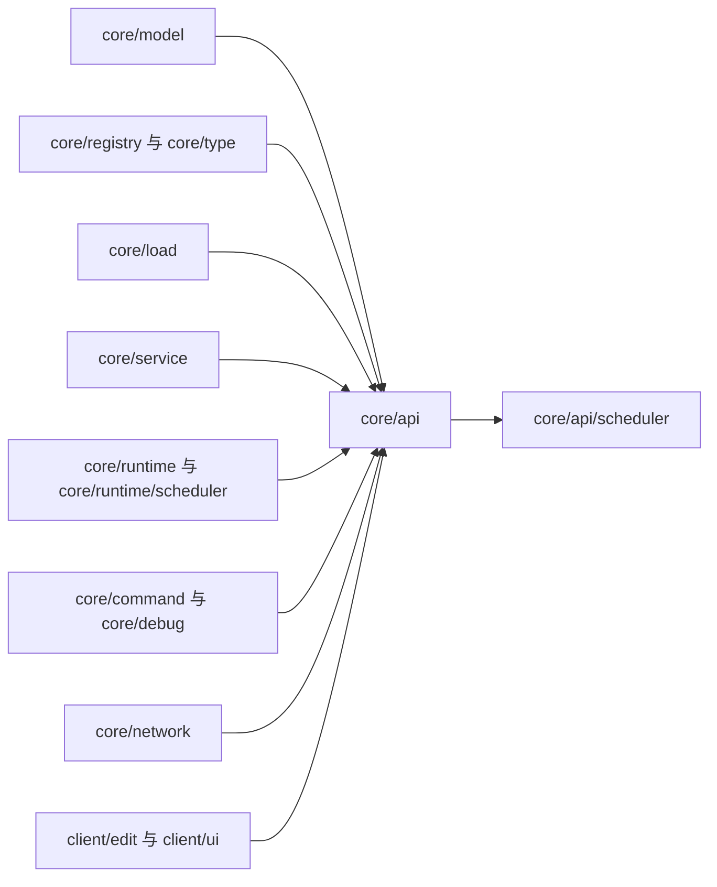
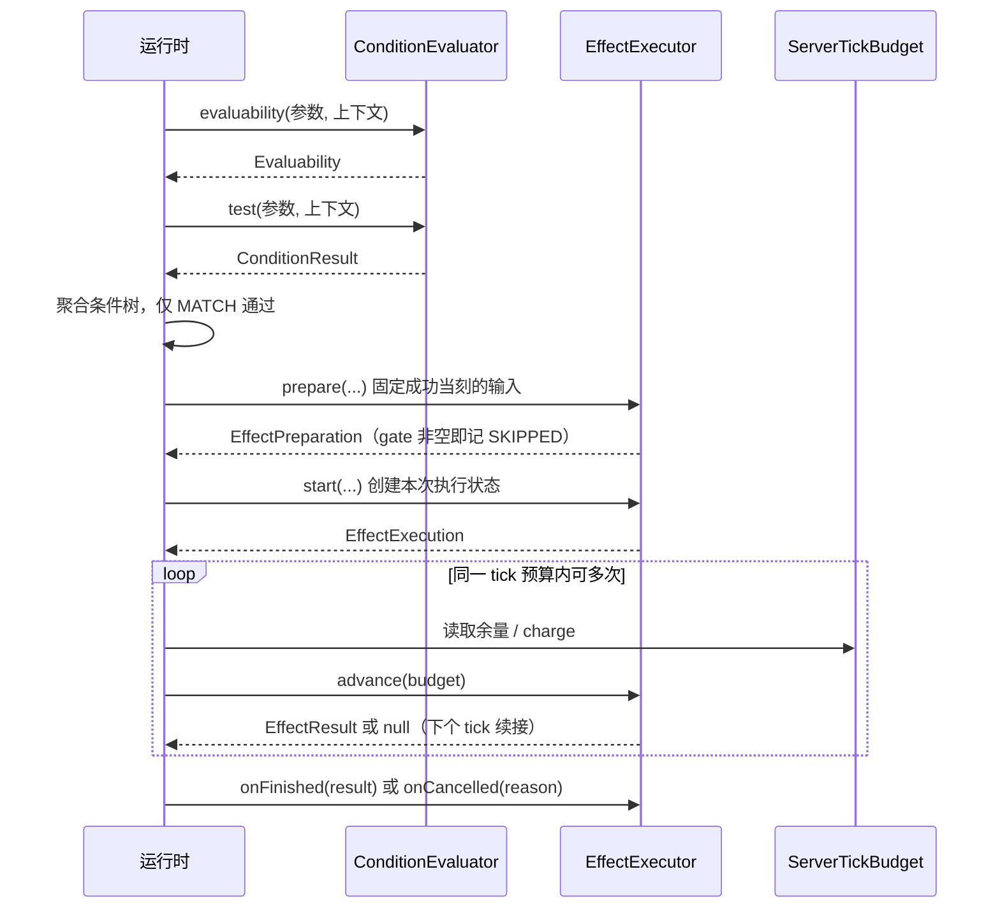
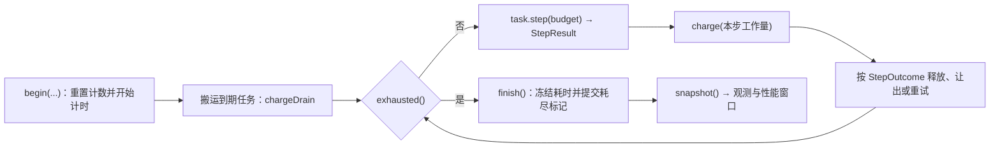

# 契约层核心

> **TL;DR**
> - `core/api` 是全项目的契约底座：条件与效果的上下文/执行器、类型注册与扁平分发、Issue 模型、字段名常量、只读引用查询、观测接缝。
> - 契约层只声明形状与不可变值；模型落地、注册表实现、索引与状态归模型层、注册表与运行时。
> - `core/api/scheduler` 定义单 tick 共享预算与任务调度契约，长循环必须拆成有界步骤并从这里扣费。

**适用对象**：新增条件/效果类型、编写调度任务、实现观测接缝、阅读规则解码与执行链路的开发者。

## 1. 模块职责

一句话边界：把跨子系统必须共同认识的形状固定成接口与不可变值，让模型层、注册表、加载层、运行时、命令与调试、客户端编辑器都只依赖契约，彼此之间经契约相遇。

契约层承担的面：

- 条件求值的输入与输出：`ConditionContext`、`ConditionEvaluator`、`ConditionResult`、`Evaluability`。
- 效果执行的输入、状态与回执：`EffectContext`、`EffectExecutor`、`EffectExecution`、`EffectPreparation`、`EffectResult`。
- 类型注册与扁平字段分发：`TypeDefinition`、`TypeRegistry`、`TypeDispatch`。
- 解码入口与规模预算：`RuleDecoder`、`RuleDecodeBudget`；JSON 字段名常量的唯一来源 `RuleFields`。
- 问题模型 `Issue`/`IssueCollector`/`IssueSeverity`，以及类型参数与注册表引用校验的公共助手 `ParamChecks`、`RefChecks`。
- 只读引用与查询：`TaggedId`、`TagLookup`、`ClimateSample`/`ClimateSampler`、`ChunkPresence`。
- 运行时观测接缝 `RuntimeObserver`。
- 调度契约 `core/api/scheduler`：任务单元、单步回执、共享 tick 预算、排期请求与取消。

契约层保留的进程级接缝状态是刻意设计的：`RuntimeObserver` 的当前实现持有者（装配期经 `install` 写入、运行期只读）与 `StepWorkCounter` 的线程隔离工作量窗口。其余类型都是接口、不可变 record 或无状态工具。

## 2. 模块边界

### 对外入口

按契约分工，外部按需引用其中一组：

- 类型实现者：`TypeDefinition` + `TypeRegistry`，分发由 `TypeDispatch.flat` 完成。
- 条件类型实现者：`ConditionContext` + `ConditionEvaluator` + `ConditionResult` + `Evaluability`；上下文不足的门禁写在类型自己的 `evaluability` 上。
- 效果类型实现者：`EffectExecutor` + `EffectContext` + `EffectResult`；需要跨 tick 推进时实现 `EffectExecution`，需要成功当刻固定输入时覆盖 `prepare` 与对应的 `start` 重载。
- 加载与装配：`RuleDecoder`（单条规则 JSON 解码契约）、`RuleDecodeBudget`（文本与条件树的规模预算）、`RuleFields`（字段名）、`IssueCollector`（问题回流）。
- 调度任务实现者：`ServerTask` + `StepResult` + `StepOutcome` + `ServerTickBudget`；`TaskQueue` 与 `ScheduledTaskHandle` 用于提排期请求与精确取消。
- 观测实现者：`RuntimeObserver`（上报点与排期包装）。

### 依赖方向

箭头表示编译期依赖：

`core/api` 的编译期依赖只落在 Minecraft、DFU（DataFixerUpper）、Gson 与 JetBrains annotations 上；`core/api/scheduler` 的内部依赖只指向 `core/api` 自身。模型层、注册表与运行时对契约层的依赖是单向的，契约层因此可以作为全项目的依赖底座被任意一侧引用。

### 被谁依赖

- 模型层用它实现 Codec、校验与类型定义特化（`core/model` 的 `EffectType`/`ConditionType` 建立在 `TypeDefinition` 上）。
- 注册表与内置类型用它提供 `TypeRegistry` 实现与逐类型的 `validateParams`。
- 加载层只持有 `RuleDecoder` 与 `IssueCollector`，与模型层保持解耦。
- 装配层用它把解码器、校验器与问题收集器串起来。
- 运行时的表达式求值、组派发与结算用条件/效果契约；调度实现用 `core/api/scheduler`。
- 命令、调试与编辑协议复用 `Issue` 的文本化与字段路径；客户端编辑器复用 `RuleFields`、`TypeDispatch` 与条件表达式编解码。

## 3. 关键类地图

仅列对外入口、扩展点、聚合根与并发/预算敏感类，非穷举。

| 契约（`core/api` 下） | 角色 | 职责 | 协作对象 |
|---|---|---|---|
| `TypeDefinition` / `TypeRegistry` / `TypeDispatch` | 注册与分发入口 | 类型定义 = 稳定 id + `MapCodec` + 参数校验；`TypeDispatch.flat` 让类型专属字段与通用字段同处一个 JSON 对象，字段白名单取该类型 `codec().keys()`；编码未注册类型直接抛 `IllegalStateException` | `core/registry` 实现注册表；`core/model` 提供 `EffectType`/`ConditionType` 特化 |
| `ConditionContext` / `ConditionEvaluator` / `ConditionResult` / `Evaluability` | 条件侧扩展点 | 求值器是纯谓词，只读上下文；结果由 `ConditionResult` 承载，只有 `MATCH` 通过、判不了与出错原样穿透取反节点；上下文不足以判定由 `Evaluability` 前置声明 | `core/model/ConditionType` 把三者绑到一个可注册类型；运行时表达式求值器做树聚合 |
| `EffectExecutor` / `EffectContext` / `EffectExecution` / `EffectPreparation` / `EffectResult` | 效果侧扩展点 | 执行器只做世界操作并返回真实回执；`EffectExecution.advance` 在预算内推进、返回 `null` 表示需续接；`EffectPreparation` 承载成功当刻固定的输入与跳过原因；回执区分完成量与已受理量 | `core/model/EffectType`；运行时的组派发、候选位置策略与结算记账 |
| `ServerTickBudget` / `StepWorkCounter` | 预算与计价（并发敏感） | 时间上限与全局工作量上限同时生效；`begin` 只由调度器每 tick 调用；`exhausted()` 无副作用，`charge` / `chargeDrain` 记账并提交耗尽标记，`finish` 冻结耗时，`snapshot` 产出只读快照；计价窗口按服务器线程隔离、支持嵌套，由调度器在步骤前后开合，任务按真实完成的世界操作量上报 | 调度实现、每个 `ServerTask.step`、长循环效果执行器 |
| `ServerTask` / `StepResult` / `StepOutcome` / `ServerTaskKind` / `CancelReason` / `TaskQueue` / `ScheduledTaskHandle` / `RunnableTask` | 调度扩展点与排期请求 | 单步必须有界；回执声明本步工作量（下界为 1）、状态与下次入队延迟；种类用于跨维度公平轮转、效果配额与分类统计；取消原因不得静默丢弃；排期只经 `scheduleAt(realmKey, task, dueTick)`，句柄可读任务、到期刻、分类与终态并精确取消（幂等）；`RunnableTask` 把无参动作适配成固定消耗一步的任务 | `core/runtime/scheduler`；`RuntimeObserver` 的排期包装 |
| `Issue` / `IssueCollector` / `IssueSeverity` / `ParamChecks` / `RefChecks` | 问题模型与校验助手 | 收集器累积问题并可派生来源继承的子收集器（写入同时落入上游、按默认来源补齐）；严重级决定条目是否拒载；`RefChecks` 对未注册的非标签引用报错、对未绑定的标签数据只告警 | 模型层校验、加载层、装配层 |
| `RuleDecoder` / `RuleDecodeBudget` / `RuleFields` | 解码入口与规模预算 | 加载层持有 `RuleDecoder`，实现由模型层提供；预算入口先做文本嵌套深度预检、再在进入递归解码前拦截超深/超规模条件树；字段名常量统一从这里取 | `core/load`、`core/model`、命令输出 |
| `RuntimeObserver` | 观测接缝 | 未注入实现时 `NONE` 让判定返回安全默认值、上报为空操作、排期直接入队；装配期注入一次，运行期只读；重载应用阶段的上报点在规则索引替换后、维度回扫前调用，实现方只允许以抛出异常表达注入失败，调用方按重载失败收口 | `core/debug` 提供实现，平台在服务端装配阶段注入 |
| `TaggedId` / `TagLookup` / `ClimateSampler` / `ChunkPresence` | 只读引用与查询 | 统一 `id` 与 `#tag` 引用形状；标签成员与气候采样由实现方按位置/维度缓存；`ChunkPresence` 只判定区块是否已加载 | 条件求值器、候选索引、运行时 |

## 4. 关键流程

规则命中后的契约协作链（求值 → 固定输入 → 预算内推进 → 回执）：

单 tick 预算的一次推进：

## 5. 扩展点与约束

### 扩展点

- **新增条件类型**：参数 record 实现 `Condition`，实现 `ConditionEvaluator`；需要上下文门禁时覆盖类型定义上的 `evaluability`，判定区块是否就绪用 `ChunkPresence`。注册与冻结流程见 [type-system](type-system.md)。
- **新增效果类型**：实现 `EffectExecutor.execute` 返回真实回执；需要跨 tick 推进时覆盖 `start` 返回自定义 `EffectExecution`，在 `advance` 内用 `ServerTickBudget` 与 `StepWorkCounter.report` 计价；异步分批产出用 `EffectResult.deferred` 受理、再用 `EffectContext.reportProgress` 收敛为完成量。需要成功当刻固定输入时成对覆盖 `prepare` 与 `start(..., preparation)`。
- **新增调度任务种类**：在 `ServerTaskKind` 加常量，队列的公平轮转与分类统计按该枚举归类；新增取消路径在 `CancelReason` 加常量。简单的一次性动作直接用 `RunnableTask`。调度实现与配额见 [conversion-runtime](conversion-runtime.md)。
- **新增观测能力**：实现 `RuntimeObserver` 的对应默认方法，装配期注入实现；需要包裹排期时覆盖 `schedule` 重载。新增注入点只能落在既有上报时机（判定、排期与取消回调、重载应用阶段），生产实现保持空操作。调试侧实现见 [authoring](authoring.md)。
- **新增问题级别或格式**：问题经 `IssueCollector` 写入，严重级取 `IssueSeverity`；字段路径由调用方按 JSON 形状拼接（`ParamChecks.child` / `ParamChecks.index`）。语义与文案约定见 [errors](../api/errors.md)。

### 约束

- `ConditionEvaluator` 是纯谓词：只读 `ConditionContext`，世界改动与消耗一律由效果承担。
- `EffectExecutor` 不得吞掉异常（运行时统一捕获并记录）；不得用计划量冒充完成量，结算只认 `EffectResult` 与 `reportProgress` 收敛后的量。
- `ServerTask.step` 单步必须有界，长循环自行拆步；`ServerTickBudget` 是每 tick 的临时对象，不得跨 tick 保存。
- 契约层的 Codec 与工厂不得产出 `null`：DFU 的 `DataResult` 内部使用 `Optional.of`，可空字段以 `Optional` 承载并在记录构造末步回落。
- 契约层只声明形状：新增字段名、枚举值或类型时，按依赖方向让模型层、加载层与运行时各自消费，避免契约层反向引用它们。

### 改动后的验证

改契约后面临的是全项目编译面：先做 IDE 工作区检查，再执行 `tools/dsh-build.ps1 -Tasks build`；涉及平台或客户端导入时另跑 `python tools/check-isolation.py`。改文档链接后跑 `python tools/check-docs.py`。

## 6. 数据与配置引用

- 规则 JSON 的字段语义与取值：[`docs/api/rule-json.md`](../api/rule-json.md)（`RuleFields` 常量的使用点）。
- 错误、告警与拒载粒度：[`docs/api/errors.md`](../api/errors.md)。
- 编辑协议的会话、分片与回执：[`docs/api/edit-protocol.md`](../api/edit-protocol.md)。
- tick 预算与检查间隔等配置项：[`docs/ops/configuration.md`](../ops/configuration.md)（`ServerConfig` 的取值与默认值）。

## 相关文档

- 模型落地：[`core/model` 规则模型](rule-model.md)
- 类型注册与内置类型：[type-system](type-system.md)
- 调度与结算落地：[conversion-runtime](conversion-runtime.md)
- 观测实现与命令调试：[authoring](authoring.md)
- 模块总览：[模块索引](README.md)
- 架构约束：[依赖规则](../architecture/dependency-rules.md)、[架构总览](../architecture/overview.md)
- 决策：[ADR-0013](../adr/0013-dfu-codec-and-flat-type-dispatch.md)、[ADR-0024](../adr/0024-shared-server-tick-budget-scheduler.md)、[ADR-0034](../adr/0034-scheduler-contract-and-implementation-layering.md)、[ADR-0035](../adr/0035-runtime-observation-seam.md)
