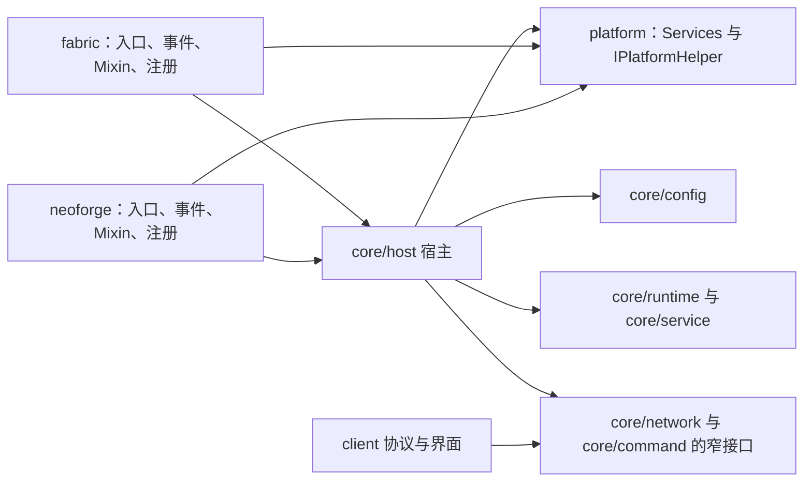
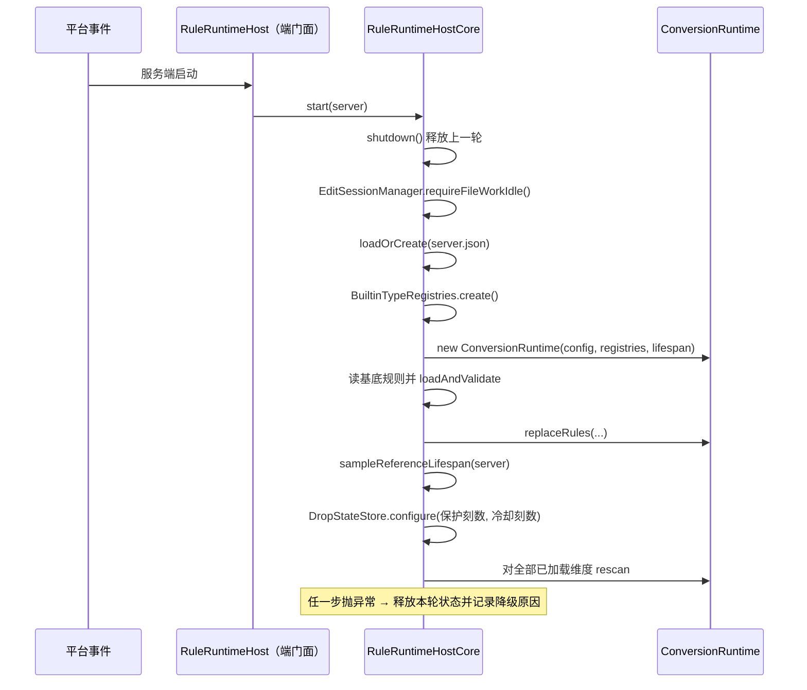
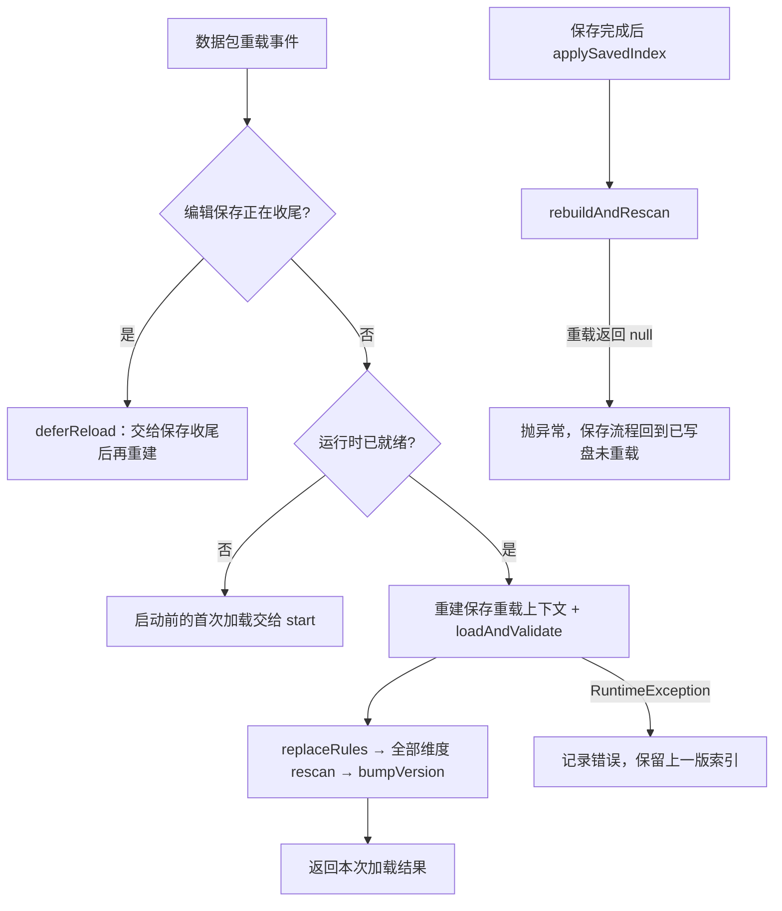

# 平台接入层

> **TL;DR**
> - 公共宿主持有一次存档生命周期的全部运行时状态，两端只实现差异适配面、事件接线与注册。
> - 平台能力经 `IPlatformHelper` 由 `ServiceLoader` 注入；两端各提供一个实现，能力以接口默认实现兜底。
> - Fabric 与 NeoForge 的事件能力不同：能走原生事件的走事件，事件覆盖不到的路径用最小 Mixin 补齐。

**适用对象**：新增平台能力、调整服务端生命周期接线、补 Mixin 或维护客户端接入的开发者。读之前先看 [架构总览](../architecture/overview.md) 与 [包职责](../architecture/package-responsibility.md)。

## 1. 模块职责

一句话边界：把与加载器相关的一切收敛成“适配面 + 事件接线 + 注册”，让业务模块只依赖 Minecraft、原版契约与平台能力接口。

模块承担的面：

- **公共宿主** `RuleRuntimeHostCore`：引导、数据包重载、停服、维度回扫，以及掉落物进入/离开、环境致死、自然消失判定、tick 的转发入口；持有一次存档生命周期的当前服务端、模组级配置、内置类型注册表、覆盖层目录、运行时与保存重载上下文。
- **窄接口适配**：以 `RuleEditServerContext` 与 `RuleCommandContext` 向网络层与命令层暴露运行时能力，调用方拿不到宿主对象本身。
- **平台能力注入**：`IPlatformHelper` 由 `ServiceLoader` 发现唯一实现，具体能力面见接口本身；实体状态的读写也在这里，两端使用各自的持久化容器。
- **模组级配置读取**：`ServerConfig.loadOrCreate` 负责 `server.json` 的读取、缺失即落盘与坏文件降级，两端共用同一实现与同一份文件。
- **两端加载器接入**：入口类、事件订阅、Mixin、网络载荷注册、命令注册、客户端初始化。

规则读取与合并、运行时调度与结算、编辑会话与落盘、界面渲染分别由 [规则加载](rule-loading.md)、[转化运行时](conversion-runtime.md)、[编辑与落盘](authoring.md)、[编辑器界面](client-ui.md) 负责，本模块只提供它们所需的平台侧入口与生命周期钩子。

## 2. 模块边界

### 对外入口

- **宿主生命周期**：`RuleRuntimeHostCore.start` / `reload` / `shutdown`，两端 `RuleRuntimeHost` 提供同名静态门面并持有单例 `CORE`。
- **宿主转发入口**：掉落物加入与移除、环境致死请求、自然消失延后判定、服务端 tick、维度加载与卸载；两端事件接线只调用这些方法。
- **能力视图**：`editContext()` 与 `commandContext()`，分别在网络层与命令层使用。
- **平台能力**：`Services.PLATFORM`，即 `IPlatformHelper` 的唯一实例；新增能力先在该接口加默认实现。
- **差异适配面**：`RuleRuntimeHostCore.PlatformAdapter`，两端唯一需要实现的差异集合（寿命提供者、包层判定、参考寿命采样与复位）。
- **配置聚合**：`ServerConfig` 与 `NearbyProductLimits`，字段语义与默认值见 [服务器配置](../ops/configuration.md)。
- **客户端接线**：Fabric 的 `client.ItemDespawnToWhatClient` 与 NeoForge 的 `client.register.ClientSetup`。

### 依赖方向

`common/` 下的代码不 import 任何加载器 API，平台专属代码只出现在 `fabric/` 与 `neoforge/`；反向依赖与端隔离由 `python tools/check-isolation.py` 固化，规则说明见 [依赖规则](../architecture/dependency-rules.md)。

### 两端差异：引导、事件与注册

两端的加载器入口与事件 API 不同，接线的落点也不同；下表是同一语义在两端各自的实现位置，语义本身由公共宿主统一持有。

| 关注点 | Fabric 端 | NeoForge 端 |
|---|---|---|
| 模组入口 | `ModInitializer#onInitialize` 依次注册运行时事件、编辑载荷、命令注册器 | `@Mod` 构造为空，事件由各 `@EventBusSubscriber` 类静态注册 |
| 服务端启动 | `ServerLifecycleEvents.SERVER_STARTED` 转 `RuleRuntimeHost.start` | `ServerStartedEvent` 转同名方法 |
| 服务端停止 | `SERVER_STOPPING` 转 `RuleRuntimeHost.shutdown` | `ServerStoppingEvent` 转同名方法 |
| 数据包重载 | `END_DATA_PACK_RELOAD`，成功标志为真才重建 | `OnDatapackSyncEvent`，`getPlayer()` 为空时重建（登录同步不重建） |
| 掉落物进入与离开 | `ServerEntityEvents.ENTITY_LOAD` / `ENTITY_UNLOAD` | `EntityJoinLevelEvent` / `EntityLeaveLevelEvent` |
| 自然消失 | Mixin 拦截 `ItemEntity#tick` 的 `discard()`，延后判定为真时不丢弃 | `ItemExpireEvent`，延后判定为真时 `addExtraLife`，并在寿命钳制上限前抬升 age |
| 环境伤害保护 | Mixin 在 `Entity#isInvulnerableTo` 头部按状态直接判免疫 | `EntityInvulnerabilityCheckEvent` 设置免疫 |
| 死亡背包排除标记 | `EntityMixin` 与 `PlayerMixin` 在掉落物入世界前打标记 | `LivingDropsEvent` 给每个掉落加排除标记 |
| 实体状态持久化 | Fabric Attachment API 的持久化附件（写入 `fabric:attachments`） | `getPersistentData()` 的 NBT 复合标签 |
| 参考寿命采样 | 运行期首次比较寿命常量时采样，未采到时用配置里的兜底刻数 | 启动时就地构造参考掉落物读取 `lifespan` |
| 网络注册 | `PayloadTypeRegistry` 注册类型，`ServerPlayNetworking` / `ClientPlayNetworking` 接管收发 | `RegisterPayloadHandlersEvent` 的 registrar，`playToServer` / `playToClient` 分别接处理器 |
| 命令注册 | `CommandRegistrationCallback` | `RegisterCommandsEvent` |
| 客户端初始化 | `ClientModInitializer#onInitializeClient` 顺序接线 | `FMLClientSetupEvent` 内 `enqueueWork` 到客户端主线程 |

### 注册面：网络与命令

- **网络**：载荷命名空间取 `RuleEditLimits.NAMESPACE`，协议版本取 `RuleEditProtocol.VERSION`；两端都在公共初始化路径注册 C2S 与 S2C 两类类型，保证连接协商双向可编码。服务端接收器先切回服务端线程，再交 `RuleEditServerHandler`；S2C 处理器一律经 `RuleEditPayloadRouter` 分发，不引用客户端类。客户端接收器在客户端初始化注册，回调切到客户端主线程。
- **命令**：正式平台注册器把 dispatcher 与 `RuleRuntimeHost.commandContext()` 交给 `RuleCommandTree`；开发命令由 NeoForge `src/probe` 的 `ProbeMod` 另行合并注册。
- **开发观测**：`ProbeMod` 装配空接缝的实现、推进开发场景并在停服时释放；运行和发布隔离见[后端探针](../guides/backend-probes.md)。
- **载荷字段、分片与回执语义**：[编辑协议](../api/edit-protocol.md)。

## 3. 关键类地图

仅列对外入口、扩展点、聚合根与并发/事务敏感类，非穷举。

| 类或包 | 角色 | 职责 | 协作对象 |
|---|---|---|---|
| `RuleRuntimeHostCore`（core/host） | 聚合根·生命周期 | 持有一次存档生命周期的配置、注册表、覆盖层、运行时与保存重载上下文；启动失败就地降级为未启动并释放本轮状态，重载失败保留上一版索引 | `PlatformAdapter`、`ConversionRuntime`、`RuleLoadingService`、`RuleEditServerHandler` |
| `RuleRuntimeHostCore.PlatformAdapter`（core/host） | 扩展点 | 两端唯一需要实现的差异面：寿命提供者、包层判定、参考寿命采样与复位 | 两端 `RuleRuntimeHost` |
| `Services` / `IPlatformHelper`（common/platform） | 注入入口 | `ServiceLoader` 发现唯一实现；平台名、模组判断、开发环境、配置目录、发包与实体状态读写都以接口方法声明，默认实现给出安全兜底 | 全部调用方 |
| `FabricPlatformHelper` / `NeoForgePlatformHelper`（两端 platform 包） | 平台能力实现 | 按各自加载器 API 覆盖能力方法 | `Services.PLATFORM` |
| `RuleRuntimeHost`（两端 runtime 包） | 端适配门面 | 持有 `CORE` 单例，提供静态转发，并把本端 `PlatformAdapter` 交给核心 | `RuleRuntimeEvents`、网络与命令注册器 |
| `RuleRuntimeEvents`（两端 runtime 包） | 事件接线 | 平台事件转宿主转发方法；同时驱动编辑会话 tick 与空闲过期；开发调试由 NeoForge probe 事件独立驱动 | `RuleRuntimeHost`、`RuleEditServerHandler` |
| `ItemEntityMixin`、`EntityMixin`、`PlayerMixin`、`ItemLifespanReferenceMixin`（各端 mixin 包） | 最小注入 | 补齐平台事件覆盖不到的路径：自然到期、环境伤害、死亡掉落标记、掉落物合并兼容、参考寿命采样 | `DropStateStore`、死亡掉落标记、`RuleRuntimeHost` |
| `RuleEditPayloadRegistrar`（两端 network/registrar） | 注册面 | 载荷类型、协议版本、服务端接收器与断线清理；S2C 只经路由器分发 | `RuleEditServerHandler`、`RuleEditPayloadRouter` |
| `FabricRuleCommandRegistrar` / `NeoForgeRuleCommandRegistrar` | 注册面 | 把命令树挂到平台命令事件 | `RuleCommandTree` |
| `ClientSetup` / `ItemDespawnToWhatClient`（两端 client 包） | 客户端接线 | 注入 sink 与发送器、注册 S2C 接收器、客户端 tick 与界面 opener bootstrap | `RuleEditClientWorkspace`、`EditorScreenHooks` |
| `ServerConfig`（core/config） | 配置聚合 | 模组级参数与派生换算；缺失即落盘默认值，解析失败记 Issue 并回落默认值 | `RuleRuntimeHostCore`、`ConversionRuntime` |

## 4. 关键流程

### 服务端引导

启动必须等到全部维度创建完成后才能回扫，否则启动期已存在的掉落物会被漏掉；异常在宿主内消化，不逃逸到平台启动回调。

### 数据包重载与保存后重建

重载与保存后的重建走同一条 apply 路径；两条路径的差异只在失败表现：重载失败保留旧索引并返回空结果，保存后的重建失败必须抛异常让保存回执体现未重载。

### 客户端接入顺序

两端都把“注入 sink → 注入发送器 → 界面 opener bootstrap”放在同一次客户端初始化里完成，差别只在事件载体：

- Fabric：`ClientModInitializer#onInitializeClient` 内依次注册客户端 tick、S2C 接收器，再注入 sink 与发送器，最后 bootstrap 界面 opener。
- NeoForge：`FMLClientSetupEvent` 是并行分发事件，接线统一 `enqueueWork` 到客户端主线程；S2C 处理器由公共载荷注册的 `playToClient` 分支直接分发，客户端 tick 由 `ClientTickEvent.Post` 驱动。

工作区在会话建立时调用 `EditorScreenHooks.open`，在会话失效时调用 `close`；opener 未注册只记日志，不阻断协议流程。

## 5. 扩展点与约束

### 新增平台能力

1. 先在 `IPlatformHelper` 加方法并给出安全默认实现：世界逻辑热路径上的读取（如实体状态）只能返回确定值，不得抛异常。
2. 两端实现按需覆盖；覆盖前调用方拿到的就是默认语义。
3. 调用方只经 `Services.PLATFORM`，不在业务代码里判断当前平台。
4. 能力与“一次存档生命周期”绑定时（需要服务端实例、需要每次启动重建），加在 `PlatformAdapter` 上而不是 `IPlatformHelper`。

### 新增事件接线

- 订阅写在 `RuleRuntimeEvents`，回调只做薄转发：判断当前是否就绪、状态是否命中的逻辑留在核心，平台类不复制业务规则。
- 需要两端语义一致时在 `RuleRuntimeHostCore` 加转发方法，两端各自接一次线。
- 服务端 tick 上的新工作并入现有 tick 入口，与编辑会话 tick、空闲过期、调试会话保持既有顺序，避免同一帧内的处理顺序漂移。

### Mixin 使用原则

- 只给平台事件覆盖不到的路径加注入，注入点选最小语义点（方法头部短路、指定调用点、常量表达式替换），不整体替换方法体。
- 已有原生事件的路径不再用 Mixin 重复实现：自然消失、环境伤害保护、死亡掉落标记在两端各走一条路径，Mixin 只补事件覆盖不到的分支（Fabric 端的环境伤害保护注入 `Entity#isInvulnerableTo`、`onDestroyed` 分支与合并兼容）。
- 合并兼容的语义集中在公共状态门面 `DropStateStore`：永久标志不一致时拒绝合并；合并完成时临时状态取并集，死亡掉落的检查锁标记随存活载体保留。两端 `ItemEntityMixin` 只调用同一入口，不各写一份判定。
- Mixin 配置声明 `injectors.defaultRequire`，目标方法消失时启动即失败；新增注入必须同步 `itemdespawntowhat.mixins.json`。
- Mixin 目标只取原版与世界逻辑类，不注入客户端类，保证专用服务端不加载客户端代码。

### 注册面扩展

- 新增载荷：类型、协议版本与两端注册同时补齐；C2S 与 S2C 都必须在公共注册路径声明，否则连接协商会判定通道缺失；S2C 处理器只经 `RuleEditPayloadRouter`。
- 新增命令：加进 `RuleCommandTree`，平台注册器保持不动。

### 改动后的验证

- 平台接线、Mixin 或平台能力改动：先做 IDE 工作区检查，再跑 `tools/dsh-build.ps1 -Tasks build`，随后分别在两端进游戏验证启动、重载、停服与掉落物行为。
- 端隔离：`python tools/check-isolation.py`。
- 文档链接：`python tools/check-docs.py`。

## 6. 数据与配置引用

- 模组级配置项、分组与派生换算：[服务器配置](../ops/configuration.md)（`server.json`，由 `ServerConfig` 承载）。
- 编辑会话的独占与目标锁：[ADR-0019](../adr/0019-exclusive-edit-session-and-target-lock.md)。
- 载荷、分片与回执语义：[编辑协议](../api/edit-protocol.md)。
- 错误、保存状态与文案 key：[错误与状态码](../api/errors.md)。
- 规则 JSON 字段：[规则 JSON](../api/rule-json.md)。

## 相关文档

- [模块索引](README.md)
- [架构总览](../architecture/overview.md)
- [关键链路](../architecture/key-flows.md)
- [依赖规则](../architecture/dependency-rules.md)
- [规则加载](rule-loading.md)
- [转化运行时](conversion-runtime.md)
- [编辑与落盘](authoring.md)
- [客户端协议工作区](client-editor.md)
- [编辑器界面](client-ui.md)
- [服务器配置](../ops/configuration.md)
- 决策：[ADR-0029](../adr/0029-client-dependency-boundary-and-shared-subpackage.md)、[ADR-0030](../adr/0030-ui-kit-as-standalone-library-api.md)、[ADR-0035](../adr/0035-runtime-observation-seam.md)
