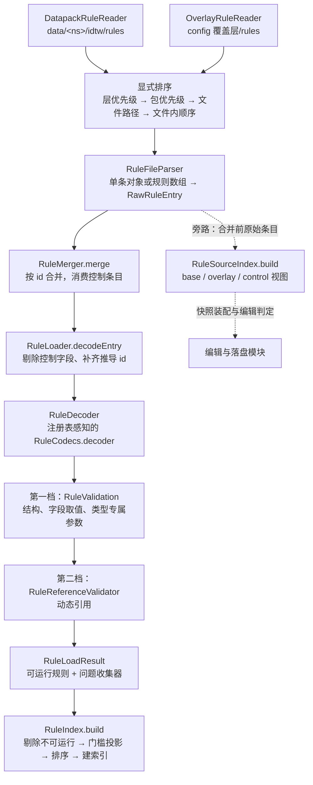

# 规则加载与装配

## TL;DR

- 三层来源读成原始条目，按 id 合并，经注入的解码器解码，再过两档校验，得到可运行规则集。
- 拒载分文件级与条目级；读取不完整时抛异常，由调用方保留上一版索引。
- 合并结果进入 `RuleIndex` 前完成催化剂门槛投影；索引随重载整体替换，缓存一并丢弃。

## 适用对象

需要改动规则来源层、合并语义、拒载粒度或校验链路的开发者；以及排查「规则为什么没生效」时想弄清加载各阶段职责的人。规则 JSON 的字段写法查 [规则 JSON](../api/rule-json.md)，错误文案与状态码查 [错误与状态码](../api/errors.md)。

## 1. 模块职责

本模块把三层规则文件装配成模型对象并完成校验，再把规则集整理成「物品 → 候选规则」的查询结构。

`core/load` 不 import `core/model`：它以泛型与 `RuleDecoder` 注入的方式表达模型，`RuleLoadingService` 是加载层与模型层之间的唯一桥接。加载链本身无缓存、无单例、不管理生命周期，这些属于运行时（见 [转化运行时](conversion-runtime.md)）。

## 2. 模块边界

| 方向 | 内容 |
|---|---|
| 对外入口 | `RuleLoader`（`load` / `loadRaw` / `decodeEntry`）、`RuleLoadingService`（`load` / `loadAndValidate` / `sourceIndex` / `countByLayer` / `describeRules` / `summarize`）、`RuleLoadContext` 与 `RuleLoadRequest` / `RuleLoadResult`、`RuleSourceIndex.build`、`RuleIndex.build` |
| 依赖 | `core/api` 的 `IssueCollector` / `RuleDecoder` / 字段常量与解码预算、DFU Codec；`PackLayerResolver` 由平台注入，`RuleDecoder` 由模型层注入，类型注册表来自[类型系统](type-system.md) |
| 被依赖 | 宿主启动与数据包重载、保存后的重载、调试场景装配、命令与日志回显 |
| 边界之外 | 快照装配与落盘见 [编辑与落盘](authoring.md)；索引发布、缓存失效与结算见 [转化运行时](conversion-runtime.md) |

加载上下文是一次的入参容器：三层来源、注册表与注册表访问器都显式传入，装配层自身不持有全局状态。

## 3. 关键类地图

仅列对外入口、扩展点、聚合根与并发敏感类，非穷举。

| 类/包 | 角色 | 职责 | 协作对象 |
|---|---|---|---|
| `core/load/RuleLoader` | 加载入口与聚合根 | 读取 → 合并 → 逐条解码；解码异常降级为该条拒载 | `DatapackRuleReader`、`OverlayRuleReader`、`RuleMerger`、`RuleDecoder` |
| `core/load/RuleFileParser` | 文件解析 | 单条对象或规则数组两种形状、id 解析、控制字段校验 | 两个读取器 |
| `core/load/DatapackRuleReader` | 数据包层读取 | 取回同名文件在所有包中的副本，按层与包优先级显式排序 | `PackLayerResolver`、`ResourceManager` |
| `core/load/OverlayRuleReader` | 覆盖层读取 | 扫描 `config/<覆盖层目录>/rules`，按绝对路径排序并推导缺省 id | `RulePaths` |
| `core/load/RuleMerger` | 合并聚合根 | 按 id 合并，消费 `disabled` / `delete` 控制条目 | `RawRuleEntry`、`IssueCollector` |
| `core/load/RuleSourceLayer`、`RuleOrigin` | 来源模型 | 三层与优先级、可写性；来源可读标识进入 `Issue.origin` | 全部读写与诊断路径 |
| `core/load/RuleSourceIndex` | 旁路聚合 | 把合并前原始条目归并为 base / overlay / control 三视图 | 快照装配、编辑判定 |
| `core/load/PackLayerResolver` | 注入的判定点 | 包 id → 来源层；按本次加载包的来源元数据建快照 | 平台引导层 |
| `core/service/RuleLoadingService` | 装配点 | 构造注册表感知解码器，串起加载、两档校验与命令用统计 | `RuleLoadContext`、`RuleReferenceValidator` |
| `core/service/RuleReferenceValidator` | 动态引用一档 | 只遍历条件树与效果清单，按 `DynamicReferenceCheck` 分派 | 类型自带的扩展点 |
| `core/runtime/RuleIndex` | 候选索引聚合根 | 剔除不可运行规则、门槛投影、排序、建立直接索引与标签懒展开 | `ConversionRuntime`、调试场景、保存后重建 |
| `core/runtime/CatalystThresholdProjection` | 运行期投影 | 把留空门槛解析为当前消耗配置下的有效值与共享半径 | `RuleIndex.build` |

## 4. 关键流程

流程要点：

- 读取顺序是显式排序结果，不依赖文件系统或资源枚举顺序。
- 合并结果保持 id 首次出现的顺序；最终来源标识取该条最后生效的条目。
- 解码前的加工：剔除 `disabled` / `delete` 控制字段、补齐由文件路径推导的 id、被停用的条目注入 `enabled=false`。
- 索引构建的排序键是「优先级降序 → 条件叶数降序 → 定义序」，第三条由稳定排序兜底。

## 5. 扩展点与约束

### 三层来源与合并

来源层集合与优先级由 `RuleSourceLayer` 定义，按优先级从低到高是内置数据包、世界数据包、config 覆盖层；覆盖层是唯一可写层（`RuleOverlayWriter` 的写入目标，见 [编辑与落盘](authoring.md)）。

- 数据包层：扫描 `data/<ns>/idtw/rules/**/*.json`，对每个资源位置取回全部包的同名副本，逐包展开，避免高优先级包遮蔽低优先级包里的其它规则。
- 覆盖层：扫描 `config/<覆盖层目录>/rules/**/*.json`，按文件绝对路径排序。
- 合并：不同 id 叠加；同 id 后者胜；同一层内先应用普通条目、再应用控制条目，因此停用与删除语义不受文件名字典序影响。
- 层判定由引导层注入的 `PackLayerResolver` 给出，它只产出内置数据包与世界数据包；快照只覆盖本次资源管理器已加载的包，快照外或来源存在歧义时一律按世界数据包处理。来源元数据缺失不做降级：错层会改变优先级，交由加载失败边界处理。

### 控制条目语义

- `disabled: true`：保留同 id 基底的内容，最终来源记为控制条目，解码前注入 `enabled=false`；找不到同 id 基底时报 WARN 并忽略该条。
- `delete: true`：移除同 id 条目，幂等；基底不存在时不做任何事。
- 控制条目只识别 `id` / `disabled` / `delete`，夹带其它字段时报 WARN 且其余字段被忽略。
- 判定按取值：`disabled: false` 是普通规则。
- 同一条同时声明 `disabled` 与 `delete`、或控制字段出现在数据包层，该条拒载。
- 新建规则表达「不参与运行」用规则级 `enabled: false`；控制条目表达的是对基底规则的覆盖意图。

### id 推导

- 显式 `id` 优先，取值须能解析为 `ResourceLocation`。
- 文件只含一条规则时可省略 id：数据包层推导为 `<文件命名空间>:<去掉 idtw/rules 前缀与 .json 的相对路径>`，覆盖层推导为 `<覆盖层命名空间>:<去掉扩展名的相对路径>`，相对路径基准是 `<overlayRoot>/rules`。
- 多条目文件中的每条规则都必须显式声明 id。
- 同一文件内 id 重复时，后出现的条目拒载。
- 推导落在两个读取器里，解析器只消费调用方传入的推导结果；覆盖层写入侧用同一相对路径基准反推 id，改动目录或命名空间时两侧要一起改。

### 拒载粒度

文件级（整个文件拒载）：JSON 文本非法、文本嵌套深度超过解析预算、文件为空、顶层既非规则对象也非规则数组、文件读取失败。

条目级（仅该条拒载）：条目不是 JSON 对象、id 缺失/类型非法/无法解析、多条目文件省略 id、控制字段类型非法或语义冲突、控制字段出现在数据包层、同文件内 id 重复、合并阶段 id 为空、条件树超出深度或节点预算、解码失败、两档校验未通过。

- 解码异常的降级边界：`RuntimeException` 与 `StackOverflowError` 都降级为该条拒载，完整堆栈进日志，议题里保留异常类名与首个栈帧，避免异常被折叠成不可定位的字符串。
- 所有问题都携带来源标识与字段路径；错误级别、文案与状态码的权威定义在 [错误与状态码](../api/errors.md)。

### 两档校验

- 第一档是模型语义校验，使用注册表感知的重载：结构、字段取值、类型专属参数与服务端配置换算出的运行期上限一并检查，未注册类型与区间类非法参数都在这里报错，条款不通过即剔除该条。
- 第二档是动态引用校验：遍历规则级条件树、顶层效果、候选结果内效果以及效果级条件树，按 `DynamicReferenceCheck` 逐叶分派，判定依据是当前服务端实际已加载的注册表与资源。这一档要求非空服务端；无服务端的装配只做第一档。
- 两档都不通过则剔除该条，问题保留在结果的问题收集器中，供命令与日志回显。

### 先建后换与失败保留旧索引

- 构建与应用分离：重载先在构建阶段建新 `RuleIndex` 与候选结构摘要，构建期只读规则与当前注册表视图，不改动在跑的索引、追踪表与排队任务；构建结果先收在发布物里。
- 换入只有一条路径：发布时一次性换入索引与候选摘要，再清空各维度的追踪与标签/气候缓存、按维度带原因取消排队任务；换入本身只做内存容器替换，不在其中重新构建索引（入口与顺序见 [转化运行时](conversion-runtime.md)）。
- 失败保留旧索引：读取、加载、构建与应用期注入的失败都发生在换入之前，旧索引、追踪与任务队列保持有效；宿主记日志并返回带结构化问题的重载回执，命令回执写明「本次未应用任何规则变更」，平台事件不因失败中断（入口见 [平台模块](platform.md)）。
- 换入之后的收尾：逐维排队回扫，单维排队异常的其余维度仍继续；此时索引已生效，日志按「已应用但收尾未完成」记录，不再声称保留了旧索引。

### 来源索引（旁路）

`RuleSourceIndex.build` 不参与主流水线：它按 id 把合并前的原始条目归并成 base（数据包层胜出条目）、overlay（覆盖层胜出条目）、control（最后一次控制条目）三视图，并记录控制条目是否仍为该 id 的最后一次声明。

- 输入顺序由 `build` 内部按合并器口径归一化（同层普通条目在前、控制条目在后），调用方不必预先按层排序；同层同类内仍是输入顺序的后者胜。
- 用途是快照装配判定来源与状态、分别下发 base / overlay 视图，以及编辑时的落点判定。
- 它不读文件、不解码、不校验；被覆盖或停用的基底因此得以保留，供可恢复的编辑使用。

### 候选索引构建

`RuleIndex.build` 是候选索引的唯一构建入口：数据包重载、保存后重建与调试场景都走它。

- 先剔除不可运行规则（未启用，或没有可执行候选），再做门槛投影，最后排序。
- 排序键：优先级降序 → 条件叶数降序 → 定义序（稳定排序保证兜底）。
- 直接物品项在建索引期直接建表；含标签项的规则进入标签集合，标签成员在首次查询到该标签时才展开并缓存，标签不存在时缓存空集。
- 查询结果按 itemId 缓存；标签命中的候选最终仍按全局顺序过滤，因此并列时定义序同样成立。
- 缓存不单独失效：重载时索引对象整体替换，标签与查询缓存随之丢弃。
- 候选结构摘要在构建阶段一并预计算（`CandidateStructureVersions.prepare`），换入时一次替换；摘要只与规则内容有关，规则实例与注册表视图确定后即可离线算完。

### 催化剂门槛投影

`CatalystThresholdProjection.project` 在 `RuleIndex.build` 内执行，把条件叶留空的门槛解析成运行期有效值。

- 门槛取值：优先条件叶声明的 `counts`，其次显式 `count`，都未声明时取规则 `catalyst_cost` 中该引用的数量；规则未声明该引用时用 `CatalystPresentCondition.DEFAULT_COUNT`。实际消耗量不参与门槛解析。
- 共享半径：规则声明 `catalyst_cost` 时取其 `radius`，否则沿用条件叶的 `radius`；半径是运行期属性，不写回保存声明。
- 无留空门槛时原样复用同一个 `Rule` 实例；有变化时只重建条件树与效果列表，其余字段与排序键保持不变，效果经 `withConditions(...)` 重建真实类型。
- 投影不反写保存声明，重载与保存后重建索引时重新解析；编辑器展示门槛复用同一 `resolveThreshold`，不改写声明。

### 新增来源层、控制语义与拒载规则

- 新增来源层：扩 `RuleSourceLayer`（优先级与可写性）、读取侧排序键、`RuleSourceIndex` 的三视图划分，以及覆盖层写入目标；一处遗漏会让层优先级或快照状态判断失真。
- 新增控制条目语义：在 `RuleFileParser` 的控制字段校验、`RuleMerger` 的应用分支、`RuleSourceIndex` 的 control 视图三处同步，并确认快照状态语义。
- 新增拒载规则：往 `IssueCollector` 写入问题时带上来源标识与字段路径，文案与错误码统一维护在 [错误与状态码](../api/errors.md)。
- 新增规则字段或类型：不落在本模块，按 [规则 JSON](../api/rule-json.md) 与[类型系统](type-system.md) 的步骤改。

### 约束与验证

- 包优先级取自 `listPacks()` 的顺序；未登记的包按最低包优先级参与排序，并按包各告警一次；优先级表读取失败时告警并按文件路径退化排序。
- `core/load` 不 import `core/model`，模型能力一律经注入获得。
- 合并结果中 `delete` 恒为 `false`；`disabled` 表示该规则已被覆盖层停用。
- 加载结果是只读视图：规则列表不可变，问题收集器本身可变，加载完成后按只读方式使用。
- 改动后依次运行：`python tools/check-docs.py`、`tools/dsh-build.ps1 -Tasks build`，再做实机验证；加载结果的 `summarize` 与 `describeRules` 可直接用于命令回显和日志确认。

## 6. 数据与配置引用

| 事实 | 唯一落点 |
|---|---|
| 规则 JSON 顶层形状、三层来源目录与控制条目语义、扩字段/扩类型方式 | [规则 JSON](../api/rule-json.md) |
| 问题级别、错误码、拒载粒度与文案 key | [错误与状态码](../api/errors.md) |
| 覆盖层目录等 `server.json` 配置项与默认值生成 | [运行配置](../ops/configuration.md) |
| 三层作用域与按 id 覆盖合并的决策 | [ADR-0014](../adr/0014-three-layer-scope-and-overlay-merge.md) |
| 动态引用校验作为扩展点的决策 | [ADR-0036](../adr/0036-dynamic-reference-check-extension-point.md) |

## 相关文档

- [规则模型](rule-model.md)
- [类型系统](type-system.md)
- [转化运行时](conversion-runtime.md)
- [编辑与落盘](authoring.md)
- [关键链路](../architecture/key-flows.md)
- [依赖规则](../architecture/dependency-rules.md)
