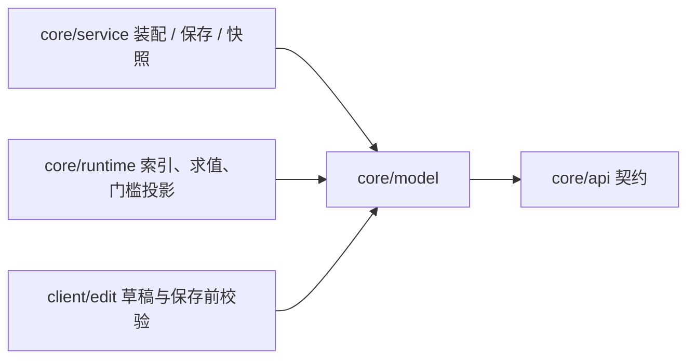
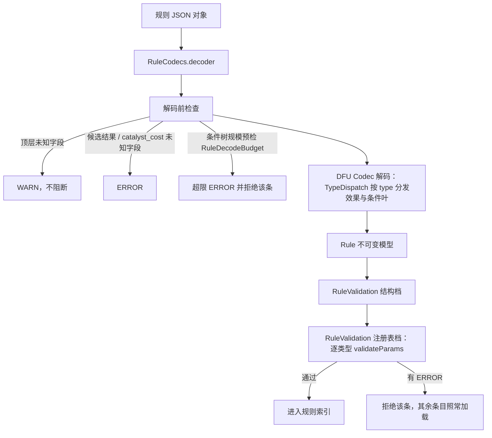
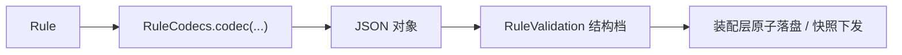

# 规则模型

> **TL;DR**
> - `core/model` 固定规则数据的唯一形态：全 record 不可变，一条 `Rule` 由源匹配、消失方式、条件树、固定成本、组合模式与候选结果组成。
> - 编解码与语义校验分离：`RuleCodecs` 负责 JSON ↔ 模型，`RuleValidation` 负责结构校验与类型参数校验。
> - 扩字段、扩枚举、扩条件节点都落在 `RuleFields` + `RuleCodecs` + `RuleValidation`（条件树另加 `ConditionNode`/`ConditionTrees`）上。

**适用对象**：调整规则 JSON 契约、编写内置或第三方效果/条件类型、维护编辑器草稿与保存链路、排查加载与校验问题的开发者。

## 1. 模块职责

一句话边界：给定一份规则 JSON，本模块产出不可变且已通过语义校验的 `Rule`；反过来把 `Rule` 编码回同一形状的 JSON。

具体承担：

- 规则数据形态：`Rule` 与源匹配、固定成本、候选结果、条件表达式等部件。
- 条件树算法：`ConditionTrees` 的遍历（带 JSON 字段路径）、规模统计与不可变结构变换。
- 编解码组装：`RuleCodecs`（规则、效果、条件树）、`CommonFields`（共用字段片段）、各记录与枚举自带的 `CODEC`。
- 语义校验：`RuleValidation` 的三档入口（结构、类型参数、运行期上限）与规模上限判定。
- 规模上限常量：`ConditionLimits`，其中条件树的节点数与深度引用契约层解码预算的同一常量。
- 分类派生：`RuleCategoryClassifier` 按生效效果的产出类别派生规则分类。
- 类型定义形态：`EffectType`、`ConditionType` 及一行式实现 `SimpleEffectType`、`SimpleConditionType`。

世界读写、注册表实现、来源合并与加载编排分别由运行时、注册表、加载层与装配层承担；本模块只提供它们共用的数据形态与校验结论。

## 2. 模块边界

### 对外入口

- 解码与编码：`RuleCodecs.codec(...)`（`Codec<Rule>`）、`effectCodec(...)`、`conditionExpressionCodec(...)`，以及供加载层注入的 `decoder(...)`。
- 校验：`RuleValidation.validate(...)` 的结构档；带效果与条件类型注册表、追加类型参数校验的重载；再叠加服务端运行期上限（`RuleRuntimeLimits`）的重载。
- 数据访问：`Rule` 的派生入口（可运行性、生效消失方式、生效候选、全部效果、特异性）、`ConditionExpression` 的统计与结构合法性、`ConditionTrees` 的遍历与结构变换。
- 类型扩展：`Effect`、`Condition` 两个参数对象接口，`EffectType`、`ConditionType` 两个类型定义接口，以及一行式实现 `SimpleEffectType`、`SimpleConditionType`。
- 常量：`RuleCodecs.DEFAULT_TRIGGER_AFTER_SECONDS`、`RuleCodecs.DEFAULT_SCHEMA_VERSION`、`ConditionLimits` 的规模上限、`OutcomeCandidate.IMPLICIT_ID`、`CatalystCost` 与 `SourceCost` 的数量默认值。

### 依赖方向

本模块的编译期依赖只有 `core/api`、DFU、Minecraft（`BuiltInRegistries` 与 `ResourceLocation`）、Gson 与 log4j 日志接口。注册表以 `core/api/TypeRegistry` 接口注入，模型层因此只面向注册表接口编程。装配层经 `RuleCodecs.decoder(...)` 产出 `RuleDecoder` 注入加载层，加载层因此只依赖契约层，与模型层的耦合点就是这一个函数式接口。

### 被谁依赖

- 注册表与内置类型：实现 `EffectType`/`ConditionType`，内置类型用 `Simple*` 一行注册。
- 加载层：经 `RuleDecoder` 注入，模型层只通过该接口与它相遇。
- 装配层：加载、保存、快照与提交校验都走 `RuleCodecs` 与 `RuleValidation` 的同一套入口。
- 运行时：规则索引、表达式求值、催化剂门槛投影与候选结构版本比对读取模型。
- 命令与调试：查询输出、调试场景定义复用 `Rule` 与 `RuleCategoryClassifier`。
- 客户端编辑器：草稿解析、条件树编解码与保存前校验共用同一套 Codec。

## 3. 关键类地图

仅列对外入口、扩展点、聚合根与并发/事务敏感类，非穷举。

| 类型（`core/model` 下） | 角色 | 职责 | 协作对象 |
|---|---|---|---|
| `Rule` | 聚合根 | 规则唯一配置单元；紧凑构造器规范化展示名、空条件、空消失方式与空候选；派生 `complexity()`、`isRunnable()`、`effectiveTriggers()`、`effectiveOutcomes()`、`allEffects()` | `RuleCodecs` 解码、`RuleValidation` 校验、运行时索引 |
| `RuleCodecs` | 编解码入口 | 保留规则、候选与催化剂的 MapCodec，以实际 keys 派生解码字段集合；组装递归条件树 Codec；`decoder(...)` 在解码前做顶层未知字段告警、候选结果与 `catalyst_cost` 的未知字段报错、条件树规模预检 | `TypeDispatch`、`RuleDecodeBudget`、`OutcomeCandidate`、各枚举 CODEC |
| `RuleValidation` | 校验入口 | 结构档检查 id、触发时间、源匹配、`effects`/`outcomes` 二选一、`schema_version`、固定成本、展示名码点、条件树结构与规模；注册表档对每个效果与条件叶先执行绑定声明检查，再调业务语义和运行期限额钩子，并报告未注册类型；运行期上限档再叠加服务端配置的放置半径上限 | `IssueCollector`、`ParamChecks`、`RefChecks`、`TypeRegistry` |
| `ConditionExpression` / `ConditionNode` / `ConditionTrees` / `ConditionLimits` | 条件树（数据 + 算法 + 限额） | 表达式只有一个根节点，`null` 表示无条件；节点分组合、取反与条件叶，构造器只做不可变拷贝，非空与规模在 `isStructurallyValid()` 与解码期判定；遍历产出与 JSON 一致的字段路径并统计叶数/节点数/深度，`replaceAt`/`updateTermsAt` 为纯函数结构变换（非法路径返回原树并记 WARN）；叶数、节点数、深度、效果数与源匹配项上限集中在限额常量，节点与深度直接引用 `RuleDecodeBudget` 的同一常量 | `RuleCodecs`、运行时求值器、编辑器、`RuleValidation` |
| `EffectOffset` | 值对象 | 行为相对冻结触发点的三轴整数格偏移；零默认、子字段声明、Codec、原点加法与服务端逐轴限额校验集中于该对象 | 公共效果参数、运行时原点解析与编辑器投影 |
| `Effect` / `EffectType` / `SimpleEffectType` / `Condition` / `ConditionType` / `SimpleConditionType` | 类型定义扩展点 | 参数对象实现 `Effect`（类型 id、延迟、概率、整格触发点偏移）或 `Condition`（类型 id）；`EffectType` 追加执行器、一次性标记、产出类别与每轮一组容量需求（`capacityDemand`），`ConditionType` 追加求值器与可求值性门禁；`Simple*` 用 id + MapCodec + 校验器 + 执行器或求值器 + 参数声明一行注册 | `core/api` 的执行器与求值器契约、注册表 |
| `CommonFields` | 共用参数声明 | 效果通用字段（延迟、概率）的 spec 声明、默认值与 `EFFECT_PARAMS`；各效果把它拼进自己的 `PARAMS` | 各效果参数记录 |
| `SourceMatcher` / `SourceEntry` / `SourceCost` / `CatalystCost` | 输入声明 | 源匹配含匹配项与排除项（排除优先）；源成本按当前堆叠取数量，直接物品优先、其次按源声明顺序取首个命中标签；催化剂把存在门槛与实付量分开声明并共享半径 | 运行时索引与门槛投影 |
| `OutcomeCandidate` / `CombinationMode` / `TriggerKind` | 候选与消失方式 | 候选标识规则内唯一，携带共同执行的效果与两个位置开关，未声明候选时顶层效果隐式映射为唯一候选，组合模式决定同组选候选的方式；消失方式取值为小写下划线、解析大小写不敏感、未知取值明确报错，规则未声明时按自然消失处理 | 运行时产出派发与触发路径 |
| `RuleCategoryClassifier` / `ProductKind` | 分类派生 | 纯函数：按生效效果的产出类别派生分类标识，多根类别与实体子类别各有组合标识，无产出与含未知产出的规则归扩展分组；「未完成」与「有问题」由客户端按内容草稿状态和校验问题决定，分类器不产出这两个值；草稿 JSON 走逐效果解码的入口 | 快照装配、客户端列表 |

## 4. 关键流程

JSON → 模型的解码与校验链：

模型 → JSON 的编码回写（编辑器保存、快照装配）：

编码未注册类型会抛 `IllegalStateException`（编程错误），保存路径必须把它转成用户可读错误。

## 5. 扩展点与约束

### 扩展点

- **扩规则级字段**：在 `RuleFields` 加常量 → 在 `RuleCodecs.mapCodec(...)` 使用的 `RecordCodecBuilder` 组里加字段 → 在 `Rule` 加分量 → 需要的语义检查写进 `RuleValidation`。未知字段集合从实际 MapCodec 派生；`category` 作为原始来源的展示元数据在顶层检查中显式放行，由快照装配读取。
- **扩枚举取值**：消失方式在 `TriggerKind` 加常量，组合模式在 `CombinationMode` 加常量，两者都沿用 `key()` 的小写下划线序列化与大小写不敏感解析；新增产出类别在 `ProductKind` 加常量并给出分类标识，分类组合语义集中在本模块的分类器里。
- **扩条件节点类型**：改 `ConditionNode` 的 `permits` 与记录 → 补 `ConditionTrees` 的遍历/统计/结构变换 → 补 `RuleCodecs` 的节点编解码与节点字段白名单 → 同步 `ConditionExpression.isStructurallyValid()` → 若节点会加深树，同步 `RuleDecodeBudget` 的预算遍历，并在 `RuleFields` 补节点字段名。
- **扩通用效果字段**：改 `CommonFields` 的 spec 声明（含默认值、单位与编辑器窗口）；各效果已引用同一 `EFFECT_PARAMS`，无需逐类型修改。
- **扩校验规则**：写进 `RuleValidation` 对应阶段，问题交给 `IssueCollector`；通用规模上限加到 `ConditionLimits`，属于解码期预算的改 `RuleDecodeBudget` 并由 `ConditionLimits` 引用，保证解码期与校验期同一口径。

### 约束

- 模型全 record 不可变：紧凑构造器对集合做防御性拷贝，消失方式集合用保序集合保留声明顺序；对外只暴露不可变视图。
- Codec 层不得产出 `null`：DFU 的 `DataResult` 内部使用 `Optional.of`，可空字段以 `Optional` 承载，并在记录构造的最后一步回落为可空字段。
- 空表达式与空组合节点必须可构造、可序列化（编辑器中间态），非空性与规模只在 `isStructurallyValid()` 与解码期强制。
- 未知字段按层级给出不同严重级：规则顶层告警，类型参数、条件节点、候选结果与 `catalyst_cost` 对象按错误级拒绝。
- `effects` 与 `outcomes` 二选一；`schema_version` 只接受当前契约版本；条件数组、`groups` 字段、叶级取反与整型 `catalyst_cost` 在解码期给出可定位的错误并拒绝该条。
- 条件树结构变换是纯函数：非法路径返回原树并记 WARN，实现不就地修改入参、不产生 `null` 中间态。

### 改动后的验证

先做 IDE 工作区检查，再执行 `tools/dsh-build.ps1 -Tasks build`；改动 JSON 契约后必须同时验证解码与编码往返（编辑器保存 → 重载）以及内置数据包的加载结果。文档链接改动后跑 `python tools/check-docs.py`。

## 6. 数据与配置引用

- 规则 JSON 的顶层形状、字段、默认值与覆盖层条目语义：[`docs/api/rule-json.md`](../api/rule-json.md)。
- Issue 模型、严重级与拒载粒度：[`docs/api/errors.md`](../api/errors.md)。
- 编辑器草稿、变更集与保存协议：[`docs/api/edit-protocol.md`](../api/edit-protocol.md)。
- server.json 的配置项由宿主装配读取并注入运行时，取值与默认值见 [`docs/ops/configuration.md`](../ops/configuration.md)。

## 相关文档

- 底层契约：[`core/api` 契约层](core-contract.md)
- 类型注册与内置类型：[type-system](type-system.md)
- 规则来源与合并：[rule-loading](rule-loading.md)
- 门槛投影与结算：[conversion-runtime](conversion-runtime.md)
- 客户端草稿与保存：[client-editor](client-editor.md)
- 模块总览：[模块索引](README.md)
- 决策：[ADR-0012](../adr/0012-rule-model-and-effect-list.md)、[ADR-0013](../adr/0013-dfu-codec-and-flat-type-dispatch.md)、[ADR-0018](../adr/0018-condition-tree-contract.md)、[ADR-0039](../adr/0039-rule-category-authority.md)
