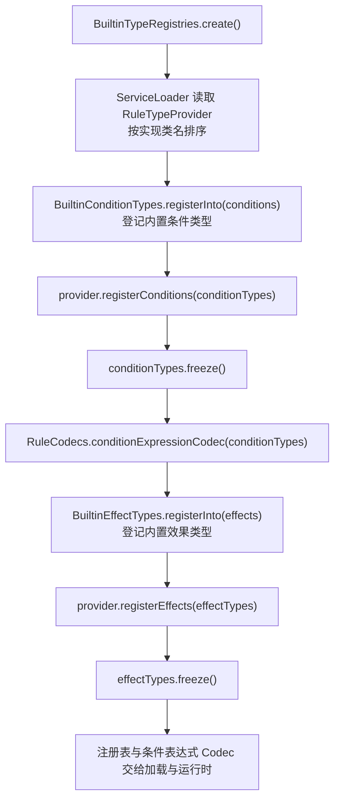

# 类型系统

## TL;DR

- 类型系统提供条件与效果类型的注册设施：注册期可变，`freeze()` 之后只读，冻结快照供运行时按 `type` 字段查表。
- 内置类型与第三方 SPI 在同一次装配中完成注册并统一冻结，SPI 在冻结前分两阶段调用。
- 新增一个类型是「参数记录 + 编解码器 + 校验与执行实现 + 一条注册」，落点见第 5 节。

## 适用对象

准备新增内置条件或效果类型的维护者，以及需要在其他模组中注册自定义类型、接入动态引用校验的扩展开发者。阅读前先了解 [核心契约](core-contract.md) 与 [规则模型](rule-model.md) 中的类型定义形态。

## 1. 模块职责

类型系统负责三件事：类型注册表的语义（注册期可变、冻结后只读）、第三方类型扩展入口（SPI 与类型自带扩展点）、内置条件与效果实现的位置与装载。

类型本身的形态——`TypeDefinition`、`ConditionType`、`EffectType`、`Condition`、`Effect` 及其 Codec 组装——归 `core/api` 与 `core/model`；本模块只消费这些契约并决定「有哪些类型可用」。

## 2. 模块边界

| 方向 | 内容 |
|---|---|
| 对外入口 | `SimpleTypeRegistry`（注册表实现）、`RuleTypeProvider`（第三方 SPI）、`DynamicReferenceCheck` / `DynamicReferenceContext`（类型自带扩展点）、`BuiltinConditionTypes` / `BuiltinEffectTypes`（内置类型装载）、`BuiltinTypeRegistries`（规范装配点与冻结边界） |
| 依赖 | `core/api` 的类型与注册契约、`core/model` 的类型定义接口与参数对象接口、DFU `MapCodec` |
| 被依赖 | 宿主启动（装配类型注册表并交给加载与运行时）、规则加载（解码与校验时按 `type` 查表）、编辑与快照装配（类型元数据参与候选与分类） |

服务端在启动装配时建立并冻结注册表，数据包重载复用同一份实例；客户端首次使用本地类型表时复用相同装配流程并缓存结果。类型集合由已安装的模组提供。

## 3. 关键类地图

仅列对外入口、扩展点、装配聚合点与并发敏感类，非穷举。

| 类/包 | 角色 | 职责 | 协作对象 |
|---|---|---|---|
| `core/registry/SimpleTypeRegistry` | 注册表实现 | 注册期用保序映射登记；`freeze()` 构造不可变快照并以 `volatile` 发布；重复 id 与冻结后注册各自抛出语义异常 | 全部查询方、`BuiltinTypeRegistries` |
| `core/api/TypeRegistry`、`TypeRegistrar`、`TypeDefinition` | 契约 | 查询与注册能力分离；类型定义持有 id、参数 MapCodec、绑定声明与业务语义钩子 | 契约细节见 [核心契约](core-contract.md) |
| `core/api/param` 的 `ParamSpec`、`ParamBinding`、`ParamList` | 参数声明 | 每个参数只声明一次：字段名、wire 存在性、值域、默认值、新建初值与编辑器元数据；typed getter 只绑定一次，Codec 字段构件与批量校验共用该绑定 | 各内置类型的 `PARAMS`；客户端 `ParamProjection` |
| `core/extension/RuleTypeProvider` | 第三方 SPI | 两侧各自装配时先注册条件类型，再注册效果类型 | `BuiltinTypeRegistries.create()` |
| `core/extension/DynamicReferenceCheck`、`DynamicReferenceContext` | 扩展点 | 参数对象申报「须依赖服务端已加载内容才能判定的引用」，由核心校验器遍历分派 | `RuleReferenceValidator`（[规则加载](rule-loading.md)） |
| `core/type/BuiltinConditionTypes`、`core/type/BuiltinEffectTypes` | 内置类型装载 | `registerInto(TypeRegistrar)` 只登记内置类型，由规范装配点统一冻结 | `BuiltinTypeRegistries` |
| `core/type/BuiltinTypeRegistries` | 装配聚合点 | 固定「条件冻结 → 条件表达式 Codec → 效果冻结」顺序，SPI 在两处冻结前插入 | 宿主启动、规则加载、客户端类型表 |
| `core/type/EnumCodecs` | 公共工具 | 枚举取值统一小写下划线形式、解析大小写不敏感、未知取值报错时附可选值 | 各内置类型的参数 Codec |

## 4. 关键流程

注册生命周期（`BuiltinTypeRegistries.create()`）是冻结语义的唯一执行点：

- 顺序的成因：规则级条件树的编解码器依赖已冻结的条件类型，因此在装配效果类型之前先冻结条件类型并构建该 Codec；效果参数不引用条件表达式。
- 冻结产物是独立的 `TypeRegistry` 只读视图；provider 只获得 `TypeRegistrar`，封口权由装配点持有。`freeze()` 幂等并返回同一视图，保留的注册句柄再次 `register` 抛 `RegistryFrozenException`；重复 id 在注册期就抛 `DuplicateTypeException`，注册表保持原状，不做静默覆盖。
- 异常处理：装配点自身不吞异常，注册冲突与 provider 抛出的运行时异常向上交给宿主启动边界（见 [平台模块](platform.md)）。
- 并发约定：注册期只允许单线程注册，`freeze()` 由执行注册的同一线程调用；冻结后 `find` / `require` / `all` / `ids` 可被任意线程并发读。

## 5. 扩展点与约束

### 新增内置条件类型

目录：参数记录放 `common/src/main/java/com/meteorite/itemdespawntowhat/core/type/condition/`，求值器放同层的 `eval/`。

1. 写参数 `record` 并实现 `Condition`；需要动态引用校验时同时实现 `DynamicReferenceCheck`。
2. 在同一记录里声明参数：按 JSON 字段顺序写 spec 常量（`IntSpec`、`RefSpec` 等，承载字段名、wire 存在性、值域、默认值、新建初值与编辑器元数据），用 `spec.bind(Record::getter)` 聚合为 `ParamList<Record>`；Codec 用 `PARAMS.field(spec)` / `nullableField(spec)` 复用同一 getter。规则校验入口自动遍历全部绑定，跨字段与模式相关校验留在 `validateParams`。
3. 提供 `static final ResourceLocation ID`（同时是 JSON 中 `type` 的取值）、参数 `MapCodec`、`validateParams(...)`，以及返回 `ConditionType` 的静态工厂（传 `PARAMS`）。静态工厂命名为 `conditionType()`，因为 `Condition` 已有无参实例方法 `type()`。
4. 求值器实现 `ConditionEvaluator`：它是纯谓词，只给原始判定，不承担消耗；上下文不足时由类型经 `evaluability(...)` 申报 `UNAVAILABLE`。
5. 在 `BuiltinConditionTypes.registerInto(...)` 增加一条 `registry.register(...)`；冻结由装配点统一完成，不要在类型内部冻结。
6. 该类型的 JSON 字段语义写入 [规则 JSON](../api/rule-json.md)。

### 新增内置效果类型

目录：参数记录放 `core/type/effect/`，执行器放同层的 `exec/`。

1. 写参数 `record` 并实现 `Effect`。
2. 声明参数：按 JSON 字段顺序绑定 spec 与 getter，再用 `plus(CommonFields.EFFECT_PARAMS)` 追加公共绑定；Codec 字段构件取自同一 `PARAMS`，解码期不产出 `null`。
3. `effectType()` 返回 `SimpleEffectType`：id + 参数 `MapCodec` + 参数校验器 + `PARAMS` + `EffectExecutor` + 一次性标记 + 产出类别 + 容量需求解析器。
4. 执行器放 `exec/`：同步执行只需 `execute`；需要在成功转化当刻固定输入的类型覆盖 `prepare` 与按准备结果创建执行状态的 `start`，长循环在 `start` 返回的执行状态里按共享 tick 预算续接（见 [转化运行时](conversion-runtime.md)）；逐个实体写入、按区块就绪度与预算节奏续接的交付改为继承 `exec/DeliveryExecution`，只提供 `declaredRequirement`、`produce`、`write`、`isComplete`、`result`、`unitsPerStep`、`intervalTicks` 与 `onUnitWritten`，队列、区块等待、预算双检与逐单位回执由基类统一实现。固定范围覆盖 `EffectExecution.requiredChunks()` 声明 `ChunkRequirement`；处理中途遇到未加载区块返回 `EffectStep.AwaitChunks`，预算或批次上限用 `Yield`，正常间隔用 `Delay`，最终回执用 `Done`。区块检查、重试刻与超时由运行时处理；执行状态保留随机目标、游标与已完成量。具体契约见 [契约层核心](core-contract.md)。
5. 在 `BuiltinEffectTypes.registerInto(...)` 增加一条登记。
6. 声明产出类别（`productKind`）后，含该效果的规则可按类别归组；`productKind` 默认 `ProductKind.NONE`，含这类效果的规则参与归类时按无产出处理（分类装配见 [编辑与落盘](authoring.md)）。内置 `spawn_entity` 按产出子类声明产出类别：掉落物、生物、其他实体与经验分别对应 `entity.item`、`entity.mob`、`entity.entity`、`entity.experience`；同一条规则含多个实体子类时归 `entity.mixed`。
7. 产物占用邻近容量时通过 `capacityDemand` 声明每轮一组最小产出需求（具体物品/实体件数，或产物类型未知时按区域物品总量的保守下界）；不声明则视为不占容量，计划期产出预算不为该效果计需求。

包内有界效果以 `BoundedExecution` 统一单步续接与终态回放，以 `StepBudget` 统一步内上限和已报告未扣账工作量。`DeliveryExecution` 在其上保留实体 pending、生产与写前预算双检；方块放置按每个候选尝试计费，邻域计数以组合方式共用同一步额度，成功量仍按所属请求回执。区块等待与重试由调用层驱动，见 [ADR-0042](../adr/0042-effect-chunk-wait-driving.md)。

### 第三方类型 SPI

1. 实现 `core/extension/RuleTypeProvider`，在自身 jar 的 `META-INF/services/com.meteorite.itemdespawntowhat.core.extension.RuleTypeProvider` 中登记实现类全名。
2. provider 方法接收 `TypeRegistrar`，只在装配线程登记或查询；调用时机就是 `BuiltinTypeRegistries.create()`：内置条件登记之后、`conditionTypes.freeze()` 之前调 `registerConditions`；内置效果登记之后、`effectTypes.freeze()` 之前调 `registerEffects`。
3. 多个 provider 按实现类名排序后依次调用，跨端与跨次启动顺序稳定。
4. 注册的 id 自带命名空间；与已注册 id 冲突会抛 `DuplicateTypeException`，注册表不做覆盖。
5. 客户端安装同一 provider 后，`ClientTypeRegistries` 复用该装配流程。非空 `params()` 自动生成表单、初值与默认值，必填字段的新建预填由 `initialValue` 提供；定制描述符入口见[客户端编辑器](client-editor.md#新增类型编辑器)。
6. provider 的注册方法只建立类型定义，可在客户端和服务端分别装配，类加载与注册独立于当前世界和服务端实例。

### 动态引用校验扩展点

在参数对象上实现 `DynamicReferenceCheck.checkDynamicReferences(DynamicReferenceContext)`：上下文给出当前服务端、议题收集通道与当前效果/条件叶相对规则根的字段路径。实现把问题写入 `issues()`，字段路径以 `fieldPath()` 为前缀拼接，`origin` 传 `null`，由收集通道按当前规则来源统一补齐。

调用时机在规则加载的两档校验中：`RuleReferenceValidator` 遍历规则级条件树、顶层效果与候选结果内效果逐项分派，自身不含任何具体类型的判定。第三方类型实现该接口即获得同等校验。

### 约束与验证

- 类型 id 同时是 JSON `type` 的取值；未注册类型的编解码属编程错误，由分发层报错（见 [规则模型](rule-model.md)）。
- `all()` / `ids()` 在注册期也返回快照，调用方拿到的集合不会随之后的注册变化；输出顺序即注册顺序。
- 类型参数的枚举取值统一走 `EnumCodecs`，新增枚举取值时无需另写解析。
- 每个类型的参数只声明一次：值域、默认值、新建初值与编辑器窗口不写在 Codec、校验器或客户端表里；客户端描述符与新建初值由声明投影。
- 改动后先用 IDEA 检查 Java，再运行 `python tools/check-isolation.py`、`python tools/check-docs.py`、`tools/dsh-build.ps1 -Tasks build`，随后做实机验证；类型注册冲突会在启动装配时立即暴露。

## 6. 数据与配置引用

| 事实 | 唯一落点 |
|---|---|
| 规则 JSON 中 `type` 字段、各类型的参数形状与新增类型的字段写法 | [规则 JSON](../api/rule-json.md) |
| 未注册类型、参数非法、注册冲突等错误与拒载粒度 | [错误与状态码](../api/errors.md) |
| 运行期可配置项（类型注册不受其影响） | [运行配置](../ops/configuration.md) |
| 扁平类型分发与条件树形状的决策 | [ADR-0013](../adr/0013-dfu-codec-and-flat-type-dispatch.md) |
| 动态引用校验放在参数对象上的决策 | [ADR-0036](../adr/0036-dynamic-reference-check-extension-point.md) |
| 类型参数只声明一次、编解码与编辑器共同消费的决策 | [ADR-0049](../adr/0049-single-parameter-declaration.md) |

注册能力与冻结视图的取舍见 [ADR-0053](../adr/0053-type-registration-and-frozen-query-view.md)。

## 相关文档

- [核心契约](core-contract.md)
- [规则模型](rule-model.md)
- [规则加载](rule-loading.md)
- [转化运行时](conversion-runtime.md)
- [依赖规则](../architecture/dependency-rules.md)
- [关键链路](../architecture/key-flows.md)
