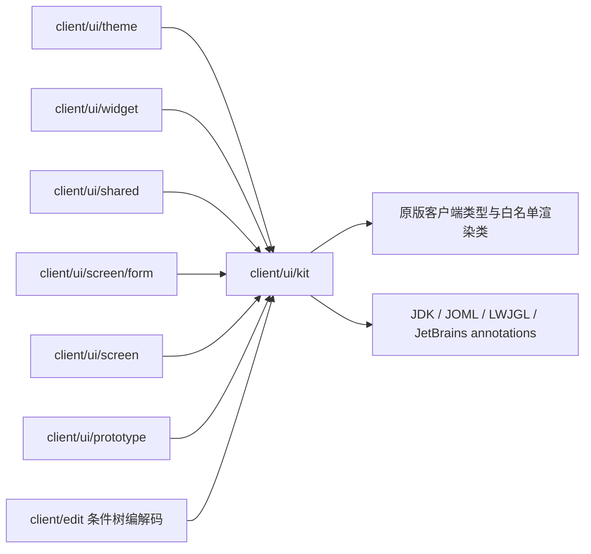
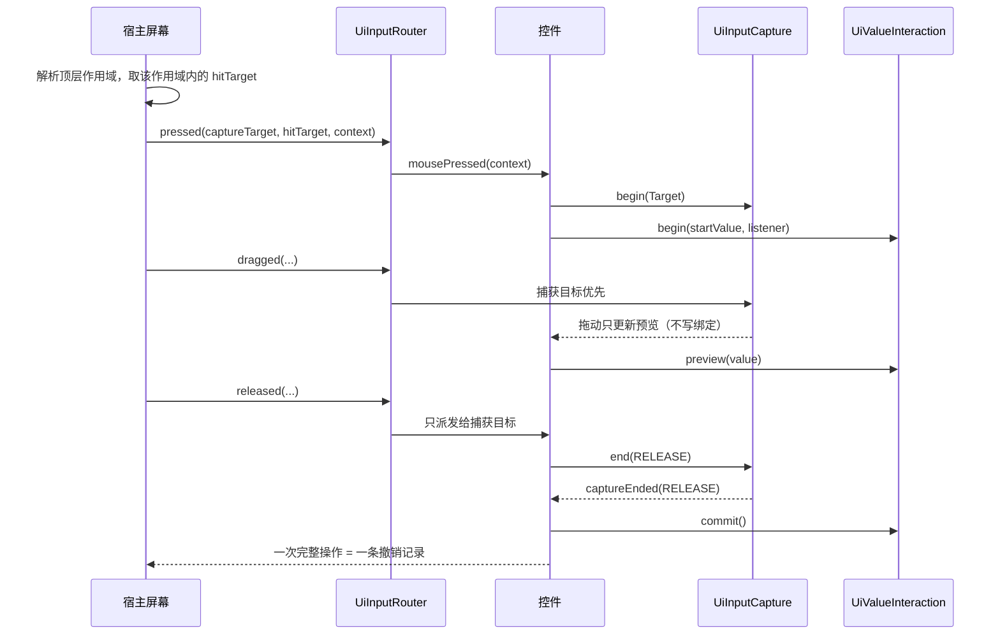
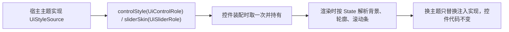

# UI kit

> **TL;DR**
> - `client/ui/kit` 是与本模组业务无关的声明式客户端 UI 原语集：排版与几何、固定矩形控件与控件组、输入路由与捕获、树编辑、数值与文本契约、预览与绘制层次。
> - 视觉规格、业务文案、模态归属与数据解释都由宿主注入：kit 只约定接口与不可变值。
> - 公开面以 `package-info.java` 为权威登记；依赖边界由 `tools/check-ui-kit-boundaries.ps1` 强制。

**适用对象**：编写新界面或新控件、实现宿主主题、给画布或树增加交互、排查输入与捕获问题的开发者。

## 1. 模块职责

一句话边界：把“界面怎么排版、怎么命中、一次拖动从哪里开始又怎样收尾”固定成与业务无关的原语，让主题、控件与屏幕在它之上各自生长。

承接的面（每组的具体公开类型在 `package-info.java` 中逐项登记）：

- **声明式排版与几何**：文档树、内容变换、文本度量、流式与线性布局，以及命中、矩形与九宫格切片原语。
- **固定矩形控件与控件组**：控件基类、按稳定 key 复用的一组控件、滚动视口，绘制统一走相对 z 偏移的绘制层。
- **宿主样式注入**：语义角色（`UiControlRole`、`UiSliderRole`）、控件样式（`UiControlStyle`）、滑块样式与画法（`UiSliderStyle` + `UiSliderPainter` 打包成 `UiSliderSkin`）、样式来源接口 `UiStyleSource`。
- **输入与操作生命周期**：输入上下文与目标契约、路由顺序、单捕获与统一结束原因、单值操作生命周期、焦点与键盘导航、局部撤销快捷键派发。
- **数值与文本契约**：合法域与吸附策略、轨道显示窗口、数值文本的显示与解析、数值与精确文本的双向绑定、标量/区间/循环滑条、文本选择与局部历史。
- **树与画布原语**：不可变树的编解码注入、结构操作与移动预览、tidy 布局、点阵网格、正交连线、框选。
- **预览与层次**：实体/方块/模型预览、图标图集与图标条、浮动面板、灯箱、悬停指针门禁。

kit 是记录来源与差异的维护副本，按可独立发布的库 API 维护（[ADR-0025](../adr/0025-reusable-client-ui-kit-boundary.md)、[ADR-0030](../adr/0030-ui-kit-as-standalone-library-api.md)）；新增公开类需要在 `package-info.java` 登记（[ADR-0033](../adr/0033-kit-zero-reference-public-api-retention.md)）。

## 2. 模块边界

### 对外入口

按调用方角色划分：

- **屏幕与页面装配者**：`UiDocument` 与节点、`UiControl`/`UiControlGroup`/`UiScrollView`、布局与几何类型、`UiRenderLayers`/`UiPointer`、`UiFlatText`（无阴影文本与悬停提示）、`UiFloatingPanel`、`UiLightbox` 与预览轮播原语。
- **主题实现者**：实现 `UiStyleSource`，按角色给出控件样式与滑块皮肤；无主题的宿主可直接取 `UiSliderStyle.pixelDefaults()` / `UiSliderSkin.pixelDefaults()`。
- **控件实现者**：实现 `UiInputTarget`，需要键盘焦点时再实现 `UiFocusTarget`；一次拖动交给 `UiInputCapture`，一次数值操作交给 `UiValueInteraction`。
- **树与数据适配方**：`UiTreeEditor.Adapter` 提供不可变节点的读取、替换与容量，`UiTreeCodec` 提供外部表示编解码，`UiTreeMoveInteraction` 把拖动绑定到捕获。
- **数值字段装配方**：`UiNumberPolicy` + `UiSliderWindow` 描述合法域与显示窗口，`UiNumbers` 负责显示与解析，`UiValueTextBinding` 负责滑条与精确输入的双向同步。

### 依赖方向

kit 的编译期依赖只有原版客户端类型、JDK、JOML、LWJGL 与 JetBrains annotations；渲染相关只精确放行 `com.mojang.blaze3d` 下实际使用到的类。宿主各子包单向依赖 kit：

边界由脚本强制：`powershell -ExecutionPolicy Bypass -File tools/check-ui-kit-boundaries.ps1`，白名单为 `java.*`、`javax.*`、`net.minecraft.*`、`org.jetbrains.*`、`org.joml.*`、`org.lwjgl.*`，另精确放行 `com.mojang.blaze3d.platform.Lighting`、`com.mojang.blaze3d.vertex.PoseStack`、`com.mojang.blaze3d.vertex.VertexConsumer`；同包互引允许，其余本项目包、loader 包与 Gson 一律不在白名单内。退出码 0 通过、1 存在违规、2 配置错误。

### 被谁依赖

- `client/ui/theme`：把主题色与度量映射成 kit 的样式值后注入，是 `UiStyleSource` 在本项目的实现侧。
- `client/ui/widget`：把可复用控件委托给 kit 核心（数值、文本、树、图标条），对外保持既有调用签名。
- `client/ui/shared`：目录图标与条件摘要复用 kit 的图标、滚动与布局原语。
- `client/ui/screen` 与 `client/ui/screen/form`：页面级装配，持有控件、捕获与焦点管理器。
- `client/edit`：条件树的编解码与节点适配引用 `UiTreeCodec`、`UiTreeEditor`、`UiTreePath`。
- `client/ui/prototype`：开发期验证 kit、主题与控件的组合。

### 宿主注入面

kit 的形态由宿主的注入决定，缺一不可：

| 注入点 | 由谁提供 | kit 侧消费方式 |
|---|---|---|
| `UiStyleSource` | 宿主主题（本项目在 `client/ui/theme`） | 控件装配时按角色取一次并长期持有；同一角色重复调用必须稳定返回 |
| `TextMeasurer` | 宿主传入 `Font` 适配器 | 只在排版阶段测量，文字按自然尺寸排版 |
| `UiTreeCodec` 与 `UiTreeEditor.Adapter` | 宿主业务节点 | kit 只做结构操作，外部表示与节点语义由宿主解释 |
| `UiInputRouter` 的 `hitTarget` / `focused` / `container` | 宿主屏幕 | 顶层作用域（例如一层模态）由宿主解析后作为参数传入 |
| 提交、校验与前置回调 | 宿主 | `UiTreeEditor` 的 `validator`、`commit`、`beforeEdit` 等由宿主决定落到哪份草稿 |

## 3. 关键类地图

仅列对外入口、扩展点、聚合根与并发/事务敏感类，非穷举。

| 类型（`client/ui/kit`） | 角色 | 职责 | 协作对象 |
|---|---|---|---|
| `UiStyleSource` | 扩展点 | 按语义角色给出控件样式与滑块皮肤；kit 只约定返回类型，视觉规范留在宿主 | 宿主主题、`UiControl`、`UiScalarSlider` |
| `UiControlStyle` / `UiControlRole` / `UiSliderSkin` / `UiSliderRole` | 注入值 | 角色只表达语义（如主要、次要、危险等操作语义，以及紧凑、宽松两档几何尺度）；交互状态由样式按 `State` 解析，不属于角色；皮肤把“样式 + 画法”配成一对，使两者来自同一套主题 | 主题实现、控件渲染 |
| `UiDocument` / `UiNode` | 排版聚合根 | 把声明式节点排成块几何并缓存；命中与绘制共用同一份几何 | 布局类型、`TextMeasurer`、`UiRenderLayers` |
| `UiControl` / `UiControlGroup` | 控件聚合根 | 控件按角色取样式并解析交互状态；控件组按稳定 key 复用实例、按层序命中并给 tooltip | `UiStyleSource`、`UiFocusManager` |
| `UiInputTarget` / `UiInputContext` | 输入契约 | 指针、滚轮、键盘与字符输入都以“是否消费”返回；上下文是显式快照，坐标为 GUI 逻辑坐标 | 全部 kit 控件、宿主控件适配 |
| `UiInputRouter` | 输入路由入口 | 固化“捕获目标 → 命中控件”与“聚焦控件 → 容器”的顺序，事件只派发一次 | 宿主屏幕、`UiInputCapture` |
| `UiInputCapture` | 单捕获登记 | 一个输入作用域同时只允许一个捕获目标；结束按 `EndReason` 统一通知，只有 `RELEASE` 表示正常收尾，其余原因都要求回退预览 | `UiInputRouter`、拖动型控件、`UiTreeMoveInteraction` |
| `UiValueInteraction` | 操作生命周期 | begin → preview → commit 或 cancel；值未变化时 `commit` 返回 false；同一次操作不会同时出现 commit 与 cancel | 滑条、精确输入行、宿主历史 |
| `UiFocusManager` / `UiFocusTarget` | 焦点唯一决策者 | 按宿主给出的视觉顺序登记目标并唯一决定焦点，处理 Tab/Shift+Tab 与 Enter/Space；鼠标点击不夺取焦点 | 屏幕、弹窗栈、控件组 |
| `UiTreeEditor` / `UiTreeEditor.Adapter` / `UiTreeCodec` | 树聚合根与扩展点 | 绑定宿主不可变节点做结构操作，配置变更与视图变更分开上报；一次操作以一条 `Change` 提交 | `UiTreePath`、`UiTreeMoveInteraction`、宿主节点 |
| `UiTreeMoveInteraction` | 拖动与捕获绑定 | 预览不写绑定、正常释放提交一次、其它结束原因取消 | `UiTreeEditor`、`UiInputCapture` |
| `UiNumberPolicy` / `UiSliderWindow` / `UiNumbers` | 数值契约值 | 合法域与粗细步长吸附、轨道显示窗口、数值文本显示与解析各由唯一实现承担 | 滑条、精确输入、宿主字段 |
| `UiValueTextBinding` | 双向绑定 | 统一数值预览/提交/取消与程序回填的重入保护；解析暂不可用时保留原文并停在最近有效值 | 数值控件、精确输入行 |
| `UiRenderLayers` / `UiPointer` | 绘制与悬停门禁 | 在相对 z 偏移内绘制并提交批次；被遮挡的作用域用屏幕外指针统一禁用 hover 与 tooltip 命中 | 弹窗栈、屏幕、预览类原语 |
| `UiFlatText` | 文本绘制原语 | 无阴影的居中、折行文本与悬停提示面板；深色底板的悬停提示只去掉文字阴影，文字颜色由调用方给定 | 控件、列表与树的空状态文案、页面提示 |
| `UiFloatingPanel` / `UiIconStrip` / `UiLightbox` | 复合原语 | 面板停靠与折叠、图标条按格子命中、灯箱的缩放与焦点登记 | 屏幕装配、`UiFocusManager` |

## 4. 关键流程

### 一次拖动从按下到提交

宿主先解析顶层作用域并给出该作用域内的命中控件，之后 kit 按固定顺序路由：

指针离开控件矩形、控件被隐藏或禁用、所在焦点作用域切换、宿主关闭，都走同一条结束通道，只是 `EndReason` 不同：只有 `RELEASE` 落地，其余原因由控件回退预览。

### 样式注入到渲染

## 5. 扩展点与约束

### 扩展点

- **新增 kit 公开原语**：在 `package-info.java` 的公开面清单登记分组与用途，然后跑边界脚本；随库发布的定位与命名沿用现有分组。
- **新增控件**：实现 `UiInputTarget`（必要时加 `UiFocusTarget`）；输入交给 `UiInputRouter` 路由，一次拖动用 `UiInputCapture`，一次数值操作从 `UiValueInteraction` 起算。
- **新增主题或皮肤**：实现 `UiStyleSource`，同一角色重复调用返回同一份值；滑块务必以 `UiSliderSkin` 成对给出样式与画法，使 `UiSliderPainter.Frame` 携带的样式与轨道用色同源。宿主侧的落点见 [client-ui](client-ui.md)。
- **新增数值字段**：`UiNumberPolicy` 描述合法域、粗细步长与整数策略，`UiSliderWindow` 描述这一段域映射到轨道的哪一截，`UiNumbers` 负责显示与解析，精确输入用 `UiValueTextBinding` 绑定。窗口只影响几何，超出窗口但仍在合法域内的值继续精确显示与编辑。
- **新增树或树操作**：提供 `UiTreeEditor.Adapter`（不可变节点、容量、可接受子节点）与 `UiTreeCodec`；结构操作统一走 `UiTreeEditor`，拖动走 `UiTreeMoveInteraction`，一次拖动只提交一次。
- **新增画布能力**：tidy 布局、点阵网格、正交连线、框选各有单一入口；图标统一从 `UiIconSheet` 的图集切片取，图标条按同一格子尺寸重排。

### 约束

- kit 的 import 只落在白名单内；新增依赖先改检查脚本与 `package-info.java` 的依赖说明，再加代码。
- 一次输入事件只消费一次，同一作用域只允许一个捕获目标，每个捕获都必须收到结束原因。
- 模态归属由宿主解析后以参数传入，kit 的控件按传入的目标派发。
- 尺寸钳制统一在 kit 内完成：控件、文档视口与滚动视图把负尺寸钳到 0，灯箱的最小边长钳到 1；只有 `UiRect` 在构造期拒绝负尺寸。
- 数值显示与解析以 `UiNumbers` 为唯一实现；吸附按 `min + k × step` 档位计算，避免浮点连加误差。
- kit 只声明接口与不可变值：节点业务语义、单位换算、权限与错误文案由宿主承担；角色与样式不承载具体色值语义。

### 改动后的验证

1. `powershell -ExecutionPolicy Bypass -File tools/check-ui-kit-boundaries.ps1`（改动 kit 或其依赖时必跑）。
2. IDE 工作区检查 → `tools/dsh-build.ps1 -Tasks build`。
3. 改文档链接后跑 `python tools/check-docs.py`；改语言文件跑 `python tools/check-i18n.py`。

## 6. 数据与配置引用

kit 对外只承载注入值与回调，规则数据、错误码与配置项的单一事实源在下列文档，本页只做指向：

- 规则字段语义与取值：[规则 JSON](../api/rule-json.md)。
- 错误、告警与拒载粒度：[错误与状态码](../api/errors.md)。
- 编辑会话与分片回执：[编辑协议](../api/edit-protocol.md)。
- 客户端与服务端配置项：[配置](../ops/configuration.md)。

## 相关文档

- 模块总览：[模块索引](README.md)
- 宿主侧适配与页面：[客户端界面](client-ui.md)
- 依赖规则：[依赖规则](../architecture/dependency-rules.md)
- 跨模块链路：[关键链路](../architecture/key-flows.md)
- 决策：[ADR-0022](../adr/0022-client-ui-kit-adoption.md)、[ADR-0025](../adr/0025-reusable-client-ui-kit-boundary.md)、[ADR-0028](../adr/0028-canvas-page-and-flat-skin.md)、[ADR-0030](../adr/0030-ui-kit-as-standalone-library-api.md)、[ADR-0032](../adr/0032-host-injected-ui-theme.md)、[ADR-0033](../adr/0033-kit-zero-reference-public-api-retention.md)
- 写作与命名约定：[代码风格](../guides/code-style.md)
- 文档体系：[文档体系](../README.md)
