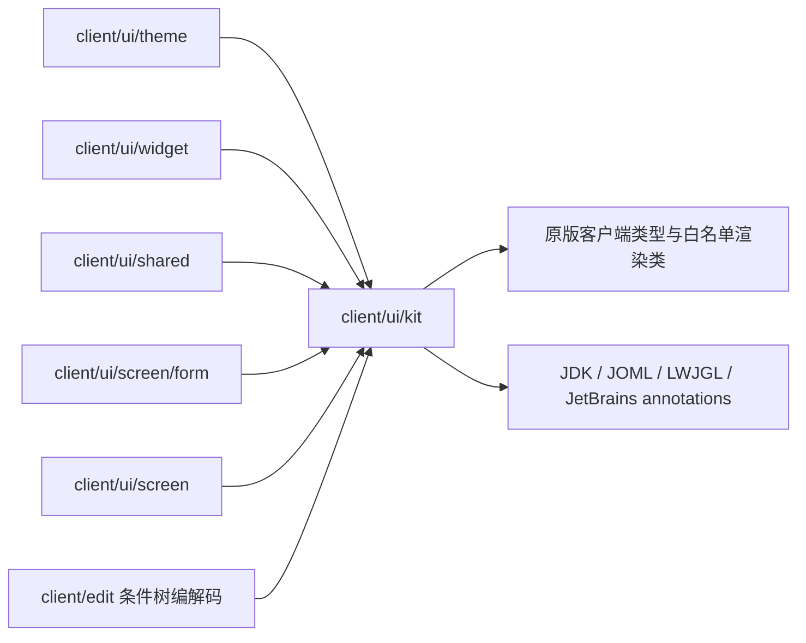
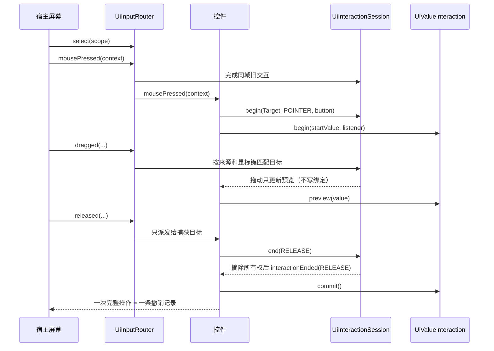
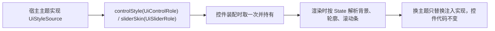

# UI kit

> **TL;DR**
> - `client/ui/kit` 是与本模组业务无关的声明式客户端 UI 原语集：排版与几何、固定矩形控件与控件组、输入作用域与持续交互、树编辑、数值与文本契约、预览与绘制层次。
> - 视觉规格、业务文案、模态归属与数据解释都由宿主注入：kit 提供通用算法、状态容器、接口与不可变值。
> - 公开面以 `package-info.java` 为权威登记；依赖边界由 `tools/check-ui-kit-boundaries.ps1` 强制。

**适用对象**：编写新界面或新控件、实现宿主主题、给画布或树增加交互、排查输入与交互生命周期问题的开发者。

## 1. 模块职责

一句话边界：把“界面怎么排版、怎么命中、一次拖动从哪里开始又怎样收尾”固定成与业务无关的原语，让主题、控件与屏幕在它之上各自生长。

承接的面（每组的具体公开类型在 `package-info.java` 中逐项登记）：

- **声明式排版与几何**：文档树、内容变换、文本度量、流式与线性布局，以及命中、矩形与九宫格切片原语。
- **固定矩形控件与控件组**：控件基类、按稳定 key 复用的一组控件、滚动视口，绘制统一走相对 z 偏移的绘制层。
- **宿主样式注入**：语义角色（`UiControlRole`、`UiSliderRole`）、控件样式（`UiControlStyle`）、滑块样式与画法（`UiSliderStyle` + `UiSliderPainter` 打包成 `UiSliderSkin`）、样式来源接口 `UiStyleSource`。
- **输入与操作生命周期**：输入上下文与目标契约、作用域选择与派发、唯一持续交互与统一结束原因、值快照、唯一焦点与键盘导航、文本局部历史优先。
- **数值与文本契约**：合法域与吸附策略、轨道显示窗口、数值文本的显示与解析、数值与精确文本的双向绑定、标量/区间/循环滑条、文本值能力、码点接纳、文本选择与局部历史。
- **树与画布原语**：不可变树的编解码注入、结构操作与移动预览、结构投影、独立视图状态与导航、tidy 布局、点阵网格、正交连线、框选。
- **预览与层次**：统一物品、方块、流体、实体、方块实体与结构场景图标、图标图集与图标条、浮动面板、灯箱、悬停指针门禁。

kit 是记录来源与差异的维护副本，按可独立发布的库 API 维护（[ADR-0025](../adr/0025-reusable-client-ui-kit-boundary.md)、[ADR-0030](../adr/0030-ui-kit-as-standalone-library-api.md)）；新增公开类需要在 `package-info.java` 登记（[ADR-0033](../adr/0033-kit-zero-reference-public-api-retention.md)）。输入所有权的取舍见 [ADR-0055](../adr/0055-ui-input-scope-ownership.md)。

## 2. 模块边界

### 对外入口

按调用方角色划分：

- **屏幕与页面装配者**：`UiDocument` 与节点、`UiControl`/`UiControlGroup`/`UiScrollView`、布局与几何类型、`UiRenderLayers`/`UiPointer`、`UiFlatText`（无阴影文本与悬停提示）、`UiFloatingPanel`、`UiLightbox` 与预览轮播原语。
- **主题实现者**：实现 `UiStyleSource`，按角色给出控件样式与滑块皮肤；无主题的宿主可直接取 `UiSliderStyle.pixelDefaults()` / `UiSliderSkin.pixelDefaults()`。
- **控件实现者**：实现 `UiInputTarget`，需要键盘焦点时再实现 `UiFocusTarget`；指针、键盘重复与数值文本编辑登记到所属作用域的 `UiInteractionSession`，数值快照交给 `UiValueInteraction`。
- **树与数据适配方**：`UiTreeEditor.Adapter` 提供不可变节点的读取、替换与容量，`UiTreeCodec` 提供外部表示编解码，`UiTreeMoveInteraction` 把拖动绑定到捕获。
- **数值字段装配方**：`UiNumberPolicy` + `UiSliderWindow` 描述合法域与显示窗口，`UiNumbers` 负责显示与解析，`UiValueTextBinding` 负责滑条与精确输入的双向同步。
- **诊断与自动化测试方**：`UiLayoutSource` 把当前排版导成 `UiLayoutNode` 只读快照（矩形、文案、测量宽度与带宽），`UiDocument#layoutNodes` 给出文档自己的行几何；快照只读、不参与绘制与命中，[GUI 探针](../guides/gui-probes.md) 据此断言界面几何。

### 本项目消费与库入口

`package-info.java` 逐项登记 `host`（本项目生产直接使用）、`library`（当前供其它宿主使用）与 `example`（装配示例）。三类都保留公开契约，零生产引用不作为删减依据。

本项目以固定矩形控件、滚动视口、焦点与捕获、树编辑、数值与文本交互装配页面。`UiDocument`/`UiNode`、`UiControlGroup`、`UiLightbox`、`UiFloatingPanel`、`UiNavigationHistory` 等保留为库接入能力；`UiSliderExamples` 提供无业务装配示例。公开成员与嵌套契约随所属顶层类型维护。

### 依赖方向

kit 的编译期依赖只有原版客户端类型、JDK、JOML、LWJGL 与 JetBrains annotations；渲染相关只精确放行 `com.mojang.blaze3d` 下实际使用到的类。宿主各子包单向依赖 kit：

边界由脚本强制：`powershell -ExecutionPolicy Bypass -File tools/check-ui-kit-boundaries.ps1`，白名单为 `java.*`、`javax.*`、`net.minecraft.*`、`org.jetbrains.*`、`org.joml.*`、`org.lwjgl.*`，另按脚本的 `$allowedClasses` 精确放行光照、顶点构建、GPU 缓冲与 RenderSystem 类型。preview 单向引用基础 kit，公开面逐目录登记。退出码 0 通过、1 存在违规、2 配置错误。

### 被谁依赖

- `client/ui/theme`：把主题色与度量映射成 kit 的样式值后注入，是 `UiStyleSource` 在本项目的实现侧。
- `client/ui/widget`：把可复用控件委托给 kit 核心（数值、文本、树、图标条），原版文本模型由宿主适配。滚动控件的行宽、屏幕到内容的纵向换算与固定行高命中共用本层 `RowGeometry`，滚动条预留宽度直接取 `UiScrollView.SCROLLBAR_WIDTH`；两个区间宿主控件（`UiCyclicTimeBar`、`UiRangeBar`）共用 `AbstractBarShell`，其内核 `AbstractRangeCore` 在 kit 内为包内可见，不进 kit 公开面。
- `client/ui/shared`：目录图标与条件摘要复用 kit 的图标、滚动与布局原语；宿主把业务对象转换成 `PreviewSubject`，注入资源世代、线程池、时钟、平台几何与诊断；`preview/PreviewScenes` 持有场景、实例与 CPU/GPU 资源。
- `client/ui/screen` 与 `client/ui/screen/form`：装配控件与稳定输入作用域，接入历史、退出、旁白和焦点滚动。
- `client/edit`：条件树的编解码与节点适配引用 `UiTreeCodec`、`UiTreeEditor`、`UiTreePath`。

### 宿主注入面

kit 的形态由宿主的注入决定，缺一不可：

| 注入点 | 由谁提供 | kit 侧消费方式 |
|---|---|---|
| `UiStyleSource` | 宿主主题（本项目在 `client/ui/theme`） | 控件装配时按角色取一次并长期持有；同一角色重复调用必须稳定返回 |
| `TextMeasurer` | 宿主传入 `Font` 适配器 | 只在排版阶段测量，文字按自然尺寸排版 |
| `UiTreeCodec` 与 `UiTreeEditor.Adapter` | 宿主业务节点 | kit 只做结构操作，外部表示与节点语义由宿主解释 |
| `UiInputScope` 的内容、历史、退出与焦点登记；`UiInputRouter.select` | 宿主屏幕 | 宿主选择稳定作用域，kit 执行切换收尾和通用派发 |
| 提交、校验与前置回调 | 宿主 | `UiTreeEditor` 的 `validator`、`commit`、`beforeEdit` 等由宿主决定落到哪份草稿 |

## 3. 关键类地图

仅列对外入口、扩展点、聚合根与并发/事务敏感类，非穷举。

| 类型（`client/ui/kit`） | 角色 | 职责 | 协作对象 |
|---|---|---|---|
| `UiStyleSource` | 扩展点 | 按语义角色给出控件样式与滑块皮肤；kit 只约定返回类型，视觉规范留在宿主 | 宿主主题、`UiControl`、`UiScalarSlider` |
| `UiControlStyle` / `UiControlRole` / `UiSliderSkin` / `UiSliderRole` | 注入值 | 角色只表达语义（如主要、次要、危险等操作语义，以及紧凑、宽松两档几何尺度）；交互状态由样式按 `State` 解析，不属于角色；皮肤把“样式 + 画法”配成一对，使两者来自同一套主题 | 主题实现、控件渲染 |
| `UiDocument` / `UiNode` | 排版聚合根 | 把声明式节点排成块几何并缓存；命中与绘制共用同一份几何 | 布局类型、`TextMeasurer`、`UiRenderLayers` |
| `UiControl` / `UiControlGroup` | 控件聚合根 | 控件按角色取样式并解析交互状态；控件组按稳定 key 复用实例、按层序命中并给 tooltip | `UiStyleSource`、`UiFocusManager` |
| `UiInputTarget` / `UiInputContext` | 输入契约 | 指针、滚轮、键盘与字符输入都以“是否消费”返回；上下文是显式快照，坐标为 GUI 逻辑坐标 | 全部 kit 控件、宿主控件适配 |
| `UiInputRouter` / `UiInputScope` | 输入作用域与路由 | 实例路由器选择活动作用域；作用域持有内容、唯一焦点与会话；普通内容派发一次，持续输入按会话归属送达 | 宿主屏幕、模态、控件 |
| `UiInteractionSession` | 唯一持续交互 | 按 POINTER / KEY / TEXT 登记目标；结束先摘除所有权再通知，控件负责提交或恢复自己的值与手势模型 | `UiInputScope`、数值、文本、按钮及视图手势 |
| `UiValueInteraction` | 操作生命周期 | begin → preview → commit 或 cancel；值未变化时 `commit` 返回 false；同一次操作不会同时出现 commit 与 cancel | 滑条、精确输入行、宿主历史 |
| `UiFocusManager` / `UiFocusTarget` / `UiFocusState` | 唯一焦点与控件视图 | 作用域按视觉顺序登记目标；资格、逻辑焦点、键盘提示与激活分别表达；复合控件内部编辑共用外部 Tab 位置 | `UiInputScope`、宿主旁白与自动滚动 |
| `UiTreeEditor` / `UiTreeEditor.Adapter` / `UiTreeCodec` | 树聚合根与扩展点 | 绑定宿主不可变节点做结构操作，配置变更与视图变更分开上报；一次操作以一条 `Change` 提交 | `UiTreePath`、`UiTreeMoveInteraction`、宿主节点 |
| `UiTreeProjection` / `UiTreeViewState` / `UiTreeNavigation` / `UiTreeRowMarker` | 树展示原语 | 每个结构版本建立先序索引；每个视图独立保存选择与折叠；可见行统一导航与标记命中，完整旧新路径映射迁移状态 | 管理树、条件摘要、`UiTreeEditor` |
| `UiTextValue` / `UiTextAcceptance` | 文本契约 | 程序回填静默保留原文；按码点整体接纳或回退；原版输入与历史由适配器负责 | 单行、多行文本与字段控件 |
| `UiScrollbarGeometry` | 纯几何 | 共用轨道、比例、最小滑块与偏移映射；滚动偏移由视口唯一持有 | `UiScrollView`、多行文本 |
| `preview/PreviewScenes` | 场景所有者 | 有界请求、异步几何交接、实例准备、逐帧上传与释放 | 宿主 `PreviewIcons`、平台 `Geometry` |
| `preview/PreviewSubject` / `PreviewStructure` | 内容契约 | 物品、状态与 NBT 快照，原版结构解码与完整占位 | 场景缓存与资源读取 |
| `preview/UiSceneView` | 绘制入口 | 模型空间包围、固定整圈适框、旋转、深度与裁剪恢复 | `PreviewScene`、相机与样式值 |
| `UiPreviewCache` | 有界状态容器 | 客户端线程使用的 LRU；显式世代变化清空，非 null 结果及加载失败含义由宿主提供 | 宿主图标 wrapper 与目录索引 |
| `UiTreeMoveInteraction` | 树移动值模型 | 预览不写绑定、正常释放提交一次、其它结束原因取消 | `UiTreeEditor`、`UiInteractionSession` |
| `UiNumberPolicy` / `UiSliderWindow` / `UiNumbers` | 数值契约值 | 合法域与粗细步长吸附、轨道显示窗口、数值文本显示与解析各由唯一实现承担 | 滑条、精确输入、宿主字段 |
| `UiValueTextBinding` | 双向绑定 | 统一数值预览/提交/取消与程序回填的重入保护；解析暂不可用时保留原文并停在最近有效值 | 数值控件、精确输入行 |
| `UiRenderLayers` / `UiPointer` | 绘制与悬停门禁 | 在相对 z 偏移内绘制并提交批次；被遮挡的作用域用屏幕外指针统一禁用 hover 与 tooltip 命中 | 弹窗栈、屏幕、预览类原语 |
| `UiFlatText` | 文本绘制原语 | 无阴影的居中、折行文本与悬停提示面板；深色底板的悬停提示只去掉文字阴影，文字颜色由调用方给定 | 控件、列表与树的空状态文案、页面提示 |
| `UiFloatingPanel` / `UiIconStrip` / `UiLightbox` | 复合原语 | 面板停靠与折叠、图标条按格子命中、灯箱的缩放与焦点登记 | 屏幕装配、`UiFocusManager` |

## 4. 关键流程

### 一次拖动从按下到提交

宿主创建稳定作用域并登记焦点目标，用 `UiInputRouter.select` 选择当前作用域。真实命中由内容树完成，叶子通过 `pointerHit(target)` 报告焦点候选；非聚焦交互区域报告 `null`，纯背景没有命中。

`RELEASE` 与 `FOCUS_TRANSFER` 完成有效数值编辑；Tab 与同域鼠标按下先完成旧交互。Esc、作用域切换、隐藏、禁用、卸载和关屏取消未完成预览。数值恢复由值模型执行，监听器只接收通知；滚动和平移结束保留当前视图位置，按钮只在匹配释放且仍命中时激活，树移动只在正常释放时提交。

### 精确文本与键盘派发

`UiValueTextBinding` 分别保存文本与数值快照。合法文本完成后提交，非法或未完成文本允许 Tab 离开、保留原文和错误、回退数值预览；合法空端点按 `UiRangeValue` 的缺席语义提交。程序回填保持静默，无净变化操作也会收束快照。

键盘沿内容树派发一次；文本局部 Undo/Redo 优先，内容未消费的历史快捷键交给作用域注入的宿主历史。Tab 先完成会话再转焦，Esc 先取消活动会话，其余内容未消费的 Enter/Space 才进入焦点激活。

### 焦点与激活

控件先声明焦点能力；`UiControl.setFocusable` 与动作独立。鼠标点击可聚焦目标转焦，不可聚焦的交互区域保留旧焦点，纯背景清焦。作用域退出挂起逻辑焦点，返回时恢复仍合格的目标，否则选择首个目标；交互会话随退出结束。

额外轮廓由 `isFocusVisible` 决定，仅键盘操作显示；文本光标、选区与业务选中保持各自语义。复合控件用 `focusWithin` 进入私有文本模式，管理器仍只持有一个目标，Tab 使用原组的位置。

### 树结构与视图同步

`UiTreeProjection.single` 的根使用 ROOT，forest 的根使用 ROOT.child(rootIndex)，视觉深度均从 0 开始。结构变化重建索引，折叠只派生可见行；位置路径跨重建的身份恢复由宿主完成。`UiTreeViewState.remap` 接收覆盖全部存活旧路径的映射，未位移路径也须登记。`UiTreeEditor` 的结构提交回调负责写入新根，视图重映射由编辑器完成；宿主几何重建保留待迁移状态。只改变视图时发出 `ViewChange`，不写入结构历史。

新文本、树与缓存 API 的最小接入示例、null/失败含义、线程与生命周期说明在各类型 JavaDoc 中维护。

### 统一预览场景

宿主通过 `PreviewScenes.request` 查询状态或 `icon` 接回 `UiIcon.Rendered`，每帧绘制前调用 `beginFrame`。物品委托原版 GUI 绘制；方块／流体按 RenderType 合并静态几何，实体与方块实体持有独立实例并调用原版 renderer。结构在局部坐标组合这两层，液体补区段原点，静态提交经过邻面与外部可达性剔除，完整占位仍供 AO、邻居与着色查询。

默认 GPU 总预算 32 MiB、单场景 8 MiB，待上传与任务预留共用独立 32 MiB 上限；请求容量 256。每帧上传最多两场景并采用 1.5 ms 软预算，预算等待保持 PREPARING。半透明保留 quad 中心与索引类型，按预览视角每 15° yaw 档更新索引；同内容同相位共享缓存。实体与方块实体在渲染线程加载载荷、测量真实输出；平台适配直接装配 Display 的冻结渲染快照。

`UiSceneView` 统一适框、相机、满亮、裁剪与绘制状态恢复。实体默认 10 秒一圈、结构 20 秒一圈，其他类型 yaw 45° 静态，默认 pitch 22°；时间与开关由宿主注入。关闭所有者取消旧任务并释放 CPU/GPU 资源，晚到结果在交接处释放。架构取舍见 [ADR-0056](../adr/0056-unified-preview-scene-contract.md)。

### 样式注入到渲染

## 5. 扩展点与约束

### 扩展点

- **新增 kit 公开原语**：在 `package-info.java` 的公开面清单登记分组、用途及 host/library/example 角色，然后跑边界脚本；随库发布的定位与命名沿用现有分组。
- **新增控件**：实现 `UiInputTarget`（必要时加 `UiFocusTarget`）；输入交给 `UiInputRouter` 路由，持续交互登记到作用域的 `UiInteractionSession`，值快照由控件模型保存。
- **新增主题或皮肤**：实现 `UiStyleSource`，同一角色重复调用返回同一份值；滑块务必以 `UiSliderSkin` 成对给出样式与画法，使 `UiSliderPainter.Frame` 携带的样式与轨道用色同源。宿主侧的落点见 [client-ui](client-ui.md)。
- **新增数值字段**：`UiNumberPolicy` 描述合法域、粗细步长与整数策略，`UiSliderWindow` 描述这一段域映射到轨道的哪一截，`UiNumbers` 负责显示与解析，精确输入用 `UiValueTextBinding` 绑定。窗口只影响几何，超出窗口但仍在合法域内的值继续精确显示与编辑。
- **新增树或树操作**：提供 `UiTreeEditor.Adapter`（不可变节点、容量、可接受子节点）与 `UiTreeCodec`；结构操作统一走 `UiTreeEditor`，拖动走 `UiTreeMoveInteraction`，一次拖动只提交一次。
- **新增文本适配**：实现 `UiTextValue`，每个控件持有一份 `UiTextAcceptance`；回填在静默作用域内写入原版模型并 reset 实际值，历史恢复后显式通知。现有单行下限为 1、多行为 0；原生模型差异留在适配器。
- **新增展示输入**：转换为 `PreviewSubject` 后复用 `PreviewScenes`；平台差异通过 `Geometry` 注入，状态与文案由宿主适配。独立库调用方同样每帧推进预算并显式 close。
- **新增画布能力**：tidy 布局、点阵网格、正交连线、框选各有单一入口；图标统一从 `UiIconSheet` 的图集切片取，图标条按同一格子尺寸重排。

### 约束

- kit 的 import 只落在白名单内；新增依赖先改检查脚本与 `package-info.java` 的依赖说明，再加代码。
- 普通内容输入沿树派发一次，同一作用域只有一个持续交互会话，每个活动目标都收到结束原因。
- 宿主只选择活动作用域；普通命中与焦点政策、持续交互派发及作用域切换由 kit 统一处理。
- 尺寸钳制统一在 kit 内完成：控件、文档视口与滚动视图把负尺寸钳到 0，灯箱的最小边长钳到 1；只有 `UiRect` 在构造期拒绝负尺寸。
- 数值显示与解析以 `UiNumbers` 为唯一实现；吸附按 `min + k × step` 档位计算，避免浮点连加误差。
- kit 提供通用算法、状态容器与值契约：节点业务语义、单位换算、权限与错误文案由宿主承担；角色与样式不承载具体色值语义。

### 改动后的验证

1. `powershell -ExecutionPolicy Bypass -File tools/check-ui-kit-boundaries.ps1`（改动 kit 或其依赖时必跑）。
2. IDE 工作区检查 → `tools/dsh-build.ps1 -Tasks build`。
3. 改文档链接后跑 `python tools/check-docs.py`；改语言文件跑 `python tools/check-i18n.py`。

## 6. 数据与配置引用

kit 对外只承载注入值与回调，规则数据、错误码与配置项的单一事实源在下列文档，本页只做指向：

- 规则字段语义与取值：[规则 JSON](../api/rule-json.md)。
- 错误、告警与拒载粒度：[错误与状态码](../api/errors.md)。
- 编辑会话与分片回执：[编辑协议](../api/edit-protocol.md)。
- 客户端与服务端配置项：[配置](../ops/configuration.md)。

## 相关文档

- 模块总览：[模块索引](README.md)
- 宿主侧适配与页面：[客户端界面](client-ui.md)
- 依赖规则：[依赖规则](../architecture/dependency-rules.md)
- 跨模块链路：[关键链路](../architecture/key-flows.md)
- 决策：[ADR-0022](../adr/0022-client-ui-kit-adoption.md)、[ADR-0025](../adr/0025-reusable-client-ui-kit-boundary.md)、[ADR-0028](../adr/0028-canvas-page-and-flat-skin.md)、[ADR-0030](../adr/0030-ui-kit-as-standalone-library-api.md)、[ADR-0032](../adr/0032-host-injected-ui-theme.md)、[ADR-0033](../adr/0033-kit-zero-reference-public-api-retention.md)
- 写作与命名约定：[代码风格](../guides/code-style.md)
- 文档体系：[文档体系](../README.md)
