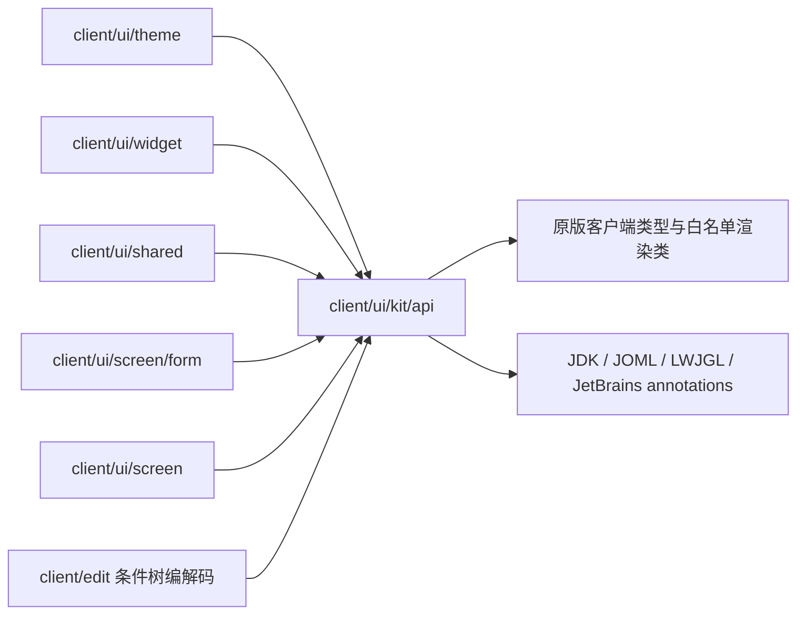
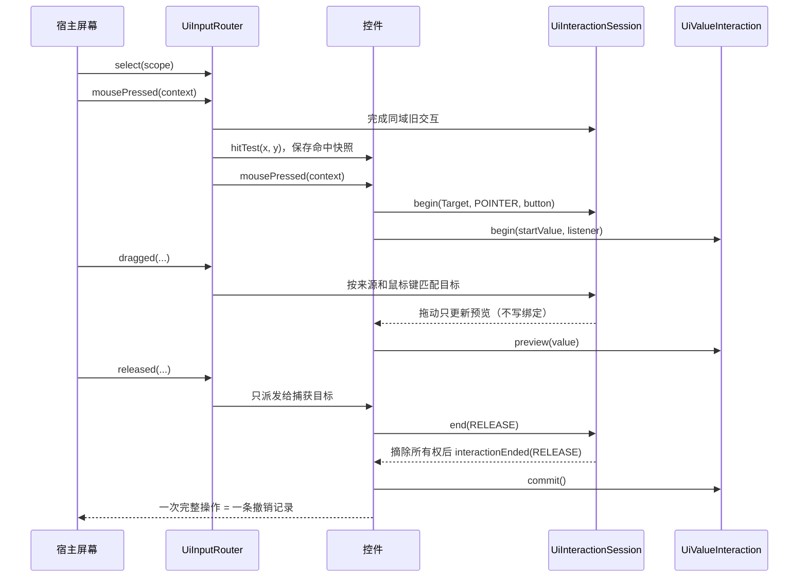

# UI kit

> **TL;DR**
> - `client/ui/kit` 是与本模组业务无关的声明式客户端 UI 原语集：排版与几何、通用控件与控件组、输入作用域与持续交互、树编辑、数值与文本契约、预览与绘制层次。
> - kit 提供原版默认主题、通用控件、模态与 Screen 装配；宿主注入业务文案、主题方案与数据解释。
> - 宿主从 `kit.api` 的能力包导入公开类型，各目录 `package-info.java` 登记消费角色；内部实现与依赖边界由 `tools/check-ui-kit-boundaries.py` 保护。

**适用对象**：编写新界面或新控件、实现宿主主题、给画布或树增加交互、排查输入与交互生命周期问题的开发者。

## 1. 模块职责

一句话边界：把“界面怎么排版、怎么命中、一次拖动从哪里开始又怎样收尾”固定成与业务无关的原语，让主题、控件与屏幕在它之上各自生长。

承接的面（具体公开类型在各能力目录的 `package-info.java` 中逐项登记）：

- **声明式排版与几何**：文档树、内容变换、文本度量、流式、线性与 `UiFormLayout` 表单布局，以及命中、矩形与九宫格切片原语。
- **通用控件与控件组**：按钮、单行/多行文本、泛型列表、模态栈、Screen 桥接、按稳定 key 复用的控件组和滚动视口，绘制统一走相对 z 偏移的绘制层。
- **宿主样式注入**：语义角色（`UiControlRole`、`UiSliderRole`）、控件样式（`UiControlStyle`）、滑块样式与画法（`UiSliderStyle` + `UiSliderPainter` 打包成 `UiSliderSkin`）、样式来源接口 `UiStyleSource`、原版默认 `UiMinecraftTheme` 与稳定的 `UiThemeContext`。
- **输入与操作生命周期**：输入上下文与目标契约、作用域选择与派发、唯一持续交互与统一结束原因、值快照、唯一焦点与键盘导航、文本局部历史优先。
- **数值与文本契约**：合法域与吸附策略、轨道显示窗口、数值文本的显示与解析、数值与精确文本的双向绑定、标量/区间/循环滑条、文本值能力、码点接纳、文本选择与局部历史。
- **树与画布原语**：不可变树的编解码注入、结构操作与移动预览、结构投影、独立视图状态与导航、tidy 布局、点阵网格、正交连线、框选。
- **预览与层次**：统一物品、方块、流体、实体、方块实体与结构场景图标、图标图集与图标条、浮动面板、灯箱、悬停指针门禁。

kit 是记录来源与差异的维护副本，按可独立发布的库 API 维护（[ADR-0025](../adr/0025-reusable-client-ui-kit-boundary.md)、[ADR-0030](../adr/0030-ui-kit-as-standalone-library-api.md)）；新增公开类需要在所属目录的 `package-info.java` 登记（[ADR-0033](../adr/0033-kit-zero-reference-public-api-retention.md)）。输入所有权的取舍见 [ADR-0055](../adr/0055-ui-input-scope-ownership.md)。

## 2. 模块边界

### 能力包与导出

公开入口位于 `client/ui/kit/api`：input 持有作用域、交互与焦点，geometry 持有坐标变换，render 持有通用绘制，control 组合控件与容器，style 提供原版默认主题并接收宿主主题；number、text、layout、tree 分别持有对应契约与算法，preview 拥有场景及资源。包级入口见 [api/package-info.java](../../common/src/main/java/com/meteorite/itemdespawntowhat/client/ui/kit/api/package-info.java)。

公开具体类直接承载状态与算法。输入和焦点的包内协作、实现 `UiRangeControl` 的区间滑块内核 `AbstractRangeCore`、preview 的句柄与场景引擎保留在各自能力包中，由 Java 可见性保护。跨能力共用的 pose 裁剪实现位于 `internal/render`，由文本绘制与视口变换调用；宿主导入统一面向 api。

### 对外入口

按调用方角色划分：

- **屏幕与页面装配者**：`UiDocument` 与节点、`UiWidget`、`UiControl`/`UiControlGroup`/`UiScrollView`、布局与几何类型、`UiRenderLayers`/`UiPointer`、`UiFlatText`（无阴影文本与悬停提示）、`UiFloatingPanel`、`UiLightbox` 与预览轮播原语。
- **主题实现者**：直接使用 `UiMinecraftTheme.INSTANCE`、以 `UiThemes.builder` 组合差异，或实现 `UiStyleSource`；控件、表面、滑块和 tooltip 均按完整皮肤注入，运行时共享 `UiThemeContext`。
- **控件实现者**：实现 `UiInputTarget`，需要键盘焦点时再实现 `UiFocusTarget`；指针、键盘重复与数值文本编辑登记到所属作用域的 `UiInteractionSession`，数值快照交给 `UiValueInteraction<V>`，标量、普通区间与有向周期区间使用各自不可变值和等价规则。
- **树与数据适配方**：`UiTreeEditor.Adapter` 提供不可变节点的读取、替换与容量，`UiTreeCodec` 提供外部表示编解码，`UiTreeMoveInteraction` 把拖动绑定到捕获。
- **数值字段装配方**：`UiNumberPolicy` + `UiSliderWindow` 描述合法域与显示窗口，`UiNumbers` 负责显示与解析，`UiValueTextBinding` 负责数值文本的双向同步；`UiNumberField` 组合标量核心与宿主提供的 `UiSingleLineEditor` 端口。
- **诊断与自动化测试方**：`UiLayoutSource` 把当前排版导成 `UiLayoutNode` 只读快照（矩形、文案、测量宽度与带宽），`UiDocument#layoutNodes` 给出文档自己的行几何；快照只读、不参与绘制与命中，[GUI 探针](../guides/gui-probes.md) 据此断言界面几何。

### 本项目消费与库入口

各能力目录的 `package-info.java` 逐项登记 `host`（kit 外本项目生产源码直接引用）、`library`（供其它宿主使用，逐项说明用途与当前无直接生产引用）与 `example`（装配示例）。三类都保留公开契约，dev/probe 使用与生产消费分别识别。

本项目以固定矩形控件、滚动视口、焦点与捕获、树编辑、数值与文本交互装配页面。`UiDocument`/`UiNode` 是只读文档排版、渲染与命中查询入口，当前无直接生产引用；`UiControlGroup`、`UiLightbox`、`UiFloatingPanel`、`UiNavigationHistory` 等保留为库接入能力；开发工作台的 `kit` 示例目录持有 `UiSliderExamples` 与无业务展示内容。`PreviewScene` 经 `request` 返回链在宿主被查询，`UiTextAcceptance` 经编辑会话被 kit 文本控件使用；词法直接引用、公开契约可达与实际调用链分别核对。公开成员与嵌套契约随所属顶层类型维护。

### 依赖方向

kit 的编译期依赖只有原版客户端类型、JDK、JOML、LWJGL 与 JetBrains annotations；渲染相关只精确放行 `com.mojang.blaze3d` 下实际使用到的类。宿主各子包单向依赖 kit：

边界由脚本强制：`python tools/check-ui-kit-boundaries.py`，白名单为 `java.*`、`javax.*`、`net.minecraft.*`、`org.jetbrains.*`、`org.joml.*`、`org.lwjgl.*`，另按脚本的 `ALLOWED_CLASSES` 精确放行光照、顶点构建、GPU 缓冲、TextureTarget、GlStateManager 与 RenderSystem 类型。preview 单向引用基础能力，基础能力的全部子包受同一规则约束。宿主只引用 api，api 的公开/protected 声明保持在导出面内，具体类可继承包内实现父类，公开类型与消费角色逐目录核验。退出码 0 通过、1 存在违规、2 配置错误。

### 被谁依赖

- `client/ui/theme`：把主题色与度量映射成 kit 的样式值后注入，是 `UiStyleSource` 在本项目的实现侧。
- `client/ui/widget`：把可复用控件委托给 kit 核心（数值、文本、树、图标条），原版文本模型由 kit 的 `UiTextInput`、`UiTextArea` 适配。滚动内容命中与纵向换算使用 `UiScrollView.hitContentY`，内容宽度由 `UiScrollView.contentWidth` 提供，固定行命中使用 `UiRowMetrics` 并保留指针小数坐标；非等高树行按实际高度二分定位。两个区间宿主控件（`UiCyclicTimeBar`、`UiRangeBar`）共用 `AbstractBarShell`，其内核 `AbstractRangeCore` 在 `api/number` 内保持包内可见。
- `client/ui/shared`：目录图标与条件摘要复用 kit 的图标、滚动与布局原语；宿主把业务对象转换成 `PreviewSubject`，注入资源世代、线程池、时钟、平台几何与诊断；`api/preview/PreviewScenes` 持有场景、实例与 CPU/GPU 资源。
- `client/ui/screen` 与 `client/ui/screen/form`：装配控件与稳定输入作用域，接入历史、退出、旁白和焦点滚动。
- `client/edit`：条件树的编解码与节点适配引用 `UiTreeCodec`、`UiTreeEditor`、`UiTreePath`。

### 宿主注入面

宿主按实际使用能力注入业务内容和生命周期：

| 注入点 | 由谁提供 | kit 侧消费方式 |
|---|---|---|
| `UiStyleSource` | 宿主主题（本项目在 `client/ui/theme`） | 控件持有稳定来源，revision 改变时刷新皮肤；不可变主题按角色稳定返回样式 |
| `TextMeasurer` | 宿主传入 `Font` 适配器 | 只在排版阶段测量，表单与文档复用测量结果 |
| `UiTreeCodec` 与 `UiTreeEditor.Adapter` | 宿主业务节点 | kit 只做结构操作，外部表示与节点语义由宿主解释 |
| `UiInputScope` 的内容、历史与退出；`UiInputRouter.select` | 宿主屏幕 | 内容按 `UiInputTarget` 贡献焦点，kit 按结构版本提交索引并执行切换收尾和通用派发 |
| 提交、校验与前置回调 | 宿主 | `UiTreeEditor` 的 `validator`、`commit`、`beforeEdit` 等由宿主决定落到哪份草稿 |

## 3. 关键类地图

仅列对外入口、扩展点、聚合根与并发/事务敏感类，非穷举。

| 类型（`client/ui/kit/api`） | 角色 | 职责 | 协作对象 |
|---|---|---|---|
| `UiStyleSource` | 扩展点 | 按角色给出控件与滑块皮肤、tooltip skin、通用语义色和度量；默认复用原版主题 | 宿主主题、`UiControl`、`UiScalarSlider` |
| `UiControlStyle` / `UiControlRole` / `UiSliderSkin` / `UiSliderRole` | 注入值 | 角色只表达语义（如主要、次要、危险等操作语义，以及紧凑、宽松两档几何尺度）；交互状态由样式按 `State` 解析，不属于角色；皮肤把“样式 + 画法”配成一对，使两者来自同一套主题 | 主题实现、控件渲染 |
| `UiDocument` / `UiNode` | 只读排版聚合根 | 把文档内容块排成几何并缓存；渲染、提示和命中查询共用几何，命中数据由宿主解释 | 布局类型、`UiPointerHit`、`UiRenderLayers` |
| `UiControl` / `UiControlGroup` | 控件聚合根 | 控件按角色取样式并解析交互状态；控件组按稳定 key 复用实例、按层序命中并给 tooltip | `UiStyleSource`、`UiFocusManager` |
| `UiTextInput` / `UiTextArea` / `UiListView` | 通用控件 | 原版文本编辑、局部历史与泛型行列表；主题变化保留控件状态 | `UiTextEditSession`、`UiScrollView` |
| `UiModal` / `UiModalStack` / `UiScreen` | 装配根 | 通用模态、顶层作用域、原版 Screen 事件桥和根资源释放 | `UiButtonWidget`、`UiInputRouter` |
| `UiThemeContext` / `UiMinecraftTheme` | 主题来源 | 根发布版本，控件刷新解析结果；默认完整皮肤复用原版 sprites | `UiStyleSource`、宿主主题 adapter |
| `UiThemes` / `UiSkinImages` / `UiSurfaceSkin` | 皮肤组合 | 基底快照、角色、配色与资源画法 | 宿主主题、纯 kit 样例 |
| `UiThemedScreen` / `UiThemePublication` | 根装配 | 共享 Context、默认背景和手势结束后的发布 | `UiScreen`、宿主屏幕 |
| `UiInputTarget` / `UiInputContext` | 输入契约 | 指针、滚轮、键盘与字符输入都以“是否消费”返回；上下文是显式快照，坐标为 GUI 逻辑坐标 | 全部 kit 控件、宿主控件适配 |
| `UiChildren` | 内容结构 | 一份实际成员驱动绘制遍历、命中、焦点贡献和普通输入；不持有第二份捕获 | 容器、页面、按钮栏 |
| `UiOverlay` | 覆盖面外壳 | 统一遮罩、局部层与阻断作用域，内容保留自己的关闭语义 | 模态、灯箱、保存层、picker |
| `UiInputRouter` / `UiInputScope` | 输入作用域与路由 | 实例路由器选择活动作用域；作用域持有内容、唯一焦点与会话；普通内容派发一次，持续输入按会话归属送达 | 宿主屏幕、模态、控件 |
| `UiPointerHit` / `UiPointer` | 命中与绘制快照 | 命中结果保存所有者链、局部坐标、焦点候选、行身份与提示呈现；绘制指针结合 active 与 POINTER 捕获选择可悬停分支 | `UiInputTarget.hitTest`、控件、容器与文档 |
| `UiInteractionSession` | 唯一持续交互 | 按 POINTER / KEY / TEXT 登记目标；结束先摘除所有权再通知，控件负责提交或恢复自己的值与手势模型 | `UiInputScope`、数值、文本、按钮及视图手势 |
| `UiValueInteraction<V>` | 操作生命周期 | begin → preview → commit 或 cancel；真实模型注入有效性与等价判断，取消先由核心恢复实际值，所有结束路径通知 finished | 滑条、精确输入行、宿主历史 |
| `UiFocusManager` / `UiFocusTarget` / `UiFocusState` | 唯一焦点与控件视图 | 作用域从内容树收集有类型的贡献，普通容器从实际成员声明顺序派生 Tab 顺序；资格、逻辑焦点、键盘提示与激活分别表达；复合控件内部编辑共用外部 Tab 位置 | `UiInputScope`、宿主旁白与自动滚动 |
| `UiFocusFollow` / `UiFocusManager.Listener` | 焦点效果 | 用注入的归属与内容坐标把目标滚入视口；组合效果按顺序执行，名称交给宿主播报 | `UiScrollView`、宿主 `UiNarration` |
| `UiTreeEditor` / `UiTreeEditor.Adapter` / `UiTreeCodec` | 树聚合根与扩展点 | 绑定宿主不可变节点做结构操作，配置变更与视图变更分开上报；一次操作以一条 `Change` 提交 | `UiTreePath`、`UiTreeMoveInteraction`、宿主节点 |
| `UiTreeProjection` / `UiTreeViewState` / `UiTreeNavigation` / `UiTreeRowMarker` | 树展示原语 | 每个结构版本建立先序索引；每个视图独立保存选择与折叠；可见行统一导航与标记命中，完整旧新路径映射迁移状态 | 管理树、条件摘要、`UiTreeEditor` |
| `UiTextValue` / `UiTextEditSession` | 文本契约与协调 | session 组合码点接纳、局部历史与指针选择；回填和历史恢复共用原版 Model adapter，光标与锚点按 UTF-16 保存 | 单行、多行文本与字段控件 |
| `UiScrollView` / `UiScrollView.Policy` | 滚动所有者 | 统一偏移、范围、对齐、视口变换与拖动；政策配置步长对齐、滑块、抓取外扩、按下居中与轨道留宽 | 列表、树、目录网格、焦点跟随 |
| `preview/PreviewScenes` | 场景所有者 | 有界请求、异步几何交接、实例准备、逐帧上传与释放 | 宿主 `PreviewIcons`、平台 `Geometry` |
| `preview/PreviewSubject` / `PreviewStructure` | 内容契约 | 物品、状态与 NBT 快照，原版结构解码与完整占位 | 场景缓存与资源读取 |
| `preview/UiSceneView` | 绘制入口 | 模型空间包围、固定整圈适框、旋转、深度与裁剪恢复 | `PreviewScene`、相机与样式值 |
| `UiPreviewCache` | 有界状态容器 | 客户端线程使用的 LRU；显式世代变化清空，非 null 结果及加载失败含义由宿主提供 | 宿主图标 wrapper 与目录索引 |
| `UiTreeMoveInteraction` | 树移动值模型 | 预览不写绑定、正常释放提交一次、其它结束原因取消 | `UiTreeEditor`、`UiInteractionSession` |
| `UiNumberPolicy` / `UiSliderWindow` / `UiNumbers` | 数值契约值 | 合法域与粗细步长吸附、轨道显示窗口、数值文本显示与解析各由唯一实现承担 | 滑条、精确输入、宿主字段 |
| `UiNumberField` | 数值字段组合 | 注入 `UiSingleLineEditor`，统一双向绑定、相对几何、输入与绘制；两个子控件分别参与 Tab，空文本缺席由宿主回调处理 | `UiScalarSlider`、`UiValueTextBinding`、宿主数值字段 |
| `UiValueTextBinding` | 双向绑定 | 统一数值预览/提交/取消与程序回填的重入保护；解析暂不可用时保留原文并停在最近有效值，未开始文本预览的取消保持原文 | 数值控件、精确输入行 |
| `UiRenderLayers` | 绘制层序 | 在相对 z 偏移内提交批次；模型以独立深度绘制并平面合成，模态层按深度展开 | 弹窗栈、屏幕、预览类原语 |
| `UiTooltipPlacement` / `UiTooltipPanel` | 提示面板 | 折行前按宿主、上限、margin 与 padding 计算正文宽度，再翻转和钳制外框，统一 TOOLTIP 层与正文裁剪 | `UiFlatText`、宿主语义说明面板 |
| `UiFlatText` | 文本绘制原语 | 无阴影的居中、折行文本与悬停提示面板；深色底板的悬停提示只去掉文字阴影，文字颜色由调用方给定 | 控件、列表与树的空状态文案、页面提示 |
| `UiFloatingPanel` / `UiIconStrip` / `UiLightbox` | 复合原语 | 面板停靠与折叠、图标条按格子命中、灯箱的缩放与焦点登记 | 屏幕装配、`UiFocusManager` |

## 4. 关键流程

### 一次拖动从按下到提交

宿主创建绑定内容的稳定作用域，由内容树自动贡献焦点目标，用 `UiInputRouter.select` 选择当前作用域。路由器在按下派发前调用内容的 `hitTest`，保存本次真实命中；命中通过 `UiInputContext.hit` 传入内容，`UiChildren` 只派发给该快照选中的成员；消费 boolean 与命中结果分别表达。普通 `UiWidget` 默认按可见性和 bounds 命中，可聚焦目标自动携带候选；复合容器返回实际叶子，滚动条等操作区返回保焦命中。左键按下派发后按结果执行空白清焦、合格候选转焦或命中保焦，切域后跳过旧结果。

`RELEASE` 与 `FOCUS_TRANSFER` 完成有效数值编辑；Tab 与同域鼠标按下先完成旧交互。Esc、作用域切换、隐藏、禁用、卸载和关屏取消未完成预览。数值恢复由值模型执行，监听器只接收通知；滚动和平移结束保留当前视图位置，按钮只在匹配释放且仍命中时激活，树移动只在正常释放时提交。

### 精确文本与键盘派发

`UiValueTextBinding` 分别保存文本与数值快照。合法文本完成后提交，非法或未完成文本允许 Tab 离开、保留原文和错误、回退数值预览；合法空端点按 `UiRangeValue` 的缺席语义提交。程序回填保持静默，无净变化操作也会收束快照。

键盘与字符沿内容树的实际焦点路径派发一次；文本局部 Undo/Redo 优先，内容未消费的历史快捷键交给作用域注入的宿主历史。Tab 先完成会话再转焦，Esc 先取消活动会话，其余内容未消费的 Enter/Space 才进入焦点激活。

### 焦点与激活

控件先声明焦点能力；`UiControl.setFocusable` 与动作独立。左键点击可聚焦目标转焦，不可聚焦的交互区域保留旧焦点，纯背景清焦。作用域退出挂起逻辑焦点，返回时恢复仍合格的目标，否则选择首个目标；交互会话随退出结束。

额外轮廓由 `isFocusVisible` 决定，仅键盘操作显示；文本光标、选区与业务选中保持各自语义。`UiFocusTarget.canFocus` 默认组合 `UiWidget` 的可见和启用状态，特殊资格由控件声明。复合控件用 `focusWithin` 进入私有文本模式，管理器仍只持有一个目标。展开组保留组到叶子的归属索引，Tab 序列只含去重的叶子；内部模式使用组内实际子目标、当前锚点、该组最近锚点或首个合格叶子续接。未登记或没有合格叶子的组拒绝进入，展开环在登记时显式报错，收集失败保留已提交索引。

焦点效果用 `UiFocusManager.Listener.compose` 按顺序装配：`UiFocusFollow` 把目标滚入视口，`Listener.narrate` 将 `accessibleName` 交给宿主 sink，再执行业务激活键政策。嵌套视口由内到外组合，每层读取滚动后的边界；超高目标覆盖视口时保持位置。Minecraft narrator 的选项与调用留在宿主 `UiNarration`。

### 指针解析与提示

宿主先完成布局和作用域同步，再调用 `scope.pointer(x, y).resolve(content)`；控件组内绘制共用此快照，以 `forTarget` 选择所属分支，坐标变换保留同一所有者链。容器按逆绘制顺序、裁剪和变换实现 `hitTest`；列表与网格直接定位行列。点击按事件时几何重新解析。快照只读，不保存另一棵输入树。

`UiPointerHit.Row` 保存所属容器、行索引、稳定 key 和屏幕矩形；列表、网格、树与表单将当前行附到命中结果，hover、选择和提示复用各自事件或绘制快照。滚动视口只做几何，业务提示由宿主投影到 hit。普通文本与富说明通过 `withTextTooltip` / `withPresentation` 注入，根调用 `renderTooltip` 统一呈现。

活动作用域允许 hover；POINTER 会话只允许捕获目标所属分支反馈，并在持续交互期间关闭 tooltip。KEY/TEXT 会话保留普通 hover。最上层命中即确定唯一提示来源，空提示也阻断向下查找；`UiControlGroup` 与 `UiLightbox` 共用这一结果。`UiTooltipPanel.contentWidth` 在折行前扣除宿主边距和 padding，普通提示与语义说明面板保留各自宽度上限和画法；正文无可用宽度时跳过绘制。

### 树结构与视图同步

`UiTreeProjection.single` 的根使用 ROOT，forest 的根使用 ROOT.child(rootIndex)，视觉深度均从 0 开始。结构变化重建索引，折叠只派生可见行；位置路径跨重建的身份恢复由宿主完成。`UiTreeViewState.remap` 接收覆盖全部存活旧路径的映射，未位移路径也须登记。`UiTreeEditor` 的结构提交回调负责写入新根，视图重映射由编辑器完成；宿主几何重建保留待迁移状态。只改变视图时发出 `ViewChange`，不写入结构历史。

新文本、树与缓存 API 的最小接入示例、null/失败含义、线程与生命周期说明在各类型 JavaDoc 中维护。

### 统一预览场景

宿主通过 `PreviewScenes.request` 查询状态或 `icon` 接回 `UiIcon.Rendered`，每帧绘制前调用 `beginFrame`，绘制后调用 `endFrame`。物品委托原版 GUI 绘制；方块／流体按 RenderType 合并静态几何，实体与方块实体持有独立实例并调用原版 renderer。结构在局部坐标组合这两层，液体补区段原点，静态提交经过邻面与外部可达性剔除，完整占位仍供 AO、邻居与着色查询。

`PreviewBudget` 由构造注入，默认值见其 `DEFAULT`。单场景、GPU 总量、pending 预留、请求数和逐帧次数/纳秒预算贯穿 CPU 编译、完成交接和 GPU 淘汰。每帧实例准备与上传共用软时间预算，实际绘制优先，帧末剩余额度用于预取，预算等待保持 PREPARING。请求槽位满且当前没有可淘汰场景时返回终态 `CAPACITY_REJECTED`，reason 带请求标识和容量上限；几何或字节超限仍为 `TOO_LARGE`。拒绝句柄不进入准备队列，容量恢复后再次 `request` 可获得新句柄，已拒绝句柄保持终态。`UiIcon.prepare` 仅登记内容；宿主为准备态和不可用状态分别提供占位。过期请求退出准备队列，晚到结果释放前仍计入待上传预算。半透明保留 quad 中心与索引类型，按预览视角每 15° yaw 档更新索引；同内容同相位共享缓存。实体与方块实体在渲染线程加载载荷、测量真实输出；平台适配直接装配 Display 的冻结渲染快照。

文本、Sprite、Item 和场景的外部基准统一为 `UiRenderLayers.CONTENT`。`model` 与 `item` 在透明颜色和独立深度工作区绘制，再把颜色以调用方内容平面合成；回调只使用传入的局部 `GuiGraphics`，`item` 在该上下文内补偿原版物品偏移。模型内部深度不进入主 GUI 深度缓冲，同层混排按绘制顺序覆盖，前景、tooltip 与上层覆盖面按整个内容块覆盖。工作区按实际 GUI 像素取样并裁剪到布局框和父裁剪交集，每次绘制清空颜色与深度；渲染线程共享工作区，尺寸按需增长，不缓存单个图标颜色。`UiScreen` 在资源失效和卸载时释放工作区，直接使用原版 Screen 的宿主在卸载时调用 `releaseModels`。

`UiSceneView` 统一适框、相机、满亮与绘制状态恢复；静态几何和实例 renderer 都输出到独立工作区。方块、方块实体与实体默认 10 秒一圈并共享相位，结构 20 秒一圈，物品与流体 yaw 45° 静态，默认 pitch 22°；时间与开关由宿主注入。宿主关屏可用 `retainRecent` 裁剪近期 READY 场景，并分别限制场景与 renderer 实例数量；关闭所有者取消旧任务并释放 CPU/GPU 资源，晚到结果在交接处释放；executor 归宿主，关闭场景所有者后可继续用于新场景。`UiModelBounds.measure` 仅为空几何返回空值，渲染异常和非有限顶点进入既有失败分类。架构取舍见 [ADR-0057](../adr/0057-preview-visible-preparation-and-retention.md)。

### 样式注入到渲染

完整默认覆盖窗口、标题带、内凹、面板、卡片及选择、焦点和滚动等语义表面。默认窗口是 kit 绘制的半透明渐变，按钮和滑块使用原版 sprites。

`UiThemes.builder` 在配置期读取完整基底并复制角色表，生成后的主题是不可变快照；便利方法读取最终 skin 与 metrics。颜色组通过 `UiSurfaceStyle` 的分组派生方法表达，变化的输入、面板、标题、选择、控件文字与 tooltip 语义同步到对应皮肤，未变化的组保持原定义。角色级修改可进一步替换渐变端点、装饰与画法。调用顺序决定覆盖顺序，后一次编辑作用于当前已解析的值。

`UiSkinImages` 集中解析状态资源回退，支持原版 sprite、自有九宫格及显式染色，同一资源描述可生成控件、表面或滑块皮肤。sprite 像素配色由资源和染色描述决定；表面 painter 从传入 skin 取颜色，控件与滑块 painter 从只读 Frame 取状态和几何。绘制实现负责恢复自己改变的渲染状态，资源生命周期沿用原版管理器与宿主所有者。

`UiControl.setSkin` 覆盖完整结构、画法与主题文字，`setStyle` 保持纯色画法，独立文字覆盖继续优先；后调用的完整 skin 替换结构覆盖，换根主题保留显式覆盖。`clearSkinOverride` 恢复所属主题的结构和画法，文字覆盖独立保留。宿主可对区域注入单独 Context。

`UiThemePublication` 收束最后请求优先、捕获等待和关屏丢弃；宿主提供当前值与发布动作，因此正文与画布外壳可在同一准备点更新。

默认控件直接使用 `UiMinecraftTheme.INSTANCE`。`metrics()` 是基础度量源，便利方法从中派生；固定行、可见行与表单测量在布局阶段响应 revision。根创建 `UiThemeContext.minecraft()` 后将同一来源注入控件；换肤更新上下文，控件按 revision 刷新不可变皮肤和语义色。原版默认用 button/slider sprites，宿主皮肤可使用纯色或自有 painter。`UiTooltipSkin` 将背景 painter、通用文字色与 padding 配套提供；`UiFlatText` 与宿主结构化说明复用 `UiTooltipPanel` 的默认宽度、边距和定位。`UiIcon.Themed` 在真实绘制位置接收主题，缓存的图标内容不持有活动 Screen 或 Context。

根在输入派发结束后的准备点发布主题；指针捕获期间保留最后一次请求，原手势正常结束后才应用。重复选择保持 revision，随后以新度量刷新布局并同步作用域。文本原文、选区、局部撤销、业务选择、焦点与有效滚动偏移由原控件保持；显式样式和颜色覆盖继续优先。

### Screen 与模态接入

`UiThemedScreen` 提供默认原版背景与主题窗口，再调用内容 hook；无注入时创建 Minecraft Context，注入时直接共享宿主实例。控件绑定同一来源，背景通过 `renderThemedBackground` 覆写，内容布局仍归宿主。使用该入口的内容只绘制标题与业务区域，窗口底板由屏幕统一绘制。

`UiScreen` 的 final `render` 依次同步资源、调用 `prepareUi` 和 `layoutUi`、刷新作用域，再进入子类 `renderUi`；指针与键盘事件前完成准备和布局，派发结束后再次准备待发布状态。子类的 `inputScope` 只返回当前页或顶层覆盖面的稳定作用域，kit 是唯一应用选择的入口。根通过资源 hook 使自己拥有的缓存失效或释放。

`UiInputTarget.addFocusTargets` 是有类型的贡献契约。`UiChildren` 是容器实际成员，绘制遍历同一集合，逆序命中、顺序贡献焦点，并将结构及子树版本向上传递。`UiInputScope.refreshFocus` 只在 dirty 或 `focusRevision` 变化时提交索引，其他调用仅刷新资格；独立结构变更可调用 `invalidateFocus`。语义组仍由 `UiFocusTarget.focusTargets` 表达，复合编辑模式保持原有 Tab 锚点。resize 保持控件与编辑会话，只调整几何；多行换宽通过 snapshot/restore 恢复原版模型、选区与历史。

`UiOverlay` 持有覆盖面的唯一阻断作用域、保焦背景命中、遮罩与局部内容层，模态、灯箱、保存层和 picker 共享它。`UiModal.closeWhen` 为正常关闭请求提供否决；Esc、背景、取消、确认与正常栈关闭统一经 `requestClose`，确认动作仅在关闭成功后执行。栈 `remove/clear` 用于宿主生命周期强制移除。保存阶段与取消协议仍由宿主解释。

`UiModalStack` 持有通用模态与栈政策，`UiButtonWidget` 让默认按钮和宿主按钮共用 footer；宿主注入焦点播报与业务历史。编辑保存、草稿和 type picker 的优先级仍由宿主解释。可运行接入见开发工作台 `KitShowcaseScreen`、`KitInputsExample` 与 `KitSurfacesExample`。

### 纯样例与独立编译

`KitSkinSamples` 展示默认、局部配色、sprite/九宫格与 painter 配方，以及单控件完整覆盖；展示屏幕以 F6 或 Theme 按钮轮换相同内容的主题。Surfaces 页展示通用角色，输入、模态和滚动页共用同一 Context。

`common/src/dev/java/com/meteorite/itemdespawntowhat/client/debug/kit` 是公开面消费样例。`common:compileUiKitSamples` 只编译 kit 与该样例根，classpath 排除产品 main 输出；common 的 `check` 已依赖它。工作台运行同一份样例，外层注入导航、宿主主题和可选 preview 工厂。样例自己关闭拥有的场景与点阵，executor 归工厂宿主；样例不进入正式 main jar。

边界脚本同时检查样例只引用 kit.api、原版/许可依赖与本地模型。`--root`、`--kit-path`、`--kit-package`、`--host-prefix` 和可重复的 `--sample-path` 支持迁移后的路径与包名；当前默认值匹配本仓库。Java 编译核对可见性，脚本核对明确的依赖政策。

### 点阵资源

`UiDotGrid` 的纹理与配置属于实例；同配置重绘复用该纹理，单实例配置变化只重建自己的纹理。根在资源重载调用 `invalidate`，下一次绘制重新创建资源；卸载调用 `close` 永久关闭实例，再次打开由根创建新实例。生产条件图和独立展示各自持有点阵所有者。

### 输入与几何调用契约

- 指针释放优先交给匹配会话；同域已消费的按下在无会话时向根内容释放一次。切域、关屏使配对失效。
- 子内容通过有类型的 `addFocusTargets` 贡献目标，作用域根按结构版本使用 `UiFocusManager.updateTargets` 同步收集；收集成功才提交，异常保留旧列表并退出更新状态。手工登记配对错误与刷新时漏结束显式报错。
- `UiScrollView` 默认按像素滚动；`Policy` 的对齐步长作用于所有偏移写入、范围和 ensure-visible。目录网格按整行配置，视口不足一行时保留一个裁剪显示的内容单元。
- 内容命中使用 `UiScrollView.hitContentY(x,y)`，视口外与滚动条区域返回空；`toContentX/Y` 保持纯坐标换算。
- 滚动条统一由 `UiScrollView.renderScrollbar(graphics, styleSource)` 读取主题轨道与 thumb painter。`push(graphics, clip)` 将裁剪矩形与内容变换分开，文本和代码正文使用局部内容坐标。
- `TextInputSupport` 共用输入底与焦点呈现；单行 EditBox 与多行 MultilineTextField 各自保留原版编辑模型。通用单行端口位于 text 的 `UiSingleLineEditor`。
- 局部 tooltip、侧板和深度公式由 `UiRenderLayers` 统一；`UiOverlay` 组合遮罩和内容，容器在宿主选定的外层深度中安排局部前景。

## 5. 扩展点与约束

### 扩展点

- **新增 kit 公开原语**：按职责放入 `api` 能力包，在同目录 `package-info.java` 登记用途及 host/library/example 消费角色；共享内部实现按真实协作放入 `internal` 或保留包内可见。随后运行边界脚本。
- **新增控件**：实现 `UiInputTarget`（必要时加 `UiFocusTarget`）；输入交给 `UiInputRouter` 路由，持续交互登记到作用域的 `UiInteractionSession`，值快照由控件模型保存。
- **新增主题或皮肤**：实现 `UiStyleSource`，同一角色重复调用返回稳定值，根上下文发布变化版本；滑块务必以 `UiSliderSkin` 成对给出样式与画法，使 `UiSliderPainter.Frame` 携带的样式与轨道用色同源。宿主侧的落点见 [client-ui](client-ui.md)。
- **新增数值字段**：`UiNumberPolicy` 描述合法域、粗细步长与整数策略，`UiSliderWindow` 描述这一段域映射到轨道的哪一截，`UiNumbers` 负责显示与解析，精确输入用 `UiValueTextBinding` 绑定。窗口只影响几何，超出窗口但仍在合法域内的值继续精确显示与编辑。
- **新增树或树操作**：提供 `UiTreeEditor.Adapter`（不可变节点、容量、可接受子节点）与 `UiTreeCodec`；结构操作统一走 `UiTreeEditor`，拖动走 `UiTreeMoveInteraction`，一次拖动只提交一次。
- **新增文本适配**：实现 `UiTextValue`，每个控件持有一份 `UiTextEditSession`，通过 Model adapter 读取原版文本与选择；session 统一回填、接纳、历史通知与指针选择。现有单行下限为 1、多行为 0；原生模型差异留在适配器。
- **新增展示输入**：转换为 `PreviewSubject` 后复用 `PreviewScenes`；平台差异通过 `Geometry` 注入，状态与文案由宿主适配。独立库调用方同样每帧推进预算并显式 close。
- **新增画布能力**：tidy 布局、点阵网格、正交连线、框选各有单一入口；图标统一从 `UiIconSheet` 的图集切片取，图标条按同一格子尺寸重排。

### 约束

- kit 的 import 只落在白名单内；新增依赖先改检查脚本与 `package-info.java` 的依赖说明，再加代码。
- 普通内容输入沿树派发一次，同一作用域只有一个持续交互会话，每个活动目标都收到结束原因。
- 宿主只选择活动作用域；普通命中与焦点政策、持续交互派发及作用域切换由 kit 统一处理。
- 尺寸钳制统一在 kit 内完成：控件、文档视口与滚动视图把负尺寸钳到 0，灯箱的最小边长钳到 1；只有 `UiRect` 在构造期拒绝负尺寸。
- 数值显示与解析以 `UiNumbers` 为唯一实现；吸附按 `min + k × step` 档位计算，避免浮点连加误差；指针定位与拖动共用同一套吸附，点击轨道不会带出未吸附的全精度值。
- kit 提供通用算法、状态容器与值契约：节点业务语义、单位换算、权限与错误文案由宿主承担；角色与样式不承载具体色值语义。

### 改动后的验证

1. IDEA MCP 检查受影响的 Java 文件并处理新增问题。
2. `python tools/check-ui-kit-boundaries.py`、`python tools/check-isolation.py` → `tools/dsh-build.ps1 -Tasks build`。
3. 改文档链接后跑 `python tools/check-docs.py`；改语言文件跑 `python tools/check-i18n.py`。

## 6. 数据与配置引用

kit 对外只承载注入值与回调，规则数据、错误码与配置项的单一事实源在下列文档，本页只做指向：

- 规则字段语义与取值：[规则 JSON](../api/rule-json.md)。
- 错误、告警与拒载粒度：[错误与状态码](../api/errors.md)。
- 编辑会话与分片回执：[编辑协议](../api/edit-protocol.md)。
- 客户端与服务端配置项：[配置](../ops/configuration.md)。

## 相关文档

- 模块总览：[模块索引](README.md)
- 宿主侧适配与页面：[客户端界面](client-ui.md)
- 依赖规则：[依赖规则](../architecture/dependency-rules.md)
- 跨模块链路：[关键链路](../architecture/key-flows.md)
- 决策：[ADR-0022](../adr/0022-client-ui-kit-adoption.md)、[ADR-0025](../adr/0025-reusable-client-ui-kit-boundary.md)、[ADR-0028](../adr/0028-canvas-page-and-flat-skin.md)、[ADR-0030](../adr/0030-ui-kit-as-standalone-library-api.md)、[ADR-0061](../adr/0061-kit-default-theme-and-host-switch.md)、[ADR-0033](../adr/0033-kit-zero-reference-public-api-retention.md)
- 写作与命名约定：[代码风格](../guides/code-style.md)
- 文档体系：[文档体系](../README.md)
