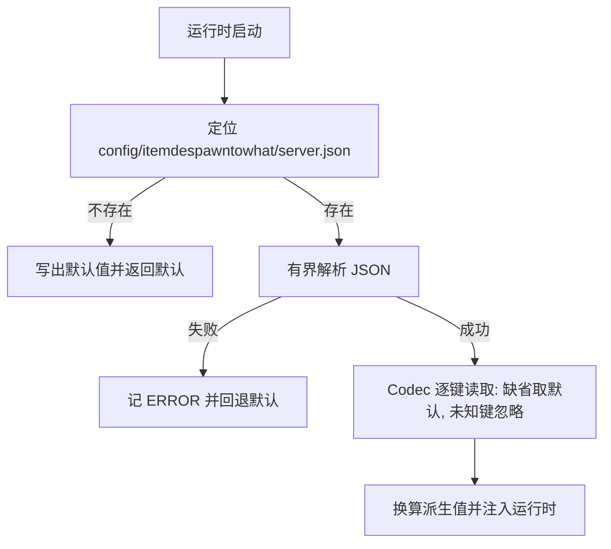

# server.json 运行配置

## TL;DR

- 模组级服务端配置固定位于 `config/itemdespawntowhat/server.json`，两端共用同一份实现与同一个文件。
- 文件缺失或损坏时写回默认值并继续启动；未知键被忽略，缺失键取默认值。
- 配置在运行时启动时读取一次，改完重启服务端生效；规则重载不重新读取本文件。

## 适用对象

调整检查节奏、tick 预算、邻近阈值，或排查配置读取失败原因的开发者与服主。

## 定位与读取

`server.json` 只承载运行时行为参数，与[规则 JSON](../api/rule-json.md)完全分离：规则描述「什么物品变成什么」，本文件描述「服务端用多少资源、按什么节奏去做」。文件路径固定，不受 `overlay_directory` 影响，避免引导期出现自引用。

读取结果按 Issue 报告：解析失败与读写异常记为 ERROR，同时回退到默认配置，服务端继续启动。默认值本身可以写回文件，方便直接编辑。

## 字段分组

键名、默认值与合法区间都在 `ServerConfig` 的 Codec 里定义，下文按职责分组说明，不复制完整字段表。

| 分组 | 回答的问题 | 代表键 | 消费方 |
|---|---|---|---|
| 检查与退避 | 多长时间查一次、连续失败如何拉长间隔 | `check_interval_ticks`、`backoff_max_ticks` | 转化运行时 |
| 共享 tick 预算 | 每 tick 允许多少工作量、效果与搬运各占多少 | `server_budget_us`、`max_work_units_per_tick`、`effects_work_units_per_tick`、`dispatch_batch_size` | 调度器 |
| 检查平滑与位置搜索 | 到期检查如何摊平、每刻能查多少个候选位置 | `check_spread_window_ticks`、`position_search_checks_per_tick` | 调度器 |
| 回扫分摊 | 启动、维度加载与规则重载后的整维回扫每步处理多少实体 | `rescan_entities_per_step` | 转化运行时 |
| 取消清理 | 规则重载、维度卸载与停服前摘除的任务每步取消多少 | `cancels_per_step` | 调度器 |
| 覆盖层与平台差异 | 覆盖层目录名、Fabric 端寿命兜底 | `overlay_directory`、`fabric_lifespan_fallback_ticks` | 加载与编辑链路、平台适配 |
| 实体临时状态 | 新产物保护与转化冷却各持续多久 | `new_product_protection_seconds`、`conversion_cooldown_seconds` | 掉落物状态层 |
| 邻近阈值 | 同区域同类物品或实体的容量口径 | `nearby_products` 子对象 | 完整组开组判定 |
| 调试 | 常规日志与调试场景准备预算 | `debug_logging`、`debug_scenario_prepare_batch_size`、`debug_scenario_prepare_budget_us` | 调试层 |

取值口径需要注意：以秒为单位的键（新产物保护、转化冷却）允许写 0，表示不授予对应状态时长，其余数值键下限为正整数；`max_work_units_per_tick` 是唯一可选键，缺省时回退到每 tick 检查数的上限值。写违反区间的值会被整体解码失败处理，配置回退默认。

## 派生换算

记录里的秒、微秒与工作量口径在运行时会换算成内部单位，换算方法集中在 `ServerConfig`，不要在调用点重复计算：

| 派生值 | 换算 |
|---|---|
| tick 预算纳秒值 | 微秒值取正后乘 1000 |
| 每 tick 工作量上限 | 可选键为空时回退到检查数上限 |
| 秒到 tick | 秒数取非负后按每秒固定 tick 数换算 |
| 退避间隔 | 以检查间隔为基数按失败次数左移，位移量有上限，最终被退避上限截断 |

退避的直觉是「间隔翻倍直到上限」，但基数是配置的检查间隔而不是固定常量，改基数会整体平移整条序列。位移量设上限是为了长失败次数下不溢出，最终仍受退避上限约束。

## nearby_products

`nearby_products` 是一个嵌套对象，默认值来自 `NearbyProductLimits`。物品与通用实体各自有容量上限与统计半径，上限写 0 表示不对该类做容量检查；半径按方块计。经验球两项保留读写与区间校验，与物品、通用实体的准入口径分开维护。

阈值只决定完整转化组能否开组：开组前按当前区域统计不足时该组暂缓启动，成本尚未支付，源物品保持原样。

## 新增参数

1. 在 `ServerConfig` 的 record 分量里加字段。
2. 在 Codec 里加 `optionalFieldOf`（需要区间就用区间校验），缺省值指向 `DEFAULT` 的对应分量。
3. 在 `DEFAULT` 里给出默认值；需要派生换算时加方法，而不是在调用点写字面量。
4. 若参数替换了既有硬编码常量，确认消费方改为读取配置，并在[架构总览](../architecture/overview.md)相关链路里保持口径一致。

新增键不能只改 Java 而漏掉 Codec：那样解码会整体失败并回退默认，表现为所有配置项回到默认值。

## 相关文档

- [架构总览](../architecture/overview.md)
- [平台模块](../modules/platform.md)
- [转化运行时模块](../modules/conversion-runtime.md)
- [规则 JSON 契约](../api/rule-json.md)
- [故障排查](troubleshooting.md)
