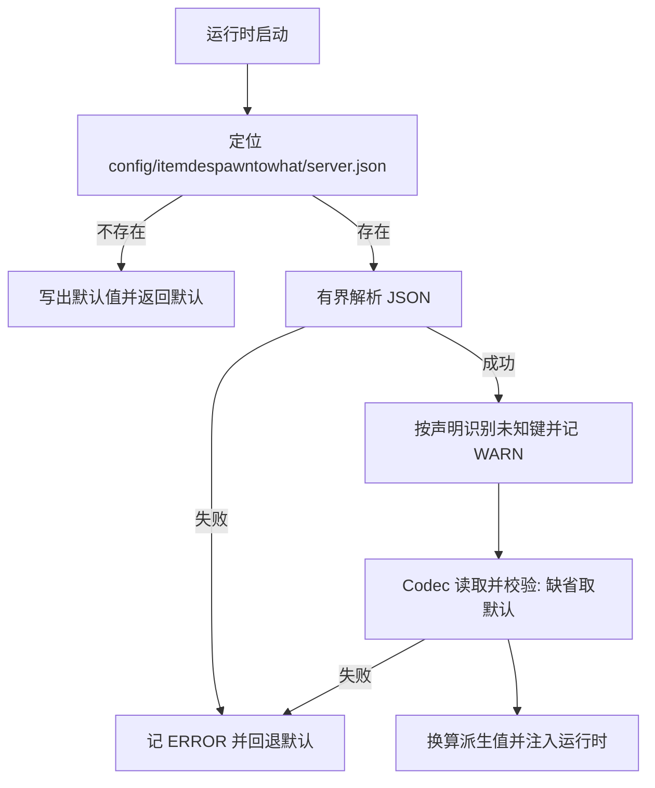

# server.json 运行配置

## TL;DR

- 模组级服务端配置固定位于 `config/itemdespawntowhat/server.json`，两端共用同一份实现与同一个文件。
- 文件缺失时写出默认配置，解析失败时报告问题并按默认值启动；未知键按完整路径记 WARN，缺失键取默认值。
- 配置在运行时启动时读取一次，改完重启服务端生效；规则重载不重新读取本文件。

## 适用对象

调整检查节奏、tick 预算、邻近阈值，或排查配置读取失败原因的开发者与服主。

## 定位与读取

`server.json` 只承载运行时行为参数，与[规则 JSON](../api/rule-json.md)完全分离：规则描述「什么物品变成什么」，本文件描述「服务端用多少资源、按什么节奏去做」。文件路径固定，不受 `overlay_directory` 影响，避免引导期出现自引用。

已有文件的解析或读取失败以 ERROR Issue 报告并回退默认配置，原文件保留。根对象及 `nearby_products` 的未知键以 WARN Issue 报告完整路径，其余合法字段继续读取；值类型与区间交由 Codec 校验。缺失文件使用 Codec 写出默认值，等于默认值的键会被省略；写出失败记日志 WARN，仍按默认配置启动。

## 字段分组

键名、默认值与合法区间由 `core/config` 内的包内 `ConfigField` 声明提供，同一声明构造 MapCodec、各组 DEFAULT、未知键识别和构建期参考事实。Java 内按调度、有界任务、实体状态、位置与调试分组，各组 MapCodec 直接平铺组合；`overlay_directory` 留在顶层，`nearby_products` 保持嵌套对象。下文按使用职责说明，生成的完整键表见[服务端配置](../wiki/zh-07-server-config.md)。

| 分组 | 回答的问题 | 代表键 | 消费方 |
|---|---|---|---|
| 检查与退避 | 多长时间查一次、连续失败如何拉长间隔 | `check_interval_ticks`、`backoff_max_ticks` | 转化运行时 |
| 共享 tick 预算 | 每 tick 允许多少工作量、效果与搬运各占多少 | `server_budget_us`、`max_work_units_per_tick`、`effects_work_units_per_tick`、`dispatch_batch_size` | 调度器 |
| 结算准备 | 一次结算每步最多为多少组固定效果输入 | `prepare_groups_per_step` | 结算任务 |
| 检查平滑与位置搜索 | 到期检查如何摊平、每刻能查多少个候选位置 | `check_spread_window_ticks`、`position_search_checks_per_tick` | 调度器 |
| 回扫分摊 | 启动、维度加载与规则重载后的整维回扫每步处理多少实体 | `rescan_entities_per_step` | 转化运行时 |
| 取消清理 | 规则重载、维度卸载与停服前摘除的任务每步取消多少 | `cancels_per_step` | 调度器 |
| 覆盖层与平台差异 | 覆盖层目录名、Fabric 端寿命兜底 | `overlay_directory`、`fabric_lifespan_fallback_ticks` | 加载与编辑链路、平台适配 |
| 实体临时状态 | 新产物保护与转化冷却各持续多久；保护覆盖全部产物，冷却只作用于掉落物 | `new_product_protection_seconds`、`conversion_cooldown_seconds` | 掉落物状态层 |
| 邻近阈值 | 同区域同类物品或实体的容量口径 | `nearby_products` 子对象 | 计划期产出预算（组数上界） |
| 规则上限 | 规则里 `place_block` 的半径上限，同时决定编辑器半径滑条的窗口 | `max_place_block_radius` | 规则加载与保存校验、编辑器 |
| 结算恢复 | 当前会话内结算失败后的重试上限 | `settlement_recovery_max_attempts` | 转化运行时 |
| 调试 | 常规日志与调试场景准备预算 | `debug_logging`、`debug_scenario_prepare_batch_size`、`debug_scenario_prepare_budget_us` | 调试层 |

新产物保护与转化冷却的秒数允许写 0，表示不授予对应状态时长；邻近容量上限的 0 表示关闭对应检查，合法区间见生成键表。`max_work_units_per_tick` 缺省时动态回退到本次配置的 `max_checks_per_tick`，显式填写时使用显式值。类型或区间错误使整份配置回退默认值。

## 派生换算

记录里的秒、微秒与工作量口径在运行时会换算成内部单位，换算方法集中在 `ServerConfig` 与 `SchedulerConfig.from`，不要在调用点重复计算：

| 派生值 | 换算 |
|---|---|
| tick 预算纳秒值 | 微秒值取正后乘 1000 |
| 每 tick 工作量上限 | 可选键为空时回退到检查数上限 |
| 秒到 tick | 秒数取非负后按每秒固定 tick 数换算 |
| 退避间隔 | 以检查间隔为基数按失败次数左移，位移量有上限，最终被退避上限截断 |

退避的直觉是「间隔翻倍直到上限」，但基数是配置的检查间隔而不是固定常量，改基数会整体平移整条序列。位移量设上限是为了长失败次数下不溢出，最终仍受退避上限约束。

## nearby_products

`nearby_products` 是一个嵌套对象，默认值来自 `NearbyProductLimits`。物品与实体（生物与其他实体）各自有容量上限与统计半径，上限写 0 表示不对该类做容量检查；半径按方块计。经验球两项保留读写与区间校验，开组只按物品与实体两项计算。

阈值在计划期按初始区域存量和声明的理论产量确定完整组预算，不按概率折减；预算覆盖之外的源物品返还。生成期间不再查询上限，外部新增产物不挤占额度，允许最终存量超限。实际产量由效果类型决定，未用完的预算不补开组。

## 新增参数

1. 将字段加入所属职责组的 record，在同组创建 `ConfigField` 并登记到有序 `FIELDS`；邻近子字段在 `NearbyProductLimits` 声明。
2. 组 MapCodec 消费字段的 `codec()`，组 DEFAULT 消费 `defaultValue()`；聚合层按需提供访问委托与派生换算。根键平铺、邻近键嵌套的文件结构保持明确。
3. 在 `tools/config-docs/messages/zh_cn.json` 与 `en_us.json` 为完整路径补齐说明文字与使用建议。
4. 运行 `tools/dsh-build.ps1 -Tasks generateConfigReference` 更新两种语言的受管块；检查页面说明与场景示例是否仍适用。
5. 完成 IDE 检查后运行 `tools/dsh-build.ps1 -Tasks build`，配置参考校验随各子项目 check 执行。

`tools/config-docs/ConfigReferenceExporter.java` 独立编译并读取实际声明，核对 Codec 键集和完整默认等价性，将事实导出至 `build/config-docs/schema.json`；工具类留在工具编译目录。Python 渲染器只读取导出事实与双语文案，生成完整默认等价 JSON、根字段表和邻近子表。`checkConfigReference` 只校验受管块与文案键集，`generateConfigReference` 负责写入页面。

## 相关文档

- [架构总览](../architecture/overview.md)
- [平台模块](../modules/platform.md)
- [转化运行时模块](../modules/conversion-runtime.md)
- [规则 JSON 契约](../api/rule-json.md)
- [故障排查](troubleshooting.md)
