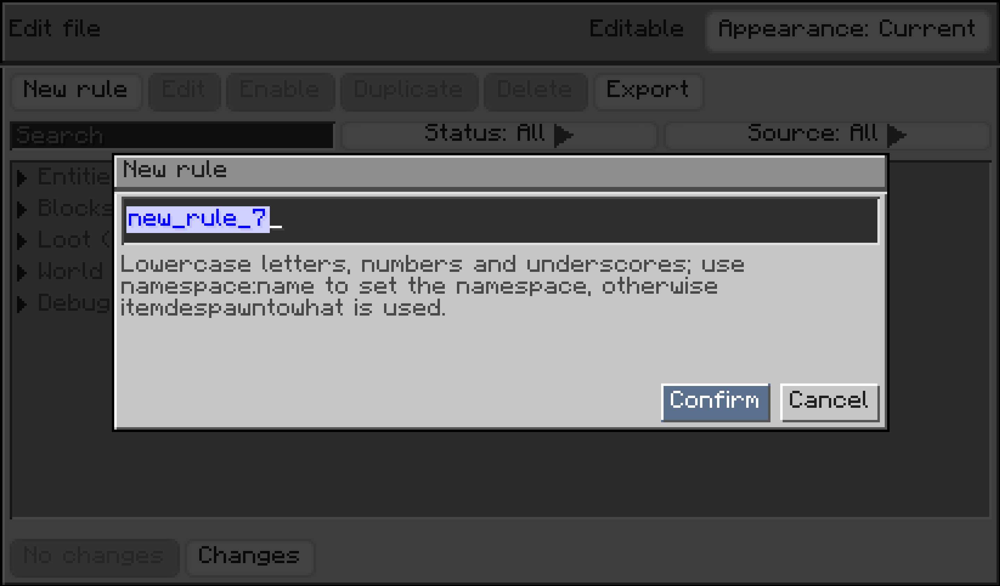
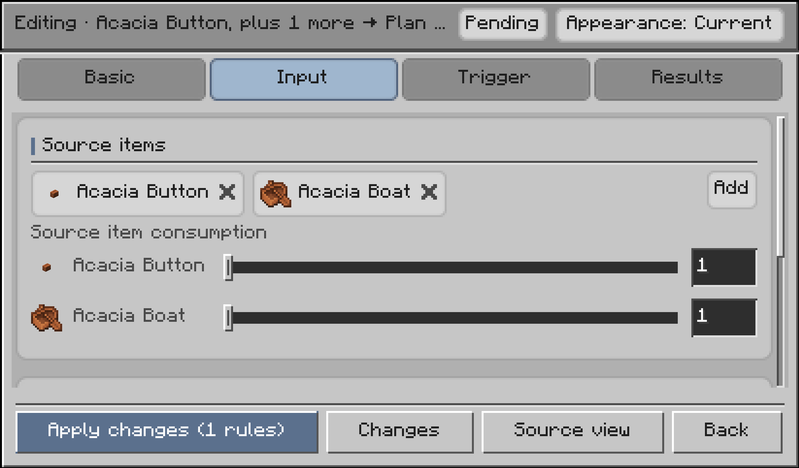
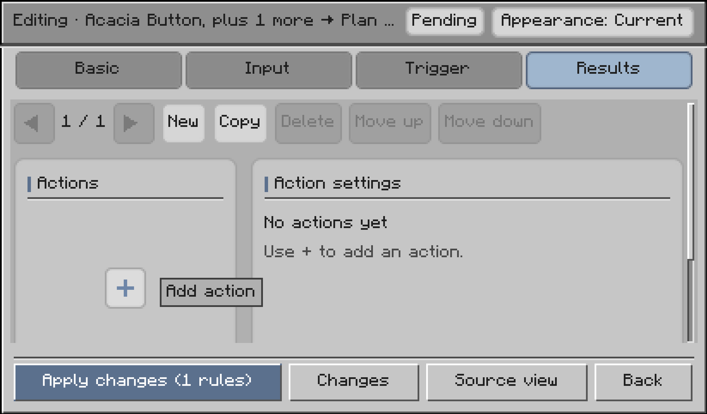
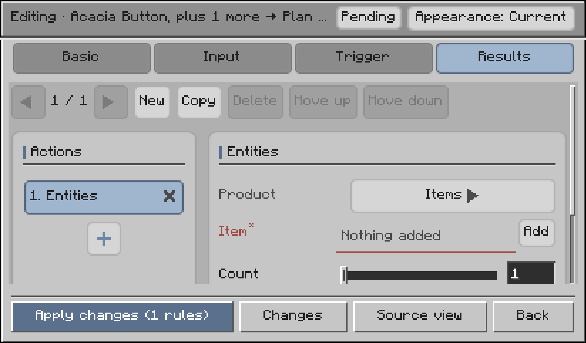
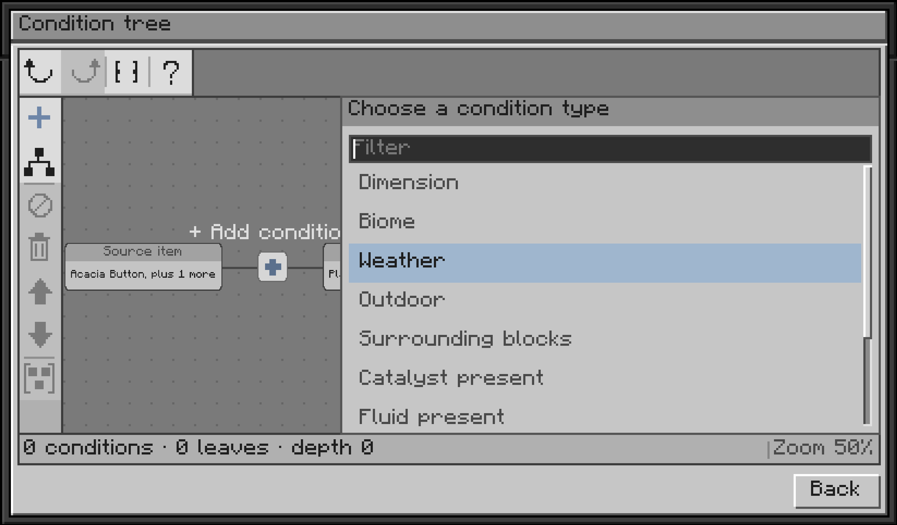

# Getting Started

> Applies to **2.0.0** (Minecraft **1.21.1**).

This guide walks you through creating and testing your first conversion rule using the in-game GUI editor, and introduces core mechanisms, configuration paths, and troubleshooting steps.

---

## Create Your First Rule in the GUI

Here is a step-by-step example creating a rule where **raw chicken turns into rotten flesh after dropping for 10 seconds**.

> **Preparation**: Install the mod and load your world. Singleplayer world owners can open the editor directly. In multiplayer, both the server and any client opening the editor need the mod installed, and players need permission level ≥ 2. Only one player can use the editor at a time.

### 1. Open the Editor

Type and run in chat:

```text
/idtw editor open
```

You can also use the shorthand `/idtw editor`.


### 2. Create a New Rule

Click **New rule**, set the rule ID to `myrules:chicken_to_rotten_flesh`, and click **Confirm**.

*Note: Rule IDs must be unique and follow the `namespace:path` format using lowercase letters, numbers, and underscores.*



### 3. Select the Input Item

Under the **Input** tab in the **Source items** section, click **Add** and pick chicken (`minecraft:chicken`).
Keep **Source item consumption** set to `1` so each conversion consumes 1 chicken.



### 4. Set the Trigger Timer

Switch to the **Trigger** tab:
- Keep the trigger mode as **Natural (item despawn)**.
- Set **Trigger time (seconds)** to `10`.
- Leave the condition tree empty for now (unconditional).

### 5. Set the Conversion Result

Switch to the **Results** tab:
1. Click the `+` button in the left **Actions** section to add an **Entities** action.



2. In the right-hand panel, set **Product** to **Items**.
3. Click **Add** next to **Item**, select rotten flesh (`minecraft:rotten_flesh`), and set **Count** to `1`.



### 6. Apply and Test

Click **Apply changes** at the bottom, wait for the save confirmation, then close the screen. The rule reloads automatically.

**Test it in-game**:
Drop 1 raw chicken onto the ground and wait 10 seconds. It will transform into 1 rotten flesh! You can also run `/idtw rule list` in chat to see your active rules.

### Adding Conditions (Optional)

If you want the rule to trigger only in certain weather, at night, or in specific biomes:
Open the condition tree in the **Trigger** tab, click `+` to add conditions, and configure their parameters (see [Conditions](en-03-conditions)).



---

## How the Mod Works

ItemDespawnToWhat monitors when dropped items despawn or get destroyed in the world, transforming them according to your rules.

### 1. Four Trigger Kinds (`triggers`)

| Trigger Kind | When It Checks and Fires | Waiting Required? |
| --- | --- | --- |
| `natural` | When the item reaches the trigger time or its natural despawn limit | Waits for `trigger_after_seconds` |
| `fire` | The exact tick the item is burned by fire | **Instant**, no timer |
| `lava` | The exact tick the item is consumed by lava | **Instant**, no timer |
| `cactus` | The exact tick the item touches and is destroyed by cactus | **Instant**, no timer |

### 2. Available Effects

- **Spawn items**: e.g., chicken transforms into rotten flesh after 10 seconds;
- **Spawn mobs**: e.g., raw eggs hatch into baby chicks;
- **Place blocks**: e.g., dropped saplings plant themselves into the ground;
- **Roll loot tables**: e.g., drop items based on dungeon chest tables;
- **Weather and lightning**: e.g., clear stormy weather or strike a bolt of lightning;
- **Cause explosions**: e.g., volatile items explode when left unattended.

### 3. Stack Settlement and Leftover Refunds

If a whole stack (e.g. 64 items) drops and each conversion costs 1 item, the whole stack converts into 64 outputs.
If a rule costs 5 items per group and you drop 7 items:
- 1 group converts (costs 5);
- The remaining 2 items **do not meet the group cost and are refunded safely to the ground**, never disappearing into thin air.
See [Outcome Candidates and Settlement](en-05-outcomes-and-settlement) for full details.

---

## Where Configuration Files Live

Rules can be provided through two layers that automatically merge by rule ID:

| Location | Editing Method | Purpose |
| --- | --- | --- |
| `config/itemdespawntowhat/rules/**/*.json` | GUI or manual JSON editing | **Local overlay**: Highest priority, GUI saves rules here |
| `<save>/datapacks/<pack>/data/<namespace>/idtw/rules/**/*.json` | Datapack editing | **World datapack**: Best for modpacks or sharing |

The mod also creates a server configuration file at `config/itemdespawntowhat/server.json` to configure lag-prevention limits and check intervals (see [Server Configuration](en-07-server-config)).

---

## Advanced: Writing JSON Rules Manually

If you prefer managing configuration files directly, create `.json` files under `config/itemdespawntowhat/rules/`.

### Minimal Rule Example

Save the following content to `config/itemdespawntowhat/rules/myrules/chicken_to_rotten_flesh.json`:

```json
{
  "id": "myrules:chicken_to_rotten_flesh",
  "source": {
    "items": [
      "minecraft:chicken"
    ]
  },
  "trigger_after_seconds": 10,
  "effects": [
    {
      "type": "idtw:spawn_entity",
      "variant": "item",
      "item": "minecraft:rotten_flesh",
      "count": 1
    }
  ]
}
```

Field summary:
- `id`: Unique rule identifier (`namespace:path`);
- `source`: Dropped items to match. Can use item IDs or `#` tags (e.g. `"#minecraft:saplings"`);
- `trigger_after_seconds`: How many seconds to wait before triggering;
- `effects`: Actions to execute when triggered.

For all available options, see [Rule Fields](en-02-rule-basics).

### Applying Changes After Manual Edits

After editing JSON files, you do not need to restart the game:

1. **Check for errors**: Run `/idtw rule validate` in chat to inspect files for syntax errors or unknown IDs.
2. **Reload rules**: Run `/idtw rule reload` to reload all rules and apply changes instantly.

---

## Troubleshooting: 5-Step Checklist

If a rule does not trigger in-game, check these common items:

1. **File path and extension**: Ensure files are in `config/itemdespawntowhat/rules/` or datapacks, ending with `.json`.
2. **Validation errors**: Run `/idtw rule validate` to check for red syntax errors or misspelled item IDs.
3. **Rule toggle state**: Run `/idtw rule list` to verify the rule exists and is enabled. Use `/idtw rule enable <id>` to re-enable it.
4. **Trigger kind**: If you want an item to convert when destroyed by fire or lava, make sure `fire` or `lava` is added to `triggers`.
5. **Conditions**: If you configured `conditions`, ensure all required conditions (e.g., rain, night, biome) are currently met.

---

## Next Steps

- [Rule Fields](en-02-rule-basics): Complete reference for top-level fields.
- [Conditions](en-03-conditions): Filter conversions by environment, time, and world states.
- [Effects](en-04-effects): Explore available actions and visual effects.
- [Command Reference](en-08-commands): In-game commands and shortcuts.
