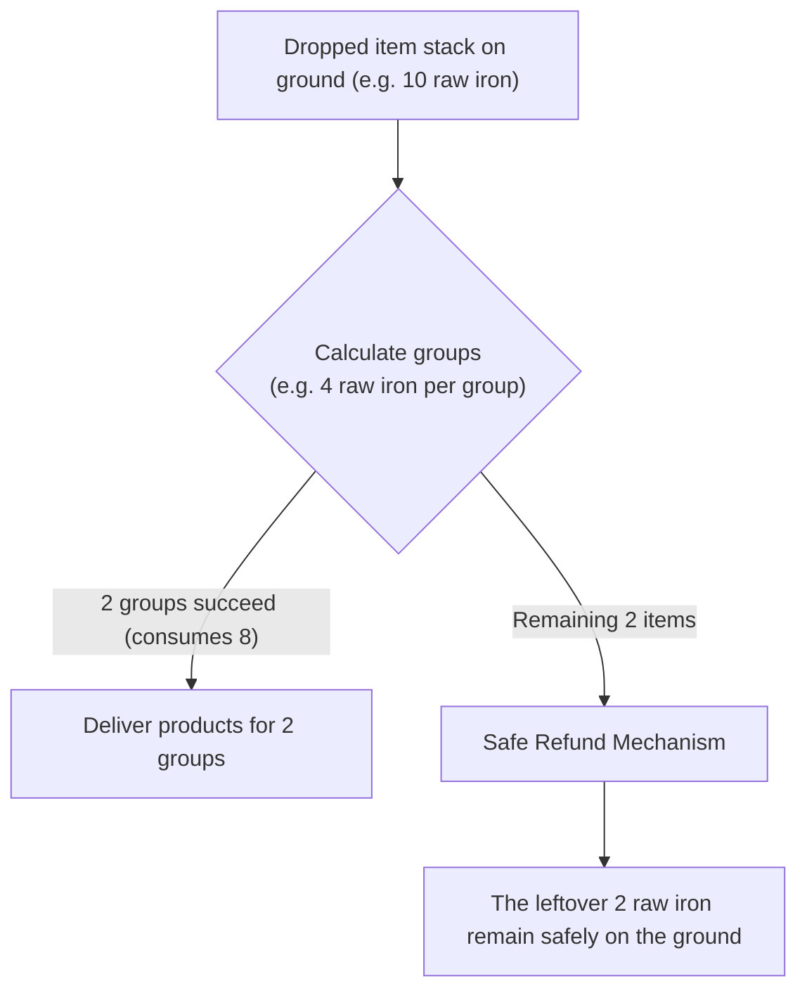

# Outcome Candidates and Settlement (`outcomes`)

> Applies to **2.0.0** (Minecraft **1.21.1**).

This page explains how to produce multiple different results from a single rule (such as random or rotating outputs), how to set material and catalyst costs, and how stacks of dropped items settle safely in the world without losing items.

---

## Single Outcomes vs Multiple Outcome Candidates

Every rule must specify its products. The mod supports two formats (**mutually exclusive**; do not mix both):

| Format | When to Use | Number of Outcomes |
| --- | --- | --- |
| **Top-level `effects`** | Fixed, single output scheme (e.g. chicken always becomes rotten flesh) | 1 implicit outcome |
| **`outcomes` list** | Multiple output schemes (e.g. sometimes a chick, sometimes feathers) | 2 to 32 outcome candidates |

### Outcome Candidate Fields

Inside the `outcomes` list, each candidate is an object with the following fields:

| Field | Description | Type / Range | Default |
| --- | --- | --- | --- |
| `id` | Unique candidate name | String (unique within this rule) | **Required** |
| `effects` | List of effects for this candidate | Non-empty array of effect objects | **Required** (see [Effects](en-04-effects)) |
| `safe_spawn` | Search nearby safe ground when spawning entities | `true` / `false` | `true` (avoids suffocation/lava) |
| `fill_origin` | Allow `place_block` to fill the trigger position itself | `true` / `false` | `true` |

---

## Multiple Outcome Strategies (`combination`)

When an `outcomes` list is configured, the top-level `combination` field defines how candidates are chosen:

| Strategy | How It Works | Best Used For |
| --- | --- | --- |
| `round_robin` | **Sequential rotation**: Cycles through Outcome A ➔ Outcome B ➔ Outcome C | Evenly distributing diverse products across multiple groups |
| `weight` | **Weighted random**: Chooses candidates randomly according to configured weights | Lucky-dip mechanics or rare item drops |

---

## Conversion Costs

Conversions can consume source items as well as catalyst items dropped nearby:

### 1. Source Item Cost (`source_cost`)

- Declares how many source items are consumed per group.
- If omitted, defaults to 1 source item per conversion group.

```json
"source_cost": {
  "minecraft:iron_ingot": 4
}
```
*Each conversion group costs 4 iron ingots.*

### 2. Catalyst Item Cost (`catalyst_cost`)

- Declares auxiliary items required from the ground nearby.
- The mod automatically finds and consumes matching dropped items.

```json
"catalyst_cost": {
  "minecraft:redstone": 2
}
```
*In addition to source items, each group consumes 2 redstone dust items dropped nearby.*

---

## Stack Settlement and Safe Refunds

In gameplay, players frequently drop whole stacks of items (e.g. 64 items). The settlement mechanism is fair, deterministic, and safe:



1. **Calculate groups**: Total dropped items divided by cost per group;
2. **Execute outputs**: Generates products for all complete groups;
3. **Safe leftovers refund**: **Items that do not make up a full group are safely refunded** as dropped items on the ground so players never lose their belongings.

---

## Example: Alternating Two Outcomes

Here is a rule where **raw chicken consumes 1 item and alternates between rotten flesh and a baby chick**:

```json
{
  "id": "myrules:chicken_two_forms",
  "source": { "items": ["minecraft:chicken"] },
  "trigger_after_seconds": 300,
  "source_cost": { "minecraft:chicken": 1 },
  "combination": "round_robin",
  "outcomes": [
    {
      "id": "rotten_flesh",
      "effects": [
        {
          "type": "idtw:spawn_entity",
          "variant": "item",
          "item": "minecraft:rotten_flesh",
          "count": 1
        }
      ]
    },
    {
      "id": "baby_chick",
      "safe_spawn": true,
      "effects": [
        {
          "type": "idtw:spawn_entity",
          "variant": "mob",
          "entity": "minecraft:chicken",
          "age": -24000,
          "count": 1
        }
      ]
    }
  ],
  "schema_version": 1
}
```

---

## Next Steps

- [Source Layers and Overrides](en-06-layers-and-overrides): Understand how local overlay rules override datapacks.
- [Effects](en-04-effects): Reference for all available action types and parameters.
