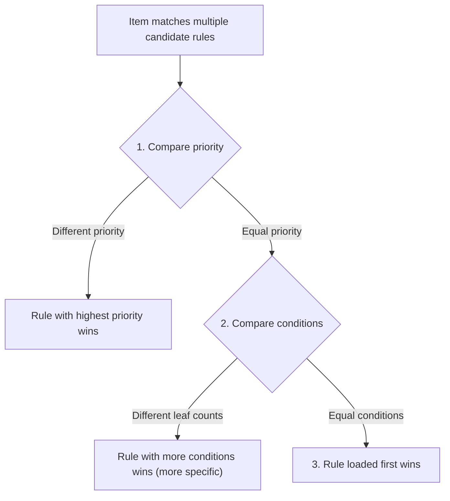

# Source Layers and Overrides (`layers & overrides`)

> Applies to **2.0.0** (Minecraft **1.21.1**).

This page explains how rules are loaded across layers: how datapacks and local configuration files cooperate, how to completely replace existing rules by ID, and which rule wins when multiple rules match the same dropped item.

---

## Source Layers and Priority

Rules can reside in two different source layers. When matching `id`s appear, **the local config overlay takes priority over world datapacks**:

| Source Layer | File Path | Primary Editing Method | Priority | Role & Purpose |
| --- | --- | --- | --- | --- |
| **World Datapack** (`world`) | `<save>/datapacks/<pack>/data/<namespace>/idtw/rules/*.json` | Text editors / Datapack tools | Low | **Rule Base**: Bundled with maps or modpacks; treated as read-only templates by GUI editor |
| **Config Overlay** (`overlay`) | `config/itemdespawntowhat/rules/**/*.json` | In-game GUI or manual editing | **High** | **Highest Authority**: Rules saved via the GUI editor reside here |

### Merging Principles
- **Different IDs**: Rules from datapacks and the overlay are merged together into one unified ruleset;
- **Identical IDs**: **The higher-priority source completely replaces the lower-priority rule** (overlay replaces datapack).

---

## Complete Replacement by ID

If you want to alter a rule provided by a world datapack (for example, turning a datapack's chicken-to-rotten-flesh into chicken-to-gold), you don't need to unpack and edit the datapack. Simply create an overlay rule with the **exact same `id`**.

> [!IMPORTANT]
> **Complete Replacement**: Overriding replaces the entire rule definition rather than merging fields. When overriding, define all necessary fields (inputs, triggers, effects); omitted optional fields revert to their default values.

### Walkthrough: Overriding an Existing Rule

Suppose a datapack provides a rule `mypack:chicken_to_rotten_flesh` that spawns rotten flesh after 300 seconds.

To change it to spawn gold ingots after 60 seconds, create a local file at `config/itemdespawntowhat/rules/chicken_to_gold.json`:

```json
{
  "id": "mypack:chicken_to_rotten_flesh",
  "priority": 10,
  "source": {
    "items": ["minecraft:chicken"]
  },
  "trigger_after_seconds": 60,
  "triggers": ["natural"],
  "effects": [
    {
      "type": "idtw:spawn_entity",
      "variant": "item",
      "item": "minecraft:gold_ingot",
      "count": 1
    }
  ]
}
```

Run `/idtw rule reload`:
- The active rule `mypack:chicken_to_rotten_flesh` now uses your customized version;
- The timer drops to 60 seconds and produces gold ingots;
- To revert, delete your local file and reload again to restore the datapack's original rule.

---

## Per-Save Enable Overrides

Rules define an `enabled` default in JSON. Administrators can also toggle rules in-game for the current save:

- `/idtw rule enable <id>`: Force-enable the rule in this save;
- `/idtw rule disable <id>`: Force-disable the rule in this save;
- `/idtw rule reset <id>`: Remove the override and follow the rule's default `enabled` state.

*Note: Save-level toggles are stored with world save data and do not modify your JSON files.*

---

## Conflict Resolution: Multiple Rules Matching One Item

If a dropped item matches multiple rules (e.g. raw chicken matches both "chicken-to-flesh" and "all-meats-to-fertilizer"), **only one rule executes**.

The conflict arbitrator resolves ties as follows:



1. **Priority value (`priority`)**: Highest integer wins. Rules with high priority (e.g. `10`) take precedence over default rules (`0`);
2. **Specificity (Condition leaf count)**: When priorities tie, rules with more condition leaves win (specific rules beat generic fallbacks);
3. **Registration order**: When still tied, the rule loaded earlier executes.

---

## Next Steps

- [Server Configuration](en-07-server-config): Check intervals, lag-prevention budgets, and cooldowns.
- [Command Reference](en-08-commands): All in-game commands and operational permissions.
