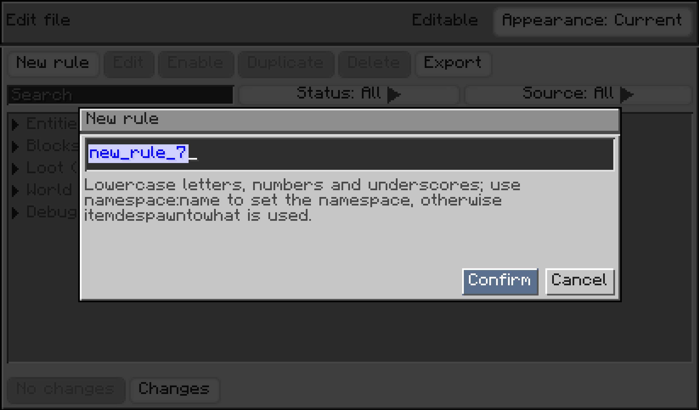
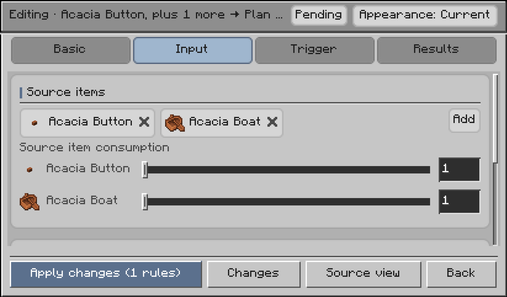
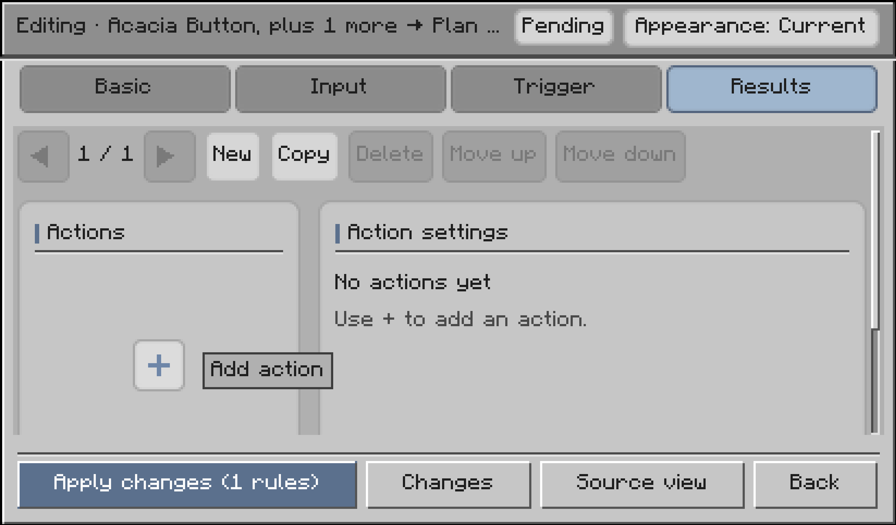
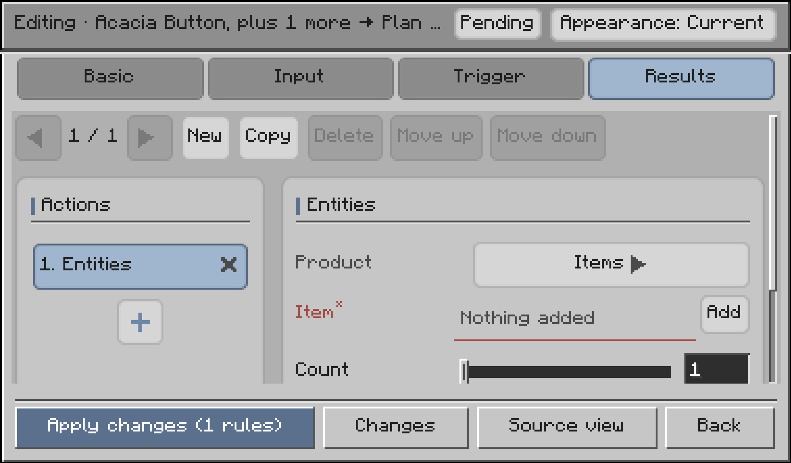
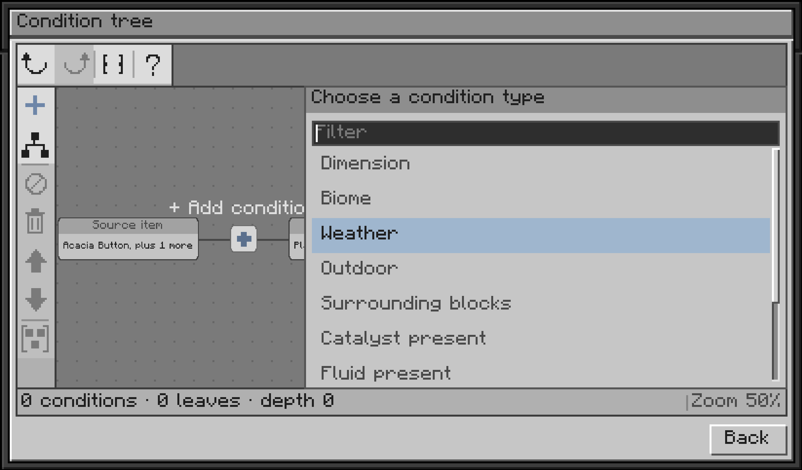

# 首次使用与生效流程

> 适用版本：**2.0.0**（Minecraft **1.21.1**）。

本页将带你通过游戏内可视化编辑器创建并验证第一条转化规则，同时介绍规则机制、配置文件存放位置以及常见排查方法。

---

## 用 GUI 创建第一条规则

下面以创建一条**「鸡肉掉落 10 秒后变成腐肉」**的规则为例进行演示。

> **准备工作**：安装模组并进入世界。单人存档房主可直接使用；多人联机中，服务端与使用编辑器的客户端都需安装模组，且执行玩家需要管理员权限（权限等级 ≥2）。同一时间只允许一位玩家使用编辑器。

### 1. 打开编辑器

在聊天栏输入并执行：

```text
/idtw editor open
```

也可以简写为 `/idtw editor`。


### 2. 新建规则

点击**「新建规则」（New rule）**，输入规则 ID，例如 `myrules:chicken_to_rotten_flesh`，然后点击「确认」。

*提示：规则 ID 用于唯一区分规则，冒号前为命名空间，仅支持小写字母、数字和下划线。*



### 3. 选择输入物品

在**「输入」（Input）**页面的「源物品」（Source items）中点击「添加」，选择鸡肉（`minecraft:chicken`）。
将「源物品消耗」（Source item consumption）保持为 `1`，表示每组转化消耗 1 个鸡肉。



### 4. 设置触发时间

切换到**「触发」（Trigger）**页面：
- 消失方式保留默认的「自然（物品消失）」（Natural (item despawn)）；
- 将「触发时间（秒）」（Trigger time (seconds)）调整为 `10`。
- 初次尝试时，下方的「条件树」可先保持为空（即无条件触发）。

### 5. 设置转化结果

切换到**「结果」（Results）**页面：
1. 点击左侧「执行行为」（Actions）区域的 `+` 按钮，添加一个「实体」（Entities）行为。



2. 在右侧面板中，将「产物」（Product）类型选择为「物品」（Items）。
3. 点击「物品」旁边的「添加」，选择腐肉（`minecraft:rotten_flesh`），数量保持为 `1`。



### 6. 应用并验证

点击屏幕下方的**「应用更改」（Apply changes）**，稍等片刻看到保存成功的提示后关闭界面。游戏会自动重新加载规则。

**进游戏实测**：
往地上扔出 1 个鸡肉，静静等待 10 秒，原位置就会变成 1 个腐肉！你也可以在聊天栏输入 `/idtw rule list` 查看已生效规则。

### 按需添加条件

如果想让规则只在特定天气、夜晚或特定生物群系下触发：
在「触发」页打开条件树，点击 `+` 挑选所需条件并填写参数即可（详见 [条件](zh-03-conditions)）。



---

## 模组核心工作机制

ItemDespawnToWhat 监听掉落物在世界中的**消失时机**，并在满足条件时将其转化为设定好的产物。

### 1. 四种消失时机（`triggers`）

| 消失方式 | 什么时候判定与触发 | 是否需要等待时间 |
| --- | --- | --- |
| `natural`（自然消失） | 掉落物存活到达设定时间或自然寿命到期时 | 等待 `trigger_after_seconds` |
| `fire`（火烧） | 掉落物接触火焰被烧毁的瞬间 | **立即触发**，不等计时器 |
| `lava`（岩浆销毁） | 掉落物掉入岩浆被销毁的瞬间 | **立即触发**，不等计时器 |
| `cactus`（仙人掌销毁） | 掉落物触碰仙人掌被刺破的瞬间 | **立即触发**，不等计时器 |

### 2. 丰富多样的转化效果

- **产出物品**：例如鸡肉 10 秒后变成腐肉；
- **召唤生物**：例如鸡蛋落地孵出幼年小鸡；
- **放置方块**：例如树苗落地扎根长成方块；
- **掉落战利品**：例如按地牢宝箱战利品表随机爆出物资；
- **世界天气与雷击**：例如把暴风雨转为晴天，或原地引下一道闪电；
- **引发爆炸**：例如未妥善保存的易燃易爆物原地爆炸。

### 3. 按组结算与零头返还

如果掉落物是一整堆（如 64 个），规则设定每次消耗 1 个，那么整堆会批量转化为 64 份产物。
如果某条规则要求消耗 5 个，而地面上只有 7 个物品：
- 成功转化 1 组（消耗 5 个）；
- 剩下的 2 个**不足一组，会自动返还留在原地**，绝不会凭空吞掉玩家的物品。
详细结算机制见 [候选结果与结算](zh-05-outcomes-and-settlement)。

---

## 配置文件存放在哪

模组支持两种规则提供方式，加载时会按 ID 自动合并（单人存档文件在 `.minecraft/saves/<存档名>/` 下，服务器在服务端根目录下）：

| 存放位置 | 编辑方式 | 适用场景 |
| --- | --- | --- |
| `config/itemdespawntowhat/rules/**/*.json` | GUI 保存或手动编辑 | **本地覆盖层**：GUI 默认保存于此，优先级最高 |
| `<存档>/datapacks/<数据包>/data/<命名空间>/idtw/rules/**/*.json` | 数据包编辑 | **世界数据包**：适合随整合包分发或分享给他人 |

此外，首次启动服务端还会在 `config/itemdespawntowhat/server.json` 生成一份服务端性能配置，用于调节服务器检查频率与防卡顿阈值（详见 [服务端配置](zh-07-server-config)）。

---

## 进阶：手动编写 JSON 规则

如果你更喜欢直接管理文本文件，也可以在 `config/itemdespawntowhat/rules/` 下创建 `.json` 文件。

### 最小可用规则示例

在 `config/itemdespawntowhat/rules/myrules/chicken_to_rotten_flesh.json` 写入以下内容：

```json
{
  "id": "myrules:chicken_to_rotten_flesh",
  "source": {
    "items": [
      "minecraft:chicken"
    ]
  },
  "trigger_after_seconds": 10,
  "effects": [
    {
      "type": "idtw:spawn_entity",
      "variant": "item",
      "item": "minecraft:rotten_flesh",
      "count": 1
    }
  ]
}
```

字段简明说明：
- `id`：规则唯一标识符，建议写为 `命名空间:路径`；
- `source`：监听的掉落物，`items` 中可填单个物品 ID 或 `#` 开头的物品标签（如 `"#minecraft:saplings"`）；
- `trigger_after_seconds`：自然消失前等待多少秒触发；
- `effects`：触发后执行的行为列表。

更多字段与详细解释请查阅 [规则基础字段](zh-02-rule-basics)。

### 手动修改后的生效流程

修改或新增 JSON 文件后，无需重启游戏，只需两步：

1. **语法诊断**：在聊天框执行 `/idtw rule validate`。它会扫描所有规则并报告是否存在格式错误或参数超标。
2. **应用重载**：执行 `/idtw rule reload`。模组会重新加载全部规则并让改动立即在游戏中生效。

---

## 规则不生效？5 步排查清单

如果添加了规则但在游戏中没有反应，请按以下顺序快速自查：

1. **检查文件路径与后缀**：文件是否放置在 `config/itemdespawntowhat/rules/` 或数据包路径下，且后缀名为 `.json`。
2. **检查控制台报错**：输入 `/idtw rule validate`，查看是否有标红的语法错误或未知物品 ID。
3. **确认规则开关**：输入 `/idtw rule list`，查看目标规则是否存在且状态为「启用」。如果被停用，可用 `/idtw rule enable <id>` 开启。
4. **确认触发方式（`triggers`）**：如果希望物品被火烧或岩浆销毁时触发，必须在 `triggers` 中显式填入 `fire` 或 `lava`，否则默认只会对自然消失生效。
5. **确认条件是否满足**：如果配置了 `conditions`，必须完全满足所设条件（如要求雨天、夜晚或特定群系）。

---

## 相关指引

- [规则基础字段](zh-02-rule-basics)：了解顶层配置项与高级参数。
- [条件](zh-03-conditions)：为规则增加精准的环境与时间触发过滤。
- [效果](zh-04-effects)：探索各种神奇的产出和世界交互效果。
- [命令参考](zh-08-commands)：查阅全部管理命令与快捷用法。
