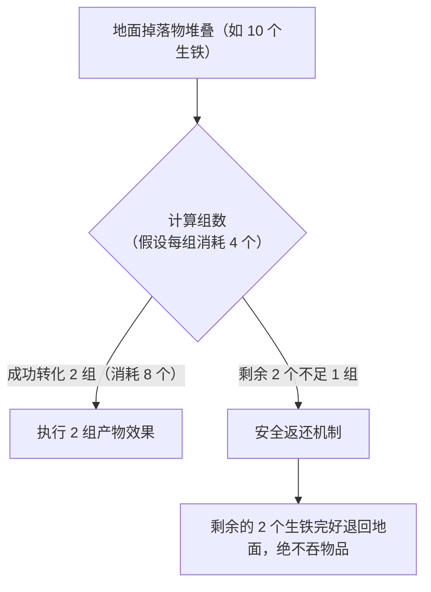

# 候选结果与结算（outcomes）

> 适用版本：**2.0.0**（Minecraft **1.21.1**）。

本页介绍如何让一条规则产生多种不同的结果（例如随机产出或轮流产出）、如何设置转化的材料消耗（源物品与催化剂），以及整堆掉落物在游戏里是如何安全结算与返还的。

---

## 结果方案：单结果与多候选结果

一条规则必须明确定义转化后的产物。模组支持两种结果书写方式（**二选一**，不可混用）：

| 书写方式 | 适用场景 | 结果方案数量 |
| --- | --- | --- |
| **直接写顶层 `effects`** | 转化产物固定单一（如鸡肉必定变腐肉） | 1 个隐式方案 |
| **写 `outcomes` 列表** | 规则拥有多种不同产出（如有时变小鸡、有时变羽毛） | 2 ~ 32 个候选方案 |

### 候选结果字段速查

在 `outcomes` 列表中，每个候选方案是一个独立对象：

| 字段 | 作用说明 | 取值 | 默认值 |
| --- | --- | --- | --- |
| `id` | 候选方案的唯一名称 | 字符串（单条规则内不重复） | **必填** |
| `effects` | 该方案要执行的效果列表 | 效果对象数组（非空） | **必填**（详见 [效果](zh-04-effects)） |
| `safe_spawn` | 生成实体时是否先在附近寻找安全站立点 | `true` / `false` | `true`（优先平坦无害地面） |
| `fill_origin` | 放置方块时是否允许填充触发点本身那一格 | `true` / `false` | `true` |

---

## 多方案轮换策略（combination）

当配置了 `outcomes` 列表时，通过规则顶层的 `combination` 字段决定多个方案之间的挑选策略：

| 策略取值 | 运作逻辑 | 典型应用场景 |
| --- | --- | --- |
| `round_robin` | **轮流循环**：按顺序轮流执行方案 A ➔ 方案 B ➔ 方案 C ➔ 方案 A | 适合多组转化时按比例均衡产出不同物品 |
| `weight` | **按权重随机**：每个方案可配置权重，按几率随机命中 | 适合做“抽奖”或稀有产物概率掉落 |

---

## 成本消耗配置（Costs）

转化不仅可以消耗掉落物本身，还可以要求消耗周围地面上的特定催化剂物品：

### 1. 源物品消耗（`source_cost`）

- 规定转化一组需要消耗几个源物品；
- 如果不填写，默认每组消耗 1 个源物品。

```json
"source_cost": {
  "minecraft:iron_ingot": 4
}
```
*表示每组转化需要消耗 4 个铁锭。*

### 2. 催化剂消耗（`catalyst_cost`）

- 规定转化一组需要消耗周围地面上的哪些辅助物品；
- 模组会自动在触发点附近搜寻匹配的掉落物并扣除。

```json
"catalyst_cost": {
  "minecraft:redstone": 2
}
```
*表示每组转化除了源物品外，还会在附近消耗 2 个红石粉掉落物。*

---

## 整堆物品的结算流程与零头返还

在游戏中，玩家通常会扔下一整堆物品（例如 64 个），模组的结算机制极其公平安全：



1. **计算可转化组数**：以地面现有物品总数除以单组所需消耗；
2. **批量执行产物**：针对成功转化的组数，按设定方案生成对应的产物；
3. **零头绝对安全返还**：**不足一组的剩余物品会自动返还给世界**，以掉落物形式留在原地，玩家随时可以捡回，绝不会凭空消失！

---

## 双结果轮换范例

下面是一份完整的配置：**生鸡肉每次消耗 1 个，轮流变成腐肉与幼年小鸡**。

```json
{
  "id": "myrules:chicken_two_forms",
  "source": { "items": ["minecraft:chicken"] },
  "trigger_after_seconds": 300,
  "source_cost": { "minecraft:chicken": 1 },
  "combination": "round_robin",
  "outcomes": [
    {
      "id": "rotten_flesh",
      "effects": [
        {
          "type": "idtw:spawn_entity",
          "variant": "item",
          "item": "minecraft:rotten_flesh",
          "count": 1
        }
      ]
    },
    {
      "id": "baby_chick",
      "safe_spawn": true,
      "effects": [
        {
          "type": "idtw:spawn_entity",
          "variant": "mob",
          "entity": "minecraft:chicken",
          "age": -24000,
          "count": 1
        }
      ]
    }
  ],
  "schema_version": 1
}
```

---

## 下一步

- [来源层与覆盖](zh-06-layers-and-overrides)：了解本地配置与世界数据包的合并与优先级规则。
- [效果](zh-04-effects)：查阅所有产物行为与参数。
