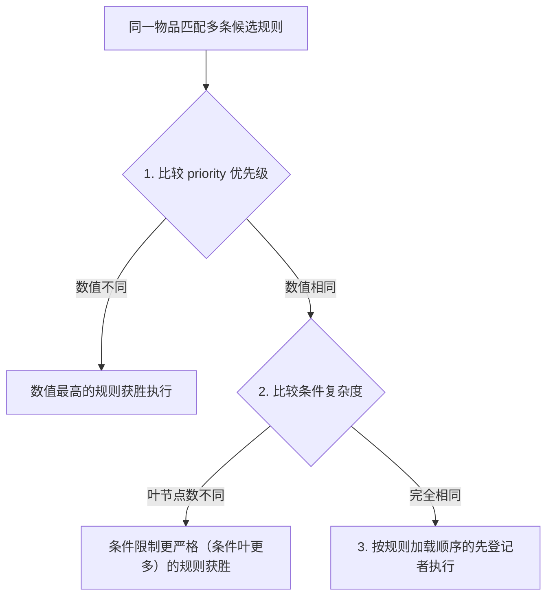

# 来源层与覆盖（layers & overrides）

> 适用版本：**2.0.0**（Minecraft **1.21.1**）。

本页说明自定义规则的加载层级关系：数据包与本地配置如何协同工作、如何使用同名 ID 整条替换已有规则、以及多条规则匹配同一个掉落物时由谁胜出。

---

## 规则来源与优先级

规则可以存放在两个不同的来源层中。当出现相同 `id` 时，**本地覆盖层（config）的优先级高于世界数据包**：

| 来源层 | 文件存放路径 | 常见编辑方式 | 优先级 | 特性与适用场景 |
| --- | --- | --- | --- | --- |
| **世界数据包**（world） | `<存档>/datapacks/<数据包>/data/<命名空间>/idtw/rules/*.json` | 文本编辑器 / 数据包工具 | 低 | **规则基底**：随地图或整合包分发；游戏内 GUI 编辑器将其视为只读模板 |
| **本地覆盖层**（overlay） | `config/itemdespawntowhat/rules/**/*.json` | 游戏内 GUI 或手动编辑 | **高** | **最高生效权**：游戏内 GUI 编辑器保存的规则均存放于此 |

### 合并原则
- **不同 ID 的规则**：来自数据包和本地覆盖层的规则会全部合并加载，彼此共存、互不影响；
- **相同 ID 的规则**：**高优先级的规则直接整条替换低优先级的规则**（覆盖层替换数据包规则）。

---

## 同 ID 覆盖：整条替换机制

如果想修改世界数据包自带的某条规则（例如将数据包里的鸡肉变腐肉改为鸡肉变金锭），无需去解包修改原数据包，只需在本地覆盖层创建一条**具有相同 `id` 的规则**。

> [!IMPORTANT]
> **整条替换原则**：覆盖发生时，模组会直接用高优先级规则替换掉旧规则，**不是字段级的拼凑继承**。因此，编写覆盖规则时，请务必写出完整的规则内容（输入、触发、效果等），未填写的可选字段将回到其官方默认值。

### 覆盖操作实操示例

假设某个数据包中自带了一条规则 `mypack:chicken_to_rotten_flesh`，等待 300 秒后生成腐肉。

如果我们希望将其改为：等待 60 秒并生成金锭，只需在本地文件 `config/itemdespawntowhat/rules/chicken_to_gold.json` 中写下：

```json
{
  "id": "mypack:chicken_to_rotten_flesh",
  "priority": 10,
  "source": {
    "items": ["minecraft:chicken"]
  },
  "trigger_after_seconds": 60,
  "triggers": ["natural"],
  "effects": [
    {
      "type": "idtw:spawn_entity",
      "variant": "item",
      "item": "minecraft:gold_ingot",
      "count": 1
    }
  ]
}
```

执行 `/idtw rule reload` 重载规则后：
- 同名 ID `mypack:chicken_to_rotten_flesh` 的生效内容立刻变成你定义的版本；
- 等待时间缩短为 60 秒，产物变为金锭；
- 如需撤销覆盖，只需删除此本地 JSON 文件并再次重载，即可自动恢复数据包的原版行为。

---

## 本存档独立启停开关

每条规则可以在 JSON 中配置 `enabled`（默认启用状态）。除此之外，管理员可以在游戏内随时针对当前存档单独启停规则：

- `/idtw rule enable <id>`：在本存档强制启用；
- `/idtw rule disable <id>`：在本存档强制禁用；
- `/idtw rule reset <id>`：清除本存档的单独设置，重新跟随规则自身的默认启用状态。

*注：这些指令的修改记录保存在当前世界存档数据中，不会修改你的 JSON 文件，方便多存档使用不同方案。*

---

## 多规则竞争判定：同一个掉落物听谁的？

当同一个掉落物同时命中了多条不同的规则时（例如生鸡肉同时命中“鸡肉变腐肉”和“全肉类变肥料”），模组**一次只执行其中一条规则**。

仲裁裁判规则如下：



1. **优先级优先（`priority`）**：数值越大越先尝试。设置了高优先级（如 `10`）的规则绝对优先于默认规则（`0`）；
2. **更严格的条件优先**：若优先级相同，条件叶节点数量较多的规则优先（更精准的特殊规则优先于宽泛的兜底规则）；
3. **加载顺序**：若依然相同，则按照规则的加载注册顺序确定。

---

## 下一步

- [服务端配置](zh-07-server-config)：调整检查频率、防卡顿阈值等性能配置。
- [命令参考](zh-08-commands)：查阅全部管理命令与快捷用法。
